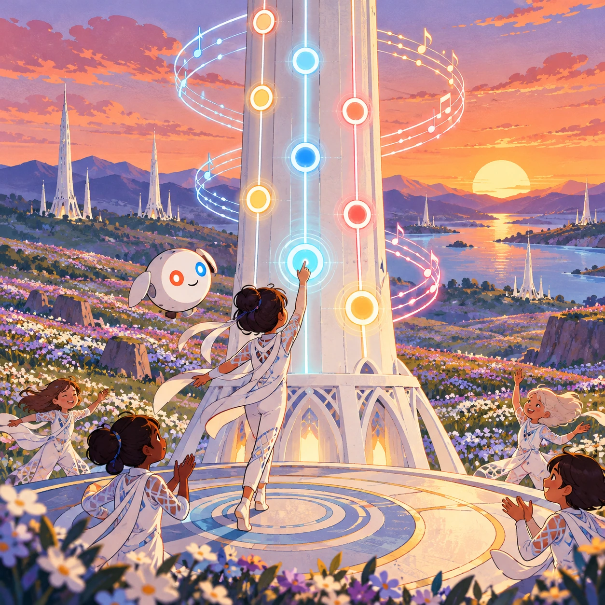
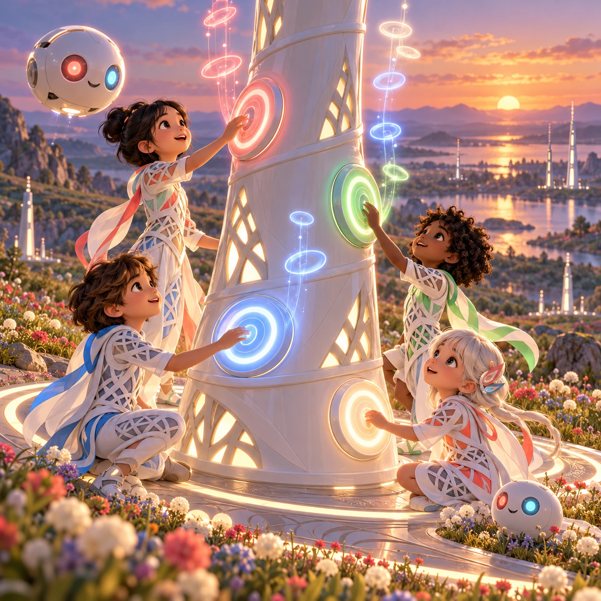
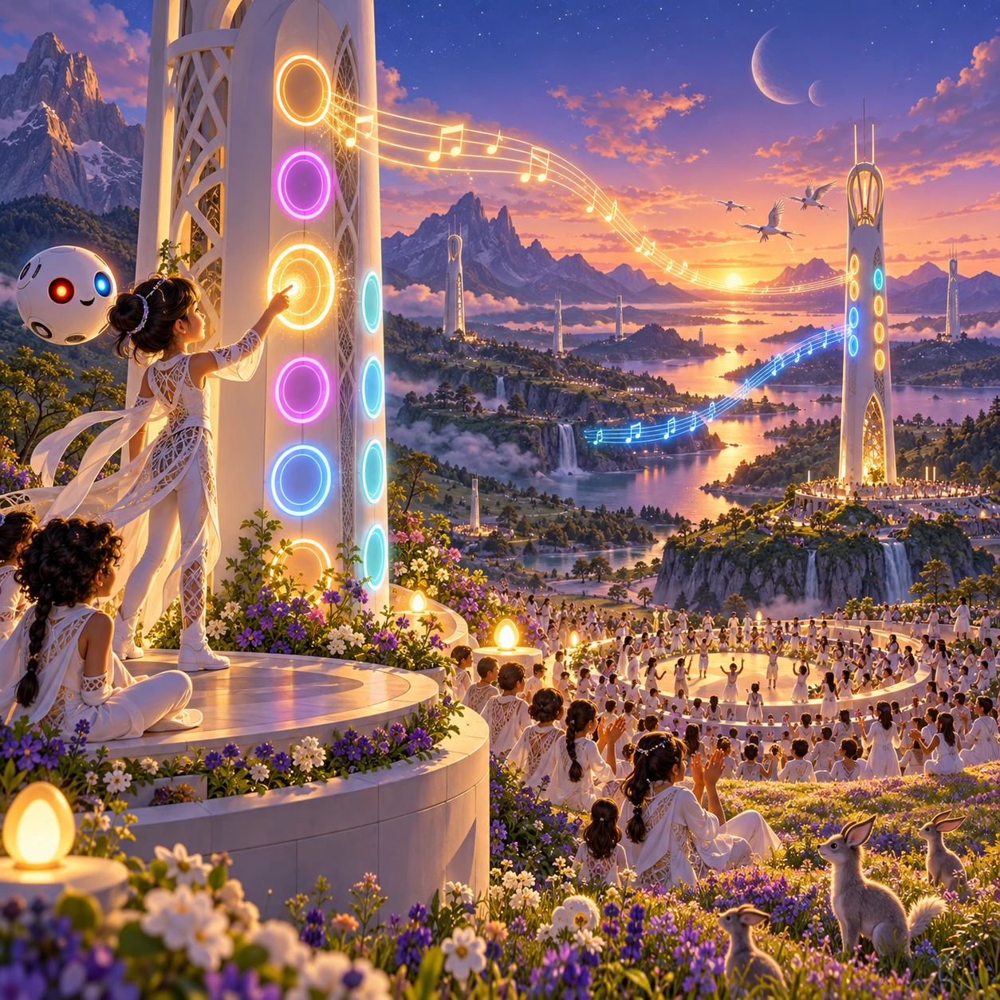

# Tower Song Festival

RY-15 · [Raya life](../ry.md) · Cx 3 · Ages 6+ · Raya story catalog

**The idea:** On a flower steppe at dusk, the player taps glowing rings on a tall white tower to place notes on a looping song track, while children below in flowing festival suits sway as the audible tower song plays.

| Decision             | Proposal                                                                                                                                                                                    |
| -------------------- | ------------------------------------------------------------------------------------------------------------------------------------------------------------------------------------------- |
| Familiar mechanic    | Music composing and rhythm performance                                                                                                                                                      |
| Learning objective   | Melody, rhythm and harmony, choosing the right time to be loud                                                                                                                              |
| First prototype      | One authored challenge built around the interaction above, with a clear goal, immediate feedback, restart and unlimited retries.                                                            |
| Technology           | React shell + PixiJS; use the shared simulation adapter only where motion or agent behavior requires it. Start with one bounded scene and measured frame time.                              |
| Scope boundary       | One bounded scenario and one core system; defer a full campaign, network play and production-scale content.                                                                                 |
| Reuse                | Shared input, saves, accessibility, seeded state and the raya life collection shell.                                                                                                        |
| Prototype acceptance | A player can identify the next action from the screen, complete one challenge, explain the practiced idea and restart without help. Check touch and keyboard play at narrow and wide sizes. |
| Main uncertainty     | Test whether the lesson follows from play and whether the first interaction is understandable without reading.                                                                              |

## Estimated plan

**First playable version:** A four-ring tower sequencer with an audible tower song, 12 festival songs to complete or compose, and a gentle clap-along rhythm mode. Two-tower call and answer and the breeding-season calendar puzzle come later.

| Measure              | Estimate                                                                                                   |
| -------------------- | ---------------------------------------------------------------------------------------------------------- |
| Youngest age         | 6+                                                                                                         |
| Toddler learnability | 1 of 5 — Needs reading, precise motor control, timing pressure or abstract rules; not a toddler game (6+). |
| Code                 | 1600 LOC, 13.3 days                                                                                        |
| Assets               | 150 hours, 25 days                                                                                         |
| Effort               | 38.3 days, risk 3 of 5                                                                                     |
| Start score          | 114.9 (rank 247 of 310; lower is better)                                                                   |

**Algorithms:** `music-sequencer` (Music sequencer, 450 LOC) · `audio-synth` (Playable instrument, 250 LOC) · `rhythm-timing` (Rhythm timing, 300 LOC)

**Assets:** 25 sprites, 10 animations, 3 backgrounds, 5 UI screens, 30 sound effects, 4 music tracks, 25 voice lines, 12 authored levels, 20 content items

How the numbers are computed: [development plan](../../development-plan.md#how-the-scores-work).

## Story

All spring the towers were silent to human ears, because the birds were raising their chicks. Then the chicks flew, and the valley planned its festival. Each child chose one ring. Trip chose the lowest. Boom, it went, deep as a heartbeat. Lina added a high, bright note, Ana a middle one, and Doubl a bouncing rhythm. At first it was a tangle. Then they listened to each other, and the notes found their places. The song rolled over the steppe. Far away, the next tower answered.

> **Wisdom:** Make music together, at the right time.

## Four visual directions

These are independently generated concept proposals for selecting a prototype.
The four views compare gameplay readability, world appeal, tactile identity and
room to grow. They are not screenshots of an implemented game. Native image
dimensions, hashes, exact prompts and generation provenance are recorded in the
[art manifest](../art/ry-15/manifest.json); see the [generation notes](../README.md#image-generation-and-provenance).

The [core prompts](../jobs/ry.json) use IDs `ry-15/01-gameplay` to `ry-15/04-discovery`.

### Gameplay

On a flower steppe at dusk, the player taps glowing rings on a tall white tower to place notes on a looping song track, while children below in flowing festival suits sway as the audible tower song plays.

### World

A wide flower steppe at sunset after the breeding season, with herds grazing far off and tall grass rippling in the wind. A white Chord tower rises in the middle, its emitter rings lit in soft rose and gold, and a second tower answers from the horizon. People glide on sky-lanes and sit in circles among the flowers. Joyful, open, windy mood.

### Characters and materials

Festival suits are fitted white lattice whose panels glow in slow white light patterns, with small coral-red, sky-blue and green accents. Orbis glow in time with the music. Lina, Doubl, Trip and Ana each play one ring. The tower is white ceramic, slightly twisted, with rings like bamboo nodes. Each note rises as a soft colored ring of light.

### Expanded play

Later festivals add more rings for chords, two towers playing call and answer across the steppe, a rhythm mode where the crowd claps on the beat, and a calendar puzzle: pick a festival night outside the breeding seasons of herds and birds. The final festival joins songs from every tower in the valley into one shared melody.

## Design checks before prototyping

- Learning target: **Melody, rhythm and harmony, choosing the right time to be loud**. Ask a domain reviewer to validate factual content in the mechanic.
- Keep goals cooperative or self-directed, using resources and needs. Avoid purchasable power. No pressure timers in the accessible mode.
- Use original layouts and character designs; the [legal checklist](../../legal.md) applies even when a mechanic is familiar.
- Choose the minimum [fidelity level](../../simulation-engine.md#determinism-and-fidelity-levels) the lesson needs; concept art does not establish scientific accuracy.
- Review silhouettes, text alternatives, reduced motion and non-color cues against the [adorability gate](../../lore/adorability-gate.md).
- Check every detail against the [Raya canon](../../lore/raya.md): untouched nature, white towers and clothing, Orbis, the Guard and the Gentle Defaults.

Genre context: [existing genre research](../../../case-studies/issue-1/data/research-genres-ideas.md)
and [expansion research](../../../case-studies/issue-1/data/research-visual-catalog.md).

[← Pim and Pom Night](ry-14.md) · [All concepts](../README.md) · [Valley Circle →](ry-16.md)
