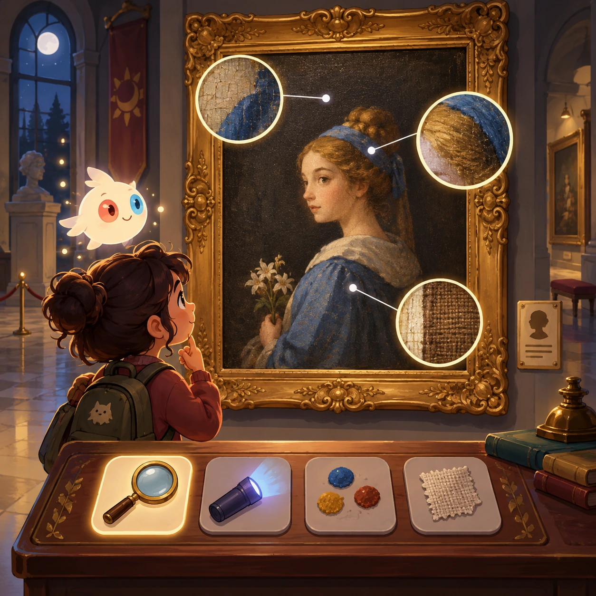
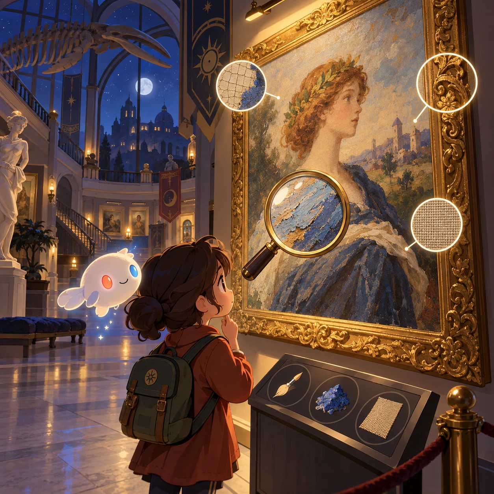
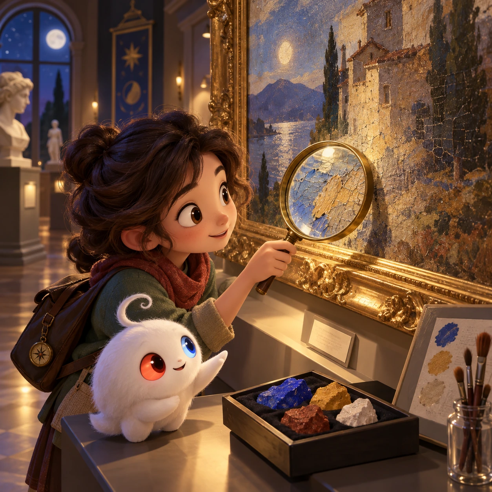
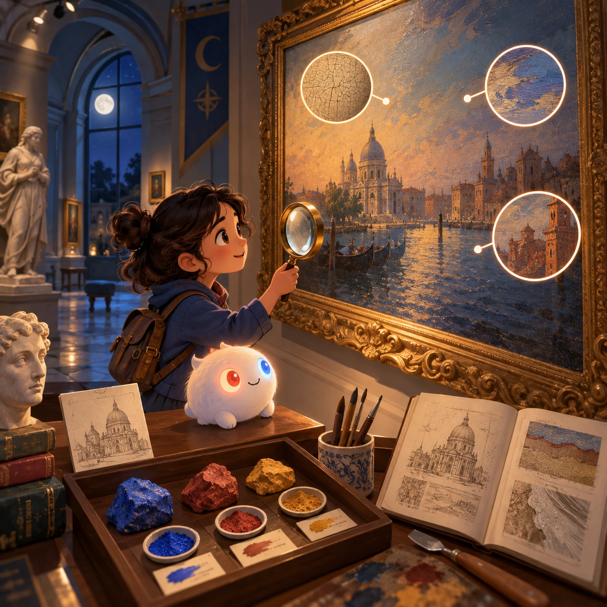
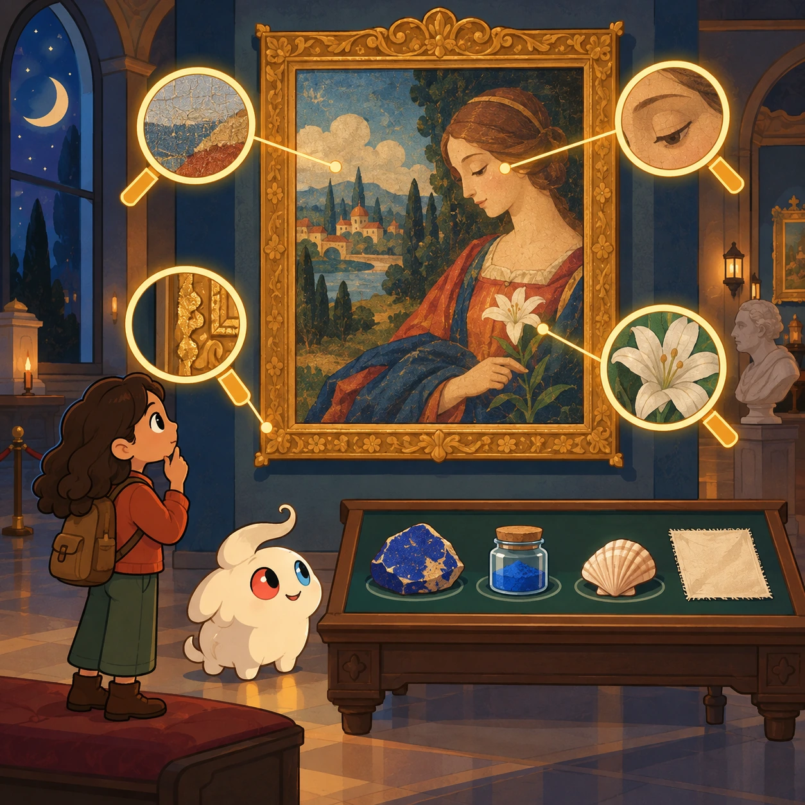
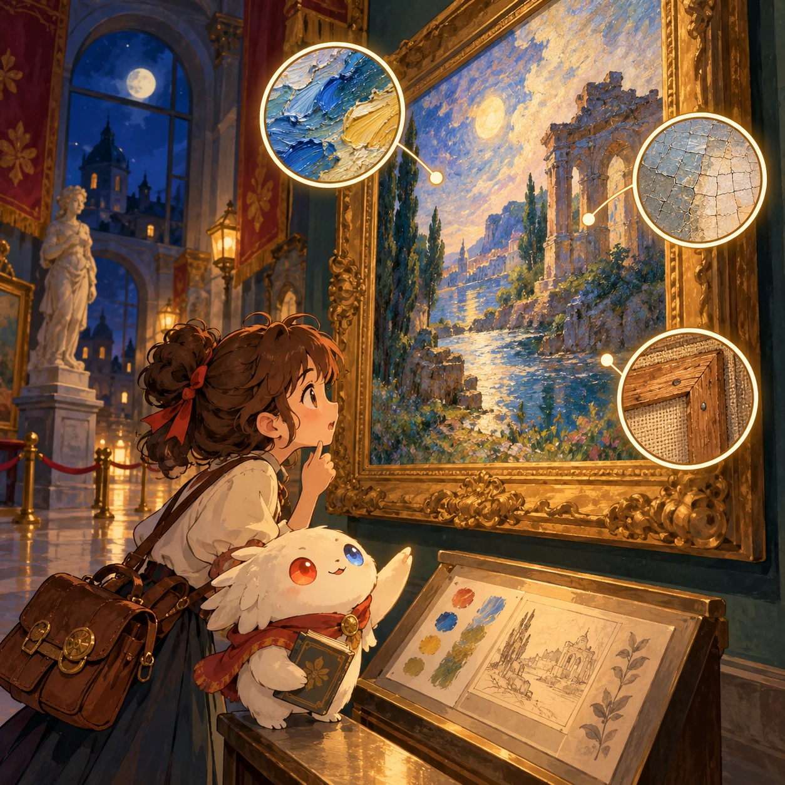

# Museum Night

SA-03 · [Stories and adventures](../sa.md) · Cx 3 · Original catalog

**The idea:** Inspect a painting and its material clues in a quiet nighttime museum.

| Decision             | Proposal                                                                                                                                                                                    |
| -------------------- | ------------------------------------------------------------------------------------------------------------------------------------------------------------------------------------------- |
| Familiar mechanic    | Point and click                                                                                                                                                                             |
| Learning objective   | Art history                                                                                                                                                                                 |
| First prototype      | One authored challenge built around the interaction above, with a clear goal, immediate feedback, restart and unlimited retries.                                                            |
| Technology           | React shell + PixiJS; use the shared simulation adapter only where motion or agent behavior requires it. Start with one bounded scene and measured frame time.                              |
| Scope boundary       | One bounded scenario and one core system; defer a full campaign, network play and production-scale content.                                                                                 |
| Reuse                | Shared input, saves, accessibility, seeded state and the stories and adventures collection shell.                                                                                           |
| Prototype acceptance | A player can identify the next action from the screen, complete one challenge, explain the practiced idea and restart without help. Check touch and keyboard play at narrow and wide sizes. |
| Main uncertainty     | Test whether the lesson follows from play and whether the first interaction is understandable without reading.                                                                              |

## Estimated plan

**First playable version:** A museum with 8 rooms where the player zooms into paintings, finds material clues and solves 8 voiced art-history puzzles with a friendly guard. Real museum licensing and a full collection are deferred.

| Measure              | Estimate                                                                                                   |
| -------------------- | ---------------------------------------------------------------------------------------------------------- |
| Youngest age         | 6+                                                                                                         |
| Toddler learnability | 1 of 5 — Needs reading, precise motor control, timing pressure or abstract rules; not a toddler game (6+). |
| Code                 | 1880 LOC, 15.7 days                                                                                        |
| Assets               | 177 hours, 29.4 days                                                                                       |
| Effort               | 45.1 days, risk 2 of 5                                                                                     |
| Start score          | 135.3 (rank 270 of 310; lower is better)                                                                   |

**Algorithms:** `hidden-object` (Hidden objects, 150 LOC) · `quest-state` (Quest and story state, 300 LOC) · `dialogue-branching` (Branching dialogue, 300 LOC) · `tap-feedback` (Tap feedback, 80 LOC) · `multi-touch` (Multi-touch gestures, 150 LOC)

**Assets:** 40 sprites, 8 animations, 8 backgrounds, 6 UI screens, 15 sound effects, 2 music tracks, 50 voice lines, 8 authored levels, 60 content items

How the numbers are computed: [development plan](../../development-plan.md#how-the-scores-work).

## Four visual directions

These are independently generated concept proposals for selecting a prototype.
The four views compare gameplay readability, world appeal, tactile identity and
room to grow. Two additional core-screen alternatives make the flat storybook and painted anime styles explicit alongside the tactile 3D study. They are not screenshots of an implemented game. Native image
dimensions, hashes, exact prompts and generation provenance are recorded in the
[art manifest](../art/sa-03/manifest.json); see the [generation notes](../README.md#image-generation-and-provenance).

The [core prompts](../jobs/sa.json) use IDs `sa-03/01-gameplay` to `sa-03/04-discovery`. Additional [style prompts](../jobs/style-variations.json) match the two alternatives below.

### Gameplay

### World

### Characters and materials

### Expanded play

## Additional style alternatives

### Flat storybook alternative

### Painted anime alternative

## Design checks before prototyping

- Learning target: **Art history**. Ask a domain reviewer to validate factual content in the mechanic.
- Keep goals cooperative or self-directed, using resources and needs. Avoid purchasable power. No pressure timers in the accessible mode.
- Use original layouts and character designs; the [legal checklist](../../legal.md) applies even when a mechanic is familiar.
- Choose the minimum [fidelity level](../../simulation-engine.md#determinism-and-fidelity-levels) the lesson needs; concept art does not establish scientific accuracy.
- Review silhouettes, text alternatives, reduced motion and non-color cues against the [adorability gate](../../lore/adorability-gate.md).

Genre context: [existing genre research](../../../case-studies/issue-1/data/research-genres-ideas.md)
and [expansion research](../../../case-studies/issue-1/data/research-visual-catalog.md).

[← Kindness Quests](sa-02.md) · [All concepts](../README.md) · [Little Detective →](sa-04.md)
