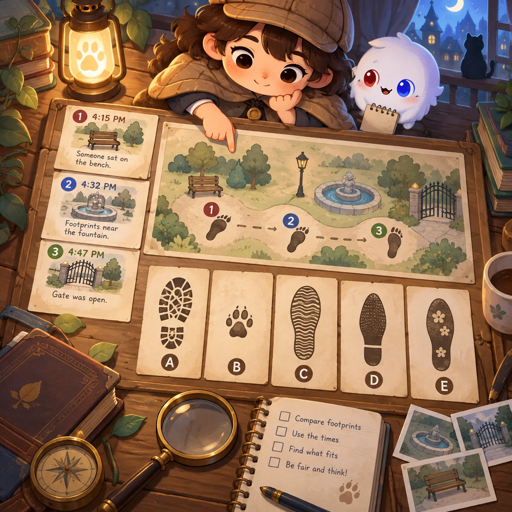
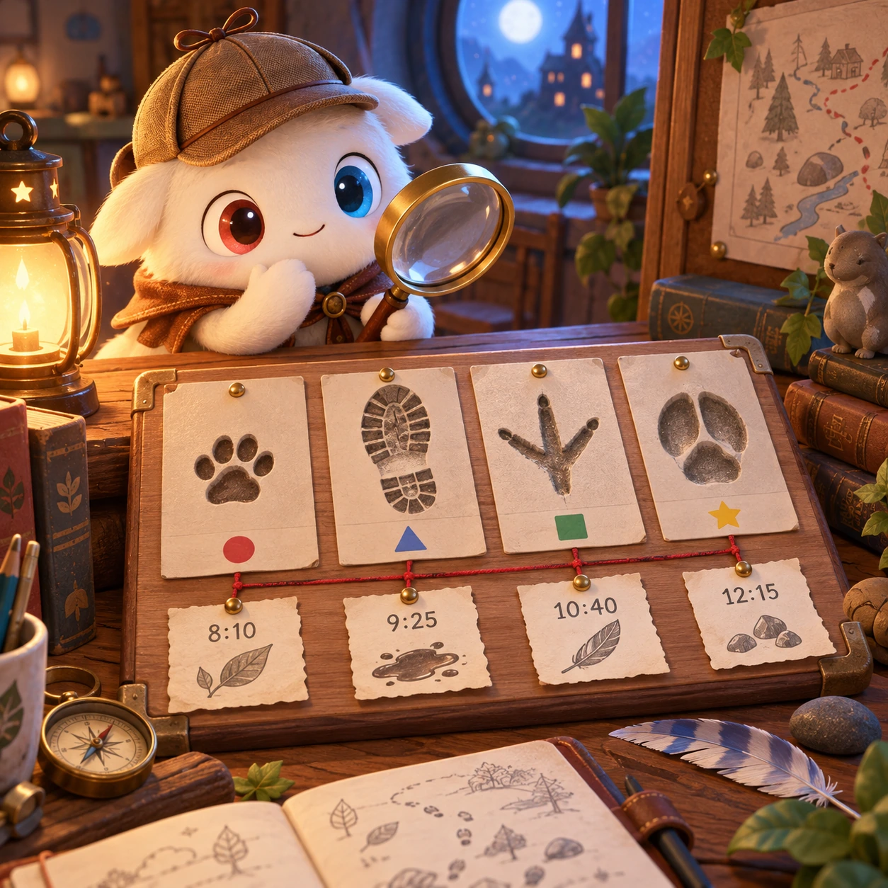
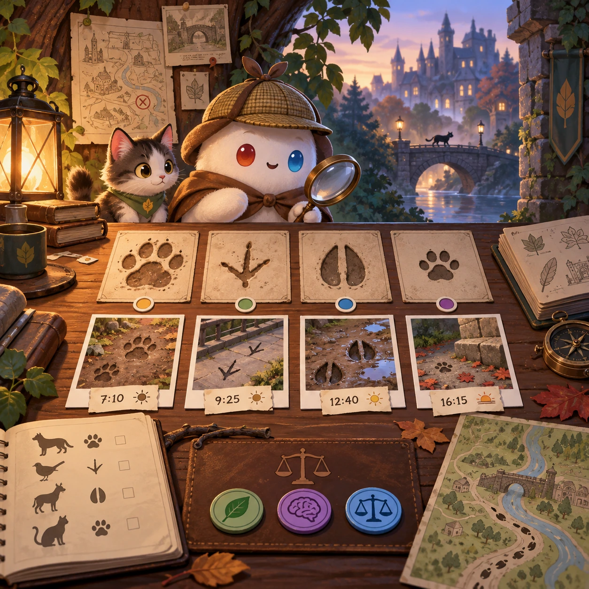

# Little Detective

SA-04 · [Stories and adventures](../sa.md) · Cx 3 · Original catalog

**The idea:** Compare footprints and timestamped notes on a gentle mystery board.

| Decision             | Proposal                                                                                                                                                                                    |
| -------------------- | ------------------------------------------------------------------------------------------------------------------------------------------------------------------------------------------- |
| Familiar mechanic    | Mystery / deduction                                                                                                                                                                         |
| Learning objective   | Evidence, reasoning, fair judgment                                                                                                                                                          |
| First prototype      | One authored challenge built around the interaction above, with a clear goal, immediate feedback, restart and unlimited retries.                                                            |
| Technology           | React shell + PixiJS; use the shared simulation adapter only where motion or agent behavior requires it. Start with one bounded scene and measured frame time.                              |
| Scope boundary       | One bounded scenario and one core system; defer a full campaign, network play and production-scale content.                                                                                 |
| Reuse                | Shared input, saves, accessibility, seeded state and the stories and adventures collection shell.                                                                                           |
| Prototype acceptance | A player can identify the next action from the screen, complete one challenge, explain the practiced idea and restart without help. Check touch and keyboard play at narrow and wide sizes. |
| Main uncertainty     | Test whether the lesson follows from play and whether the first interaction is understandable without reading.                                                                              |

## Estimated plan

**First playable version:** 6 gentle cases on a mystery board where footprints and timestamped notes are collected, sorted as strong or weak evidence and used to explain a fair conclusion. Procedural cases and blame scenes are left out.

| Measure              | Estimate                                                                                                   |
| -------------------- | ---------------------------------------------------------------------------------------------------------- |
| Youngest age         | 7+                                                                                                         |
| Toddler learnability | 1 of 5 — Needs reading, precise motor control, timing pressure or abstract rules; not a toddler game (6+). |
| Code                 | 1870 LOC, 15.6 days                                                                                        |
| Assets               | 162 hours, 26.9 days                                                                                       |
| Effort               | 42.5 days, risk 2 of 5                                                                                     |
| Start score          | 127.5 (rank 251 of 300; lower is better)                                                                   |

**Algorithms:** `quest-state` (Quest and story state, 300 LOC) · `hidden-object` (Hidden objects, 150 LOC) · `dialogue-branching` (Branching dialogue, 300 LOC) · `sort-classify` (Sorting by attribute, 120 LOC)

**Assets:** 35 sprites, 8 animations, 6 backgrounds, 8 UI screens, 12 sound effects, 2 music tracks, 50 voice lines, 6 authored levels, 60 content items

How the numbers are computed: [development plan](../../development-plan.md#how-the-scores-work).

## Four visual directions

These are independently generated concept proposals for selecting a prototype.
The four views compare gameplay readability, world appeal, tactile identity and
room to grow. They are not screenshots of an implemented game. Native image
dimensions, hashes, exact prompts and generation provenance are recorded in the
[art manifest](../art/sa-04/manifest.json); see the [generation notes](../README.md#image-generation-and-provenance).

### Gameplay

### World

### Characters and materials

### Expanded play

## Design checks before prototyping

- Learning target: **Evidence, reasoning, fair judgment**. Ask a domain reviewer to validate factual content in the mechanic.
- Keep goals cooperative or self-directed, using resources and needs. Avoid purchasable power. No pressure timers in the accessible mode.
- Use original layouts and character designs; the [legal checklist](../../legal.md) applies even when a mechanic is familiar.
- Choose the minimum [fidelity level](../../simulation-engine.md#determinism-and-fidelity-levels) the lesson needs; concept art does not establish scientific accuracy.
- Review silhouettes, text alternatives, reduced motion and non-color cues against the [adorability gate](../../lore/adorability-gate.md).

Genre context: [existing genre research](../../../case-studies/issue-1/data/research-genres-ideas.md)
and [expansion research](../../../case-studies/issue-1/data/research-visual-catalog.md).

[← Museum Night](sa-03.md) · [All concepts](../README.md) · [Escape Room Together →](sa-05.md)
