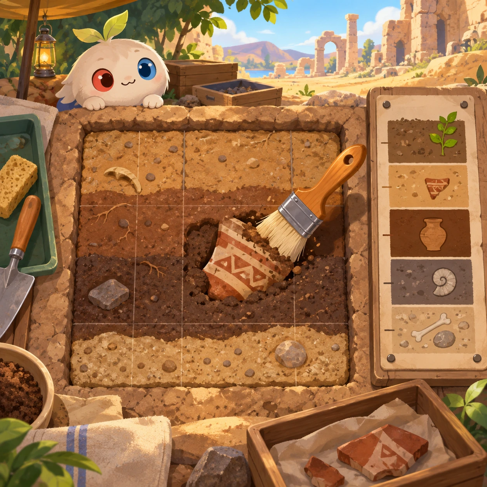
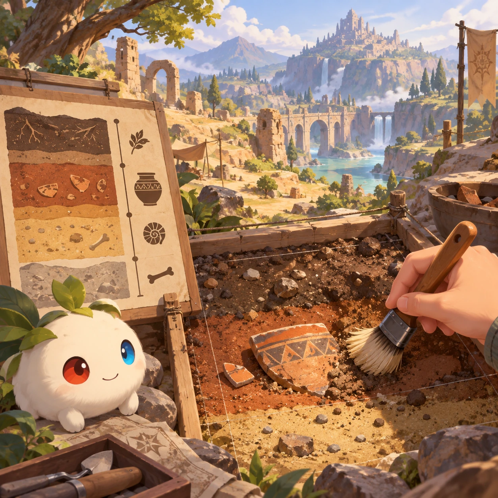
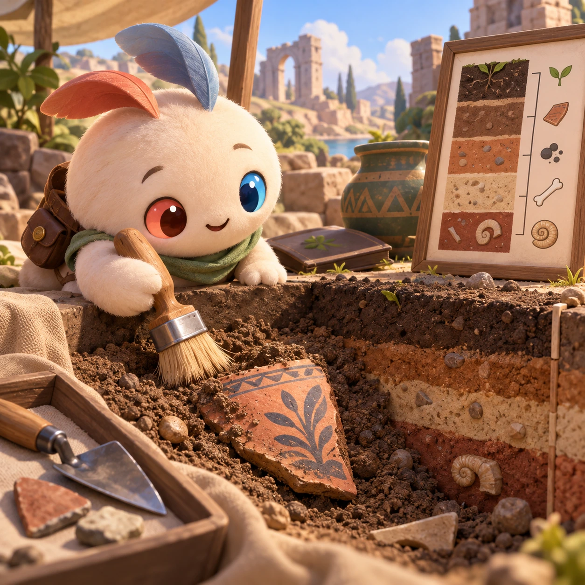
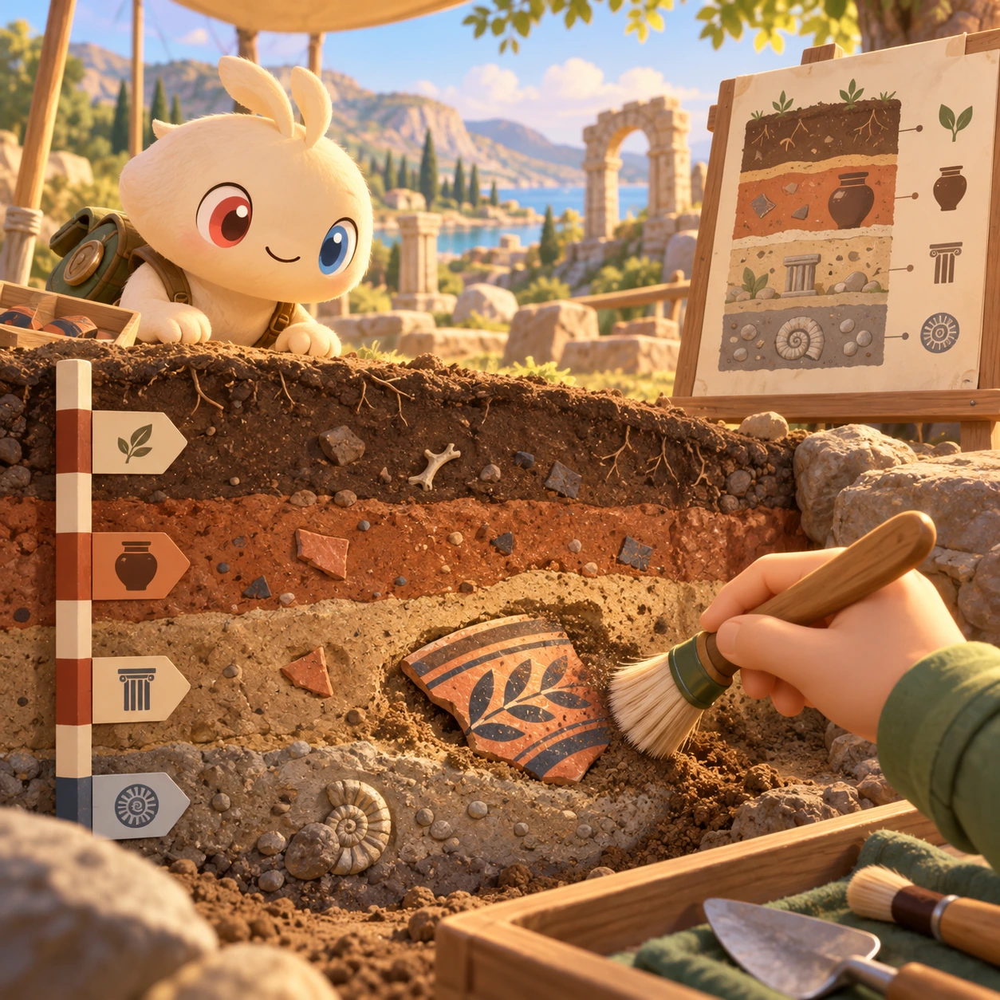
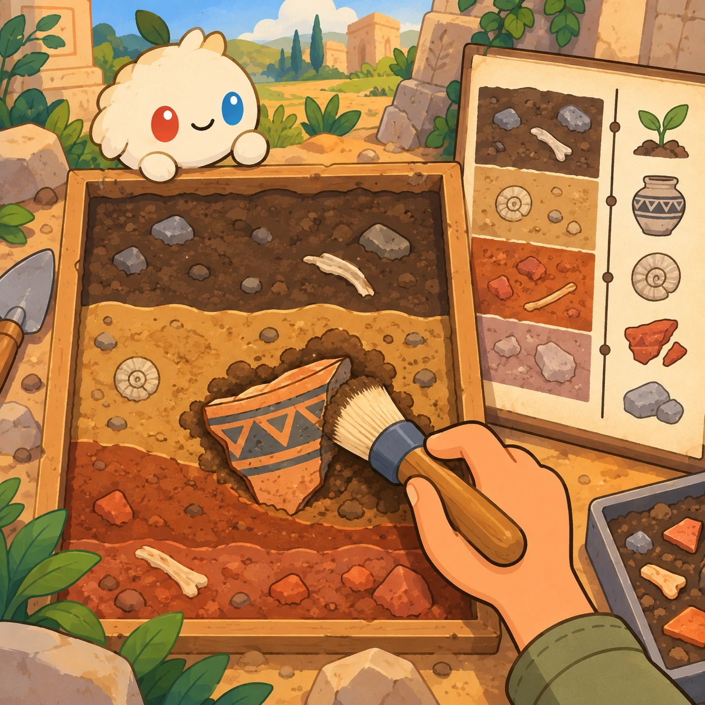
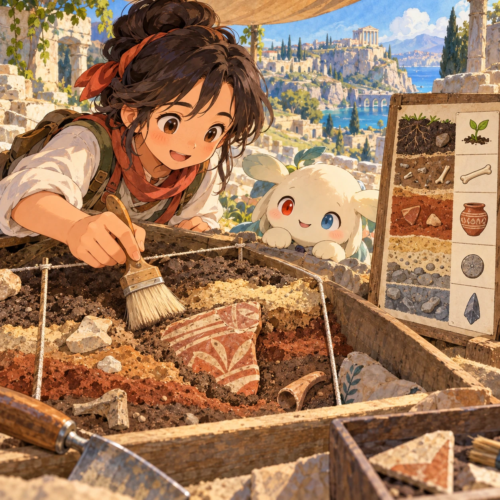

# Archaeology Dig

SA-06 · [Stories and adventures](../sa.md) · Cx 3 · Original catalog

**The idea:** Brush soil layers away from a pottery fragment beside a stratigraphy chart.

| Decision             | Proposal                                                                                                                                                                                    |
| -------------------- | ------------------------------------------------------------------------------------------------------------------------------------------------------------------------------------------- |
| Familiar mechanic    | Dig and restore                                                                                                                                                                             |
| Learning objective   | Stratigraphy, history                                                                                                                                                                       |
| First prototype      | One authored challenge built around the interaction above, with a clear goal, immediate feedback, restart and unlimited retries.                                                            |
| Technology           | React shell + PixiJS; use the shared simulation adapter only where motion or agent behavior requires it. Start with one bounded scene and measured frame time.                              |
| Scope boundary       | One bounded scenario and one core system; defer a full campaign, network play and production-scale content.                                                                                 |
| Reuse                | Shared input, saves, accessibility, seeded state and the stories and adventures collection shell.                                                                                           |
| Prototype acceptance | A player can identify the next action from the screen, complete one challenge, explain the practiced idea and restart without help. Check touch and keyboard play at narrow and wide sizes. |
| Main uncertainty     | Test whether the lesson follows from play and whether the first interaction is understandable without reading.                                                                              |

## Estimated plan

**First playable version:** 10 dig sites where rubbing brushes soil off artifacts layer by layer, shards are restored as a simple jigsaw and finds are placed on a stratigraphy chart. Real site data and 3D artifacts are left out.

| Measure              | Estimate                                                                               |
| -------------------- | -------------------------------------------------------------------------------------- |
| Youngest age         | 5+                                                                                     |
| Toddler learnability | 2 of 5 — Needs simple rules, turns, a sequence or remembering several steps; ages 4-6. |
| Code                 | 1720 LOC, 14.3 days                                                                    |
| Assets               | 157 hours, 26.2 days                                                                   |
| Effort               | 40.5 days, risk 2 of 5                                                                 |
| Start score          | 81 (rank 202 of 310; lower is better)                                                  |

**Algorithms:** `draw-trace` (Freehand drawing, 250 LOC) · `jigsaw-cut` (Jigsaw pieces, 300 LOC) · `timeline` (Timeline, 250 LOC) · `sort-classify` (Sorting by attribute, 120 LOC)

**Assets:** 40 sprites, 6 animations, 5 backgrounds, 6 UI screens, 14 sound effects, 2 music tracks, 40 voice lines, 10 authored levels, 60 content items

How the numbers are computed: [development plan](../../development-plan.md#how-the-scores-work).

## Four visual directions

These are independently generated concept proposals for selecting a prototype.
The four views compare gameplay readability, world appeal, tactile identity and
room to grow. Two additional core-screen alternatives make the flat storybook and painted anime styles explicit alongside the tactile 3D study. They are not screenshots of an implemented game. Native image
dimensions, hashes, exact prompts and generation provenance are recorded in the
[art manifest](../art/sa-06/manifest.json); see the [generation notes](../README.md#image-generation-and-provenance).

The [core prompts](../jobs/sa.json) use IDs `sa-06/01-gameplay` to `sa-06/04-discovery`. Additional [style prompts](../jobs/style-variations.json) match the two alternatives below.

### Gameplay

### World

### Characters and materials

### Expanded play

## Additional style alternatives

### Flat storybook alternative

### Painted anime alternative

## Design checks before prototyping

- Learning target: **Stratigraphy, history**. Ask a domain reviewer to validate factual content in the mechanic.
- Keep goals cooperative or self-directed, using resources and needs. Avoid purchasable power. No pressure timers in the accessible mode.
- Use original layouts and character designs; the [legal checklist](../../legal.md) applies even when a mechanic is familiar.
- Choose the minimum [fidelity level](../../simulation-engine.md#determinism-and-fidelity-levels) the lesson needs; concept art does not establish scientific accuracy.
- Review silhouettes, text alternatives, reduced motion and non-color cues against the [adorability gate](../../lore/adorability-gate.md).

Genre context: [existing genre research](../../../case-studies/issue-1/data/research-genres-ideas.md)
and [expansion research](../../../case-studies/issue-1/data/research-visual-catalog.md).

[← Escape Room Together](sa-05.md) · [All concepts](../README.md) · [Language Quest →](sa-07.md)
