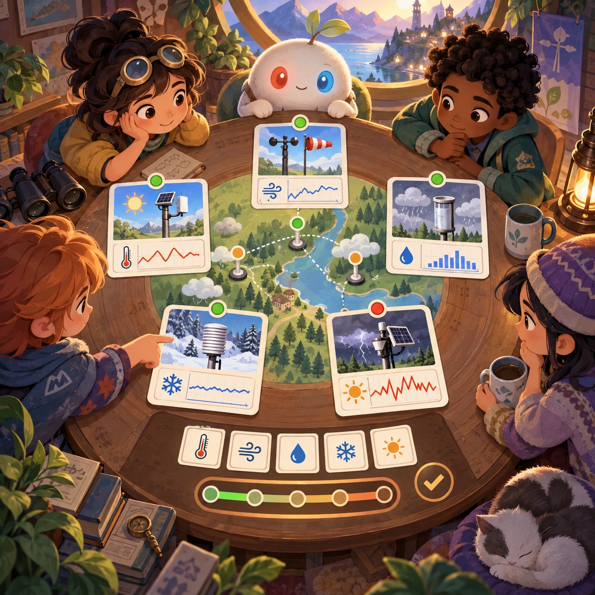
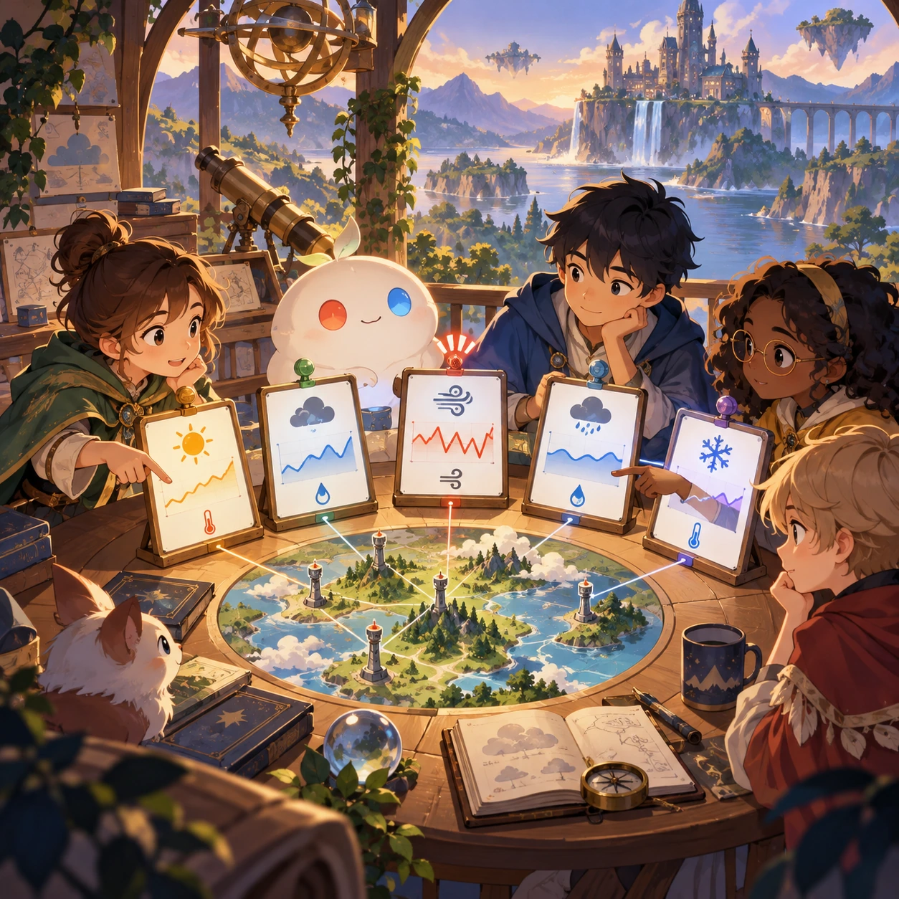
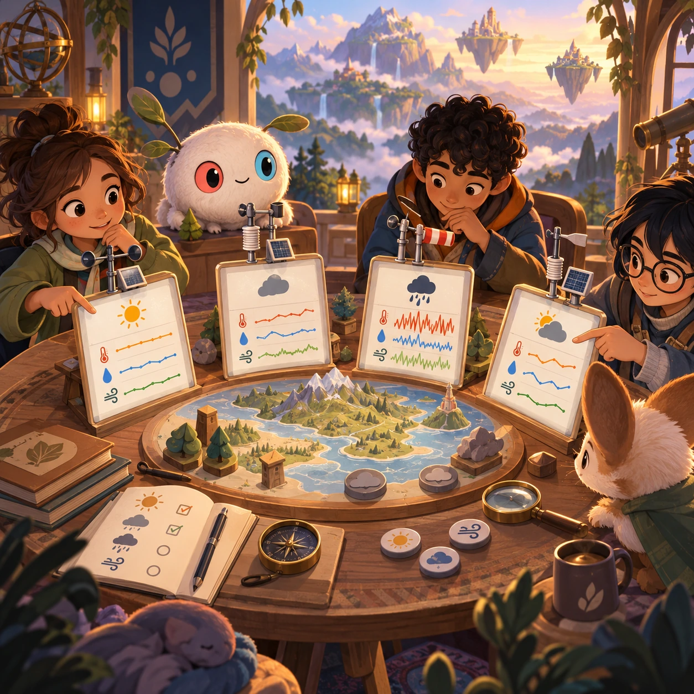

# Evidence Circle

SA-14 · [Stories and adventures](../sa.md) · Cx 3 · Added in the visual-catalog expansion

**The idea:** Compare weather-station clues around a round table to identify a faulty sensor together, with no accusing people.

| Decision             | Proposal                                                                                                                                                                                    |
| -------------------- | ------------------------------------------------------------------------------------------------------------------------------------------------------------------------------------------- |
| Familiar mechanic    | Social deduction without elimination                                                                                                                                                        |
| Learning objective   | Evidence quality and revising beliefs                                                                                                                                                       |
| First prototype      | One authored challenge built around the interaction above, with a clear goal, immediate feedback, restart and unlimited retries.                                                            |
| Technology           | React shell + PixiJS; use the shared simulation adapter only where motion or agent behavior requires it. Start with one bounded scene and measured frame time.                              |
| Scope boundary       | One bounded scenario and one core system; defer a full campaign, network play and production-scale content.                                                                                 |
| Reuse                | Shared input, saves, accessibility, seeded state and the stories and adventures collection shell.                                                                                           |
| Prototype acceptance | A player can identify the next action from the screen, complete one challenge, explain the practiced idea and restart without help. Check touch and keyboard play at narrow and wide sizes. |
| Main uncertainty     | Test whether the lesson follows from play and whether the first interaction is understandable without reading.                                                                              |

## Estimated plan

**First playable version:** 10 round-table scenarios with about 120 weather-station clue cards where players rate evidence quality together and find the faulty sensor, with AI friends for solo play. Online play and accusations are left out.

| Measure              | Estimate                                                                                                   |
| -------------------- | ---------------------------------------------------------------------------------------------------------- |
| Youngest age         | 8+                                                                                                         |
| Toddler learnability | 1 of 5 — Needs reading, precise motor control, timing pressure or abstract rules; not a toddler game (6+). |
| Code                 | 1880 LOC, 15.7 days                                                                                        |
| Assets               | 149 hours, 24.8 days                                                                                       |
| Effort               | 40.5 days, risk 3 of 5                                                                                     |
| Start score          | 121.5 (rank 242 of 300; lower is better)                                                                   |

**Algorithms:** `board-rules` (Board game rules, 400 LOC) · `shuffle-deal` (Seeded shuffle and deal, 60 LOC) · `sort-classify` (Sorting by attribute, 120 LOC) · `game-ai-minimax` (Turn-based AI, 500 LOC)

**Assets:** 30 sprites, 8 animations, 3 backgrounds, 8 UI screens, 12 sound effects, 2 music tracks, 40 voice lines, 10 authored levels, 120 content items

How the numbers are computed: [development plan](../../development-plan.md#how-the-scores-work).

## Four visual directions

These are independently generated concept proposals for selecting a prototype.
The four views compare gameplay readability, world appeal, tactile identity and
room to grow. They are not screenshots of an implemented game. Native image
dimensions, hashes, exact prompts and generation provenance are recorded in the
[art manifest](../art/sa-14/manifest.json); see the [generation notes](../README.md#image-generation-and-provenance).

### Gameplay

### World

### Characters and materials

### Expanded play

## Design checks before prototyping

- Learning target: **Evidence quality and revising beliefs**. Ask a domain reviewer to validate factual content in the mechanic.
- Keep goals cooperative or self-directed, using resources and needs. Avoid purchasable power. No pressure timers in the accessible mode.
- Use original layouts and character designs; the [legal checklist](../../legal.md) applies even when a mechanic is familiar.
- Choose the minimum [fidelity level](../../simulation-engine.md#determinism-and-fidelity-levels) the lesson needs; concept art does not establish scientific accuracy.
- Review silhouettes, text alternatives, reduced motion and non-color cues against the [adorability gate](../../lore/adorability-gate.md).

Genre context: [existing genre research](../../../case-studies/issue-1/data/research-genres-ideas.md)
and [expansion research](../../../case-studies/issue-1/data/research-visual-catalog.md).

[← Lantern Labyrinth](sa-13.md) · [All concepts](../README.md) · [Map of Whispers →](sa-15.md)
