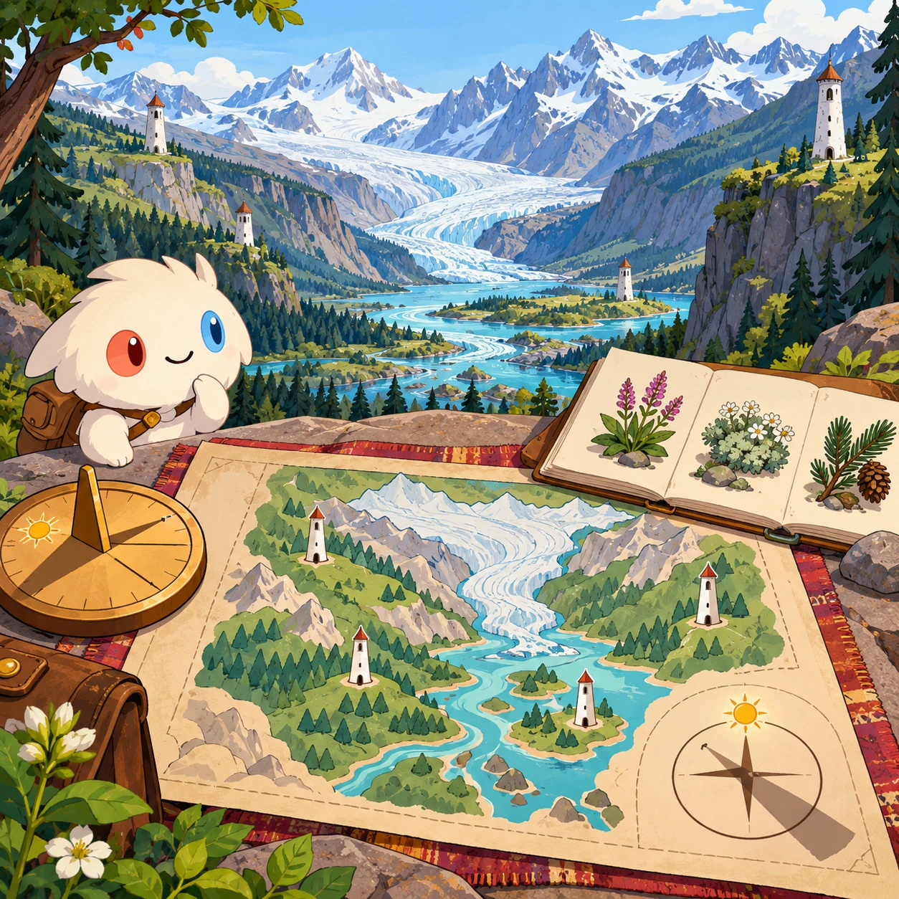
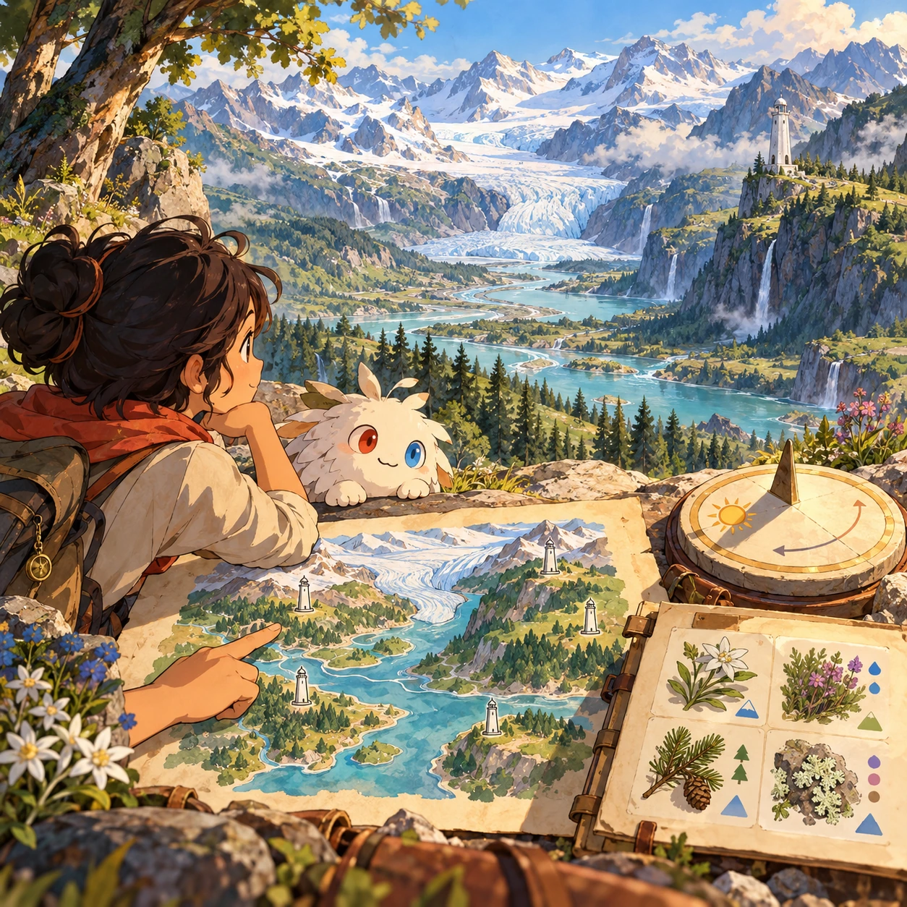
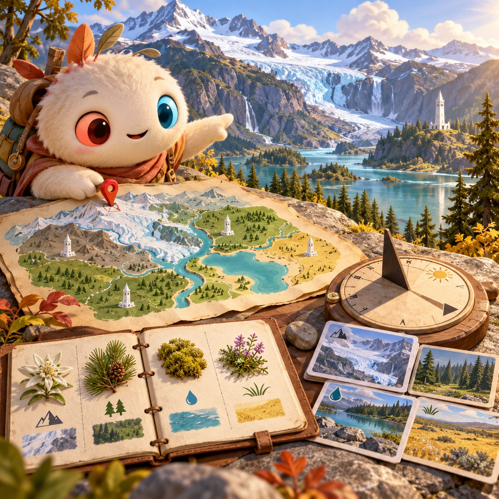
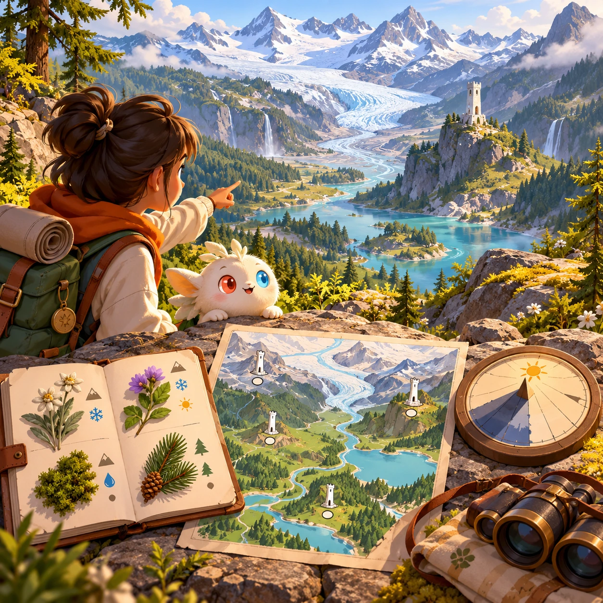

# Where on Raya?

SA-16 · [Stories and adventures](../sa.md) · Cx 2 · Ages 8+ · Research catalog

**The idea:** Compare a panorama of a glacial valley with a habitat map, a sun-shadow compass and plant samples; place a pin near the white tower that best fits the environmental clues.

| Decision             | Proposal                                                                                                                                                                                    |
| -------------------- | ------------------------------------------------------------------------------------------------------------------------------------------------------------------------------------------- |
| Familiar mechanic    | Scenery-based geographic deduction                                                                                                                                                          |
| Learning objective   | Geography, evidence, uncertainty                                                                                                                                                            |
| First prototype      | One authored challenge built around the interaction above, with a clear goal, immediate feedback, restart and unlimited retries.                                                            |
| Technology           | React + SVG/DOM; deterministic state, undo and seeded levels. Start with one local screen and touch plus keyboard input.                                                                    |
| Scope boundary       | One board and one rule set; defer accounts, multiplayer, procedural content and platform SDKs.                                                                                              |
| Reuse                | Shared input, saves, accessibility, seeded state and the stories and adventures collection shell.                                                                                           |
| Prototype acceptance | A player can identify the next action from the screen, complete one challenge, explain the practiced idea and restart without help. Check touch and keyboard play at narrow and wide sizes. |
| Main uncertainty     | Test whether the lesson follows from play and whether the first interaction is understandable without reading.                                                                              |

## Estimated plan

**First playable version:** Six original authored panoramas of Raya with a fictional biome map; explain each clue after choosing, no real location tracking or external street imagery.

| Measure              | Estimate                                                                                                   |
| -------------------- | ---------------------------------------------------------------------------------------------------------- |
| Youngest age         | 8+                                                                                                         |
| Toddler learnability | 1 of 5 — Needs reading, precise motor control, timing pressure or abstract rules; not a toddler game (6+). |
| Code                 | 1500 LOC, 12.5 days                                                                                        |
| Assets               | 93 hours, 15.5 days                                                                                        |
| Effort               | 28 days, risk 3 of 5                                                                                       |
| Start score          | 84 (rank 210 of 310; lower is better)                                                                      |

**Algorithms:** `map-geo` (Maps and geography, 400 LOC) · `camera-photo` (Camera input, 250 LOC) · `puzzle-solver-hints` (Puzzle solver and hints, 400 LOC)

**Assets:** 24 sprites, 5 animations, 3 backgrounds, 4 UI screens, 8 sound effects, 1 music track, 12 voice lines, 6 authored levels, 24 content items

How the numbers are computed: [development plan](../../development-plan.md#how-the-scores-work).

## Four visual directions

These are independently generated concept proposals for selecting a prototype.
The four views compare gameplay readability, world appeal, tactile identity and
room to grow. They are not screenshots of an implemented game. Native image
dimensions, hashes, exact prompts and generation provenance are recorded in the
[art manifest](../art/sa-16/manifest.json); see the [generation notes](../README.md#image-generation-and-provenance).

The [core prompts](../jobs/sa.json) use IDs `sa-16/01-gameplay` to `sa-16/04-discovery`.

### Gameplay

### World

### Characters and materials

### Expanded play

## Design checks before prototyping

- Learning target: **Geography, evidence, uncertainty**. Ask a domain reviewer to validate factual content in the mechanic.
- Keep goals cooperative or self-directed, using resources and needs. Avoid purchasable power. No pressure timers in the accessible mode.
- Use original layouts and character designs; the [legal checklist](../../legal.md) applies even when a mechanic is familiar.
- Choose the minimum [fidelity level](../../simulation-engine.md#determinism-and-fidelity-levels) the lesson needs; concept art does not establish scientific accuracy.
- Review silhouettes, text alternatives, reduced motion and non-color cues against the [adorability gate](../../lore/adorability-gate.md).

Genre context: [existing genre research](../../../case-studies/issue-1/data/research-genres-ideas.md)
and [expansion research](../../../case-studies/issue-1/data/research-visual-catalog.md).

[← Map of Whispers](sa-15.md) · [All concepts](../README.md) · [Lantern Seekers →](sa-17.md)
