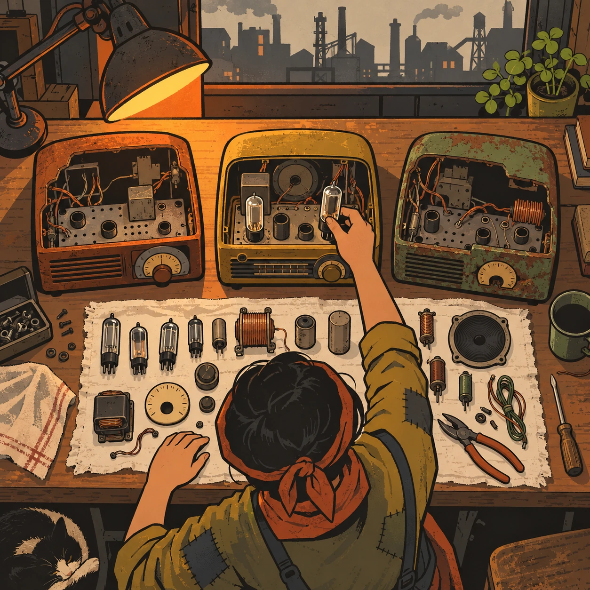
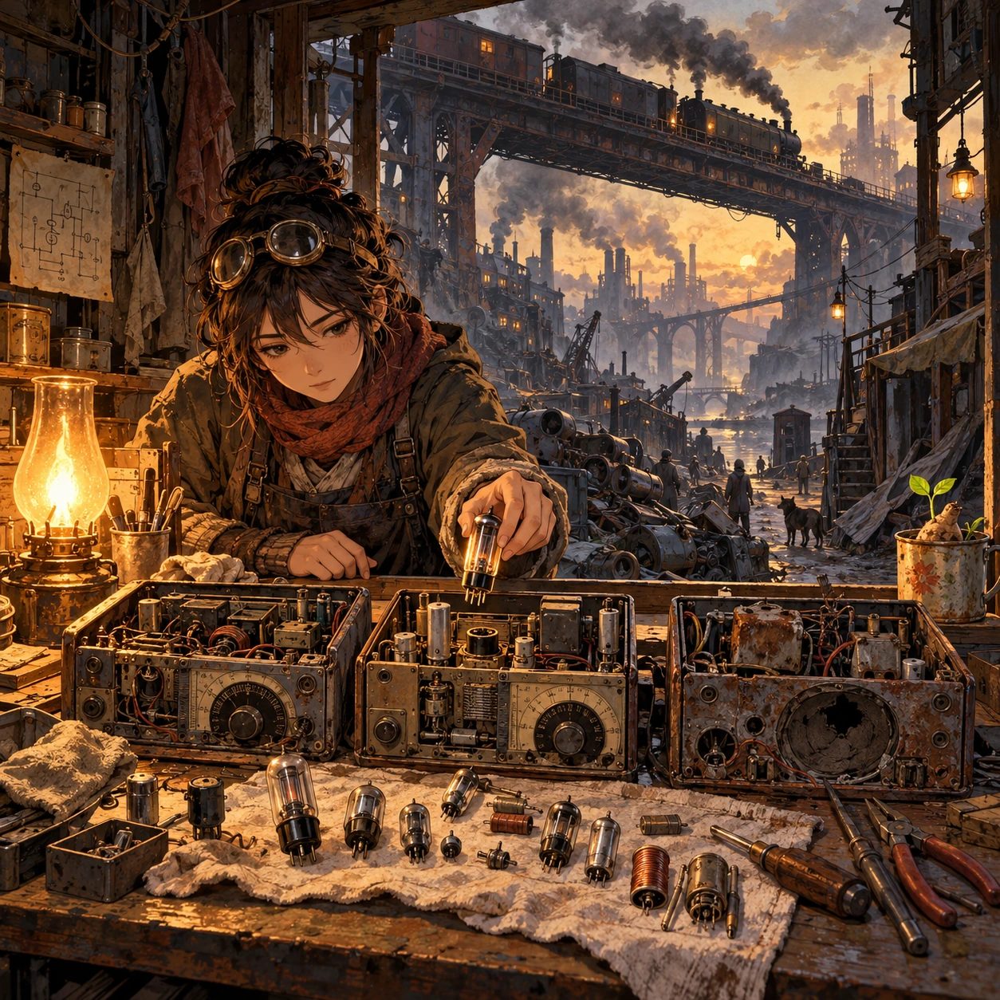
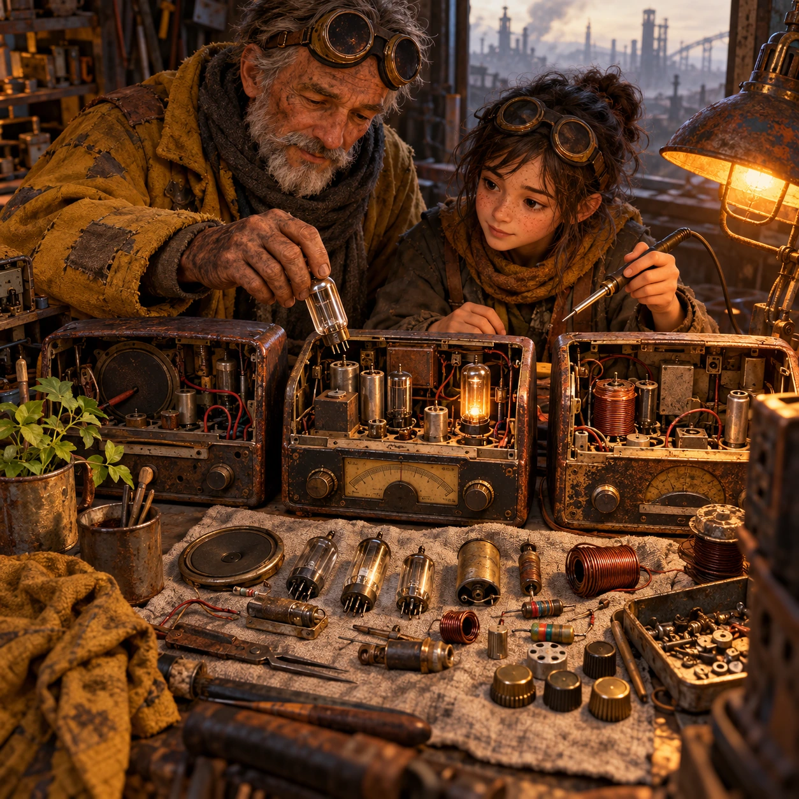
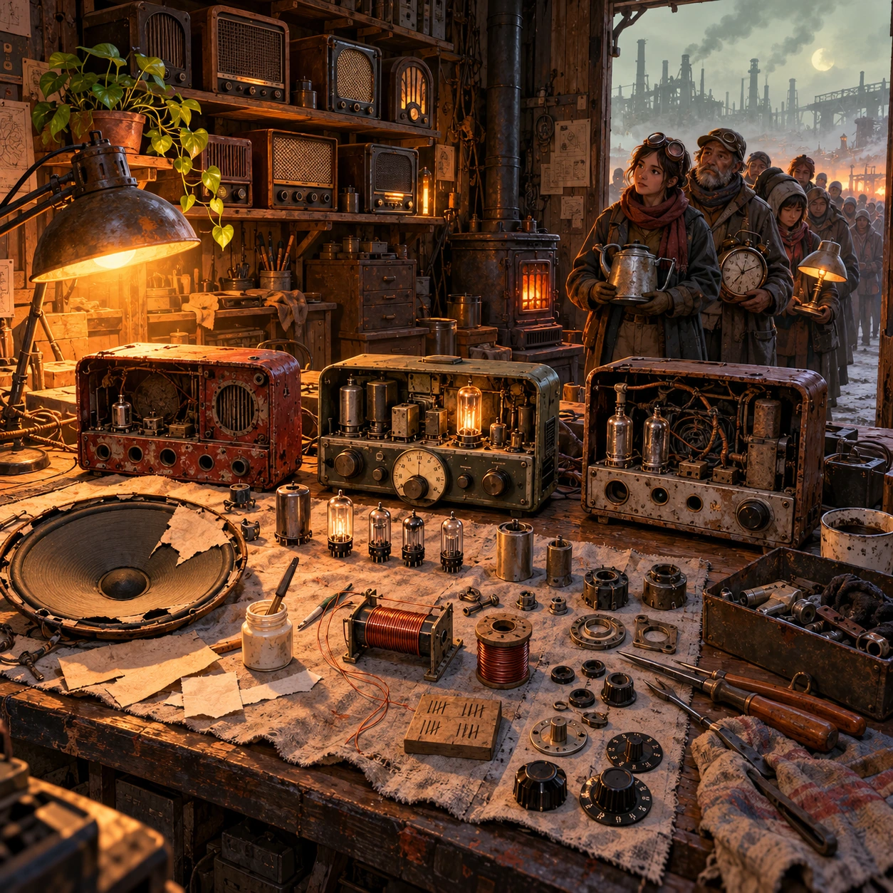

# Three Dead Radios

SH-01 · [Shacados](../sh.md) · Cx 3 · Ages 10+ · Raya story catalog

**The idea:** A mender's workbench seen from above: three gutted radios in a row, their tubes, coils and dials laid out on a rag. The player drags a good tube into the one sound chassis while a lamp warms the bench.

| Decision             | Proposal                                                                                                                                                                                    |
| -------------------- | ------------------------------------------------------------------------------------------------------------------------------------------------------------------------------------------- |
| Familiar mechanic    | Repair puzzle, salvage and rebuild                                                                                                                                                          |
| Learning objective   | Basic circuits, troubleshooting, the value of mending                                                                                                                                       |
| First prototype      | One authored challenge built around the interaction above, with a clear goal, immediate feedback, restart and unlimited retries.                                                            |
| Technology           | React shell + PixiJS; use the shared simulation adapter only where motion or agent behavior requires it. Start with one bounded scene and measured frame time.                              |
| Scope boundary       | One bounded scenario and one core system; defer a full campaign, network play and production-scale content.                                                                                 |
| Reuse                | Shared input, saves, accessibility, seeded state and the shacados collection shell.                                                                                                         |
| Prototype acceptance | A player can identify the next action from the screen, complete one challenge, explain the practiced idea and restart without help. Check touch and keyboard play at narrow and wide sizes. |
| Main uncertainty     | Test whether the lesson follows from play and whether the first interaction is understandable without reading.                                                                              |

## Estimated plan

**First playable version:** One mender's bench, 12 radios to rebuild from three dead sets each, a simple tube and coil circuit check and a voiced Brann; speaker patching and coil rewinding come later.

| Measure              | Estimate                                                                                                   |
| -------------------- | ---------------------------------------------------------------------------------------------------------- |
| Youngest age         | 10+                                                                                                        |
| Toddler learnability | 1 of 5 — Needs reading, precise motor control, timing pressure or abstract rules; not a toddler game (6+). |
| Code                 | 1730 LOC, 14.4 days                                                                                        |
| Assets               | 169 hours, 28.2 days                                                                                       |
| Effort               | 42.6 days, risk 3 of 5                                                                                     |
| Start score          | 127.8 (rank 263 of 310; lower is better)                                                                   |

**Algorithms:** `electric-circuit` (Electric circuits, 500 LOC) · `drag-drop-snap` (Drag and snap, 150 LOC) · `inventory-crafting` (Inventory and crafting, 400 LOC) · `tap-feedback` (Tap feedback, 80 LOC)

**Assets:** 45 sprites, 8 animations, 4 backgrounds, 5 UI screens, 25 sound effects, 2 music tracks, 30 voice lines, 12 authored levels, 60 content items

How the numbers are computed: [development plan](../../development-plan.md#how-the-scores-work).

## Story

Nobody in the coal town could get a new radio. So they brought the dead ones to Old Brann. He opened three of them on his bench and laid out every part like bread on a cloth. This tube is tired. This coil is good. This dial still turns. By evening one radio sang, and two empty cases sat beside it. A girl asked if the other two were wasted. Brann shook his head. They gave their best parts to a friend, he said. That is not waste. That is mending.

> **Wisdom:** Nothing is junk to someone who mends.

## Four visual directions

These are independently generated concept proposals for selecting a prototype.
The four views compare gameplay readability, world appeal, tactile identity and
room to grow. They are not screenshots of an implemented game. Native image
dimensions, hashes, exact prompts and generation provenance are recorded in the
[art manifest](../art/sh-01/manifest.json); see the [generation notes](../README.md#image-generation-and-provenance).

The [core prompts](../jobs/sh.json) use IDs `sh-01/01-gameplay` to `sh-01/04-discovery`.

### Gameplay

A mender's workbench seen from above: three gutted radios in a row, their tubes, coils and dials laid out on a rag. The player drags a good tube into the one sound chassis while a lamp warms the bench.

### World

A narrow mender's stall under a rusted rail bridge in a warm-belt coal town. Brown smog hangs over soot-black brick, and freight trains rattle overhead. Dead machines lie piled outside like driftwood. Inside, one oil lamp glows lamp orange over the bench, and a sprouting tuber in a tin cup sits on the windowsill, the only green thing in the street.

### Characters and materials

Old Brann, a former rocket welder with burned, careful hands, wears a patched mustard coat, a soot-gray scarf and goggles pushed up on his forehead. Beside him a raker girl holds a soldering iron for the first time. Brass knobs, cracked bakelite cases, cloth-wrapped wire, glass tubes and copper coils. Rust, soot, ash and mustard tones, lit by one warm lamp.

### Expanded play

Later benches bring harder salvage: a torn speaker cone to patch with paper and glue, a coil to rewind by counting turns, a tube that only works when warm. The view widens to a shelf of radios mended for neighbors and a quiet line of people at the door, each holding a broken kettle, clock or lamp, waiting their turn with patience.

## Design checks before prototyping

- Learning target: **Basic circuits, troubleshooting, the value of mending**. Ask a domain reviewer to validate factual content in the mechanic.
- Keep goals cooperative or self-directed, using resources and needs. Avoid purchasable power. No pressure timers in the accessible mode.
- Use original layouts and character designs; the [legal checklist](../../legal.md) applies even when a mechanic is familiar.
- Choose the minimum [fidelity level](../../simulation-engine.md#determinism-and-fidelity-levels) the lesson needs; concept art does not establish scientific accuracy.
- Review silhouettes, text alternatives, reduced motion and non-color cues against the [adorability gate](../../lore/adorability-gate.md).
- Follow the age and tone rules of [Shacados](../../lore/shacados.md): dark but never hopeless, people never villains, the player never harms anyone.

Genre context: [existing genre research](../../../case-studies/issue-1/data/research-genres-ideas.md)
and [expansion research](../../../case-studies/issue-1/data/research-visual-catalog.md).

[All concepts](../README.md) · [Static on the Roof →](sh-02.md)
