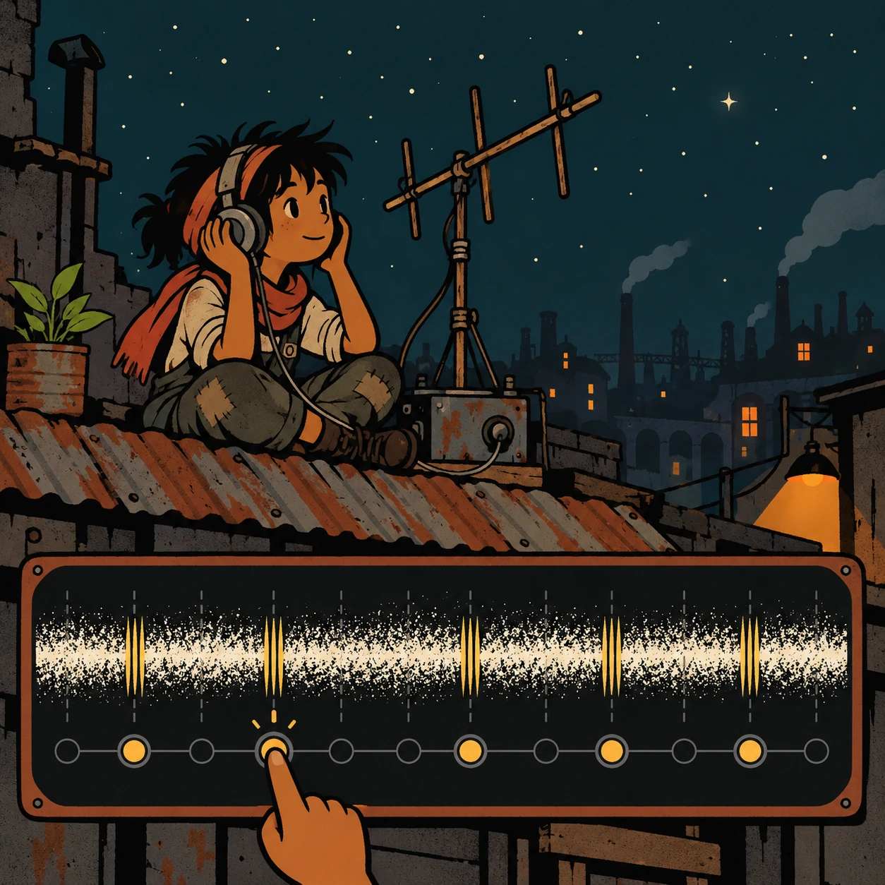
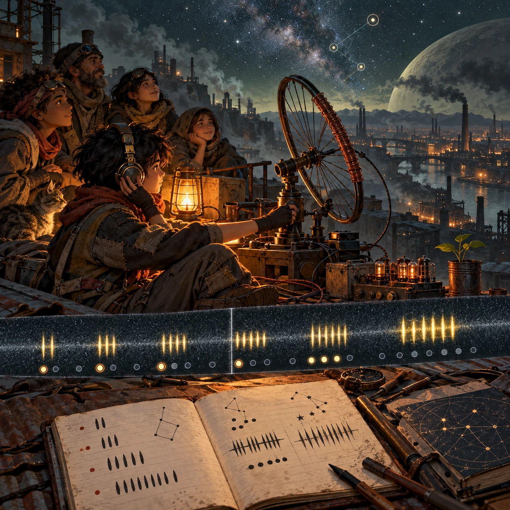

# Static on the Roof

SH-02 · [Shacados](../sh.md) · Cx 3 · Ages 10+ · Raya story catalog

**The idea:** Teyo sits on a tin roof at night with headphones and a homemade antenna. A wide band of hissing static scrolls across the screen, and the player taps the repeating pulses to pull a hidden rhythm out of the noise.

| Decision             | Proposal                                                                                                                                                                                    |
| -------------------- | ------------------------------------------------------------------------------------------------------------------------------------------------------------------------------------------- |
| Familiar mechanic    | Signal listening and pattern-finding puzzle                                                                                                                                                 |
| Learning objective   | Patterns, signal and noise, prime numbers, patience                                                                                                                                         |
| First prototype      | One authored challenge built around the interaction above, with a clear goal, immediate feedback, restart and unlimited retries.                                                            |
| Technology           | React shell + PixiJS; use the shared simulation adapter only where motion or agent behavior requires it. Start with one bounded scene and measured frame time.                              |
| Scope boundary       | One bounded scenario and one core system; defer a full campaign, network play and production-scale content.                                                                                 |
| Reuse                | Shared input, saves, accessibility, seeded state and the shacados collection shell.                                                                                                         |
| Prototype acceptance | A player can identify the next action from the screen, complete one challenge, explain the practiced idea and restart without help. Check touch and keyboard play at narrow and wide sizes. |
| Main uncertainty     | Test whether the lesson follows from play and whether the first interaction is understandable without reading.                                                                              |

## Estimated plan

**First playable version:** The rooftop scene, 15 nights of synthesized static with hidden pulse groups to tap out, antenna turning and a pulse notebook; no timing failure, building a better coil is left for later.

| Measure              | Estimate                                                                                                   |
| -------------------- | ---------------------------------------------------------------------------------------------------------- |
| Youngest age         | 10+                                                                                                        |
| Toddler learnability | 1 of 5 — Needs reading, precise motor control, timing pressure or abstract rules; not a toddler game (6+). |
| Code                 | 1530 LOC, 12.8 days                                                                                        |
| Assets               | 141 hours, 23.4 days                                                                                       |
| Effort               | 36.2 days, risk 2 of 5                                                                                     |
| Start score          | 108.6 (rank 240 of 310; lower is better)                                                                   |

**Algorithms:** `audio-synth` (Playable instrument, 250 LOC) · `pattern-sequence` (Pattern completion, 150 LOC) · `rhythm-timing` (Rhythm timing, 300 LOC) · `particle-effects` (Particles, 150 LOC) · `tap-feedback` (Tap feedback, 80 LOC)

**Assets:** 30 sprites, 6 animations, 4 backgrounds, 4 UI screens, 30 sound effects, 2 music tracks, 25 voice lines, 15 authored levels, 40 content items

How the numbers are computed: [development plan](../../development-plan.md#how-the-scores-work).

## Story

Every night Teyo climbed the roof and listened to the hiss. His neighbors said the sky had nothing to say. One night, after a storm washed the smoke away, the hiss changed. Two clicks. Three clicks. Five. Seven. Then a long, soft tone, like a choir holding one note. Teyo did not tell the Wardens. He woke his sister and gave her one side of the headphones. They sat together under the stars and heard someone far away say, in numbers every mind can count, we are here. Teyo smiled. So are we.

> **Wisdom:** Listen long enough and the noise starts talking.

## Four visual directions

These are independently generated concept proposals for selecting a prototype.
The four views compare gameplay readability, world appeal, tactile identity and
room to grow. They are not screenshots of an implemented game. Native image
dimensions, hashes, exact prompts and generation provenance are recorded in the
[art manifest](../art/sh-02/manifest.json); see the [generation notes](../README.md#image-generation-and-provenance).

The [core prompts](../jobs/sh.json) use IDs `sh-02/01-gameplay` to `sh-02/04-discovery`.

### Gameplay

Teyo sits on a tin roof at night with headphones and a homemade antenna. A wide band of hissing static scrolls across the screen, and the player taps the repeating pulses to pull a hidden rhythm out of the noise.

### World

A shanty roof of patched corrugated tin above the warm belt, on a rare clear night after a dust storm. Gas flares glow red on the horizon and chimneys breathe smoke below, but above them the stars show through. The brightest of them, a hard pale-yellow point, is Raya's sun. A candle in a jar gives the one lamp-orange light, and a tin of moss grows by the chimney.

### Characters and materials

Teyo, a 15-year-old raker with a thin face and bright eyes, wears a patched rust jacket, a long ash scarf and goggles around his neck. His receiver is a crate of salvaged tubes, a coil wound on a bottle and an antenna of bent wire and a bicycle rim. His little sister holds the candle jar. Soot, rust and mustard, with one warm glow.

### Expanded play

As the nights pass the static grows cleverer: pulses in groups of two, three, five and seven, then a slow repeating chord. The player turns the bicycle-rim antenna toward different stars, winds a better coil and fills a notebook with pulse drawings. The final view shows neighbors climbing onto the roof to listen too, their faces lit by the candle.

## Design checks before prototyping

- Learning target: **Patterns, signal and noise, prime numbers, patience**. Ask a domain reviewer to validate factual content in the mechanic.
- Keep goals cooperative or self-directed, using resources and needs. Avoid purchasable power. No pressure timers in the accessible mode.
- Use original layouts and character designs; the [legal checklist](../../legal.md) applies even when a mechanic is familiar.
- Choose the minimum [fidelity level](../../simulation-engine.md#determinism-and-fidelity-levels) the lesson needs; concept art does not establish scientific accuracy.
- Review silhouettes, text alternatives, reduced motion and non-color cues against the [adorability gate](../../lore/adorability-gate.md).
- Follow the age and tone rules of [Shacados](../../lore/shacados.md): dark but never hopeless, people never villains, the player never harms anyone.

Genre context: [existing genre research](../../../case-studies/issue-1/data/research-genres-ideas.md)
and [expansion research](../../../case-studies/issue-1/data/research-visual-catalog.md).

[← Three Dead Radios](sh-01.md) · [All concepts](../README.md) · [Jars for After →](sh-03.md)
