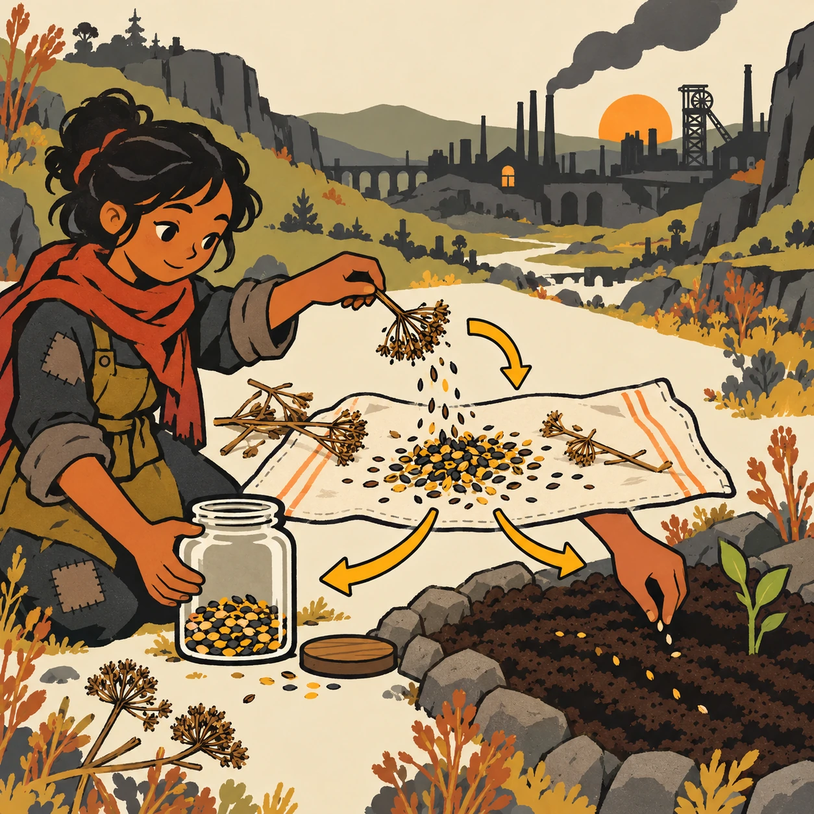
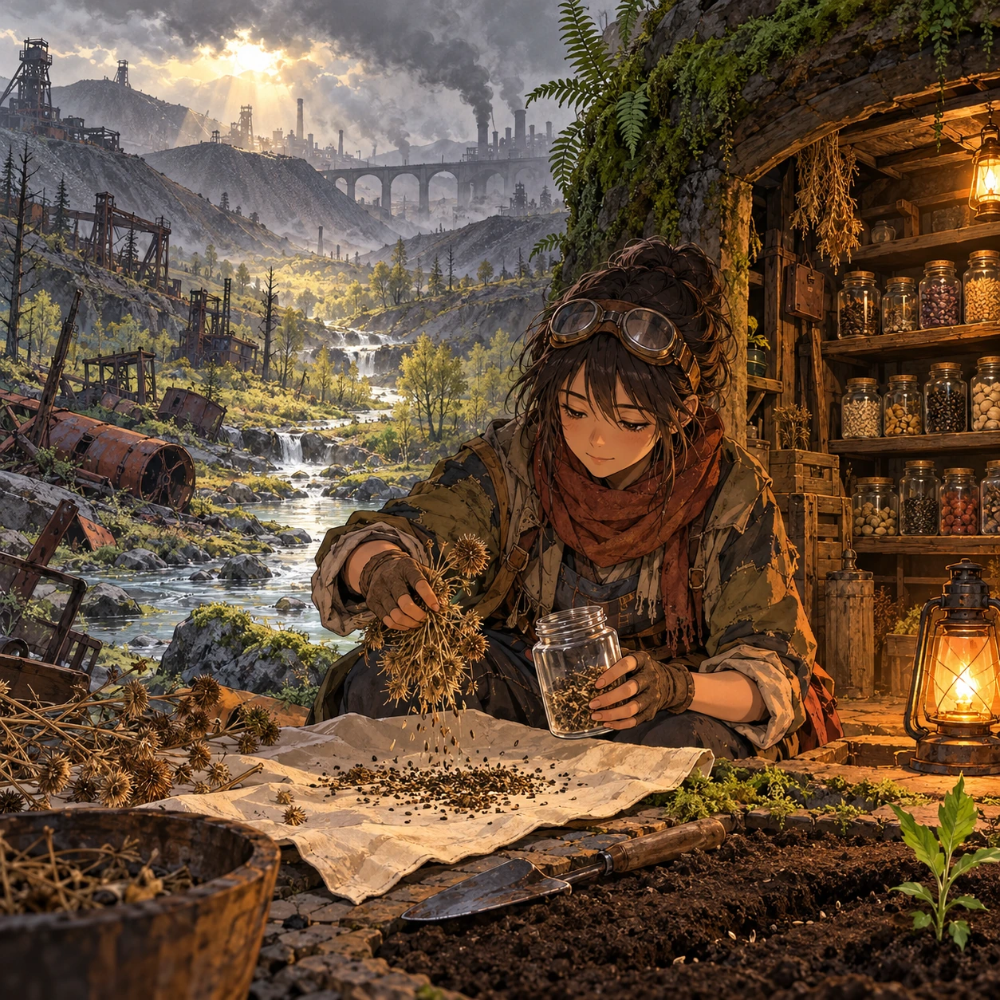
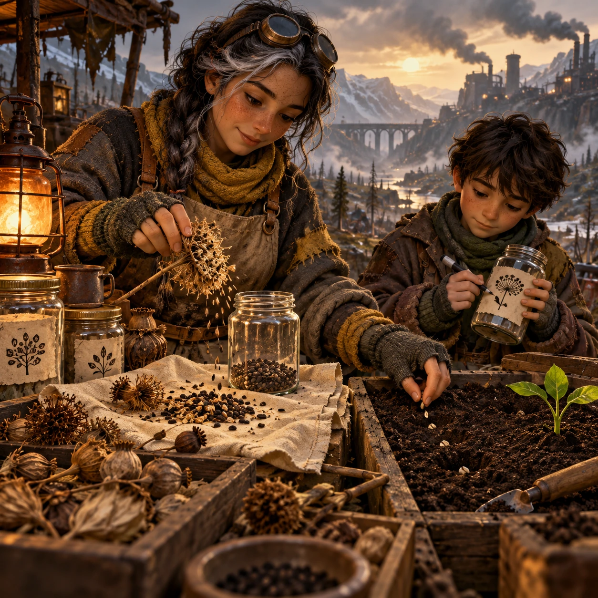
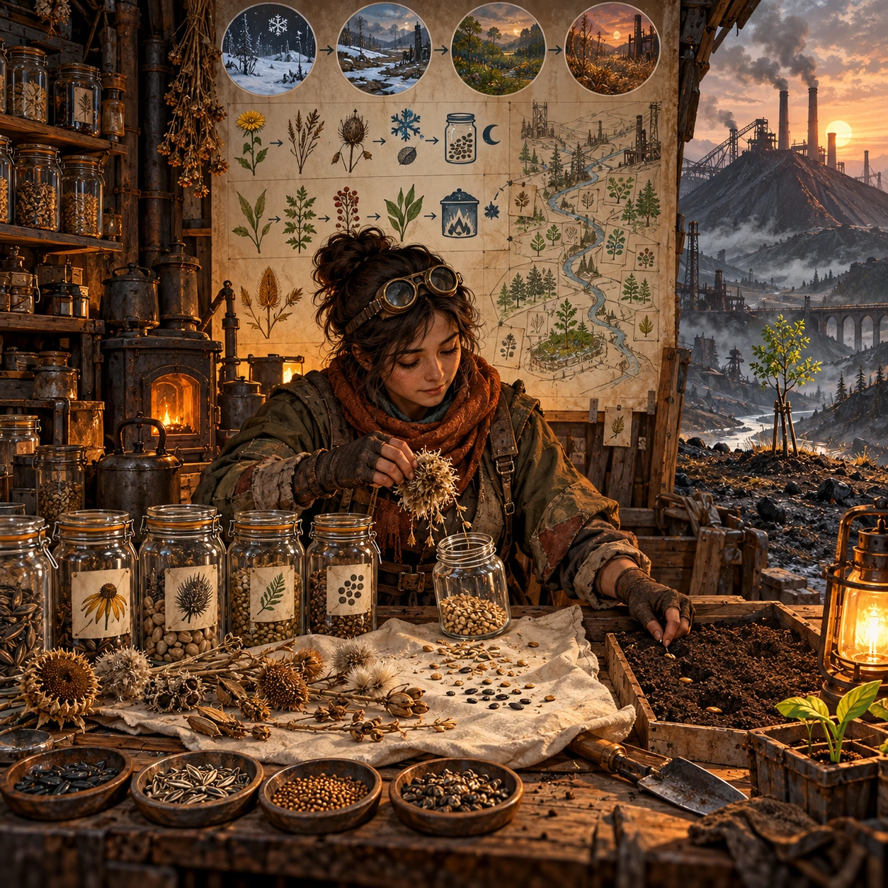

# Jars for After

SH-03 · [Shacados](../sh.md) · Cx 2 · Ages 10+ · Raya story catalog

**The idea:** In a hidden valley, Sela holds an open glass jar while the player drags dry seed heads onto a cloth, shakes out the seeds, saves half in the jar and plants half in a sheltered patch of dark soil.

| Decision             | Proposal                                                                                                                                                                                    |
| -------------------- | ------------------------------------------------------------------------------------------------------------------------------------------------------------------------------------------- |
| Familiar mechanic    | Collect, sort and plant (seed saving)                                                                                                                                                       |
| Learning objective   | Plant life cycles, seed saving, caring for the future                                                                                                                                       |
| First prototype      | One authored challenge built around the interaction above, with a clear goal, immediate feedback, restart and unlimited retries.                                                            |
| Technology           | React + SVG/DOM; deterministic state, undo and seeded levels. Start with one local screen and touch plus keyboard input.                                                                    |
| Scope boundary       | One board and one rule set; defer accounts, multiplayer, procedural content and platform SDKs.                                                                                              |
| Reuse                | Shared input, saves, accessibility, seeded state and the shacados collection shell.                                                                                                         |
| Prototype acceptance | A player can identify the next action from the screen, complete one challenge, explain the practiced idea and restart without help. Check touch and keyboard play at narrow and wide sizes. |
| Main uncertainty     | Test whether the lesson follows from play and whether the first interaction is understandable without reading.                                                                              |

## Estimated plan

**First playable version:** The root cellar and one valley plot, 10 seed types to dry, sort, save half and plant half across 10 seasons with simple growth; couriers and the cellar map are left out.

| Measure              | Estimate                                                                                                   |
| -------------------- | ---------------------------------------------------------------------------------------------------------- |
| Youngest age         | 10+                                                                                                        |
| Toddler learnability | 1 of 5 — Needs reading, precise motor control, timing pressure or abstract rules; not a toddler game (6+). |
| Code                 | 940 LOC, 7.8 days                                                                                          |
| Assets               | 122 hours, 20.3 days                                                                                       |
| Effort               | 28.2 days, risk 1 of 5                                                                                     |
| Start score          | 84.6 (rank 212 of 310; lower is better)                                                                    |

**Algorithms:** `drag-drop-snap` (Drag and snap, 150 LOC) · `sort-classify` (Sorting by attribute, 120 LOC) · `day-cycle` (Day and season cycle, 120 LOC) · `tween-cause-effect` (Cause-and-effect animation, 100 LOC)

**Assets:** 35 sprites, 6 animations, 3 backgrounds, 3 UI screens, 15 sound effects, 1 music track, 20 voice lines, 10 authored levels, 40 content items

How the numbers are computed: [development plan](../../development-plan.md#how-the-scores-work).

## Story

Sela keeps a jar on the top shelf that she never opens. The boy asked her why. These are oak seeds, she said. My grandmother saved them. The soil here is still too sour for oaks. Then why keep them? Because one day it will not be. She showed him how to dry beans, wrap them in cloth and plant half while saving half. Eat some, plant some, keep some for after, she said. The boy looked at the top shelf for a long time. Then he started a jar of his own.

> **Wisdom:** Plant for someone you will never meet.

## Four visual directions

These are independently generated concept proposals for selecting a prototype.
The four views compare gameplay readability, world appeal, tactile identity and
room to grow. They are not screenshots of an implemented game. Native image
dimensions, hashes, exact prompts and generation provenance are recorded in the
[art manifest](../art/sh-03/manifest.json); see the [generation notes](../README.md#image-generation-and-provenance).

The [core prompts](../jobs/sh.json) use IDs `sh-03/01-gameplay` to `sh-03/04-discovery`.

### Gameplay

In a hidden valley, Sela holds an open glass jar while the player drags dry seed heads onto a cloth, shakes out the seeds, saves half in the jar and plants half in a sheltered patch of dark soil.

### World

The Last Woods: a small green valley tucked between gray slag heaps, its stream half clean, its trees thin but alive. Smog lies like a lid over the hills, yet sunlight leaks through in one patch. Inside a moss-covered root cellar, shelves of seed jars wait under a single lamp-orange lantern, and a fern unfurls at the doorway.

### Characters and materials

Sela, a seed keeper with gray-streaked braids, wears layered patched wool in mustard and ash, a soil-stained apron and fingerless gloves. Her apprentice, a boy in an oversized coat, marks jars with drawn pictures instead of words. Glass jars, waxed cloth, wooden trays, dried pods and husks, wet dark soil. Rust, ash and sick green, with one warm lantern.

### Expanded play

Seasons turn in the valley. The player learns which seeds need cold, which need ash and which must dry for a month. New jars arrive from far towns with quiet couriers. A picture map of plantings spreads across the cellar wall, and the final view shows one young tree standing bravely at the foot of a slag heap, planted by the player.

## Design checks before prototyping

- Learning target: **Plant life cycles, seed saving, caring for the future**. Ask a domain reviewer to validate factual content in the mechanic.
- Keep goals cooperative or self-directed, using resources and needs. Avoid purchasable power. No pressure timers in the accessible mode.
- Use original layouts and character designs; the [legal checklist](../../legal.md) applies even when a mechanic is familiar.
- Choose the minimum [fidelity level](../../simulation-engine.md#determinism-and-fidelity-levels) the lesson needs; concept art does not establish scientific accuracy.
- Review silhouettes, text alternatives, reduced motion and non-color cues against the [adorability gate](../../lore/adorability-gate.md).
- Follow the age and tone rules of [Shacados](../../lore/shacados.md): dark but never hopeless, people never villains, the player never harms anyone.

Genre context: [existing genre research](../../../case-studies/issue-1/data/research-genres-ideas.md)
and [expansion research](../../../case-studies/issue-1/data/research-visual-catalog.md).

[← Static on the Roof](sh-02.md) · [All concepts](../README.md) · [One Stove for the Block →](sh-04.md)
