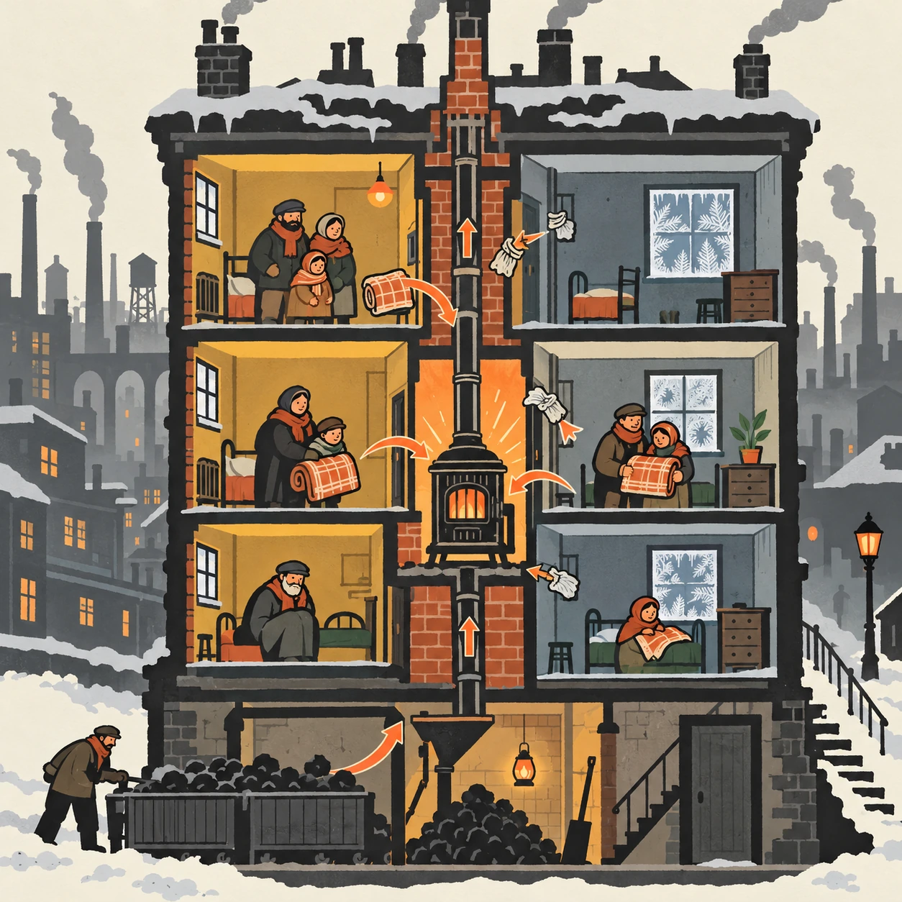
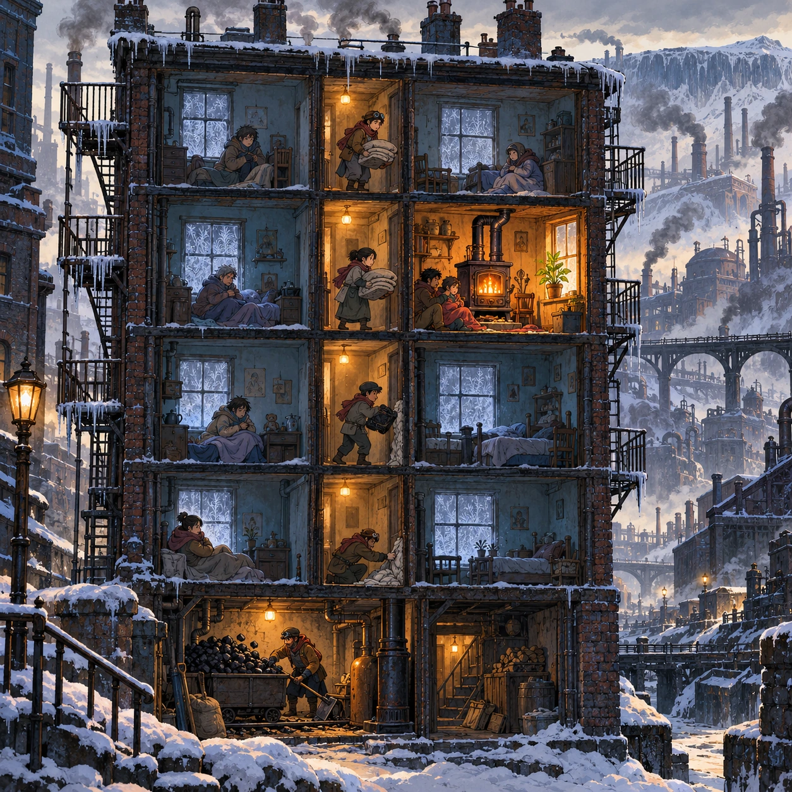
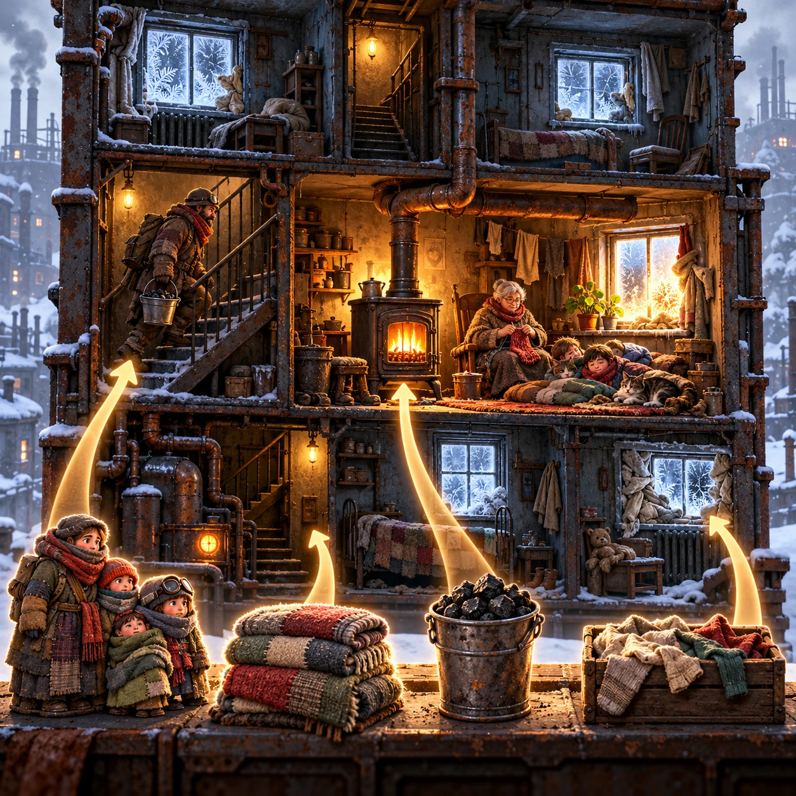
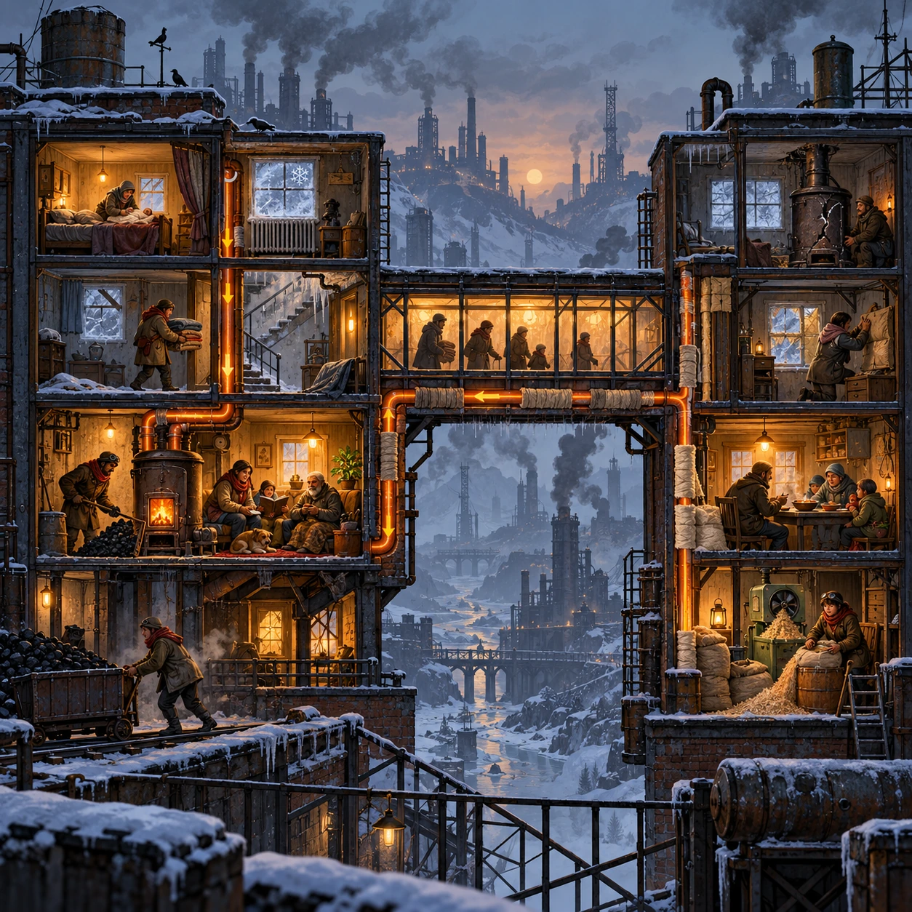

# One Stove for the Block

SH-04 · [Shacados](../sh.md) · Cx 3 · Ages 10+ · Raya story catalog

**The idea:** A cutaway of a frosty tenement block, each room a box. The player moves families and blankets into the room with the big stove, stuffs drafts with rags and routes the last coal until the frost on its window melts.

| Decision             | Proposal                                                                                                                                                                                    |
| -------------------- | ------------------------------------------------------------------------------------------------------------------------------------------------------------------------------------------- |
| Familiar mechanic    | Heat logistics puzzle                                                                                                                                                                       |
| Learning objective   | Heat and insulation, planning scarce resources, fairness                                                                                                                                    |
| First prototype      | One authored challenge built around the interaction above, with a clear goal, immediate feedback, restart and unlimited retries.                                                            |
| Technology           | React shell + PixiJS; use the shared simulation adapter only where motion or agent behavior requires it. Start with one bounded scene and measured frame time.                              |
| Scope boundary       | One bounded scenario and one core system; defer a full campaign, network play and production-scale content.                                                                                 |
| Reuse                | Shared input, saves, accessibility, seeded state and the shacados collection shell.                                                                                                         |
| Prototype acceptance | A player can identify the next action from the screen, complete one challenge, explain the practiced idea and restart without help. Check touch and keyboard play at narrow and wide sizes. |
| Main uncertainty     | Test whether the lesson follows from play and whether the first interaction is understandable without reading.                                                                              |

## Estimated plan

**First playable version:** A cutaway tenement with 20 heat puzzles where families, blankets, rags and coal are moved so one stove warms everyone, with a solver for hints; heat pipes between blocks come later.

| Measure              | Estimate                                                                                                   |
| -------------------- | ---------------------------------------------------------------------------------------------------------- |
| Youngest age         | 10+                                                                                                        |
| Toddler learnability | 1 of 5 — Needs reading, precise motor control, timing pressure or abstract rules; not a toddler game (6+). |
| Code                 | 1550 LOC, 12.9 days                                                                                        |
| Assets               | 133 hours, 22.2 days                                                                                       |
| Effort               | 35.1 days, risk 3 of 5                                                                                     |
| Start score          | 105.3 (rank 237 of 310; lower is better)                                                                   |

**Algorithms:** `graph-network` (Node-link graph, 300 LOC) · `drag-drop-snap` (Drag and snap, 150 LOC) · `puzzle-solver-hints` (Puzzle solver and hints, 400 LOC)

**Assets:** 35 sprites, 6 animations, 3 backgrounds, 4 UI screens, 15 sound effects, 1 music track, 20 voice lines, 20 authored levels, 30 content items

How the numbers are computed: [development plan](../../development-plan.md#how-the-scores-work).

## Story

The coal ran short in the first week of the deep cold. Each family in the block had a little stove and a little coal, and every room was cold. Old Dalla knocked on every door. If we burn our coal together, she said, one room can be warm instead of six rooms being cold. People grumbled. They moved anyway, dragging blankets and chairs. That night the block slept in one room, packed close around one stove. It was crowded and noisy, and someone snored. But nobody was cold, and the coal lasted until spring.

> **Wisdom:** A shared fire burns longer.

## Four visual directions

These are independently generated concept proposals for selecting a prototype.
The four views compare gameplay readability, world appeal, tactile identity and
room to grow. They are not screenshots of an implemented game. Native image
dimensions, hashes, exact prompts and generation provenance are recorded in the
[art manifest](../art/sh-04/manifest.json); see the [generation notes](../README.md#image-generation-and-provenance).

The [core prompts](../jobs/sh.json) use IDs `sh-04/01-gameplay` to `sh-04/04-discovery`.

### Gameplay

A cutaway of a frosty tenement block, each room a box. The player moves families and blankets into the room with the big stove, stuffs drafts with rags and routes the last coal until the frost on its window melts.

### World

A five-story brick tenement in a coal town at the edge of the frozen north, soot-black against gray snow. Icicles hang from rusted fire escapes and chimneys smoke thinly. Through one window a single cast-iron stove glows lamp orange, the only warm light on the street. On that windowsill a potted bean plant leans toward the heat.

### Characters and materials

Families in layered patched coats, scarves over their mouths and mittens made from old socks. A grandmother knits by the stove, a miner carries half a bucket of coal up the stairs, and children sleep in a heap of blankets. Rusted pipes, cracked plaster, rag-stuffed windows and frost ferns on the glass. Soot, ash and rust, with one orange glow.

### Expanded play

Colder weeks bring harder blocks: a draft in the stairwell, a baby who needs warmth first, a neighbor block whose stove has cracked. The player learns to carry heat through pipes, insulate walls with sawdust and paper and swap coal for soup. The final view shows two blocks joined by a covered walkway, every resident gathered around one fire.

## Design checks before prototyping

- Learning target: **Heat and insulation, planning scarce resources, fairness**. Ask a domain reviewer to validate factual content in the mechanic.
- Keep goals cooperative or self-directed, using resources and needs. Avoid purchasable power. No pressure timers in the accessible mode.
- Use original layouts and character designs; the [legal checklist](../../legal.md) applies even when a mechanic is familiar.
- Choose the minimum [fidelity level](../../simulation-engine.md#determinism-and-fidelity-levels) the lesson needs; concept art does not establish scientific accuracy.
- Review silhouettes, text alternatives, reduced motion and non-color cues against the [adorability gate](../../lore/adorability-gate.md).
- Follow the age and tone rules of [Shacados](../../lore/shacados.md): dark but never hopeless, people never villains, the player never harms anyone.

Genre context: [existing genre research](../../../case-studies/issue-1/data/research-genres-ideas.md)
and [expansion research](../../../case-studies/issue-1/data/research-visual-catalog.md).

[← Jars for After](sh-03.md) · [All concepts](../README.md) · [Sand, Charcoal, Cloth →](sh-05.md)
