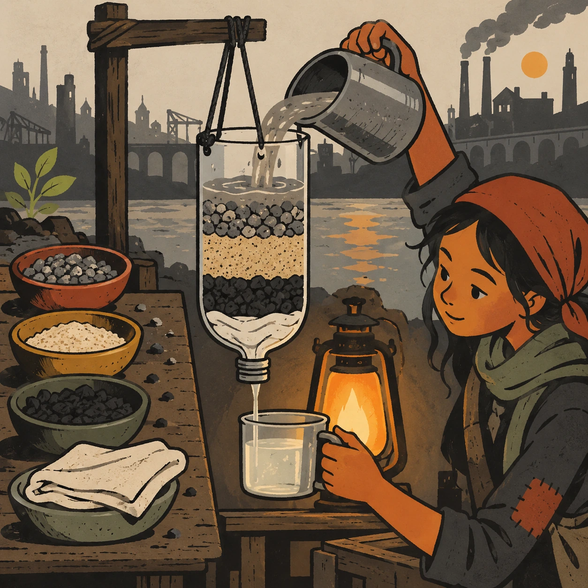
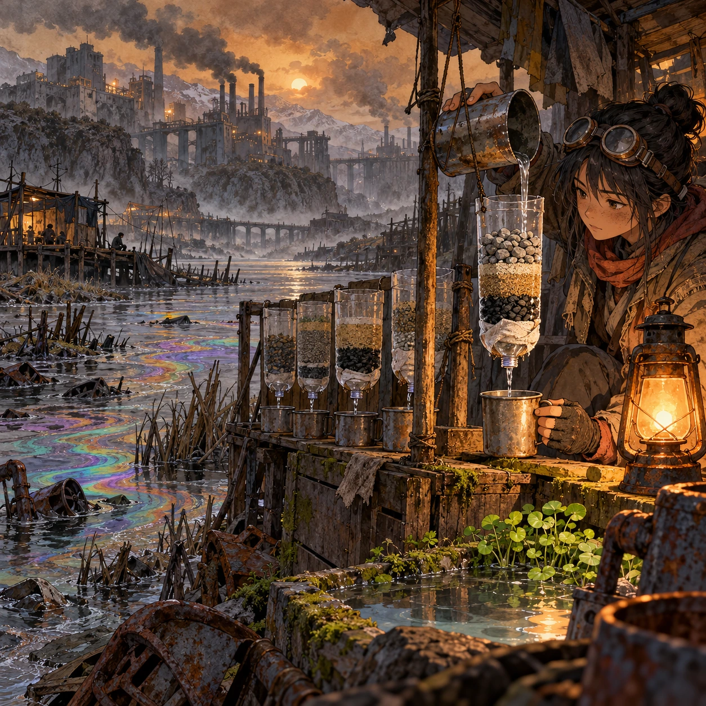
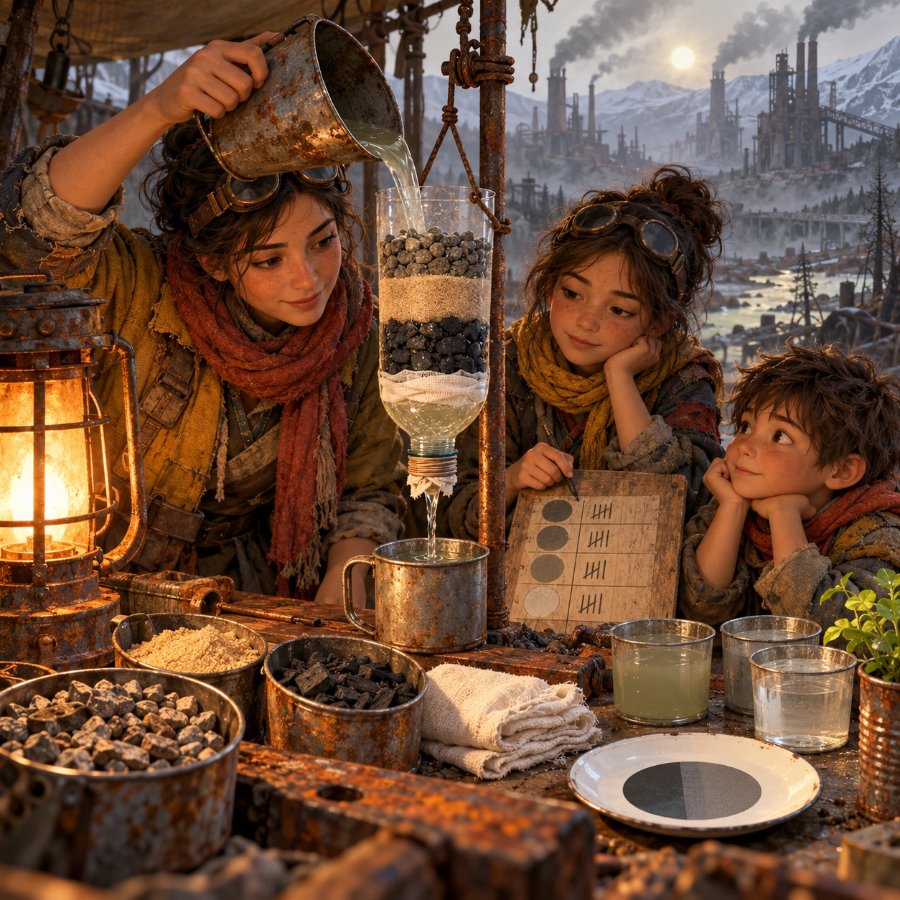
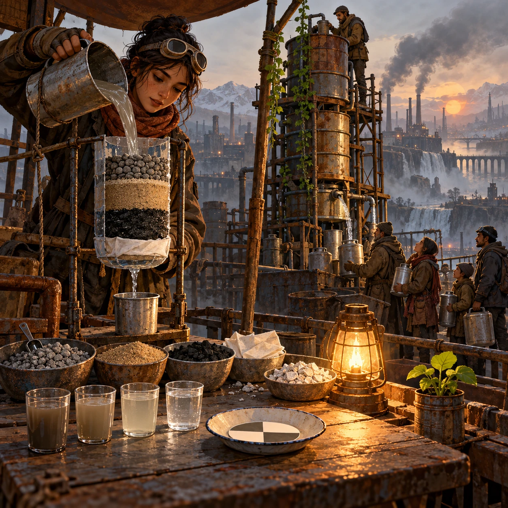

# Sand, Charcoal, Cloth

SH-05 · [Shacados](../sh.md) · Cx 3 · Ages 10+ · Raya story catalog

**The idea:** A cut-open bottle hangs over a tin cup. The player drags layers of gravel, sand, charcoal and cloth into it, pours gray river water through and holds the cup against the lamp to judge how clear it runs.

| Decision             | Proposal                                                                                                                                                                                    |
| -------------------- | ------------------------------------------------------------------------------------------------------------------------------------------------------------------------------------------- |
| Familiar mechanic    | Build-and-test science puzzle                                                                                                                                                               |
| Learning objective   | Water filtration, turbidity, testing and improving a design                                                                                                                                 |
| First prototype      | One authored challenge built around the interaction above, with a clear goal, immediate feedback, restart and unlimited retries.                                                            |
| Technology           | React shell + PixiJS; use the shared simulation adapter only where motion or agent behavior requires it. Start with one bounded scene and measured frame time.                              |
| Scope boundary       | One bounded scenario and one core system; defer a full campaign, network play and production-scale content.                                                                                 |
| Reuse                | Shared input, saves, accessibility, seeded state and the shacados collection shell.                                                                                                         |
| Prototype acceptance | A player can identify the next action from the screen, complete one challenge, explain the practiced idea and restart without help. Check touch and keyboard play at narrow and wide sizes. |
| Main uncertainty     | Test whether the lesson follows from play and whether the first interaction is understandable without reading.                                                                              |

## Estimated plan

**First playable version:** A filter bench with 12 water sources, four layer materials, a simple clarity model judged against a saucer disc and a boil step; acid rain chemistry and the barrel tower are left out.

| Measure              | Estimate                                                                                                   |
| -------------------- | ---------------------------------------------------------------------------------------------------------- |
| Youngest age         | 10+                                                                                                        |
| Toddler learnability | 1 of 5 — Needs reading, precise motor control, timing pressure or abstract rules; not a toddler game (6+). |
| Code                 | 1100 LOC, 9.2 days                                                                                         |
| Assets               | 118 hours, 19.6 days                                                                                       |
| Effort               | 28.8 days, risk 1 of 5                                                                                     |
| Start score          | 86.4 (rank 214 of 310; lower is better)                                                                    |

**Algorithms:** `drag-drop-snap` (Drag and snap, 150 LOC) · `particle-effects` (Particles, 150 LOC) · `tween-cause-effect` (Cause-and-effect animation, 100 LOC)

**Assets:** 30 sprites, 6 animations, 3 backgrounds, 4 UI screens, 15 sound effects, 1 music track, 20 voice lines, 12 authored levels, 30 content items

How the numbers are computed: [development plan](../../development-plan.md#how-the-scores-work).

## Story

The river near Mara's home was gray, and the deep well belonged to a Holder. So her mother taught her to build a filter. First stones, then sand, then charcoal from the stove, then a clean cloth. The first cup came out brown. Mara wanted to quit. Her mother poured it back through and added more charcoal. The second cup was paler. The third was almost clear. Now we boil it, her mother said. Clear is not the same as clean. That evening Mara built a second filter and carried it to the old man next door.

> **Wisdom:** Clear is not the same as clean.

## Four visual directions

These are independently generated concept proposals for selecting a prototype.
The four views compare gameplay readability, world appeal, tactile identity and
room to grow. They are not screenshots of an implemented game. Native image
dimensions, hashes, exact prompts and generation provenance are recorded in the
[art manifest](../art/sh-05/manifest.json); see the [generation notes](../README.md#image-generation-and-provenance).

The [core prompts](../jobs/sh.json) use IDs `sh-05/01-gameplay` to `sh-05/04-discovery`.

### Gameplay

A cut-open bottle hangs over a tin cup. The player drags layers of gravel, sand, charcoal and cloth into it, pours gray river water through and holds the cup against the lamp to judge how clear it runs.

### World

A riverside shanty beside a gray river stained with mine waste and dye, under a brown sky. Oily rainbows float near the bank, and dead reeds lean in the current. On a crate by the water stands a row of homemade filters, dripping slowly. A kerosene lamp gives the scene its one warm orange glow, and watercress sprouts in a clean puddle below the filters.

### Characters and materials

A mother and her two children in patched rust and mustard coats, sleeves rolled up and scarves loose. The older child scratches marks on a board to compare cups. Cut bottles, tin cans, burnt-wood charcoal, washed sand, folded cotton rags and a white saucer with a painted dark disc for judging cloudiness. Ash, soot, rust and sick-green water, with one lamp.

### Expanded play

New sources bring new problems: sour rain that needs crushed shell, mine water that must settle first, a whole street that needs a barrel-sized filter. The player tests each cup against the disc on the saucer and always boils as the last step. The final view shows a shared filter tower of stacked barrels on a rooftop, with neighbors filling cans in turn.

## Design checks before prototyping

- Learning target: **Water filtration, turbidity, testing and improving a design**. Ask a domain reviewer to validate factual content in the mechanic.
- Keep goals cooperative or self-directed, using resources and needs. Avoid purchasable power. No pressure timers in the accessible mode.
- Use original layouts and character designs; the [legal checklist](../../legal.md) applies even when a mechanic is familiar.
- Choose the minimum [fidelity level](../../simulation-engine.md#determinism-and-fidelity-levels) the lesson needs; concept art does not establish scientific accuracy.
- Review silhouettes, text alternatives, reduced motion and non-color cues against the [adorability gate](../../lore/adorability-gate.md).
- Follow the age and tone rules of [Shacados](../../lore/shacados.md): dark but never hopeless, people never villains, the player never harms anyone.

Genre context: [existing genre research](../../../case-studies/issue-1/data/research-genres-ideas.md)
and [expansion research](../../../case-studies/issue-1/data/research-visual-catalog.md).

[← One Stove for the Block](sh-04.md) · [All concepts](../README.md) · [Raker's Dune →](sh-06.md)
