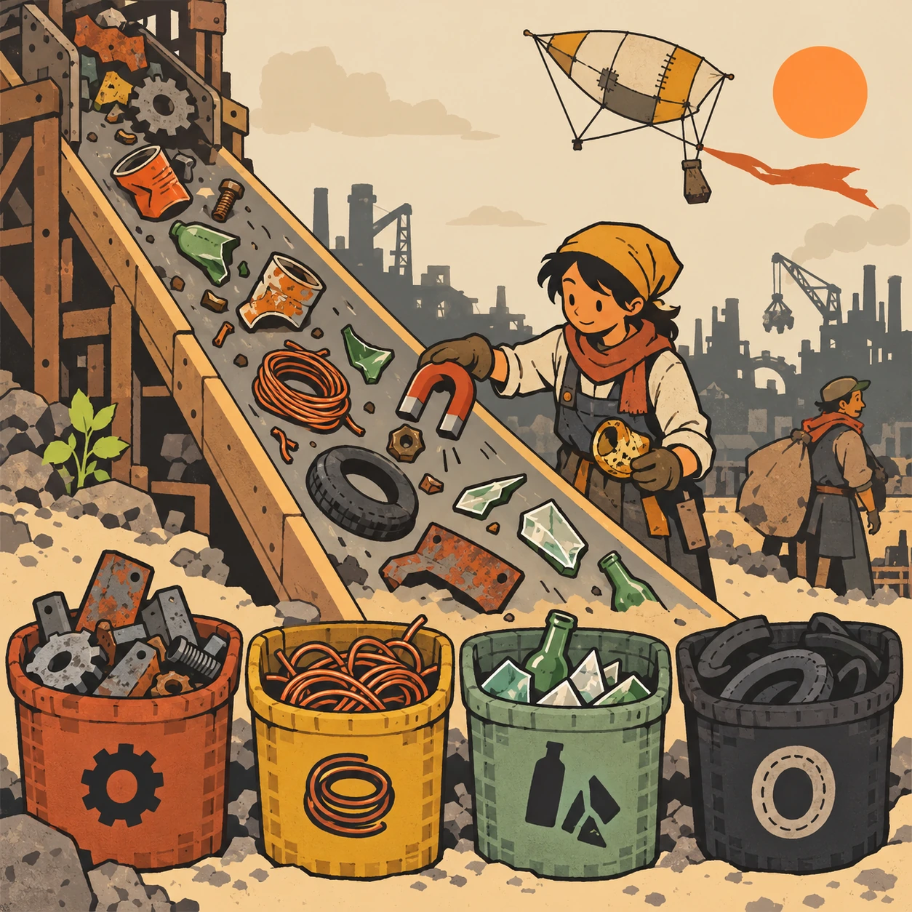
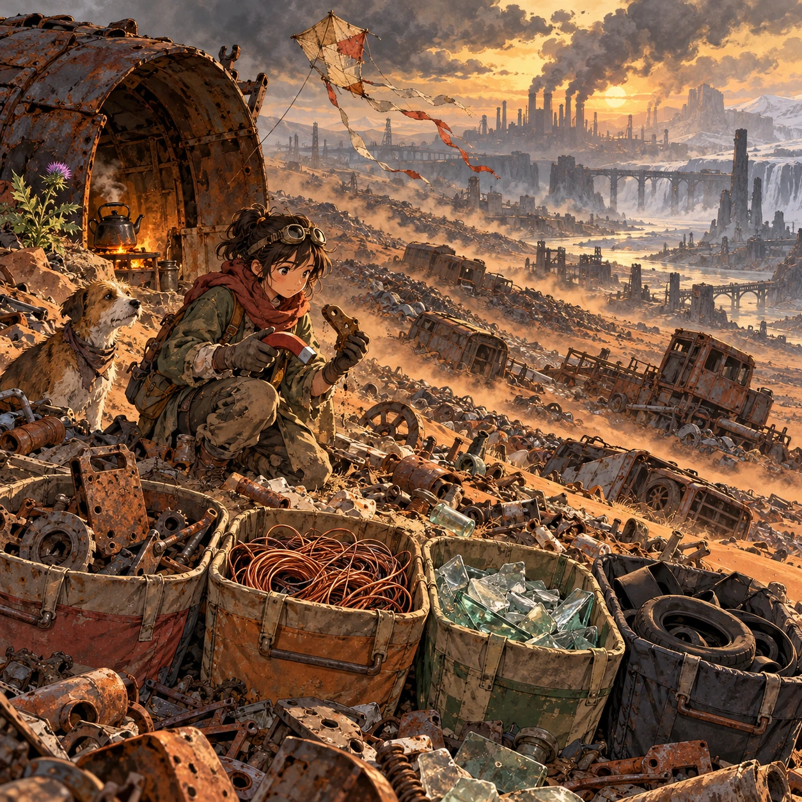
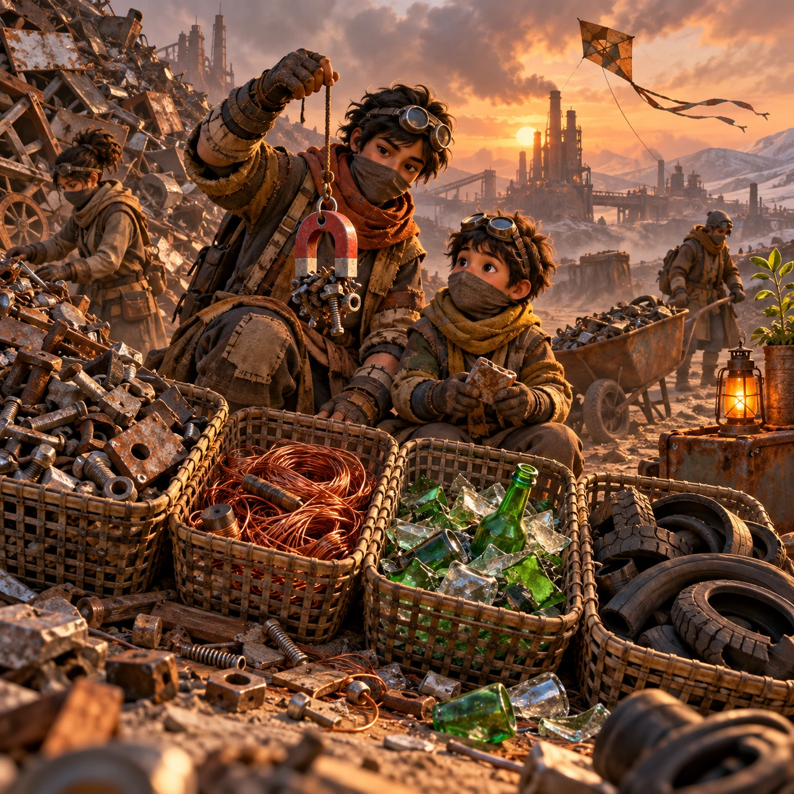
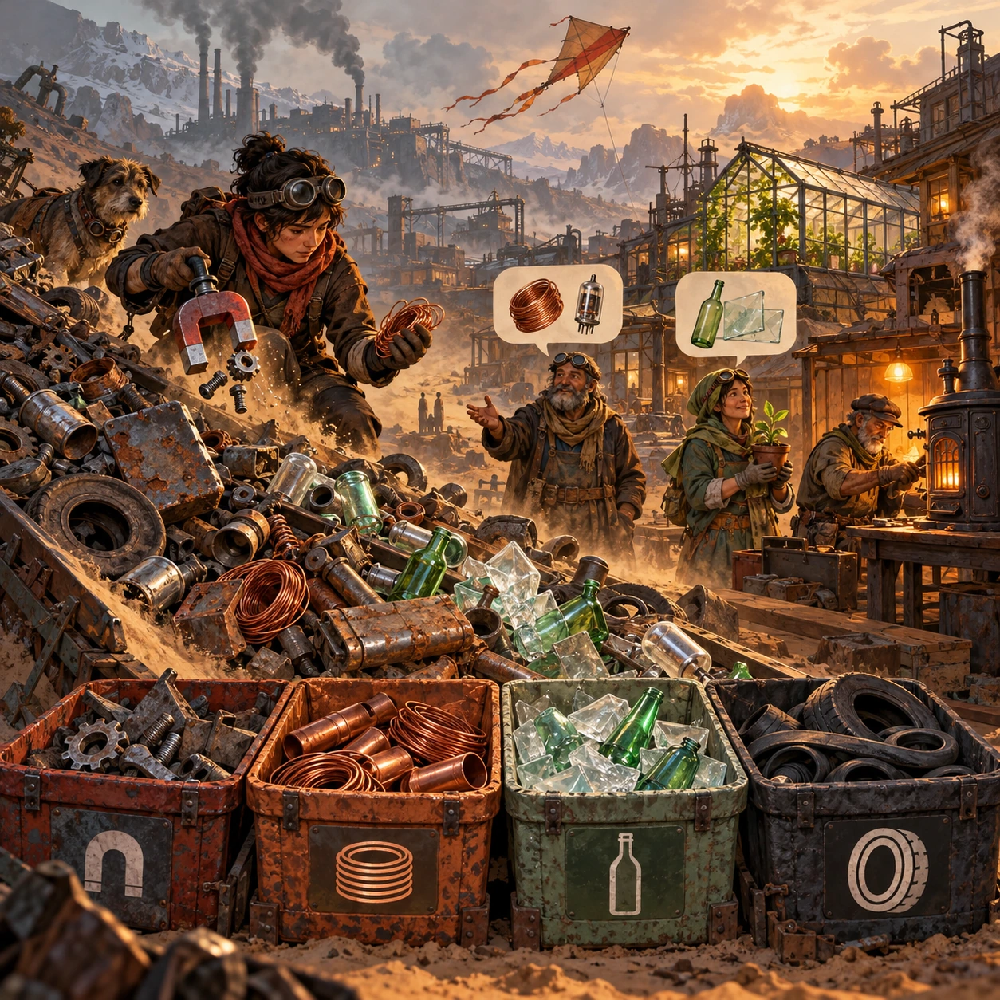

# Raker's Dune

SH-06 · [Shacados](../sh.md) · Cx 2 · Ages 10+ · Raya story catalog

**The idea:** A slope of rusted scrap tumbles gently down the screen. The player tests each piece with a magnet or a scratch and drops it into big baskets for iron, copper wire, glass and rubber, while a sack kite flies overhead.

| Decision             | Proposal                                                                                                                                                                                    |
| -------------------- | ------------------------------------------------------------------------------------------------------------------------------------------------------------------------------------------- |
| Familiar mechanic    | Sorting and salvage puzzle                                                                                                                                                                  |
| Learning objective   | Materials and their properties, sorting, reuse                                                                                                                                              |
| First prototype      | One authored challenge built around the interaction above, with a clear goal, immediate feedback, restart and unlimited retries.                                                            |
| Technology           | React + SVG/DOM; deterministic state, undo and seeded levels. Start with one local screen and touch plus keyboard input.                                                                    |
| Scope boundary       | One board and one rule set; defer accounts, multiplayer, procedural content and platform SDKs.                                                                                              |
| Reuse                | Shared input, saves, accessibility, seeded state and the shacados collection shell.                                                                                                         |
| Prototype acceptance | A player can identify the next action from the screen, complete one challenge, explain the practiced idea and restart without help. Check touch and keyboard play at narrow and wide sizes. |
| Main uncertainty     | Test whether the lesson follows from play and whether the first interaction is understandable without reading.                                                                              |

## Estimated plan

**First playable version:** One dune slope with gently tumbling scrap, magnet and scratch tests, four baskets and 12 picture requests from neighbors; the town view of finished builds is left for later.

| Measure              | Estimate                                                                                                   |
| -------------------- | ---------------------------------------------------------------------------------------------------------- |
| Youngest age         | 10+                                                                                                        |
| Toddler learnability | 1 of 5 — Needs reading, precise motor control, timing pressure or abstract rules; not a toddler game (6+). |
| Code                 | 1050 LOC, 8.8 days                                                                                         |
| Assets               | 126 hours, 20.9 days                                                                                       |
| Effort               | 29.7 days, risk 2 of 5                                                                                     |
| Start score          | 89.1 (rank 218 of 310; lower is better)                                                                    |

**Algorithms:** `sort-classify` (Sorting by attribute, 120 LOC) · `drag-drop-snap` (Drag and snap, 150 LOC) · `physics-2d` (2D physics, 300 LOC) · `tap-feedback` (Tap feedback, 80 LOC)

**Assets:** 40 sprites, 5 animations, 3 backgrounds, 3 UI screens, 15 sound effects, 1 music track, 10 voice lines, 12 authored levels, 40 content items

How the numbers are computed: [development plan](../../development-plan.md#how-the-scores-work).

## Story

Most people walked past the scrap dunes and saw garbage. Teyo saw a library. Iron sticks to the magnet. Copper shines when you scratch it. Green glass came from old medicine bottles, and good tubes still have a silver patch inside. One day a small boy followed him, kicking cans. Teyo gave him the magnet. Find me ten things that stick, he said. The boy came back with nine and a grin. That one did not stick, Teyo said, but it is copper, and copper is better. The boy kept the magnet. Teyo found another by noon.

> **Wisdom:** Every heap is full of answers.

## Four visual directions

These are independently generated concept proposals for selecting a prototype.
The four views compare gameplay readability, world appeal, tactile identity and
room to grow. They are not screenshots of an implemented game. Native image
dimensions, hashes, exact prompts and generation provenance are recorded in the
[art manifest](../art/sh-06/manifest.json); see the [generation notes](../README.md#image-generation-and-provenance).

The [core prompts](../jobs/sh.json) use IDs `sh-06/01-gameplay` to `sh-06/04-discovery`.

### Gameplay

A slope of rusted scrap tumbles gently down the screen. The player tests each piece with a magnet or a scratch and drops it into big baskets for iron, copper wire, glass and rubber, while a sack kite flies overhead.

### World

The scrap dunes: rolling hills of rusted machines, wheels, pipes and broken glass stretching to a smoky horizon. Red-brown dust blows across them in ribbons, and dead trucks lie where they stopped. A child flies a kite made from a grain sack. In the shade of an upturned boiler, a kettle sits on a small orange fire beside a single blooming thistle.

### Characters and materials

Rakers of all ages in layered patched clothes, goggles against the dust, scarves over noses and gloves sewn from old boot leather. Teyo carries a horseshoe magnet on a string and shows a younger boy how to use it. Woven wire baskets, a rusted wheelbarrow, sorted heaps of copper, green glass and iron. Rust, soot, mustard and ash, with one orange fire.

### Expanded play

Deeper in the dunes the player finds mixed treasures: tubes still good for radios, springs for menders, bottle glass for greenhouse panes. Requests from neighbors appear as pictures, a mender asking for copper, a gardener asking for glass. The final view shows a greenhouse, a working radio and a mended stove in town, each built from what the player sorted.

## Design checks before prototyping

- Learning target: **Materials and their properties, sorting, reuse**. Ask a domain reviewer to validate factual content in the mechanic.
- Keep goals cooperative or self-directed, using resources and needs. Avoid purchasable power. No pressure timers in the accessible mode.
- Use original layouts and character designs; the [legal checklist](../../legal.md) applies even when a mechanic is familiar.
- Choose the minimum [fidelity level](../../simulation-engine.md#determinism-and-fidelity-levels) the lesson needs; concept art does not establish scientific accuracy.
- Review silhouettes, text alternatives, reduced motion and non-color cues against the [adorability gate](../../lore/adorability-gate.md).
- Follow the age and tone rules of [Shacados](../../lore/shacados.md): dark but never hopeless, people never villains, the player never harms anyone.

Genre context: [existing genre research](../../../case-studies/issue-1/data/research-genres-ideas.md)
and [expansion research](../../../case-studies/issue-1/data/research-visual-catalog.md).

[← Sand, Charcoal, Cloth](sh-05.md) · [All concepts](../README.md) · [Lamplight Lessons →](sh-07.md)
