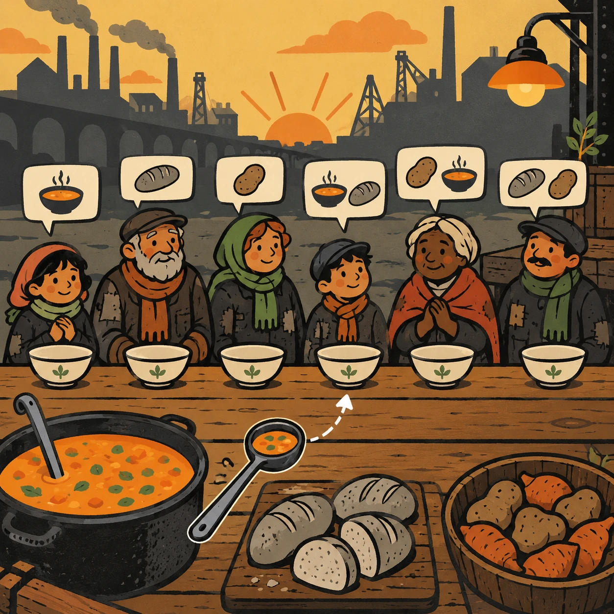
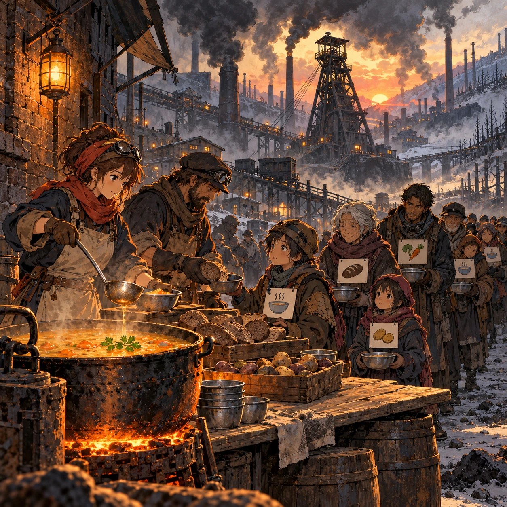
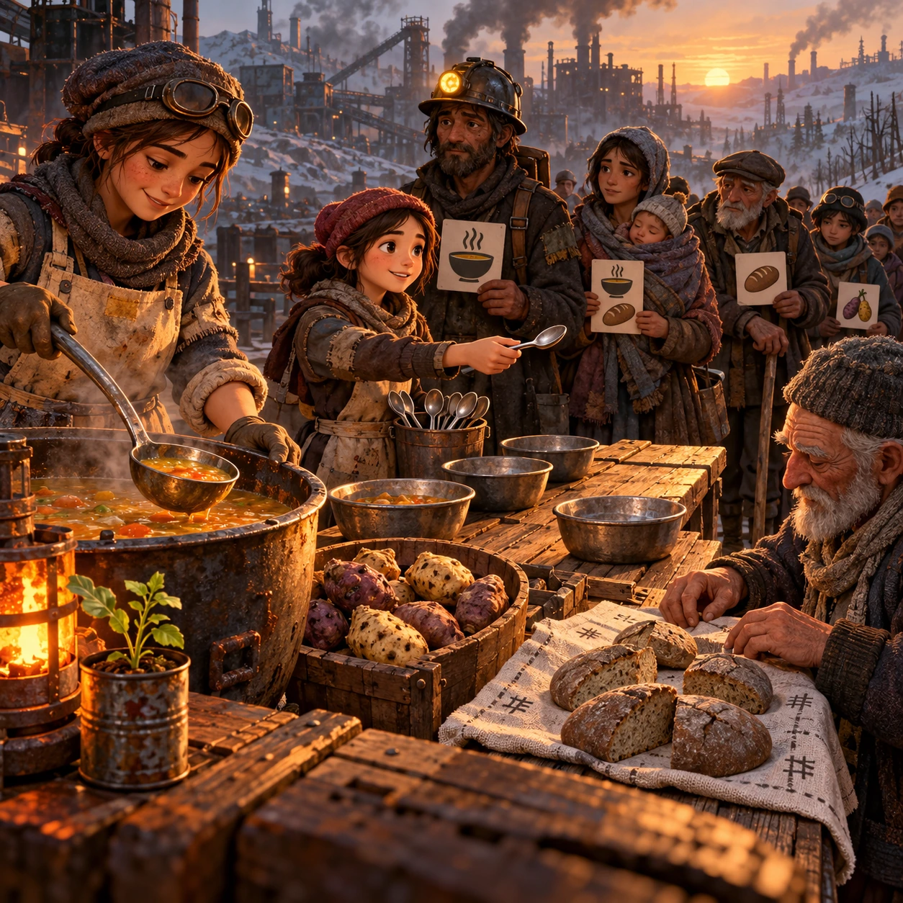
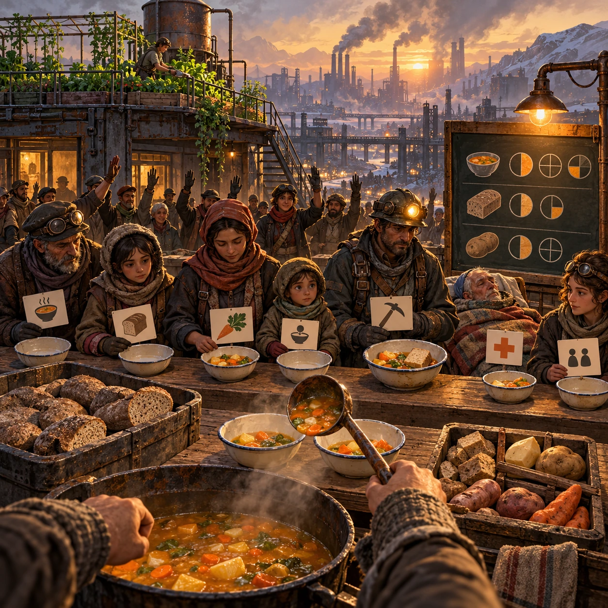

# The Fair Ladle

SH-08 · [Shacados](../sh.md) · Cx 3 · Ages 13+ · Raya story catalog

**The idea:** At a long plank soup table at dawn, the player drags ladles of soup, gray loaves and tubers into the bowls of a waiting line, each person showing a small picture of their need, until the cooperative agrees every share is fair.

| Decision             | Proposal                                                                                                                                                                                    |
| -------------------- | ------------------------------------------------------------------------------------------------------------------------------------------------------------------------------------------- |
| Familiar mechanic    | Cooperative sharing puzzle                                                                                                                                                                  |
| Learning objective   | Fair division, needs versus equal shares, fractions, empathy                                                                                                                                |
| First prototype      | One authored challenge built around the interaction above, with a clear goal, immediate feedback, restart and unlimited retries.                                                            |
| Technology           | React shell + PixiJS; use the shared simulation adapter only where motion or agent behavior requires it. Start with one bounded scene and measured frame time.                              |
| Scope boundary       | One bounded scenario and one core system; defer a full campaign, network play and production-scale content.                                                                                 |
| Reuse                | Shared input, saves, accessibility, seeded state and the shacados collection shell.                                                                                                         |
| Prototype acceptance | A player can identify the next action from the screen, complete one challenge, explain the practiced idea and restart without help. Check touch and keyboard play at narrow and wide sizes. |
| Main uncertainty     | Test whether the lesson follows from play and whether the first interaction is understandable without reading.                                                                              |

## Estimated plan

**First playable version:** The soup table, 14 mornings of short deliveries shared among a line of 8 to 16 people with visible needs and a cooperative show-of-hands vote; the week view and roof garden come later.

| Measure              | Estimate                                                                                                   |
| -------------------- | ---------------------------------------------------------------------------------------------------------- |
| Youngest age         | 13+                                                                                                        |
| Toddler learnability | 1 of 5 — Needs reading, precise motor control, timing pressure or abstract rules; not a toddler game (6+). |
| Code                 | 1750 LOC, 14.6 days                                                                                        |
| Assets               | 133 hours, 22.1 days                                                                                       |
| Effort               | 36.7 days, risk 3 of 5                                                                                     |
| Start score          | 110.1 (rank 243 of 310; lower is better)                                                                   |

**Algorithms:** `economy-sim` (Resource economy, 600 LOC) · `drag-drop-snap` (Drag and snap, 150 LOC) · `quest-state` (Quest and story state, 300 LOC)

**Assets:** 35 sprites, 6 animations, 3 backgrounds, 5 UI screens, 12 sound effects, 1 music track, 30 voice lines, 14 authored levels, 50 content items

How the numbers are computed: [development plan](../../development-plan.md#how-the-scores-work).

## Story

On the morning the grain cart came half full, the cooperative stood around the table in silence. There were sixty bowls and bread for forty. Split it the same, said one cook. The miners need more, said another. The baby needs milk, not bread, said a third. They argued quietly while the line waited in the cold. Then old Ferro, who had worked the mines for fifty years, set down his own bowl. Give mine to the mother, he said. I ate yesterday. One by one, others did the same. Nobody got enough. Everybody got some.

> **Wisdom:** Fair does not always mean the same.

## Four visual directions

These are independently generated concept proposals for selecting a prototype.
The four views compare gameplay readability, world appeal, tactile identity and
room to grow. They are not screenshots of an implemented game. Native image
dimensions, hashes, exact prompts and generation provenance are recorded in the
[art manifest](../art/sh-08/manifest.json); see the [generation notes](../README.md#image-generation-and-provenance).

The [core prompts](../jobs/sh.json) use IDs `sh-08/01-gameplay` to `sh-08/04-discovery`.

### Gameplay

At a long plank soup table at dawn, the player drags ladles of soup, gray loaves and tubers into the bowls of a waiting line, each person showing a small picture of their need, until the cooperative agrees every share is fair.

### World

A coal-town square at dawn under a sky thick with smoke. A long line of Hands waits with tin bowls beside a soot-streaked brick wall, while chimneys and a mine's winding tower rise behind them. Neighbors run a soup table of planks on barrels. A big kettle on a coal brazier gives the one warm orange glow, and a sprig of parsley floats in the pot.

### Characters and materials

Cooks in patched aprons and wool caps, a girl handing out spoons, an elder counting bread on a cloth. In line: a miner with a lamp helmet, a mother with a baby in a sling, an old man leaning on a crutch. Tin bowls, cracked ladles, gray loaves, knobby tubers and ration cards tucked into coat pockets. Rust, soot, mustard and ash, with one brazier.

### Expanded play

Harder mornings bring short deliveries, a newcomer with no ration card, a sick neighbor who cannot come and a miner starting a double shift. The player decides together with the cooperative, by a show of raised hands, and sees how the street fares over a week. The final view shows the cooperative's own small vegetable patch on a roof, now feeding the table.

## Design checks before prototyping

- Learning target: **Fair division, needs versus equal shares, fractions, empathy**. Ask a domain reviewer to validate factual content in the mechanic.
- Keep goals cooperative or self-directed, using resources and needs. Avoid purchasable power. No pressure timers in the accessible mode.
- Use original layouts and character designs; the [legal checklist](../../legal.md) applies even when a mechanic is familiar.
- Choose the minimum [fidelity level](../../simulation-engine.md#determinism-and-fidelity-levels) the lesson needs; concept art does not establish scientific accuracy.
- Review silhouettes, text alternatives, reduced motion and non-color cues against the [adorability gate](../../lore/adorability-gate.md).
- Follow the age and tone rules of [Shacados](../../lore/shacados.md): dark but never hopeless, people never villains, the player never harms anyone.

Genre context: [existing genre research](../../../case-studies/issue-1/data/research-genres-ideas.md)
and [expansion research](../../../case-studies/issue-1/data/research-visual-catalog.md).

[← Lamplight Lessons](sh-07.md) · [All concepts](../README.md) · [Seam Town Winter →](sh-09.md)
