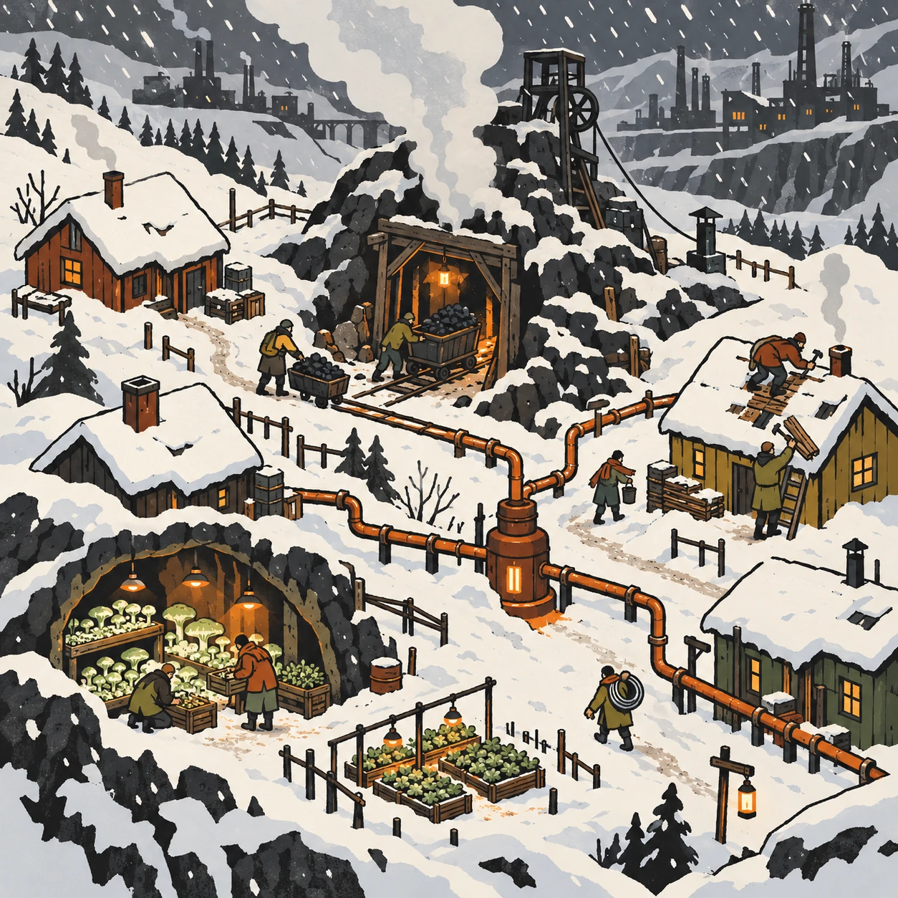
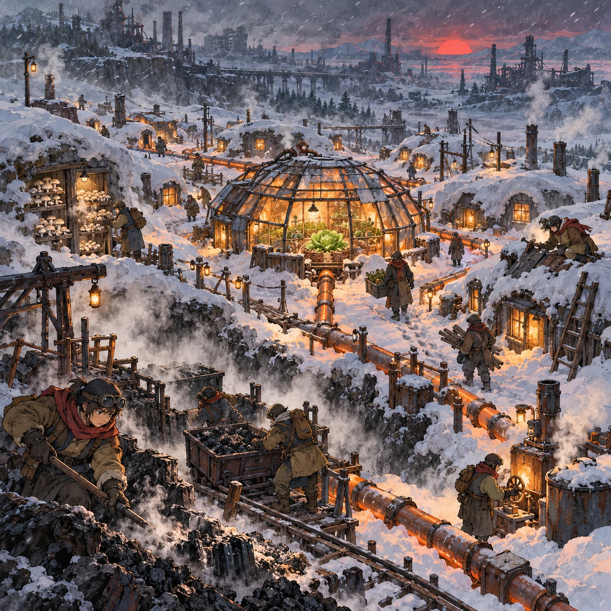
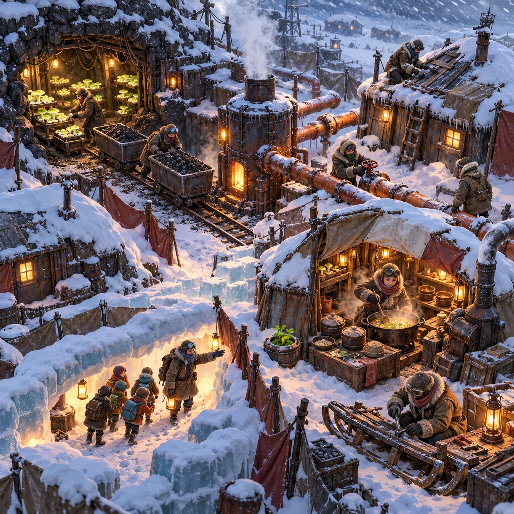
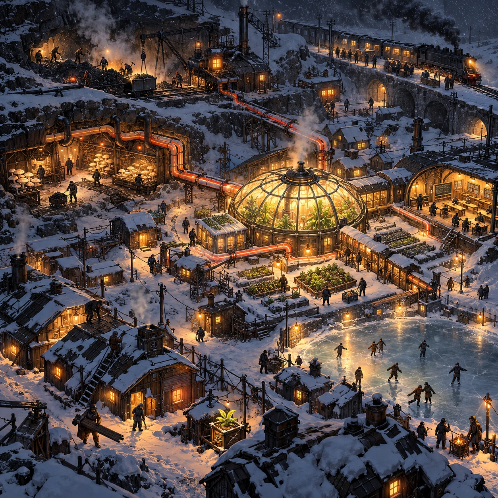

# Seam Town Winter

SH-09 · [Shacados](../sh.md) · Cx 4 · Ages 13+ · Raya story catalog

**The idea:** A top-down view of a small town half buried in snow around a steaming coal seam. The player assigns neighbors to dig coal, tend cave fungus and mend roofs, and lays warm pipes between huts as a blizzard rolls in.

| Decision             | Proposal                                                                                                                                                                                    |
| -------------------- | ------------------------------------------------------------------------------------------------------------------------------------------------------------------------------------------- |
| Familiar mechanic    | Survival town-building simulation                                                                                                                                                           |
| Learning objective   | Resource planning, community roles, heat and food chains                                                                                                                                    |
| First prototype      | One authored challenge built around the interaction above, with a clear goal, immediate feedback, restart and unlimited retries.                                                            |
| Technology           | React shell + PixiJS; use the shared simulation adapter only where motion or agent behavior requires it. Start with one bounded scene and measured frame time.                              |
| Scope boundary       | One bounded scenario and one core system; defer a full campaign, network play and production-scale content.                                                                                 |
| Reuse                | Shared input, saves, accessibility, seeded state and the shacados collection shell.                                                                                                         |
| Prototype acceptance | A player can identify the next action from the screen, complete one challenge, explain the practiced idea and restart without help. Check touch and keyboard play at narrow and wide sizes. |
| Main uncertainty     | Simulation accuracy and device cost need measured evidence before extending the scenario.                                                                                                   |

## Estimated plan

**First playable version:** One ice town on a small grid with coal, fungus, heat pipes and a greenhouse, neighbor roles and 6 winter scenarios with blizzards; trains, newcomers and the school are left out.

| Measure              | Estimate                                                                                                   |
| -------------------- | ---------------------------------------------------------------------------------------------------------- |
| Youngest age         | 13+                                                                                                        |
| Toddler learnability | 1 of 5 — Needs reading, precise motor control, timing pressure or abstract rules; not a toddler game (6+). |
| Code                 | 3020 LOC, 25.2 days                                                                                        |
| Assets               | 206 hours, 34.3 days                                                                                       |
| Effort               | 59.4 days, risk 4 of 5                                                                                     |
| Start score          | 178.2 (rank 293 of 310; lower is better)                                                                   |

**Algorithms:** `city-sim` (Settlement simulation, 800 LOC) · `weather-sim` (Weather and climate, 500 LOC) · `day-cycle` (Day and season cycle, 120 LOC) · `quest-state` (Quest and story state, 300 LOC)

**Assets:** 60 sprites, 12 animations, 4 backgrounds, 8 UI screens, 25 sound effects, 2 music tracks, 30 voice lines, 6 authored levels, 80 content items

How the numbers are computed: [development plan](../../development-plan.md#how-the-scores-work).

## Story

When the first blizzard came, the seam town had coal but little food, and the greenhouse had food but little heat. Each half could have kept what it had. Instead, the miners ran a pipe from the hot seam to the greenhouse, and the gardeners sent fungus soup down the mine. Nobody in the town was rich. Nobody in the town went hungry for long. In spring, a train arrived from the south with tired families aboard. The town did the only thing it knew how to do. It made room around the fire.

> **Wisdom:** Cold divides people, warmth gathers them.

## Four visual directions

These are independently generated concept proposals for selecting a prototype.
The four views compare gameplay readability, world appeal, tactile identity and
room to grow. They are not screenshots of an implemented game. Native image
dimensions, hashes, exact prompts and generation provenance are recorded in the
[art manifest](../art/sh-09/manifest.json); see the [generation notes](../README.md#image-generation-and-provenance).

The [core prompts](../jobs/sh.json) use IDs `sh-09/01-gameplay` to `sh-09/04-discovery`.

### Gameplay

A top-down view of a small town half buried in snow around a steaming coal seam. The player assigns neighbors to dig coal, tend cave fungus and mend roofs, and lays warm pipes between huts as a blizzard rolls in.

### World

An ice town in the frozen north: rows of huts dug into the snow around an open coal seam that steams in the cold. The chimneys of an older, buried town poke out of the drifts. The sky is pale gray with a red sun low on the horizon. At the town's heart a greenhouse dome of patched glass glows lamp orange, and inside it one cabbage is green.

### Characters and materials

Townsfolk in fur-lined patched parkas, frost-crusted goggles and scarves wrapped three times. A mender fixes a sled runner, a teacher leads children through a snow tunnel, a cook stirs fungus soup. Coal carts on rails, frosted rusted pipes, canvas windbreaks, ice-block walls and fungus trays in a mine tunnel. Ash, soot, rust and frost white, with one warm glow.

### Expanded play

Each winter grows longer and asks for new ideas: pipe the seam's waste heat under the greenhouse, open a school in the warm tunnel, swap fungus for medicine with a passing train, take in families from a town whose seam ran out. The final view shows the town at night from above, dark except the greenhouse dome, with people skating on a frozen pond in its light.

## Design checks before prototyping

- Learning target: **Resource planning, community roles, heat and food chains**. Ask a domain reviewer to validate factual content in the mechanic.
- Keep goals cooperative or self-directed, using resources and needs. Avoid purchasable power. No pressure timers in the accessible mode.
- Use original layouts and character designs; the [legal checklist](../../legal.md) applies even when a mechanic is familiar.
- Choose the minimum [fidelity level](../../simulation-engine.md#determinism-and-fidelity-levels) the lesson needs; concept art does not establish scientific accuracy.
- Review silhouettes, text alternatives, reduced motion and non-color cues against the [adorability gate](../../lore/adorability-gate.md).
- Follow the age and tone rules of [Shacados](../../lore/shacados.md): dark but never hopeless, people never villains, the player never harms anyone.

Genre context: [existing genre research](../../../case-studies/issue-1/data/research-genres-ideas.md)
and [expansion research](../../../case-studies/issue-1/data/research-visual-catalog.md).

[← The Fair Ladle](sh-08.md) · [All concepts](../README.md) · [Brann's Red Chalk →](sh-10.md)
