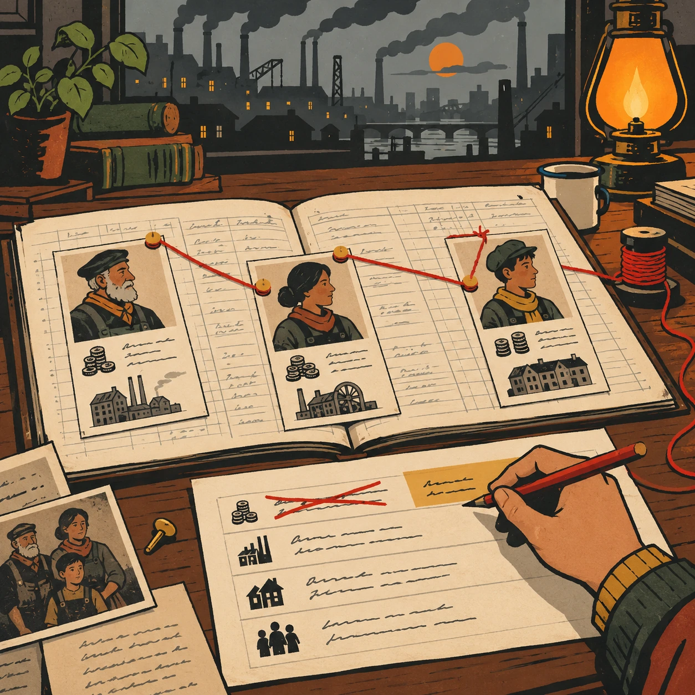
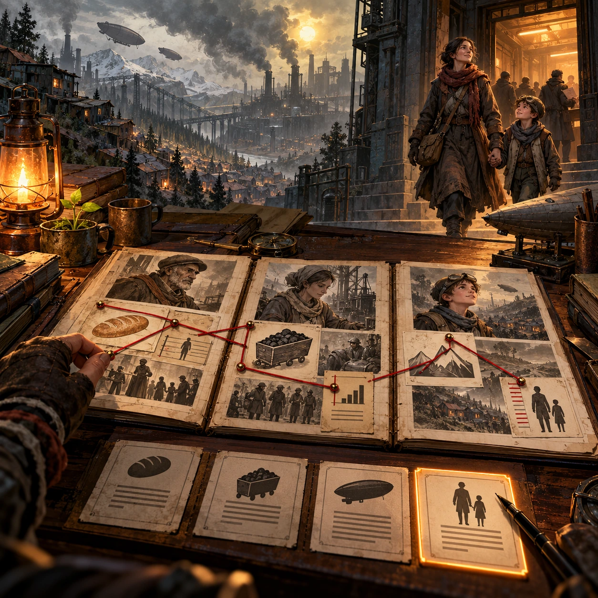

# The Heir's Ledger

SH-14 · [Shacados](../sh.md) · Cx 3 · Ages 13+ · Raya story catalog

**The idea:** On a wide desk, the player links entries across open ledger pages with red thread, tracing one family's debt through three generations, then chooses a single rule to strike out and rewrite.

| Decision             | Proposal                                                                                                                                                                                    |
| -------------------- | ------------------------------------------------------------------------------------------------------------------------------------------------------------------------------------------- |
| Familiar mechanic    | Investigation puzzle and narrative choice                                                                                                                                                   |
| Learning objective   | Cause and effect in systems, responsibility, change from within                                                                                                                             |
| First prototype      | One authored challenge built around the interaction above, with a clear goal, immediate feedback, restart and unlimited retries.                                                            |
| Technology           | React shell + PixiJS; use the shared simulation adapter only where motion or agent behavior requires it. Start with one bounded scene and measured frame time.                              |
| Scope boundary       | One bounded scenario and one core system; defer a full campaign, network play and production-scale content.                                                                                 |
| Reuse                | Shared input, saves, accessibility, seeded state and the shacados collection shell.                                                                                                         |
| Prototype acceptance | A player can identify the next action from the screen, complete one challenge, explain the practiced idea and restart without help. Check touch and keyboard play at narrow and wide sizes. |
| Main uncertainty     | Test whether the lesson follows from play and whether the first interaction is understandable without reading.                                                                              |

## Estimated plan

**First playable version:** The archive room, 8 ledger cases linked with red thread to reveal causes, short voiced scenes with the people behind them and one final rule to rewrite; a wider Hold simulation is left out.

| Measure              | Estimate                                                                                                   |
| -------------------- | ---------------------------------------------------------------------------------------------------------- |
| Youngest age         | 13+                                                                                                        |
| Toddler learnability | 1 of 5 — Needs reading, precise motor control, timing pressure or abstract rules; not a toddler game (6+). |
| Code                 | 1850 LOC, 15.4 days                                                                                        |
| Assets               | 136 hours, 22.7 days                                                                                       |
| Effort               | 38.1 days, risk 2 of 5                                                                                     |
| Start score          | 114.3 (rank 246 of 310; lower is better)                                                                   |

**Algorithms:** `graph-network` (Node-link graph, 300 LOC) · `dialogue-branching` (Branching dialogue, 300 LOC) · `quest-state` (Quest and story state, 300 LOC) · `hidden-object` (Hidden objects, 150 LOC)

**Assets:** 30 sprites, 5 animations, 4 backgrounds, 5 UI screens, 12 sound effects, 1 music track, 60 voice lines, 8 authored levels, 120 content items

How the numbers are computed: [development plan](../../development-plan.md#how-the-scores-work).

## Story

Vask grew up above the rocket yards and never went down. When his father fell ill, the ledgers came to him. He read them at night by one lamp. He found a mother who had flown twice to pay her father's debt. He found her son, already owing at six. The numbers never lied, but they never cried either. Vask could not change the whole Hold. His family would not let him. But he could change one line. In the morning he signed a new rule: no child inherits a debt. The clerk who read it had to sit down.

> **Wisdom:** Change one rule and many lives change.

## Four visual directions

These are independently generated concept proposals for selecting a prototype.
The four views compare gameplay readability, world appeal, tactile identity and
room to grow. They are not screenshots of an implemented game. Native image
dimensions, hashes, exact prompts and generation provenance are recorded in the
[art manifest](../art/sh-14/manifest.json); see the [generation notes](../README.md#image-generation-and-provenance).

The [core prompts](../jobs/sh.json) use IDs `sh-14/01-gameplay` to `sh-14/04-discovery`.

### Gameplay

On a wide desk, the player links entries across open ledger pages with red thread, tracing one family's debt through three generations, then chooses a single rule to strike out and rewrite.

### World

The archive tower of the Rocket Hold: a cold stone room with tall shelves of leather ledgers, a cast-iron radiator that never works and a high window looking down on the smoking rocket yards and shanty roofs. Dust floats in the gray light. A single desk lamp glows lamp orange, and a potted ivy, left by a clerk, climbs one shelf.

### Characters and materials

Holder Vask, a lonely young heir in a fine but worn dark coat, sleeves rolled up, wearing a knitted scarf a Hand once gave him. An old archivist in patched gray brings him more books. Leather ledgers with ink columns and no readable words, red thread, pins, a punched-card calculator and wax seals. Soot, ash, mustard and rust, with one lamp.

### Expanded play

Each ledger reveals a deeper link: the bread ration tied to the coal quota, launches placed over the poorest valleys, debts passed from parents to children. Short scenes show the people behind the numbers. In the end Vask may change only one rule, and the final view shows a mother and her son walking out of a debt office into smoky daylight, lighter than before.

## Design checks before prototyping

- Learning target: **Cause and effect in systems, responsibility, change from within**. Ask a domain reviewer to validate factual content in the mechanic.
- Keep goals cooperative or self-directed, using resources and needs. Avoid purchasable power. No pressure timers in the accessible mode.
- Use original layouts and character designs; the [legal checklist](../../legal.md) applies even when a mechanic is familiar.
- Choose the minimum [fidelity level](../../simulation-engine.md#determinism-and-fidelity-levels) the lesson needs; concept art does not establish scientific accuracy.
- Review silhouettes, text alternatives, reduced motion and non-color cues against the [adorability gate](../../lore/adorability-gate.md).
- Follow the age and tone rules of [Shacados](../../lore/shacados.md): dark but never hopeless, people never villains, the player never harms anyone.

Genre context: [existing genre research](../../../case-studies/issue-1/data/research-genres-ideas.md)
and [expansion research](../../../case-studies/issue-1/data/research-visual-catalog.md).

[← Kesh on the Ground](sh-13.md) · [All concepts](../README.md) · [Rain-Glass Garden →](sh-15.md)
