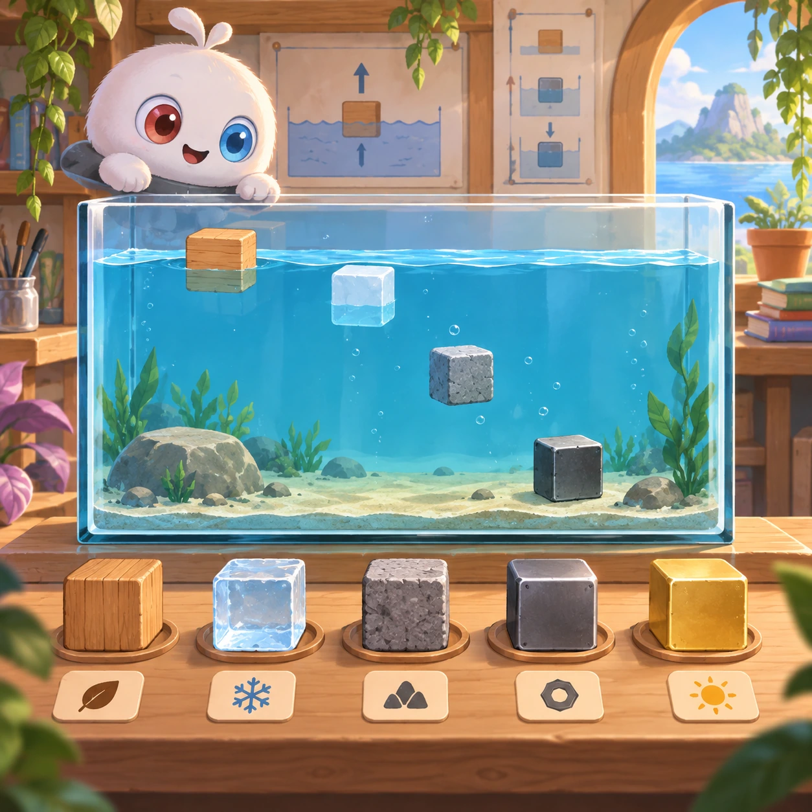
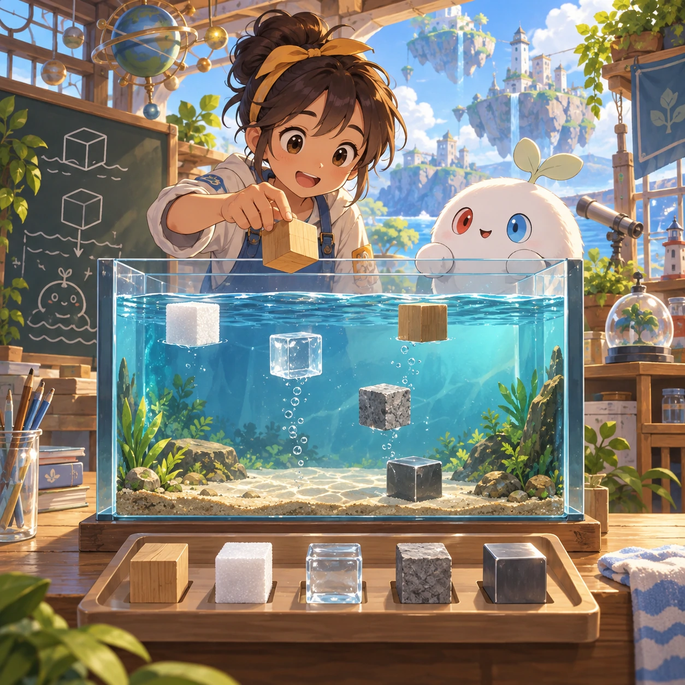
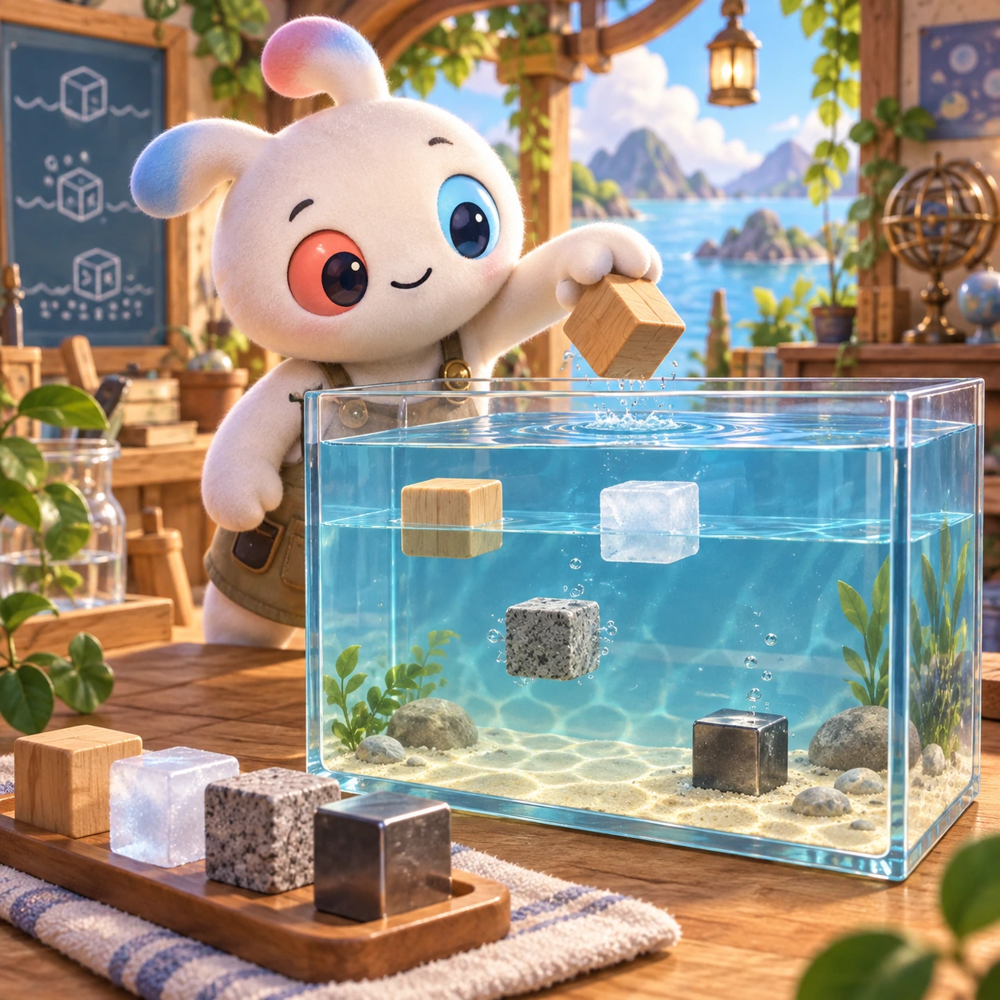
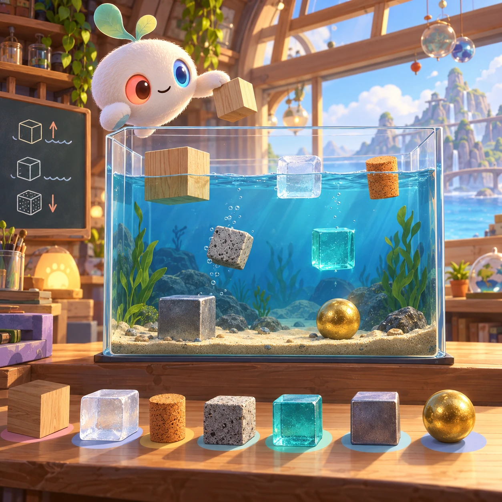

# Density Tank

SL-05 · [Science lab](../sl.md) · Cx 2–3 · Original catalog

**The idea:** Drop equal-volume objects of different densities into a clear water tank.

| Decision             | Proposal                                                                                                                                                                                    |
| -------------------- | ------------------------------------------------------------------------------------------------------------------------------------------------------------------------------------------- |
| Familiar mechanic    | Drop-and-see physics toy                                                                                                                                                                    |
| Learning objective   | Buoyancy, density                                                                                                                                                                           |
| First prototype      | One authored challenge built around the interaction above, with a clear goal, immediate feedback, restart and unlimited retries.                                                            |
| Technology           | React + SVG/DOM; deterministic state, undo and seeded levels. Start with one local screen and touch plus keyboard input.                                                                    |
| Scope boundary       | One board and one rule set; defer accounts, multiplayer, procedural content and platform SDKs.                                                                                              |
| Reuse                | Shared input, saves, accessibility, seeded state and the science lab collection shell.                                                                                                      |
| Prototype acceptance | A player can identify the next action from the screen, complete one challenge, explain the practiced idea and restart without help. Check touch and keyboard play at narrow and wide sizes. |
| Main uncertainty     | Test whether the lesson follows from play and whether the first interaction is understandable without reading.                                                                              |

## Estimated plan

**First playable version:** One water tank where 12 equal-size objects are dragged in to float or sink, with an optional guess-first mode over 10 rounds; changing the liquid and salt water are left for later.

| Measure              | Estimate                                                                                      |
| -------------------- | --------------------------------------------------------------------------------------------- |
| Youngest age         | 3+                                                                                            |
| Toddler learnability | 4 of 5 — Tap a specific big target or drag one object to a big slot; one-step goal; ages 2-3. |
| Code                 | 1270 LOC, 10.6 days                                                                           |
| Assets               | 91 hours, 15.1 days                                                                           |
| Effort               | 25.7 days, risk 2 of 5                                                                        |
| Start score          | 32.1 (rank 56 of 300; lower is better)                                                        |

**Algorithms:** `physics-2d` (2D physics, 300 LOC) · `drag-drop-snap` (Drag and snap, 150 LOC) · `particle-effects` (Particles, 150 LOC) · `sort-classify` (Sorting by attribute, 120 LOC)

**Assets:** 24 sprites, 4 animations, 2 backgrounds, 3 UI screens, 10 sound effects, 1 music track, 16 voice lines, 10 authored levels, 30 content items

How the numbers are computed: [development plan](../../development-plan.md#how-the-scores-work).

## Four visual directions

These are independently generated concept proposals for selecting a prototype.
The four views compare gameplay readability, world appeal, tactile identity and
room to grow. They are not screenshots of an implemented game. Native image
dimensions, hashes, exact prompts and generation provenance are recorded in the
[art manifest](../art/sl-05/manifest.json); see the [generation notes](../README.md#image-generation-and-provenance).

### Gameplay

### World

### Characters and materials

### Expanded play

## Design checks before prototyping

- Learning target: **Buoyancy, density**. Ask a domain reviewer to validate factual content in the mechanic.
- Keep goals cooperative or self-directed, using resources and needs. Avoid purchasable power. No pressure timers in the accessible mode.
- Use original layouts and character designs; the [legal checklist](../../legal.md) applies even when a mechanic is familiar.
- Choose the minimum [fidelity level](../../simulation-engine.md#determinism-and-fidelity-levels) the lesson needs; concept art does not establish scientific accuracy.
- Review silhouettes, text alternatives, reduced motion and non-color cues against the [adorability gate](../../lore/adorability-gate.md).

Genre context: [existing genre research](../../../case-studies/issue-1/data/research-genres-ideas.md)
and [expansion research](../../../case-studies/issue-1/data/research-visual-catalog.md).

[← Body Explorer](sl-04.md) · [All concepts](../README.md) · [Magnet Maze →](sl-06.md)
