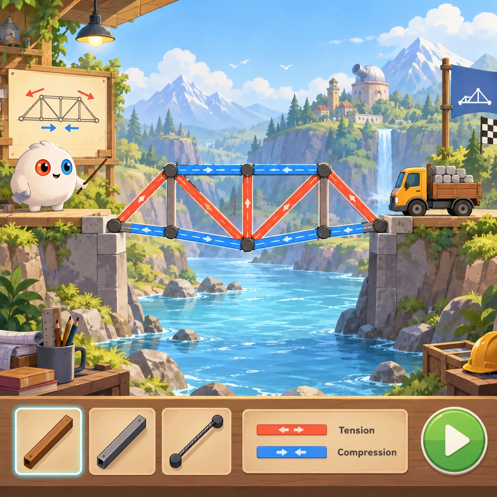
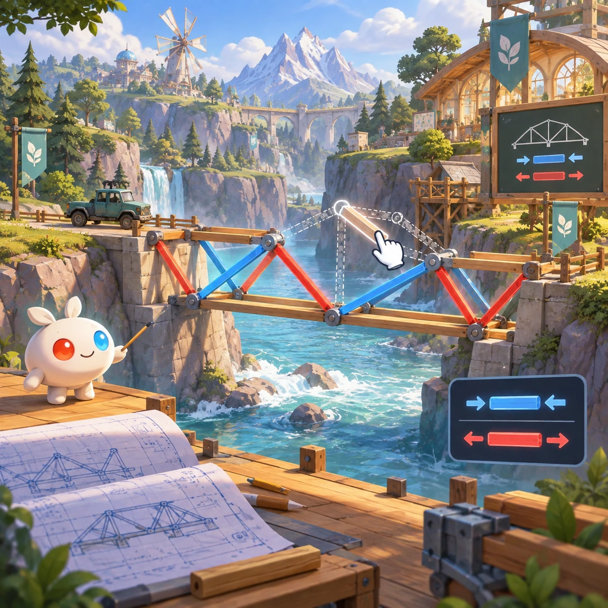
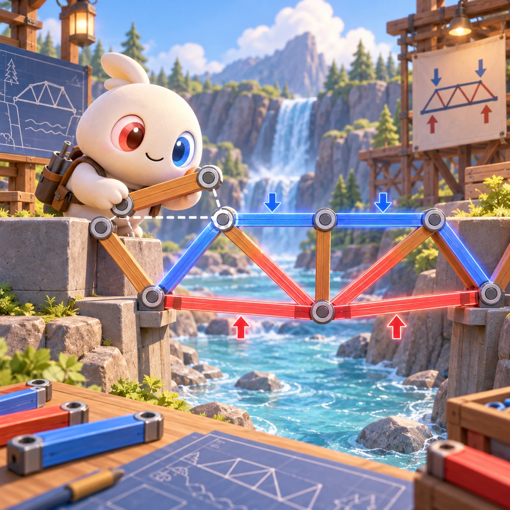
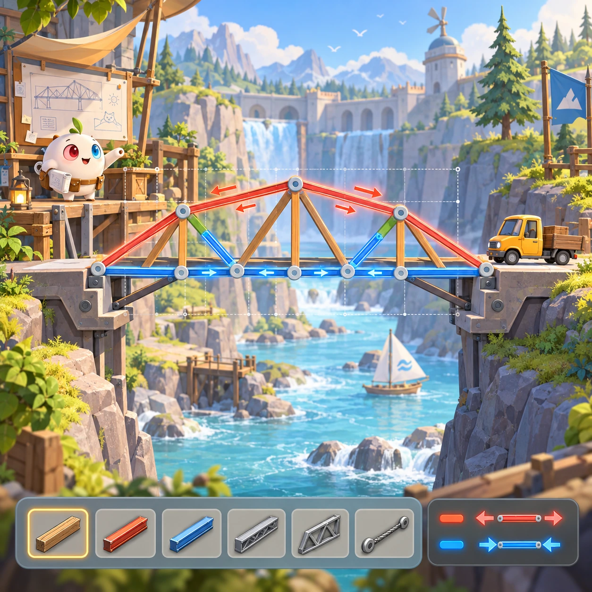

# Bridge Builder

SL-15 · [Science lab](../sl.md) · Cx 4 · Original catalog

**The idea:** Place bridge beams between riverbanks with tension and compression overlays.

| Decision             | Proposal                                                                                                                                                                                    |
| -------------------- | ------------------------------------------------------------------------------------------------------------------------------------------------------------------------------------------- |
| Familiar mechanic    | Bridge construction (Poly Bridge)                                                                                                                                                           |
| Learning objective   | Structural forces, tension and compression                                                                                                                                                  |
| First prototype      | One authored challenge built around the interaction above, with a clear goal, immediate feedback, restart and unlimited retries.                                                            |
| Technology           | React shell + PixiJS; use the shared simulation adapter only where motion or agent behavior requires it. Start with one bounded scene and measured frame time.                              |
| Scope boundary       | One bounded scenario and one core system; defer a full campaign, network play and production-scale content.                                                                                 |
| Reuse                | Shared input, saves, accessibility, seeded state and the science lab collection shell.                                                                                                      |
| Prototype acceptance | A player can identify the next action from the screen, complete one challenge, explain the practiced idea and restart without help. Check touch and keyboard play at narrow and wide sizes. |
| Main uncertainty     | Simulation accuracy and device cost need measured evidence before extending the scenario.                                                                                                   |

## Estimated plan

**First playable version:** A snap grid for beams and cables between riverbanks, a test run with a cart and tension and compression colors, over 20 authored crossings with a material limit; suspension decks and sharing are left out.

| Measure              | Estimate                                                                                                   |
| -------------------- | ---------------------------------------------------------------------------------------------------------- |
| Youngest age         | 7+                                                                                                         |
| Toddler learnability | 1 of 5 — Needs reading, precise motor control, timing pressure or abstract rules; not a toddler game (6+). |
| Code                 | 2500 LOC, 20.8 days                                                                                        |
| Assets               | 122 hours, 20.3 days                                                                                       |
| Effort               | 41.1 days, risk 2 of 5                                                                                     |
| Start score          | 123.3 (rank 246 of 300; lower is better)                                                                   |

**Algorithms:** `physics-2d` (2D physics, 300 LOC) · `graph-network` (Node-link graph, 300 LOC) · `drag-drop-snap` (Drag and snap, 150 LOC) · `grid-board` (Grid board, 150 LOC)

**Assets:** 25 sprites, 6 animations, 4 backgrounds, 6 UI screens, 14 sound effects, 1 music track, 12 voice lines, 20 authored levels, 15 content items

How the numbers are computed: [development plan](../../development-plan.md#how-the-scores-work).

## Four visual directions

These are independently generated concept proposals for selecting a prototype.
The four views compare gameplay readability, world appeal, tactile identity and
room to grow. They are not screenshots of an implemented game. Native image
dimensions, hashes, exact prompts and generation provenance are recorded in the
[art manifest](../art/sl-15/manifest.json); see the [generation notes](../README.md#image-generation-and-provenance).

### Gameplay

### World

### Characters and materials

### Expanded play

## Design checks before prototyping

- Learning target: **Structural forces, tension and compression**. Ask a domain reviewer to validate factual content in the mechanic.
- Keep goals cooperative or self-directed, using resources and needs. Avoid purchasable power. No pressure timers in the accessible mode.
- Use original layouts and character designs; the [legal checklist](../../legal.md) applies even when a mechanic is familiar.
- Choose the minimum [fidelity level](../../simulation-engine.md#determinism-and-fidelity-levels) the lesson needs; concept art does not establish scientific accuracy.
- Review silhouettes, text alternatives, reduced motion and non-color cues against the [adorability gate](../../lore/adorability-gate.md).

Genre context: [existing genre research](../../../case-studies/issue-1/data/research-genres-ideas.md)
and [expansion research](../../../case-studies/issue-1/data/research-visual-catalog.md).

[← Weather Maker](sl-14.md) · [All concepts](../README.md) · [Sand and Water →](sl-16.md)
