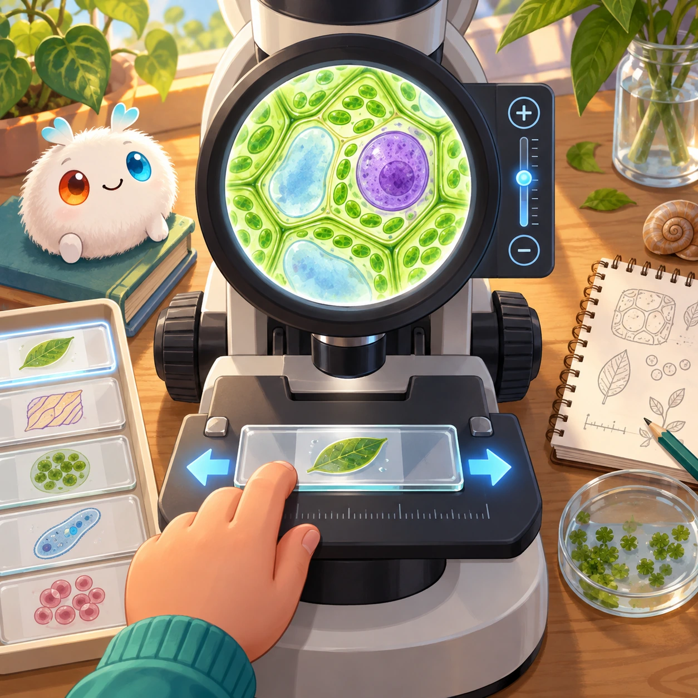
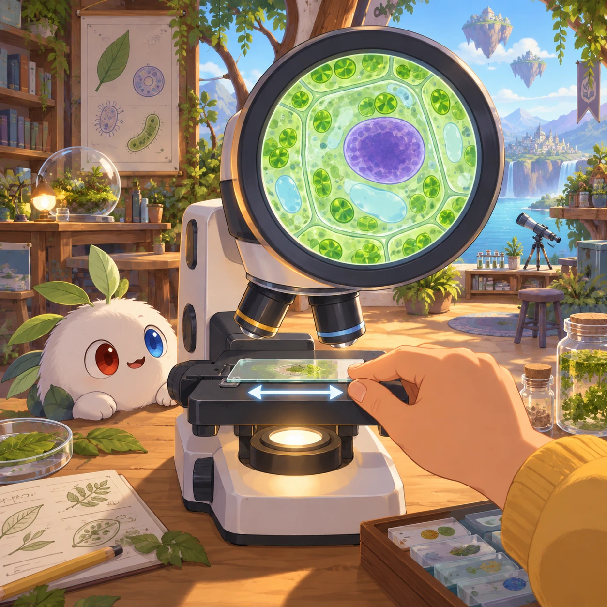
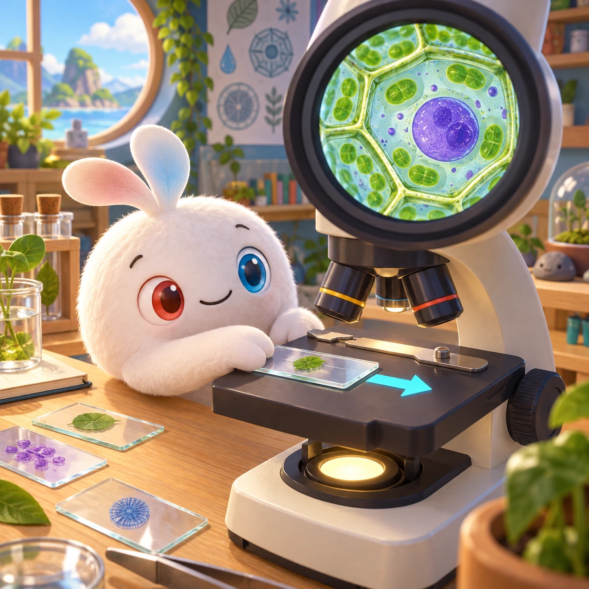
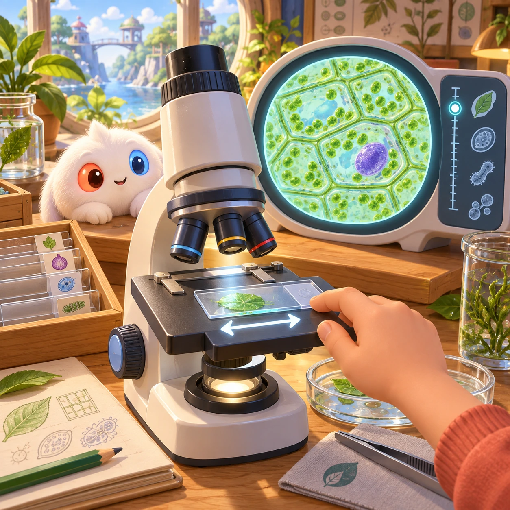

# Microscope Explorer

SL-17 · [Science lab](../sl.md) · Cx 4 · Original catalog

**The idea:** Move a microscope slide to observe a magnified cell with clearly drawn structures.

| Decision             | Proposal                                                                                                                                                                                    |
| -------------------- | ------------------------------------------------------------------------------------------------------------------------------------------------------------------------------------------- |
| Familiar mechanic    | Exploration / collection                                                                                                                                                                    |
| Learning objective   | Cells, microorganisms, scale                                                                                                                                                                |
| First prototype      | One authored challenge built around the interaction above, with a clear goal, immediate feedback, restart and unlimited retries.                                                            |
| Technology           | React shell + PixiJS; use the shared simulation adapter only where motion or agent behavior requires it. Start with one bounded scene and measured frame time.                              |
| Scope boundary       | One bounded scenario and one core system; defer a full campaign, network play and production-scale content.                                                                                 |
| Reuse                | Shared input, saves, accessibility, seeded state and the science lab collection shell.                                                                                                      |
| Prototype acceptance | A player can identify the next action from the screen, complete one challenge, explain the practiced idea and restart without help. Check touch and keyboard play at narrow and wide sizes. |
| Main uncertainty     | Simulation accuracy and device cost need measured evidence before extending the scenario.                                                                                                   |

## Estimated plan

**First playable version:** A microscope with three zoom steps and tap-to-zoom over 15 slides (cells, pond life, leaves) where moving microbes are found and added to a sticker journal; real camera input and staining are left out.

| Measure              | Estimate                                                                               |
| -------------------- | -------------------------------------------------------------------------------------- |
| Youngest age         | 5+                                                                                     |
| Toddler learnability | 2 of 5 — Needs simple rules, turns, a sequence or remembering several steps; ages 4-6. |
| Code                 | 2250 LOC, 18.8 days                                                                    |
| Assets               | 215 hours, 35.8 days                                                                   |
| Effort               | 54.6 days, risk 3 of 5                                                                 |
| Start score          | 109.2 (rank 231 of 300; lower is better)                                               |

**Algorithms:** `multi-touch` (Multi-touch gestures, 150 LOC) · `hidden-object` (Hidden objects, 150 LOC) · `sticker-scene` (Sticker scene, 200 LOC) · `agent-steering` (Agent steering, 350 LOC)

**Assets:** 50 sprites, 15 animations, 8 backgrounds, 6 UI screens, 14 sound effects, 2 music tracks, 30 voice lines, 15 authored levels, 80 content items

How the numbers are computed: [development plan](../../development-plan.md#how-the-scores-work).

## Four visual directions

These are independently generated concept proposals for selecting a prototype.
The four views compare gameplay readability, world appeal, tactile identity and
room to grow. They are not screenshots of an implemented game. Native image
dimensions, hashes, exact prompts and generation provenance are recorded in the
[art manifest](../art/sl-17/manifest.json); see the [generation notes](../README.md#image-generation-and-provenance).

### Gameplay

### World

### Characters and materials

### Expanded play

## Design checks before prototyping

- Learning target: **Cells, microorganisms, scale**. Ask a domain reviewer to validate factual content in the mechanic.
- Keep goals cooperative or self-directed, using resources and needs. Avoid purchasable power. No pressure timers in the accessible mode.
- Use original layouts and character designs; the [legal checklist](../../legal.md) applies even when a mechanic is familiar.
- Choose the minimum [fidelity level](../../simulation-engine.md#determinism-and-fidelity-levels) the lesson needs; concept art does not establish scientific accuracy.
- Review silhouettes, text alternatives, reduced motion and non-color cues against the [adorability gate](../../lore/adorability-gate.md).

Genre context: [existing genre research](../../../case-studies/issue-1/data/research-genres-ideas.md)
and [expansion research](../../../case-studies/issue-1/data/research-visual-catalog.md).

[← Sand and Water](sl-16.md) · [All concepts](../README.md) · [Momentum Pinball →](sl-18.md)
