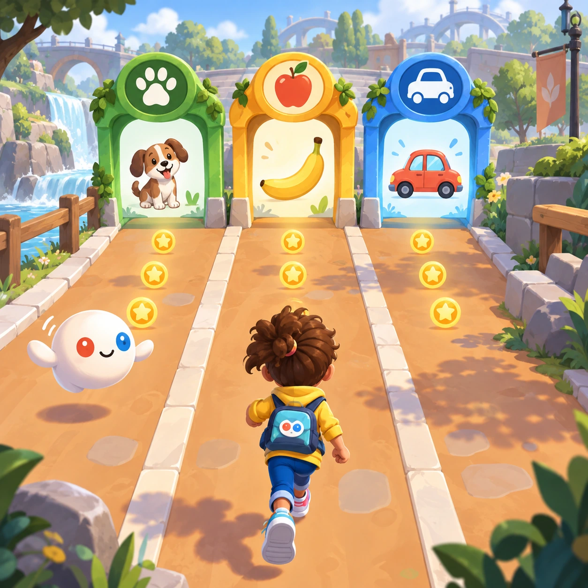
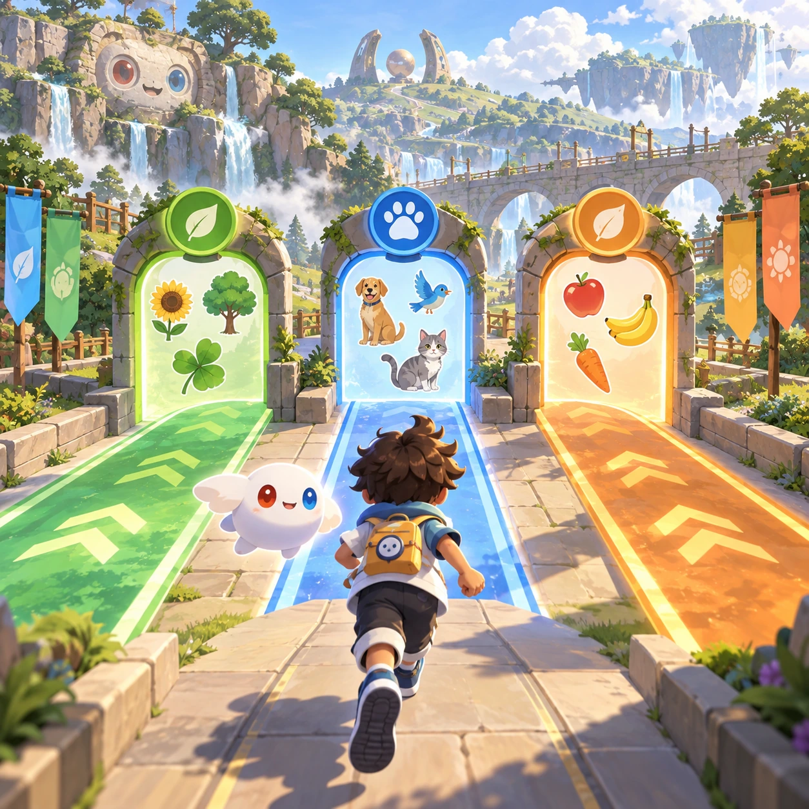
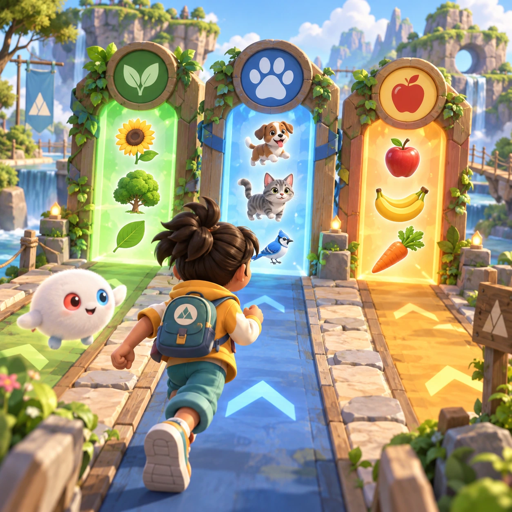
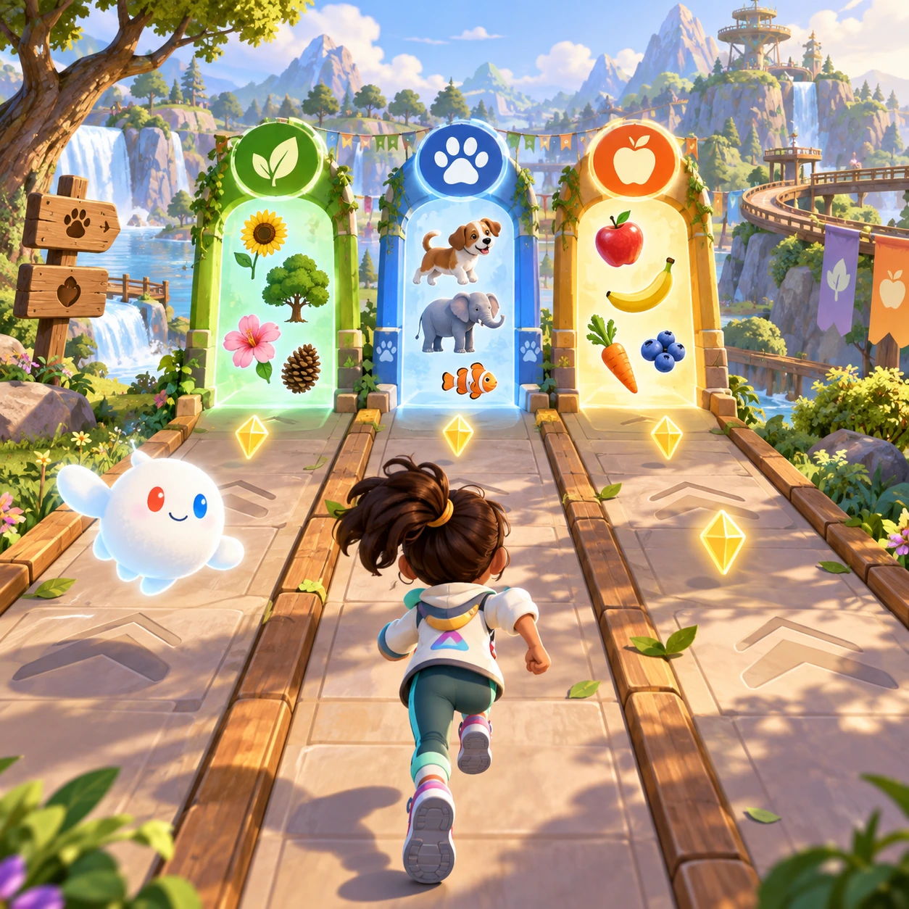
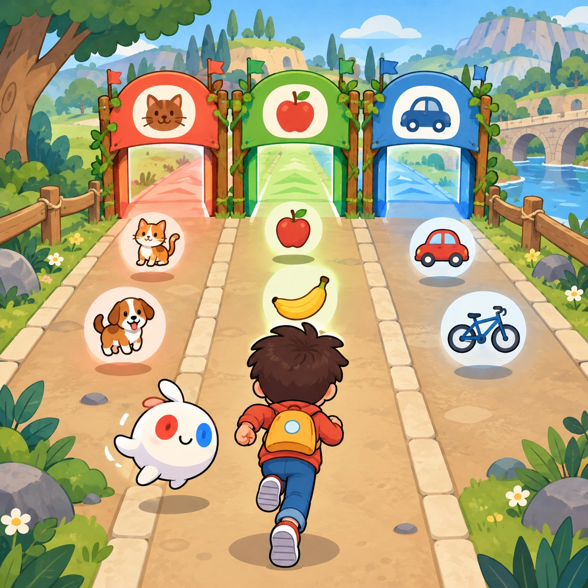
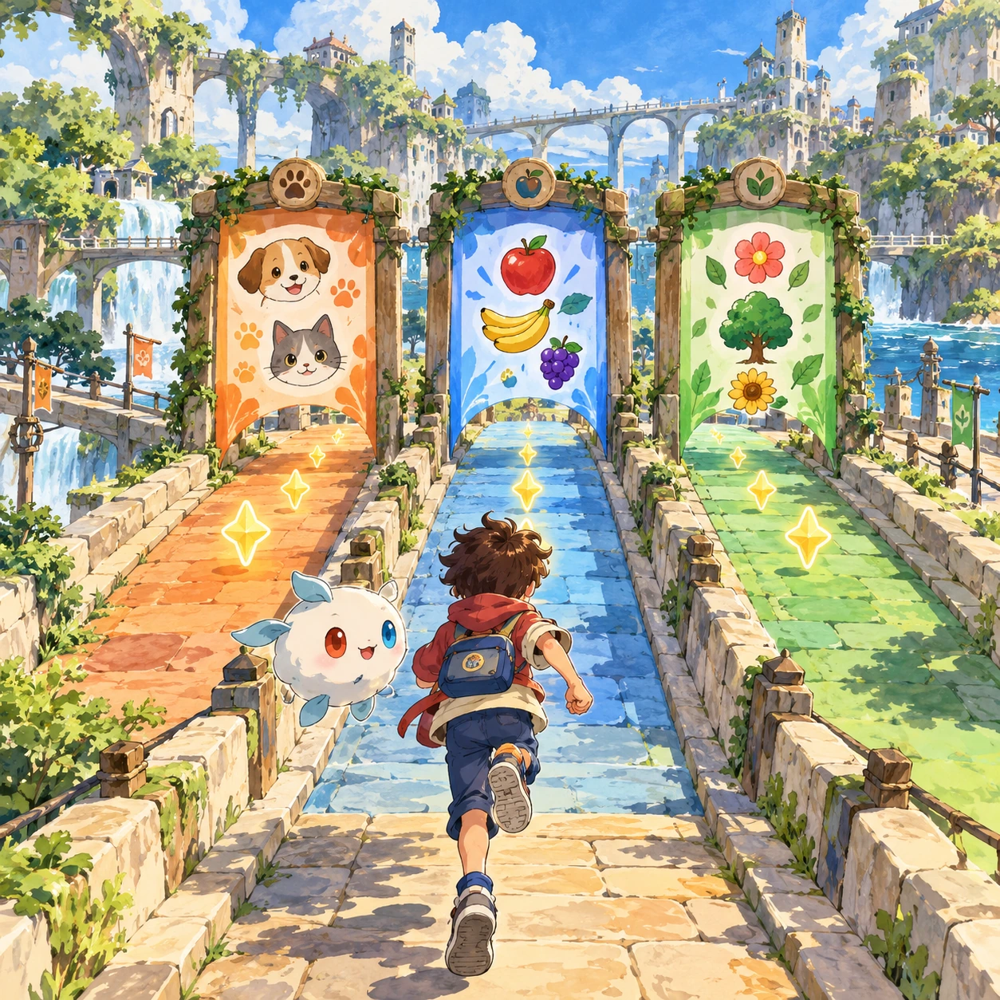

# Linky Run

SM-02 · [Sports and motion](../sm.md) · Cx 2–3 · W2 · Original catalog

**The idea:** Guide a runner between three lanes of picture-category gates.

| Decision             | Proposal                                                                                                                                                                                    |
| -------------------- | ------------------------------------------------------------------------------------------------------------------------------------------------------------------------------------------- |
| Familiar mechanic    | Endless runner                                                                                                                                                                              |
| Learning objective   | Categories (lanes), quick recall                                                                                                                                                            |
| First prototype      | One authored challenge built around the interaction above, with a clear goal, immediate feedback, restart and unlimited retries.                                                            |
| Technology           | React + SVG/DOM; deterministic state, undo and seeded levels. Start with one local screen and touch plus keyboard input.                                                                    |
| Scope boundary       | One board and one rule set; defer accounts, multiplayer, procedural content and platform SDKs.                                                                                              |
| Reuse                | Shared input, saves, accessibility, seeded state and the sports and motion collection shell.                                                                                                |
| Prototype acceptance | A player can identify the next action from the screen, complete one challenge, explain the practiced idea and restart without help. Check touch and keyboard play at narrow and wide sizes. |
| Main uncertainty     | Test whether the lesson follows from play and whether the first interaction is understandable without reading.                                                                              |

## Estimated plan

**First playable version:** A slow three-lane runner where tapping or swiping picks the gate matching a voiced category, with 80 picture items across 6 category tracks; speed-up modes, coins and leaderboards are left out.

| Measure              | Estimate                                                                               |
| -------------------- | -------------------------------------------------------------------------------------- |
| Youngest age         | 4+                                                                                     |
| Toddler learnability | 2 of 5 — Needs simple rules, turns, a sequence or remembering several steps; ages 4-6. |
| Code                 | 1390 LOC, 11.6 days                                                                    |
| Assets               | 154 hours, 25.6 days                                                                   |
| Effort               | 37.2 days, risk 2 of 5                                                                 |
| Start score          | 74.4 (rank 188 of 310; lower is better)                                                |

**Algorithms:** `runner-loop` (Endless runner, 350 LOC) · `swipe-gesture` (Swipe gestures, 80 LOC) · `tap-feedback` (Tap feedback, 80 LOC) · `sort-classify` (Sorting by attribute, 120 LOC) · `shuffle-deal` (Seeded shuffle and deal, 60 LOC)

**Assets:** 40 sprites, 10 animations, 4 backgrounds, 4 UI screens, 12 sound effects, 2 music tracks, 25 voice lines, 6 authored levels, 80 content items

How the numbers are computed: [development plan](../../development-plan.md#how-the-scores-work).

## Four visual directions

These are independently generated concept proposals for selecting a prototype.
The four views compare gameplay readability, world appeal, tactile identity and
room to grow. Two additional core-screen alternatives make the flat storybook and painted anime styles explicit alongside the tactile 3D study. They are not screenshots of an implemented game. Native image
dimensions, hashes, exact prompts and generation provenance are recorded in the
[art manifest](../art/sm-02/manifest.json); see the [generation notes](../README.md#image-generation-and-provenance).

The [core prompts](../jobs/sm.json) use IDs `sm-02/01-gameplay` to `sm-02/04-discovery`. Additional [style prompts](../jobs/style-variations.json) match the two alternatives below.

### Gameplay

### World

### Characters and materials

### Expanded play

## Additional style alternatives

### Flat storybook alternative

### Painted anime alternative

## Design checks before prototyping

- Learning target: **Categories (lanes), quick recall**. Ask a domain reviewer to validate factual content in the mechanic.
- Keep goals cooperative or self-directed, using resources and needs. Avoid purchasable power. No pressure timers in the accessible mode.
- Use original layouts and character designs; the [legal checklist](../../legal.md) applies even when a mechanic is familiar.
- Choose the minimum [fidelity level](../../simulation-engine.md#determinism-and-fidelity-levels) the lesson needs; concept art does not establish scientific accuracy.
- Review silhouettes, text alternatives, reduced motion and non-color cues against the [adorability gate](../../lore/adorability-gate.md).

Genre context: [existing genre research](../../../case-studies/issue-1/data/research-genres-ideas.md)
and [expansion research](../../../case-studies/issue-1/data/research-visual-catalog.md).

[← Juggle](sm-01.md) · [All concepts](../README.md) · [Mini Golf →](sm-03.md)
