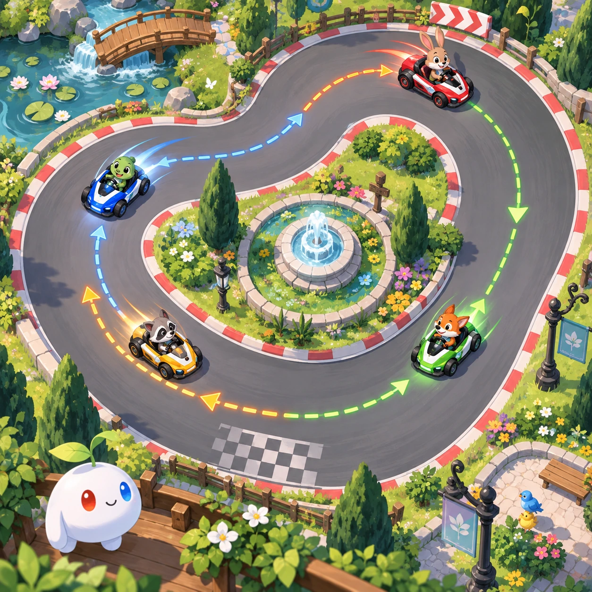
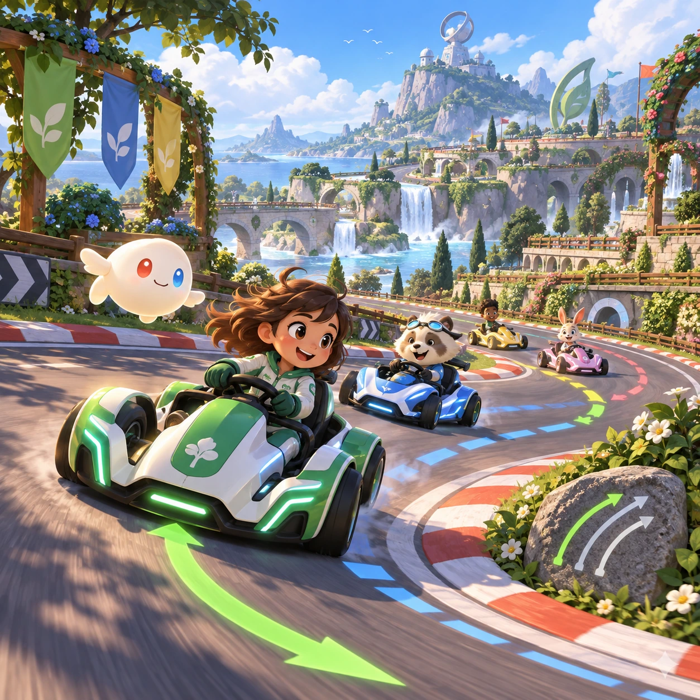
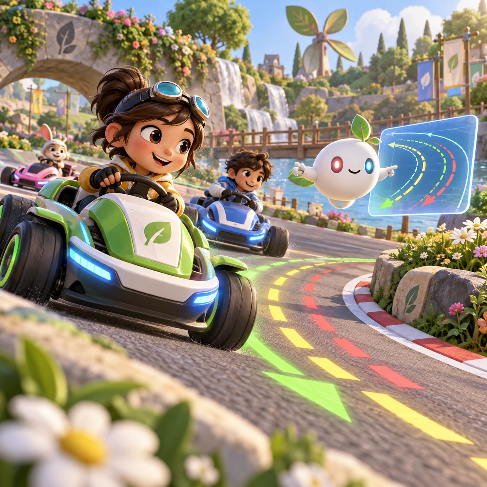
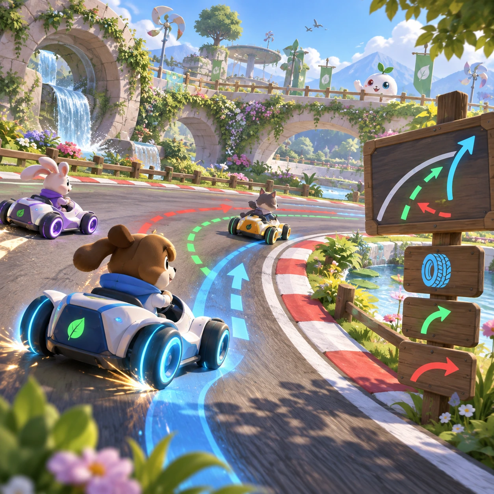

# Kart Friends

SM-11 · [Sports and motion](../sm.md) · Cx 4 · Original catalog

**The idea:** Drive friendly electric karts along an original garden circuit with visible racing lines.

| Decision             | Proposal                                                                                                                                                                                    |
| -------------------- | ------------------------------------------------------------------------------------------------------------------------------------------------------------------------------------------- |
| Familiar mechanic    | Kart racing (no items that hurt)                                                                                                                                                            |
| Learning objective   | Vectors, grip, racing lines                                                                                                                                                                 |
| First prototype      | One authored challenge built around the interaction above, with a clear goal, immediate feedback, restart and unlimited retries.                                                            |
| Technology           | React shell + PixiJS; use the shared simulation adapter only where motion or agent behavior requires it. Start with one bounded scene and measured frame time.                              |
| Scope boundary       | One bounded scenario and one core system; defer a full campaign, network play and production-scale content.                                                                                 |
| Reuse                | Shared input, saves, accessibility, seeded state and the sports and motion collection shell.                                                                                                |
| Prototype acceptance | A player can identify the next action from the screen, complete one challenge, explain the practiced idea and restart without help. Check touch and keyboard play at narrow and wide sizes. |
| Main uncertainty     | Simulation accuracy and device cost need measured evidence before extending the scenario.                                                                                                   |

## Estimated plan

**First playable version:** 4 top-down garden circuits with friendly electric karts, auto-accelerate, grip and a racing line overlay, and 3 kind AI drivers; items, online play and cups are left out.

| Measure              | Estimate                                                                               |
| -------------------- | -------------------------------------------------------------------------------------- |
| Youngest age         | 5+                                                                                     |
| Toddler learnability | 2 of 5 — Needs simple rules, turns, a sequence or remembering several steps; ages 4-6. |
| Code                 | 2800 LOC, 23.3 days                                                                    |
| Assets               | 164 hours, 27.3 days                                                                   |
| Effort               | 50.6 days, risk 3 of 5                                                                 |
| Start score          | 101.2 (rank 219 of 300; lower is better)                                               |

**Algorithms:** `vehicle-sim` (Vehicle handling, 500 LOC) · `agent-steering` (Agent steering, 350 LOC) · `particle-effects` (Particles, 150 LOC)

**Assets:** 40 sprites, 12 animations, 4 backgrounds, 8 UI screens, 16 sound effects, 3 music tracks, 15 voice lines, 4 authored levels, 10 content items

How the numbers are computed: [development plan](../../development-plan.md#how-the-scores-work).

## Four visual directions

These are independently generated concept proposals for selecting a prototype.
The four views compare gameplay readability, world appeal, tactile identity and
room to grow. They are not screenshots of an implemented game. Native image
dimensions, hashes, exact prompts and generation provenance are recorded in the
[art manifest](../art/sm-11/manifest.json); see the [generation notes](../README.md#image-generation-and-provenance).

### Gameplay

### World

### Characters and materials

### Expanded play

## Design checks before prototyping

- Learning target: **Vectors, grip, racing lines**. Ask a domain reviewer to validate factual content in the mechanic.
- Keep goals cooperative or self-directed, using resources and needs. Avoid purchasable power. No pressure timers in the accessible mode.
- Use original layouts and character designs; the [legal checklist](../../legal.md) applies even when a mechanic is familiar.
- Choose the minimum [fidelity level](../../simulation-engine.md#determinism-and-fidelity-levels) the lesson needs; concept art does not establish scientific accuracy.
- Review silhouettes, text alternatives, reduced motion and non-color cues against the [adorability gate](../../lore/adorability-gate.md).

Genre context: [existing genre research](../../../case-studies/issue-1/data/research-genres-ideas.md)
and [expansion research](../../../case-studies/issue-1/data/research-visual-catalog.md).

[← Table Tennis](sm-10.md) · [All concepts](../README.md) · [Sailing →](sm-12.md)
