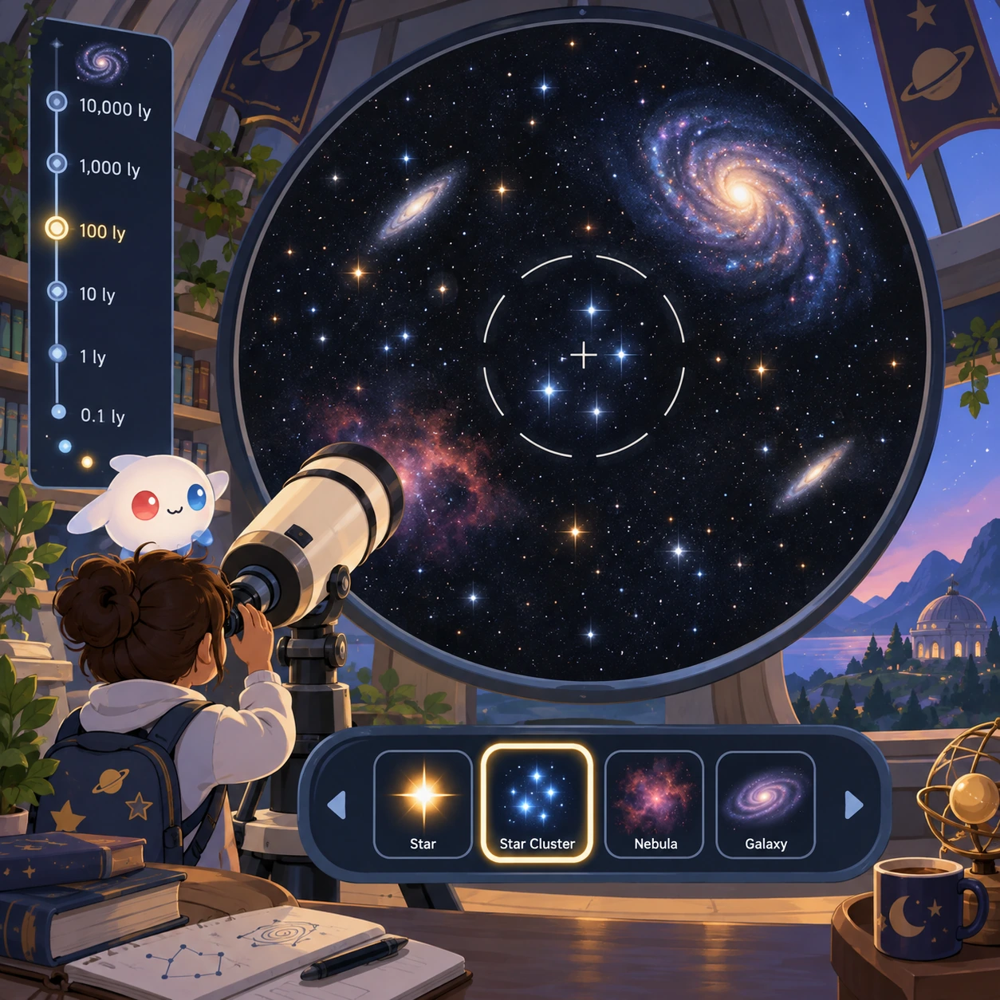
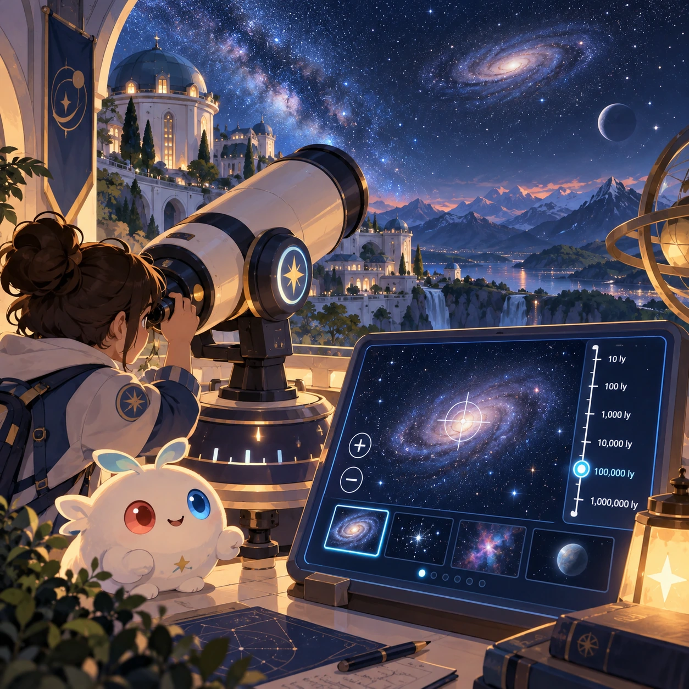
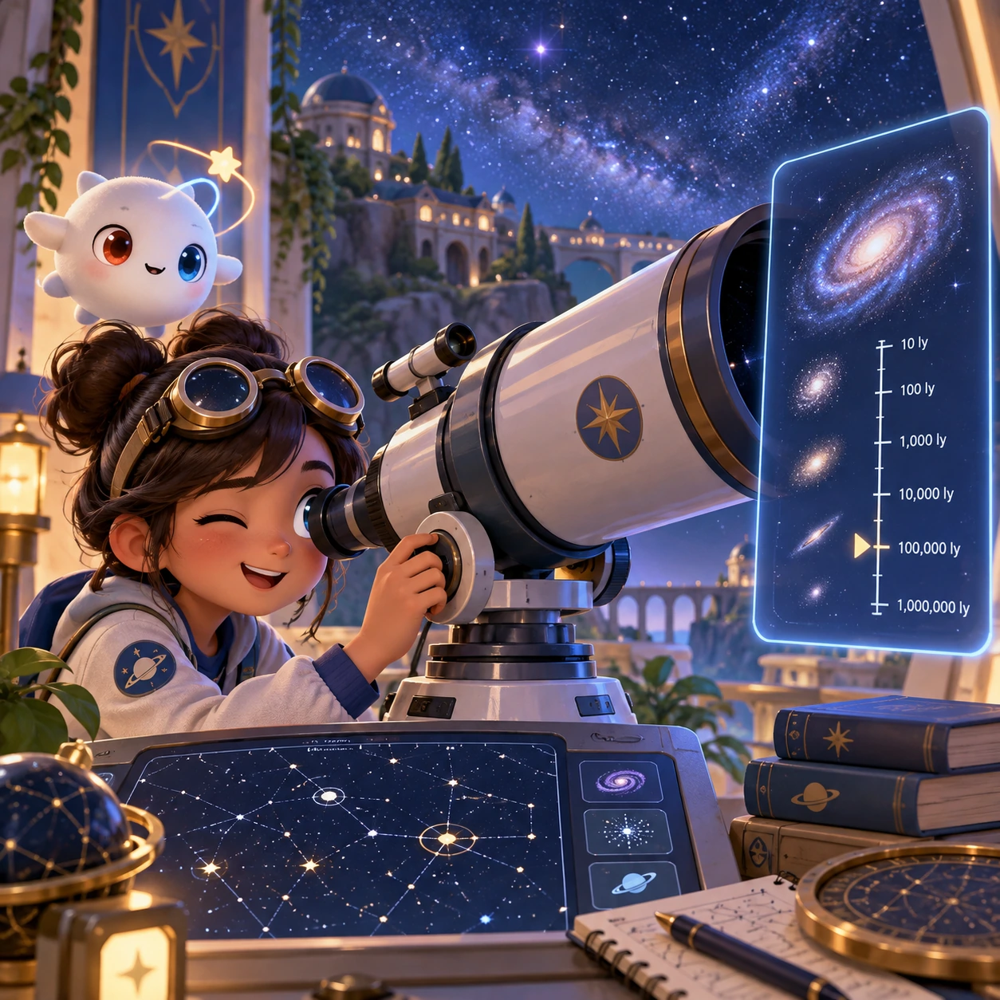
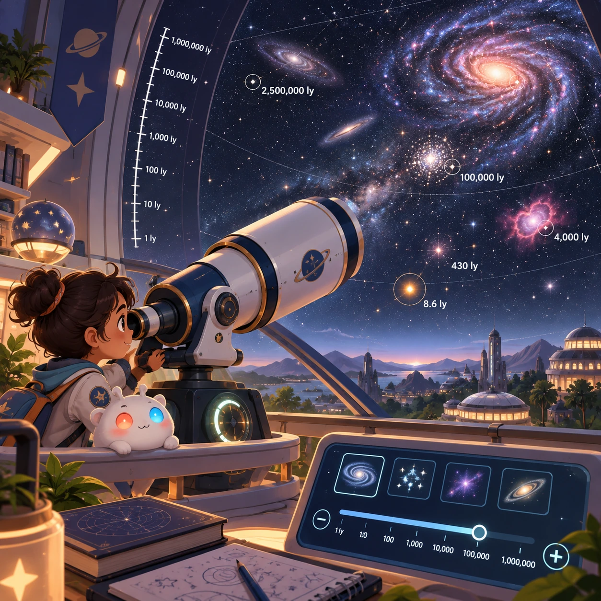
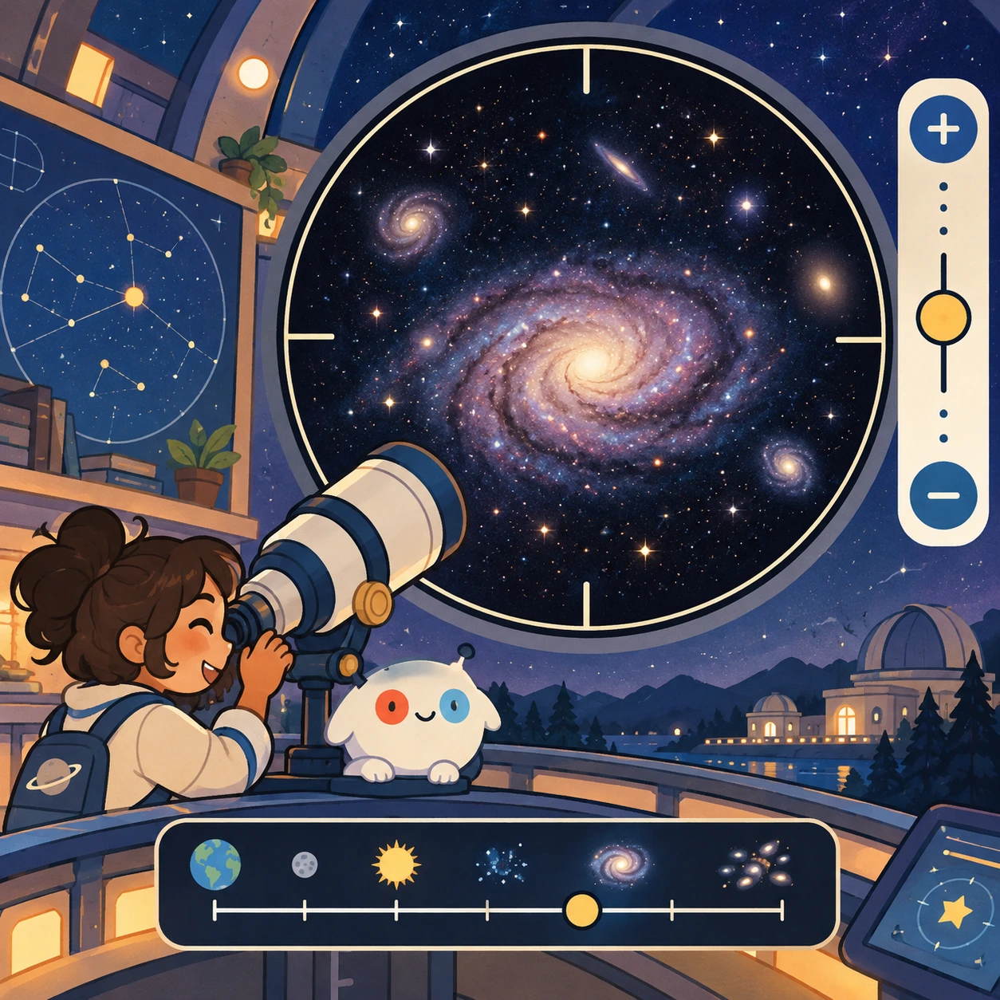
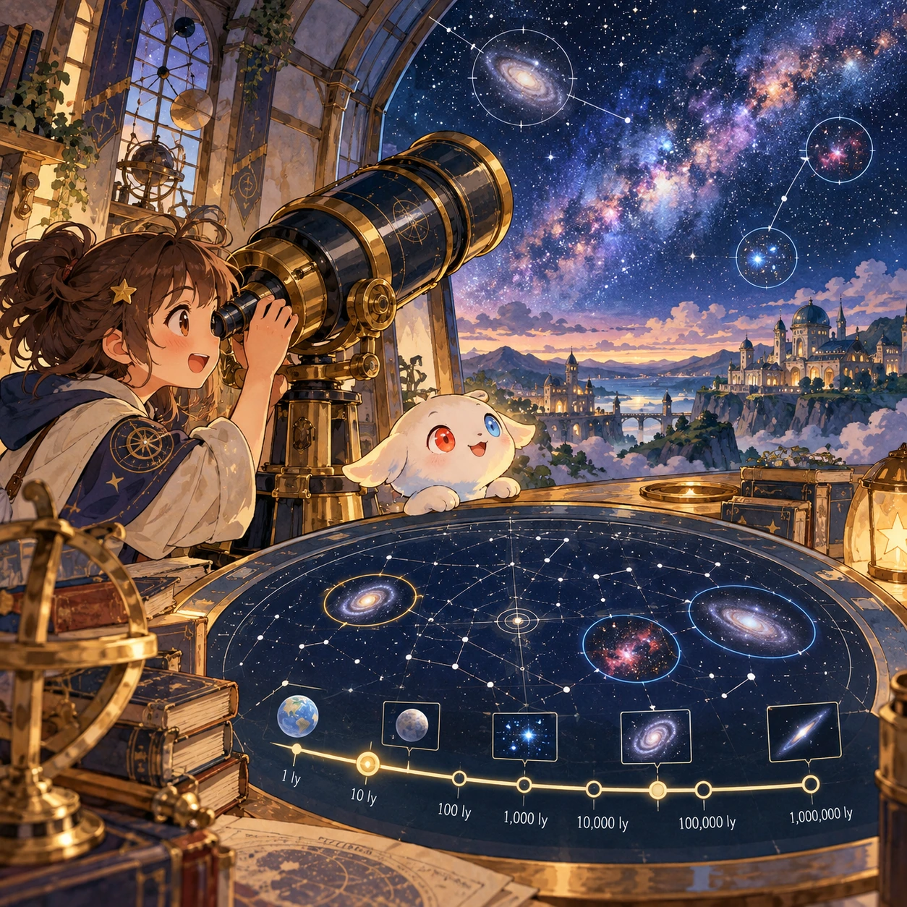

# Telescope Tour

SP-09 · [Space and physics](../sp.md) · Cx 4 · Original catalog

**The idea:** Explore a mapped star field through a telescope with distance-scale markers.

| Decision             | Proposal                                                                                                                                                                                    |
| -------------------- | ------------------------------------------------------------------------------------------------------------------------------------------------------------------------------------------- |
| Familiar mechanic    | Exploration                                                                                                                                                                                 |
| Learning objective   | Real sky catalogs, distances, light-years                                                                                                                                                   |
| First prototype      | One authored challenge built around the interaction above, with a clear goal, immediate feedback, restart and unlimited retries.                                                            |
| Technology           | React shell + PixiJS; use the shared simulation adapter only where motion or agent behavior requires it. Start with one bounded scene and measured frame time.                              |
| Scope boundary       | One bounded scenario and one core system; defer a full campaign, network play and production-scale content.                                                                                 |
| Reuse                | Shared input, saves, accessibility, seeded state and the space and physics collection shell.                                                                                                |
| Prototype acceptance | A player can identify the next action from the screen, complete one challenge, explain the practiced idea and restart without help. Check touch and keyboard play at narrow and wide sizes. |
| Main uncertainty     | Simulation accuracy and device cost need measured evidence before extending the scenario.                                                                                                   |

## Estimated plan

**First playable version:** A pannable and zoomable star field built from a real catalog with 20 guided tours that ask the child to find objects and show their distance in light-years. Deep-sky photography and AR are left out.

| Measure              | Estimate                                                                               |
| -------------------- | -------------------------------------------------------------------------------------- |
| Youngest age         | 5+                                                                                     |
| Toddler learnability | 2 of 5 — Needs simple rules, turns, a sequence or remembering several steps; ages 4-6. |
| Code                 | 2200 LOC, 18.3 days                                                                    |
| Assets               | 213 hours, 35.5 days                                                                   |
| Effort               | 53.8 days, risk 3 of 5                                                                 |
| Start score          | 107.6 (rank 239 of 310; lower is better)                                               |

**Algorithms:** `map-geo` (Maps and geography, 400 LOC) · `multi-touch` (Multi-touch gestures, 150 LOC) · `hidden-object` (Hidden objects, 150 LOC) · `quest-state` (Quest and story state, 300 LOC)

**Assets:** 50 sprites, 6 animations, 6 backgrounds, 8 UI screens, 12 sound effects, 2 music tracks, 40 voice lines, 20 authored levels, 300 content items

How the numbers are computed: [development plan](../../development-plan.md#how-the-scores-work).

## Four visual directions

These are independently generated concept proposals for selecting a prototype.
The four views compare gameplay readability, world appeal, tactile identity and
room to grow. Two additional core-screen alternatives make the flat storybook and painted anime styles explicit alongside the tactile 3D study. They are not screenshots of an implemented game. Native image
dimensions, hashes, exact prompts and generation provenance are recorded in the
[art manifest](../art/sp-09/manifest.json); see the [generation notes](../README.md#image-generation-and-provenance).

The [core prompts](../jobs/sp.json) use IDs `sp-09/01-gameplay` to `sp-09/04-discovery`. Additional [style prompts](../jobs/style-variations.json) match the two alternatives below.

### Gameplay

### World

### Characters and materials

### Expanded play

## Additional style alternatives

### Flat storybook alternative

### Painted anime alternative

## Design checks before prototyping

- Learning target: **Real sky catalogs, distances, light-years**. Ask a domain reviewer to validate factual content in the mechanic.
- Keep goals cooperative or self-directed, using resources and needs. Avoid purchasable power. No pressure timers in the accessible mode.
- Use original layouts and character designs; the [legal checklist](../../legal.md) applies even when a mechanic is familiar.
- Choose the minimum [fidelity level](../../simulation-engine.md#determinism-and-fidelity-levels) the lesson needs; concept art does not establish scientific accuracy.
- Review silhouettes, text alternatives, reduced motion and non-color cues against the [adorability gate](../../lore/adorability-gate.md).

Genre context: [existing genre research](../../../case-studies/issue-1/data/research-genres-ideas.md)
and [expansion research](../../../case-studies/issue-1/data/research-visual-catalog.md).

[← Light-Lag Chess](sp-08.md) · [All concepts](../README.md) · [Solar Sail →](sp-10.md)
