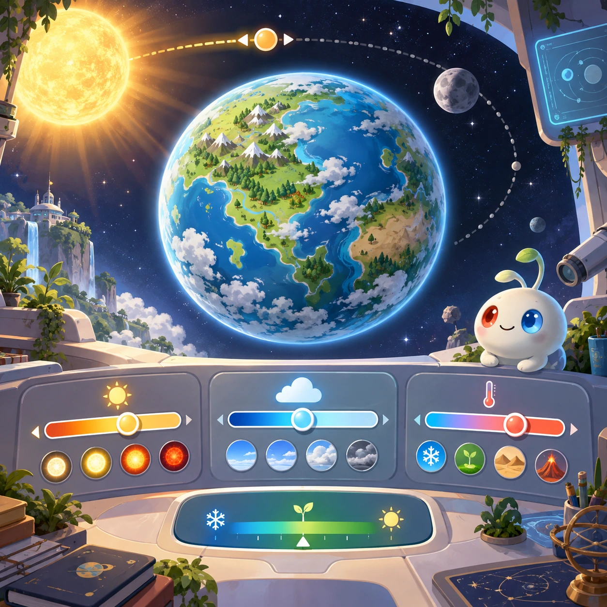
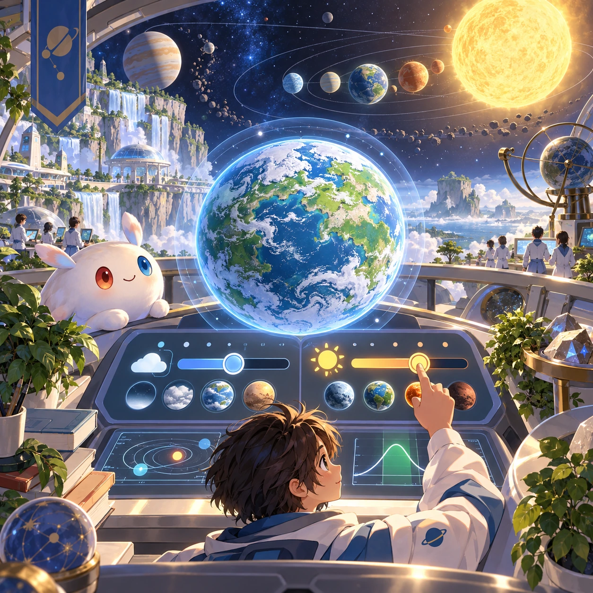
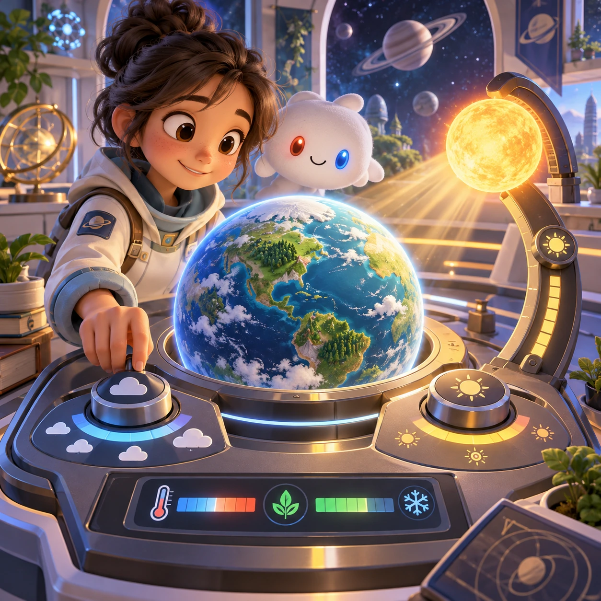
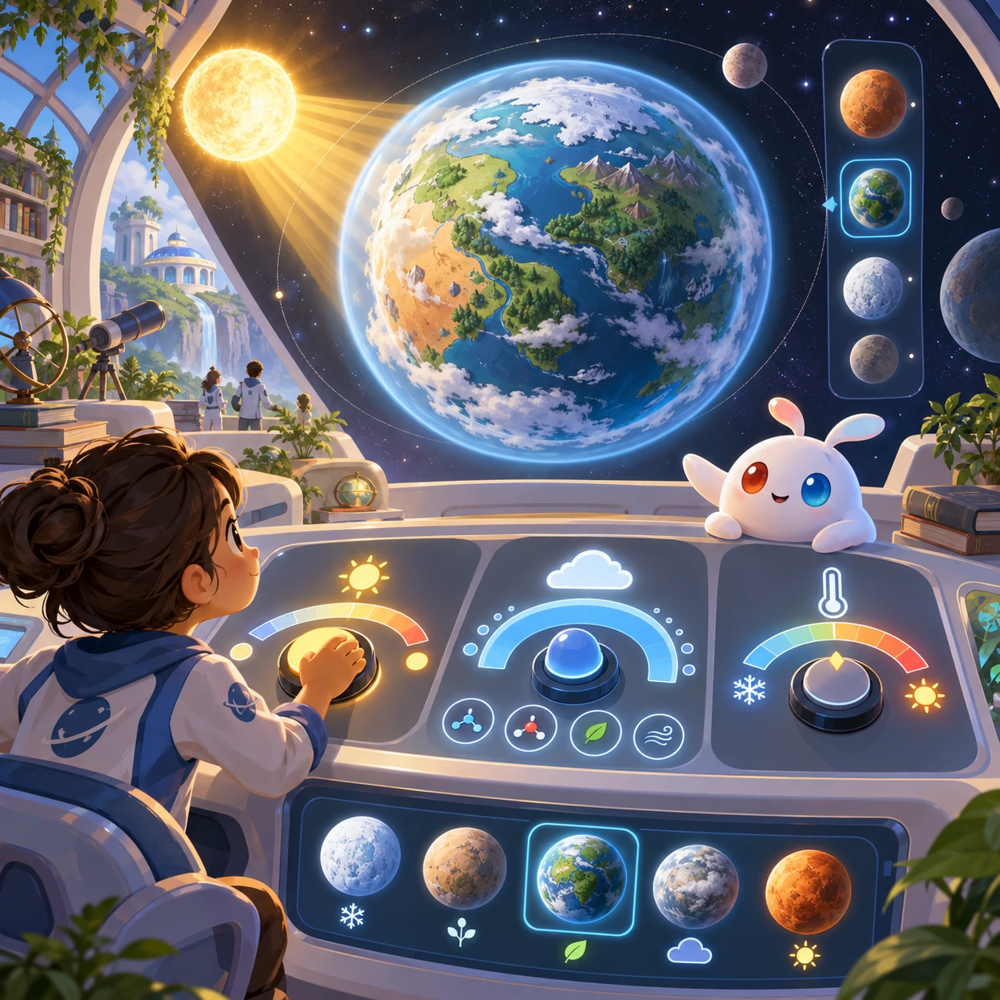
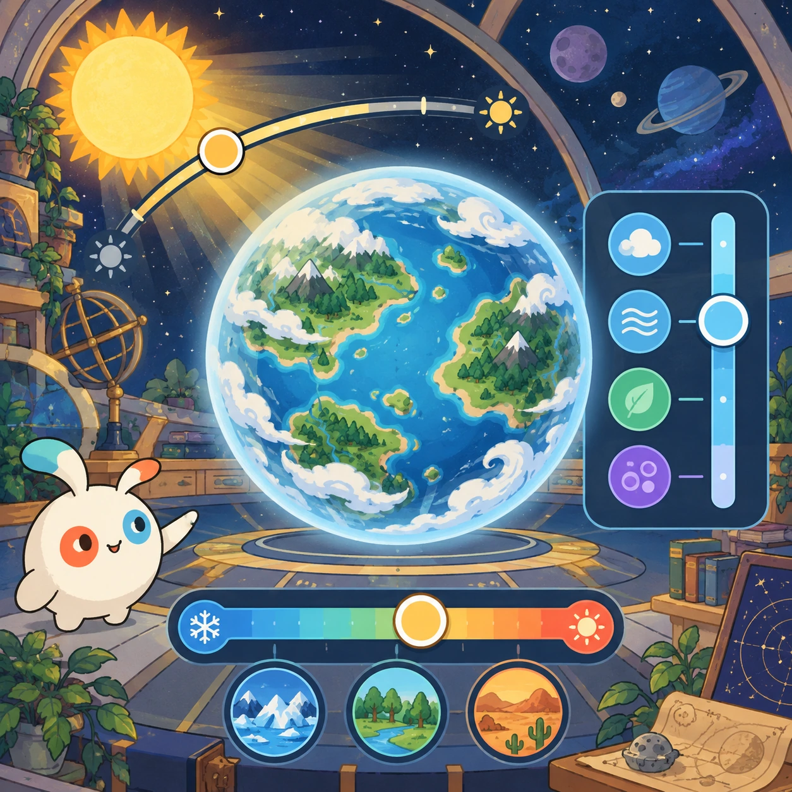
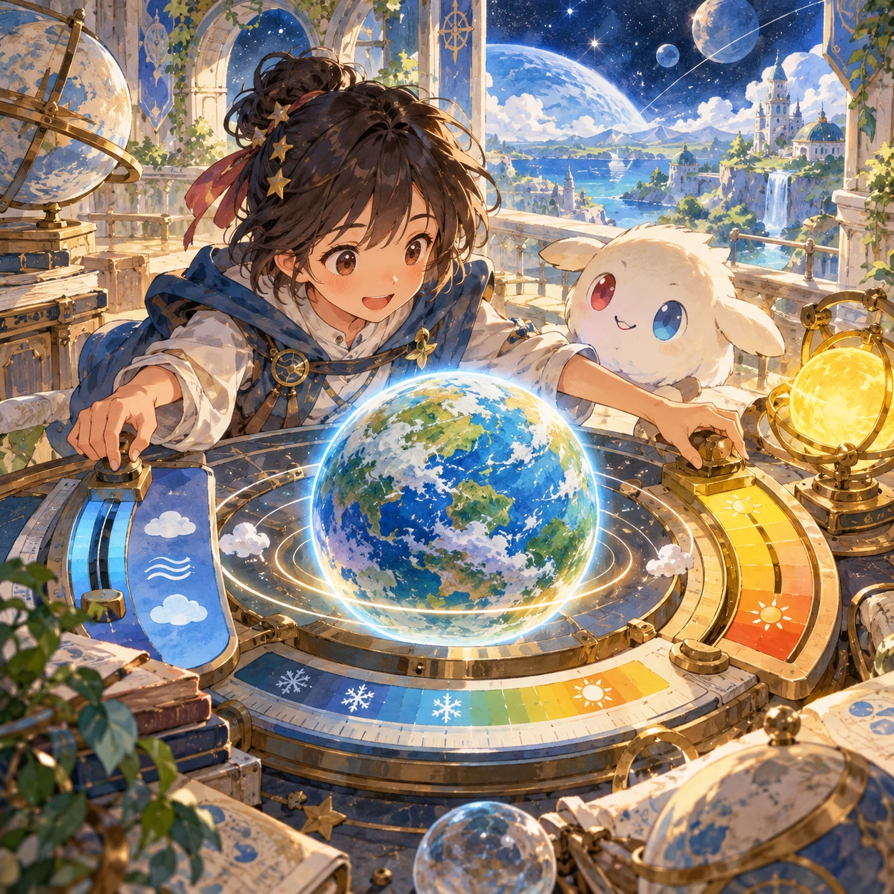

# Planet Maker

SP-13 · [Space and physics](../sp.md) · Cx 5–6 · Original catalog

**The idea:** Adjust a fictional planet's atmosphere and incoming sunlight using model controls.

| Decision             | Proposal                                                                                                                                                                                    |
| -------------------- | ------------------------------------------------------------------------------------------------------------------------------------------------------------------------------------------- |
| Familiar mechanic    | God game                                                                                                                                                                                    |
| Learning objective   | Habitable zones, atmospheres, climate                                                                                                                                                       |
| First prototype      | One authored challenge built around the interaction above, with a clear goal, immediate feedback, restart and unlimited retries.                                                            |
| Technology           | React shell + three.js/R3F and a validated simulation adapter. Begin with a small 2D reference model before a 3D vertical slice; use measured device tiers.                                 |
| Scope boundary       | One bounded scenario and one core system; defer a full campaign, network play and production-scale content.                                                                                 |
| Reuse                | Shared input, saves, accessibility, seeded state and the space and physics collection shell.                                                                                                |
| Prototype acceptance | A player can identify the next action from the screen, complete one challenge, explain the practiced idea and restart without help. Check touch and keyboard play at narrow and wide sizes. |
| Main uncertainty     | Simulation accuracy and device cost need measured evidence before extending the scenario.                                                                                                   |

## Estimated plan

**First playable version:** One 3D fictional planet whose atmosphere, star distance and sunlight sliders change temperature, oceans and ice, with 15 habitability goals. Evolving life, civilizations and multiple stars are deferred.

| Measure              | Estimate                                                                                                   |
| -------------------- | ---------------------------------------------------------------------------------------------------------- |
| Youngest age         | 10+                                                                                                        |
| Toddler learnability | 1 of 5 — Needs reading, precise motor control, timing pressure or abstract rules; not a toddler game (6+). |
| Code                 | 6020 LOC, 50.2 days                                                                                        |
| Assets               | 383 hours, 63.8 days                                                                                       |
| Effort               | 114 days, risk 4 of 5                                                                                      |
| Start score          | 342 (rank 304 of 310; lower is better)                                                                     |

**Algorithms:** `weather-sim` (Weather and climate, 500 LOC) · `terrain-gen` (Procedural terrain, 600 LOC) · `camera-3d` (3D camera, 300 LOC) · `day-cycle` (Day and season cycle, 120 LOC)

**Assets:** 30 sprites, 8 animations, 4 backgrounds, 16 UI screens, 18 sound effects, 3 music tracks, 40 voice lines, 15 authored levels, 120 content items, 25 3D models

How the numbers are computed: [development plan](../../development-plan.md#how-the-scores-work).

## Four visual directions

These are independently generated concept proposals for selecting a prototype.
The four views compare gameplay readability, world appeal, tactile identity and
room to grow. Two additional core-screen alternatives make the flat storybook and painted anime styles explicit alongside the tactile 3D study. They are not screenshots of an implemented game. Native image
dimensions, hashes, exact prompts and generation provenance are recorded in the
[art manifest](../art/sp-13/manifest.json); see the [generation notes](../README.md#image-generation-and-provenance).

The [core prompts](../jobs/sp.json) use IDs `sp-13/01-gameplay` to `sp-13/04-discovery`. Additional [style prompts](../jobs/style-variations.json) match the two alternatives below.

### Gameplay

### World

### Characters and materials

### Expanded play

## Additional style alternatives

### Flat storybook alternative

### Painted anime alternative

## Design checks before prototyping

- Learning target: **Habitable zones, atmospheres, climate**. Ask a domain reviewer to validate factual content in the mechanic.
- Keep goals cooperative or self-directed, using resources and needs. Avoid purchasable power. No pressure timers in the accessible mode.
- Use original layouts and character designs; the [legal checklist](../../legal.md) applies even when a mechanic is familiar.
- Choose the minimum [fidelity level](../../simulation-engine.md#determinism-and-fidelity-levels) the lesson needs; concept art does not establish scientific accuracy.
- Review silhouettes, text alternatives, reduced motion and non-color cues against the [adorability gate](../../lore/adorability-gate.md).

Genre context: [existing genre research](../../../case-studies/issue-1/data/research-genres-ideas.md)
and [expansion research](../../../case-studies/issue-1/data/research-visual-catalog.md).

[← Rocket Builder](sp-12.md) · [All concepts](../README.md) · [Relativity Ride →](sp-14.md)
