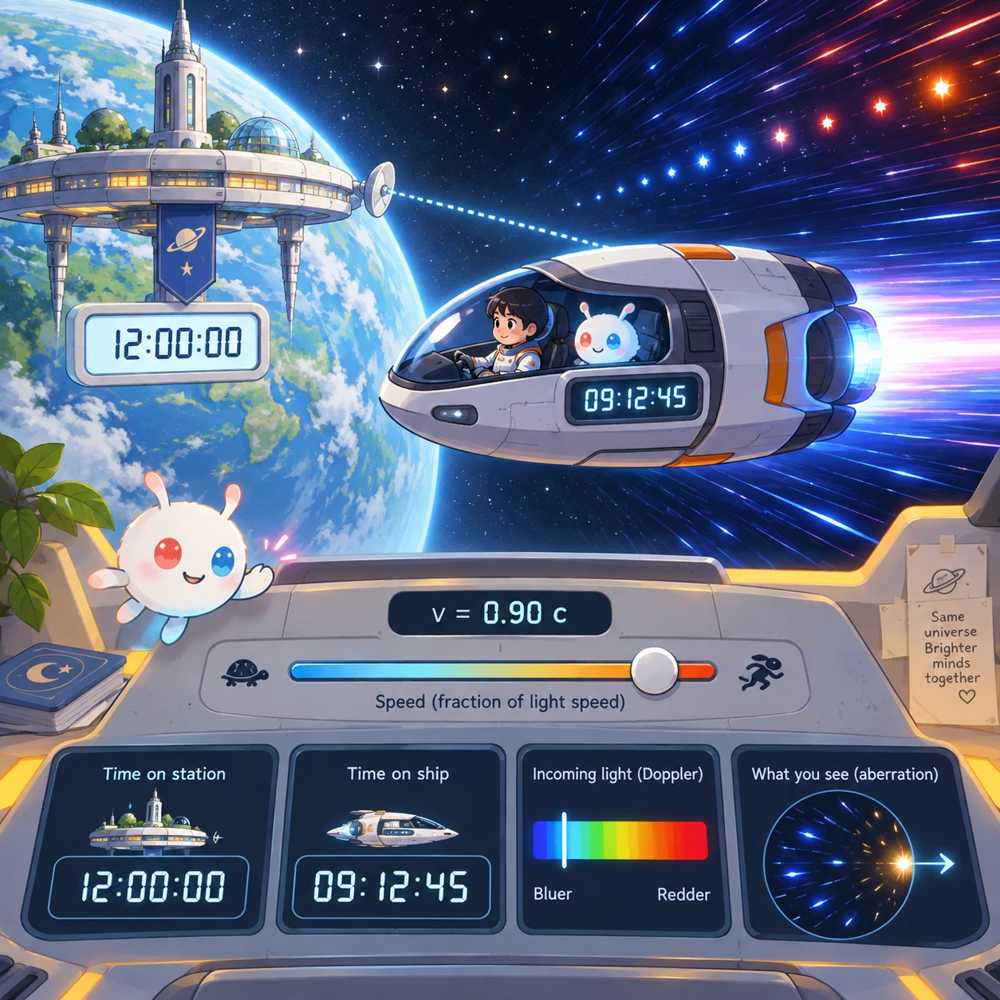
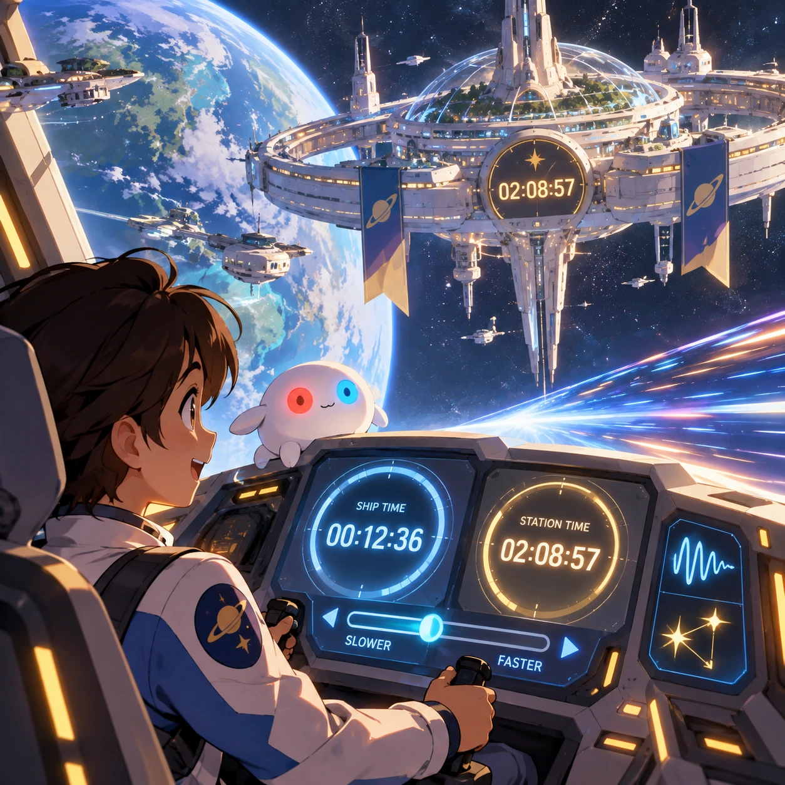
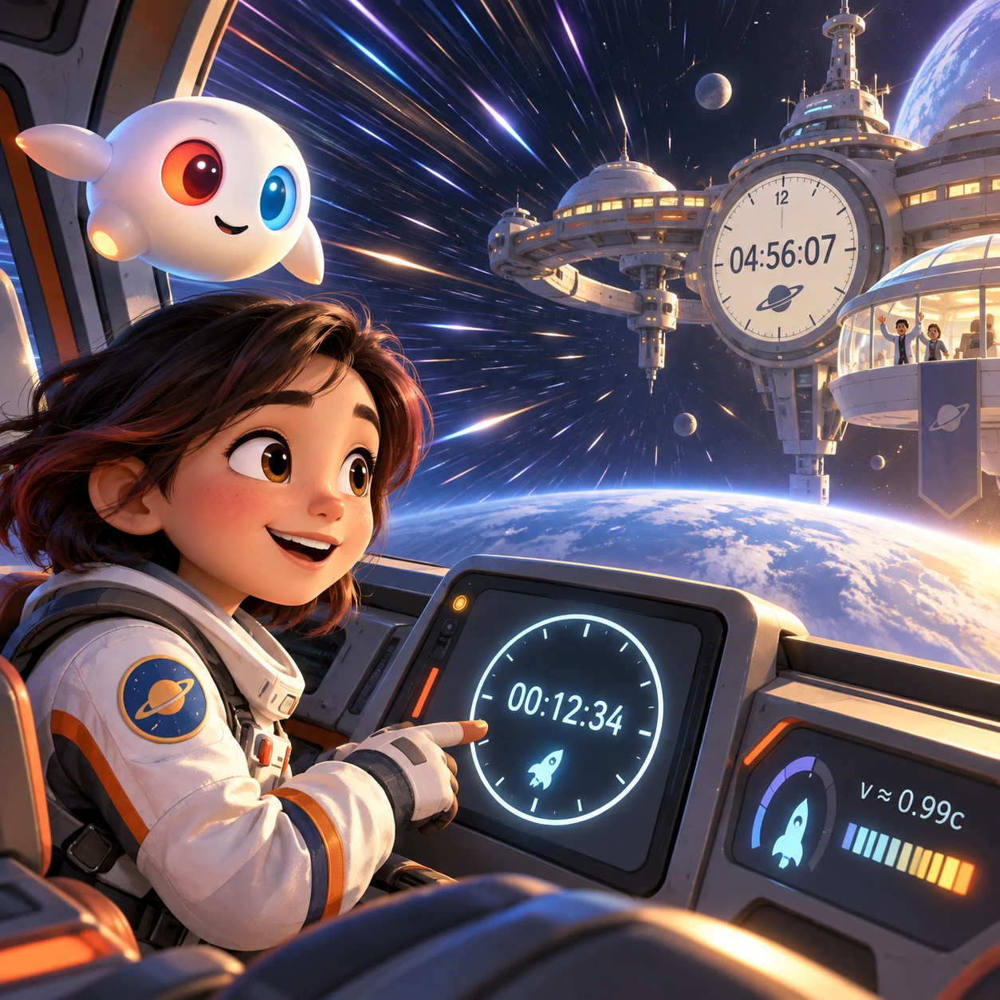
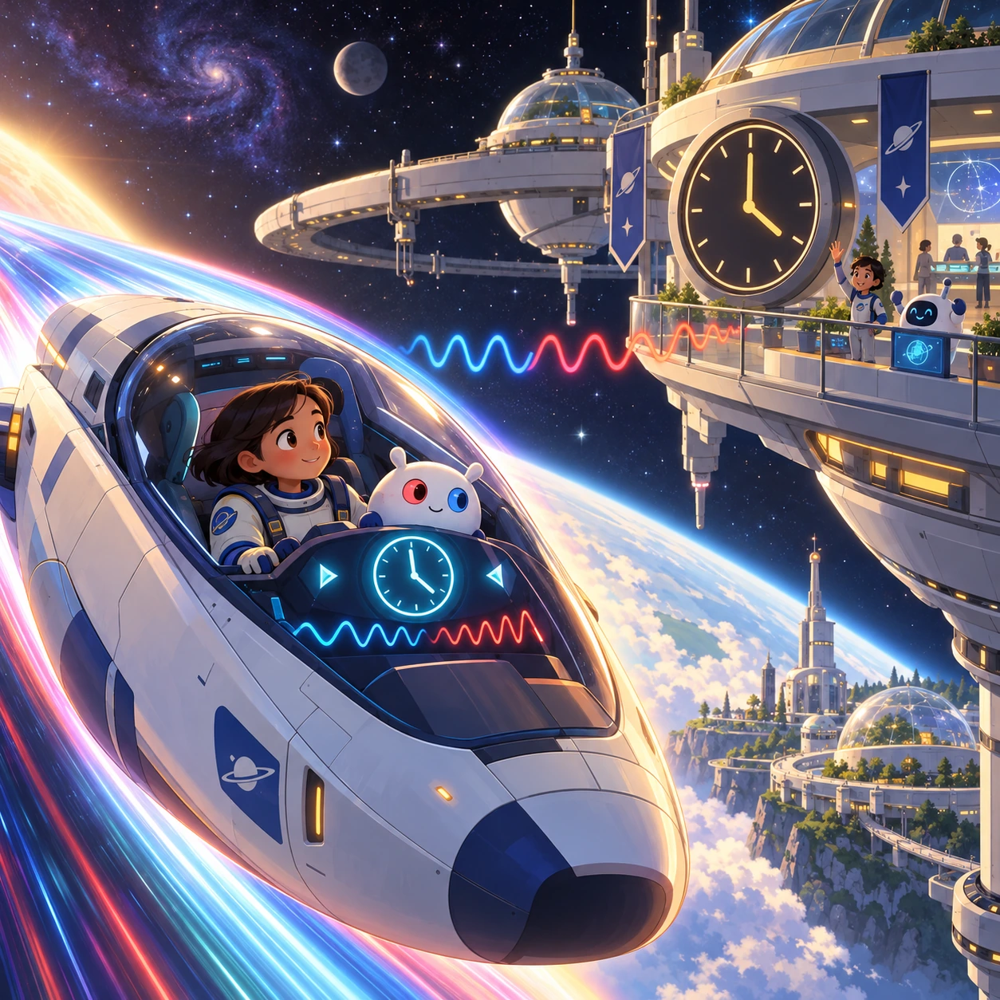

# Relativity Ride

SP-14 · [Space and physics](../sp.md) · Cx 6 · Original catalog

**The idea:** Compare clocks on a near-light-speed spacecraft and its home station.

| Decision             | Proposal                                                                                                                                                                                    |
| -------------------- | ------------------------------------------------------------------------------------------------------------------------------------------------------------------------------------------- |
| Familiar mechanic    | Flight sim near light speed                                                                                                                                                                 |
| Learning objective   | Time dilation, Doppler, aberration                                                                                                                                                          |
| First prototype      | One authored challenge built around the interaction above, with a clear goal, immediate feedback, restart and unlimited retries.                                                            |
| Technology           | React shell + three.js/R3F and a validated simulation adapter. Begin with a small 2D reference model before a 3D vertical slice; use measured device tiers.                                 |
| Scope boundary       | One bounded scenario and one core system; defer a full campaign, network play and production-scale content.                                                                                 |
| Reuse                | Shared input, saves, accessibility, seeded state and the space and physics collection shell.                                                                                                |
| Prototype acceptance | A player can identify the next action from the screen, complete one challenge, explain the practiced idea and restart without help. Check touch and keyboard play at narrow and wide sizes. |
| Main uncertainty     | Simulation accuracy and device cost need measured evidence before extending the scenario.                                                                                                   |

## Estimated plan

**First playable version:** A 3D cockpit flight between a home station and nearby beacons where speed sliders show time dilation, Doppler color and aberration, with clocks compared on return over 30 legs. Free-form galaxy travel is left out.

| Measure              | Estimate                                                                                                   |
| -------------------- | ---------------------------------------------------------------------------------------------------------- |
| Youngest age         | 12+                                                                                                        |
| Toddler learnability | 1 of 5 — Needs reading, precise motor control, timing pressure or abstract rules; not a toddler game (6+). |
| Code                 | 6550 LOC, 54.6 days                                                                                        |
| Assets               | 461 hours, 76.8 days                                                                                       |
| Effort               | 131.4 days, risk 5 of 5                                                                                    |
| Start score          | 394.2 (rank 299 of 300; lower is better)                                                                   |

**Algorithms:** `relativity` (Relativistic physics, 600 LOC) · `vehicle-sim` (Vehicle handling, 500 LOC) · `camera-3d` (3D camera, 300 LOC) · `particle-effects` (Particles, 150 LOC)

**Assets:** 20 sprites, 6 animations, 6 backgrounds, 14 UI screens, 20 sound effects, 3 music tracks, 50 voice lines, 30 authored levels, 80 content items, 35 3D models

How the numbers are computed: [development plan](../../development-plan.md#how-the-scores-work).

## Four visual directions

These are independently generated concept proposals for selecting a prototype.
The four views compare gameplay readability, world appeal, tactile identity and
room to grow. They are not screenshots of an implemented game. Native image
dimensions, hashes, exact prompts and generation provenance are recorded in the
[art manifest](../art/sp-14/manifest.json); see the [generation notes](../README.md#image-generation-and-provenance).

### Gameplay

### World

### Characters and materials

### Expanded play

## Design checks before prototyping

- Learning target: **Time dilation, Doppler, aberration**. Ask a domain reviewer to validate factual content in the mechanic.
- Keep goals cooperative or self-directed, using resources and needs. Avoid purchasable power. No pressure timers in the accessible mode.
- Use original layouts and character designs; the [legal checklist](../../legal.md) applies even when a mechanic is familiar.
- Choose the minimum [fidelity level](../../simulation-engine.md#determinism-and-fidelity-levels) the lesson needs; concept art does not establish scientific accuracy.
- Review silhouettes, text alternatives, reduced motion and non-color cues against the [adorability gate](../../lore/adorability-gate.md).

Genre context: [existing genre research](../../../case-studies/issue-1/data/research-genres-ideas.md)
and [expansion research](../../../case-studies/issue-1/data/research-visual-catalog.md).

[← Planet Maker](sp-13.md) · [All concepts](../README.md) · [Orbital Dock →](sp-15.md)
