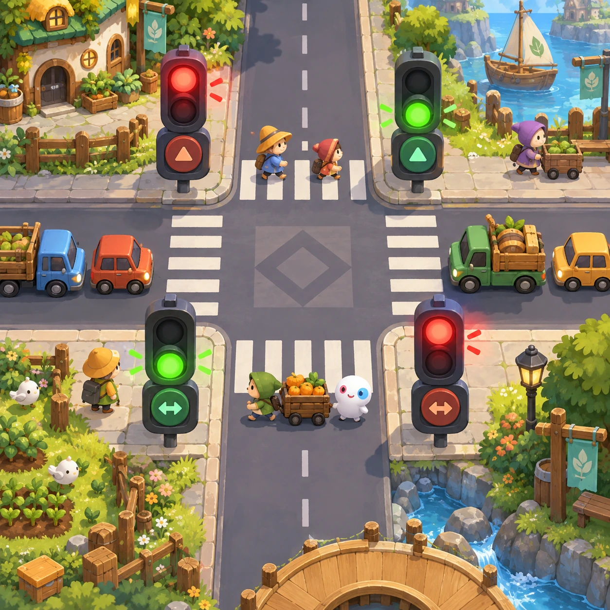
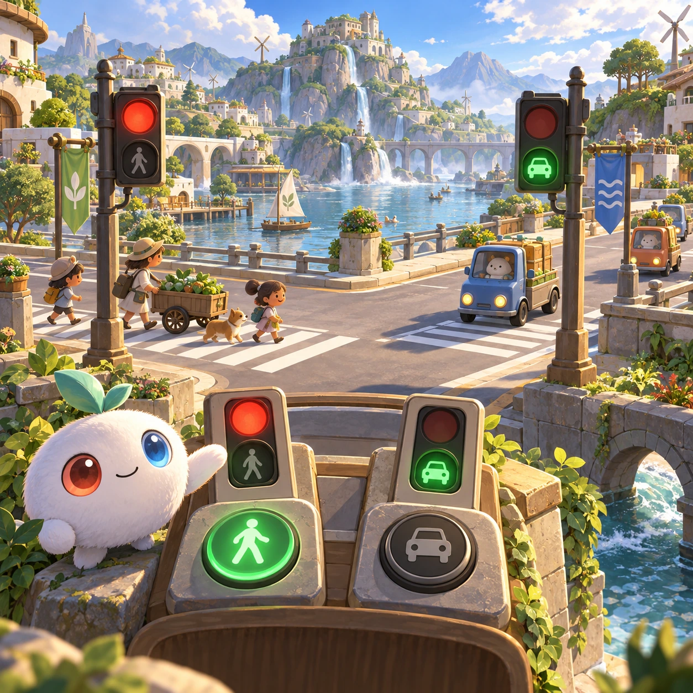
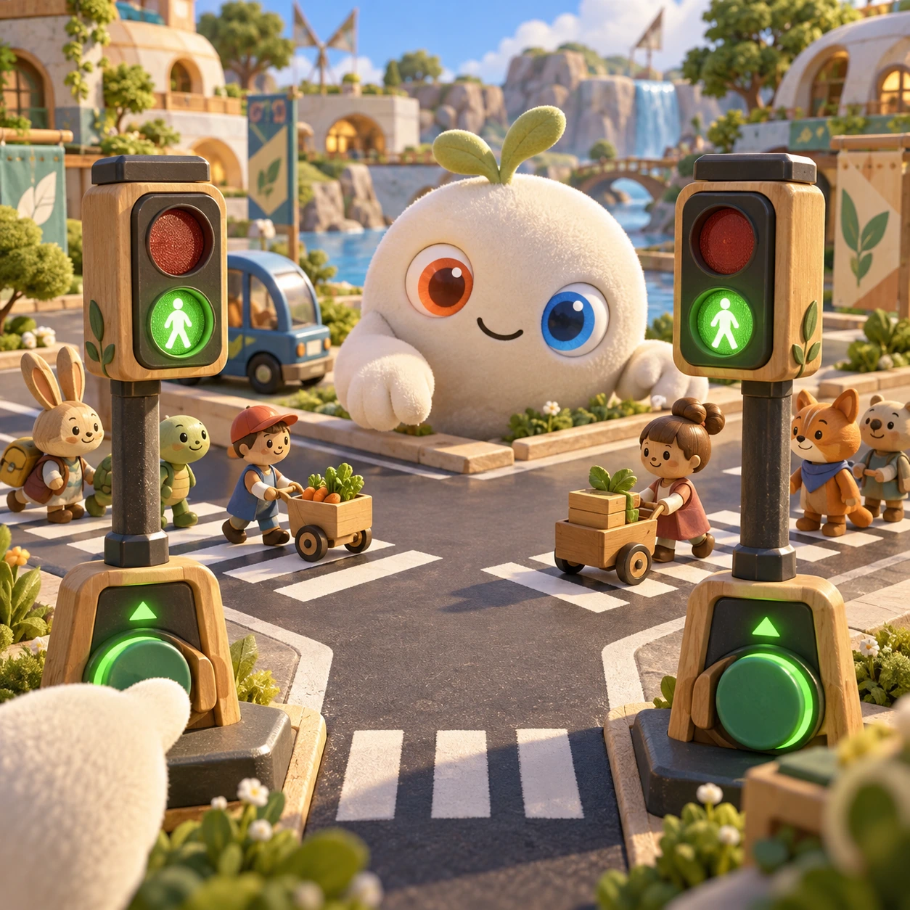
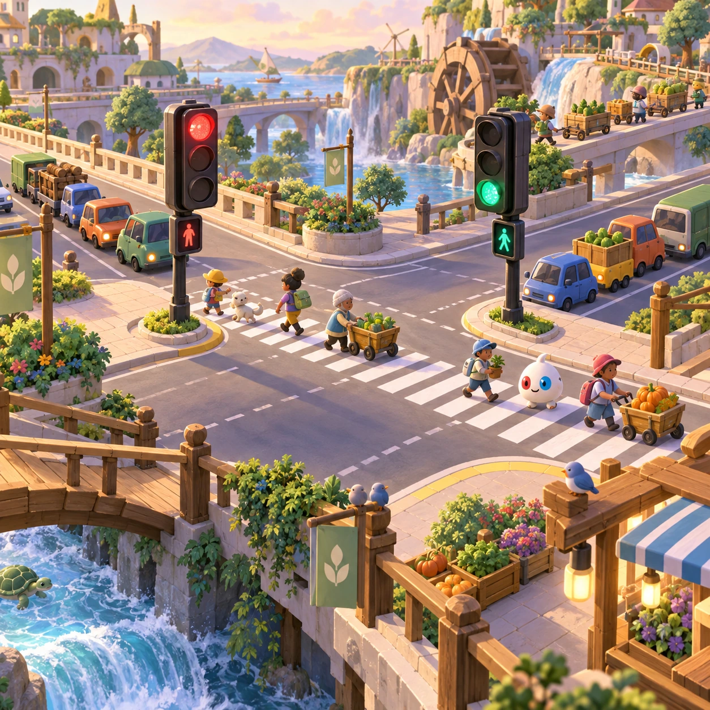

# Traffic Lights

SS-03 · [Strategy and simulation](../ss.md) · Cx 3 · Original catalog

**The idea:** Time two traffic lights so toy pedestrians and carts cross safely.

| Decision             | Proposal                                                                                                                                                                                    |
| -------------------- | ------------------------------------------------------------------------------------------------------------------------------------------------------------------------------------------- |
| Familiar mechanic    | Traffic puzzle                                                                                                                                                                              |
| Learning objective   | Flow, queues, timing                                                                                                                                                                        |
| First prototype      | One authored challenge built around the interaction above, with a clear goal, immediate feedback, restart and unlimited retries.                                                            |
| Technology           | React shell + PixiJS; use the shared simulation adapter only where motion or agent behavior requires it. Start with one bounded scene and measured frame time.                              |
| Scope boundary       | One bounded scenario and one core system; defer a full campaign, network play and production-scale content.                                                                                 |
| Reuse                | Shared input, saves, accessibility, seeded state and the strategy and simulation collection shell.                                                                                          |
| Prototype acceptance | A player can identify the next action from the screen, complete one challenge, explain the practiced idea and restart without help. Check touch and keyboard play at narrow and wide sizes. |
| Main uncertainty     | Test whether the lesson follows from play and whether the first interaction is understandable without reading.                                                                              |

## Estimated plan

**First playable version:** 20 crossings where tapping toggles two traffic lights so toy pedestrians and carts flow safely, with queue lengths shown as stacks. City-wide networks and scoring by speed are left out.

| Measure              | Estimate                                                                               |
| -------------------- | -------------------------------------------------------------------------------------- |
| Youngest age         | 5+                                                                                     |
| Toddler learnability | 2 of 5 — Needs simple rules, turns, a sequence or remembering several steps; ages 4-6. |
| Code                 | 1530 LOC, 12.8 days                                                                    |
| Assets               | 135 hours, 22.5 days                                                                   |
| Effort               | 35.3 days, risk 3 of 5                                                                 |
| Start score          | 70.6 (rank 175 of 300; lower is better)                                                |

**Algorithms:** `agent-steering` (Agent steering, 350 LOC) · `tap-feedback` (Tap feedback, 80 LOC) · `graph-network` (Node-link graph, 300 LOC)

**Assets:** 25 sprites, 10 animations, 3 backgrounds, 5 UI screens, 12 sound effects, 2 music tracks, 20 voice lines, 20 authored levels, 15 content items

How the numbers are computed: [development plan](../../development-plan.md#how-the-scores-work).

## Four visual directions

These are independently generated concept proposals for selecting a prototype.
The four views compare gameplay readability, world appeal, tactile identity and
room to grow. They are not screenshots of an implemented game. Native image
dimensions, hashes, exact prompts and generation provenance are recorded in the
[art manifest](../art/ss-03/manifest.json); see the [generation notes](../README.md#image-generation-and-provenance).

### Gameplay

### World

### Characters and materials

### Expanded play

## Design checks before prototyping

- Learning target: **Flow, queues, timing**. Ask a domain reviewer to validate factual content in the mechanic.
- Keep goals cooperative or self-directed, using resources and needs. Avoid purchasable power. No pressure timers in the accessible mode.
- Use original layouts and character designs; the [legal checklist](../../legal.md) applies even when a mechanic is familiar.
- Choose the minimum [fidelity level](../../simulation-engine.md#determinism-and-fidelity-levels) the lesson needs; concept art does not establish scientific accuracy.
- Review silhouettes, text alternatives, reduced motion and non-color cues against the [adorability gate](../../lore/adorability-gate.md).

Genre context: [existing genre research](../../../case-studies/issue-1/data/research-genres-ideas.md)
and [expansion research](../../../case-studies/issue-1/data/research-visual-catalog.md).

[← Garden Guard](ss-02.md) · [All concepts](../README.md) · [Energy Grid →](ss-04.md)
