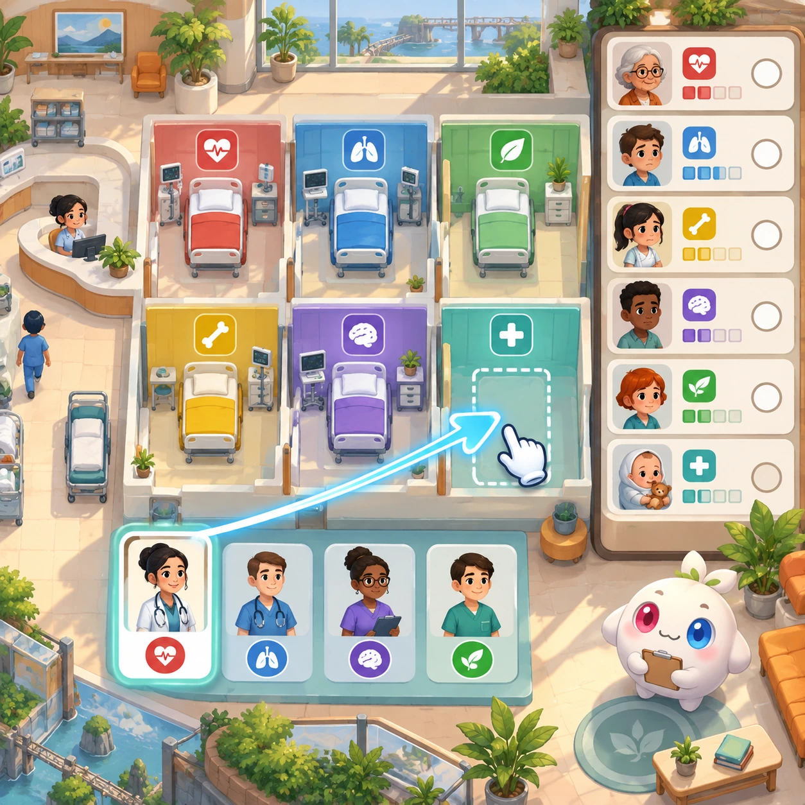
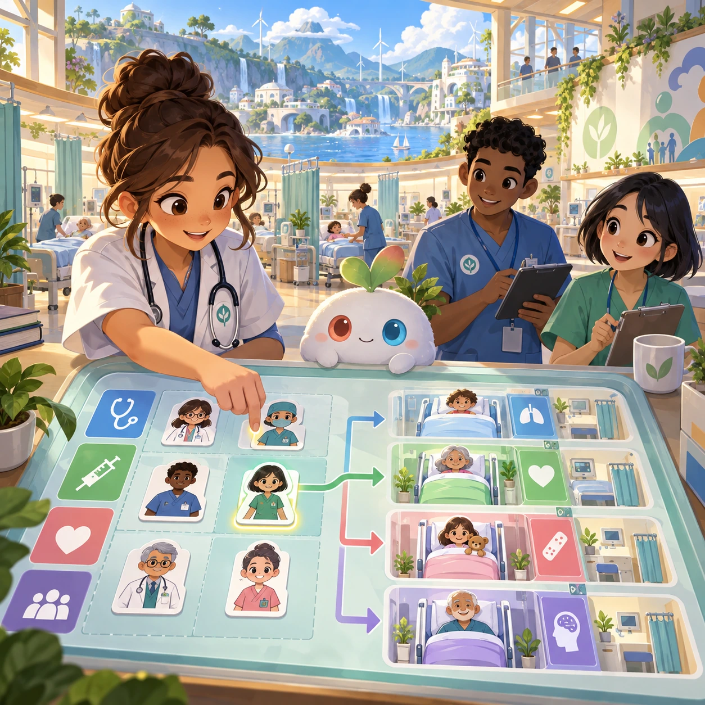
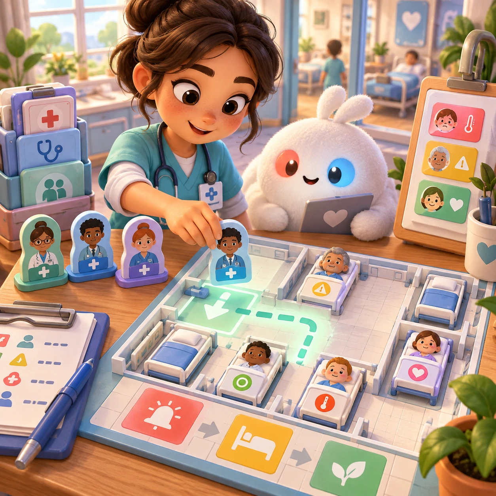
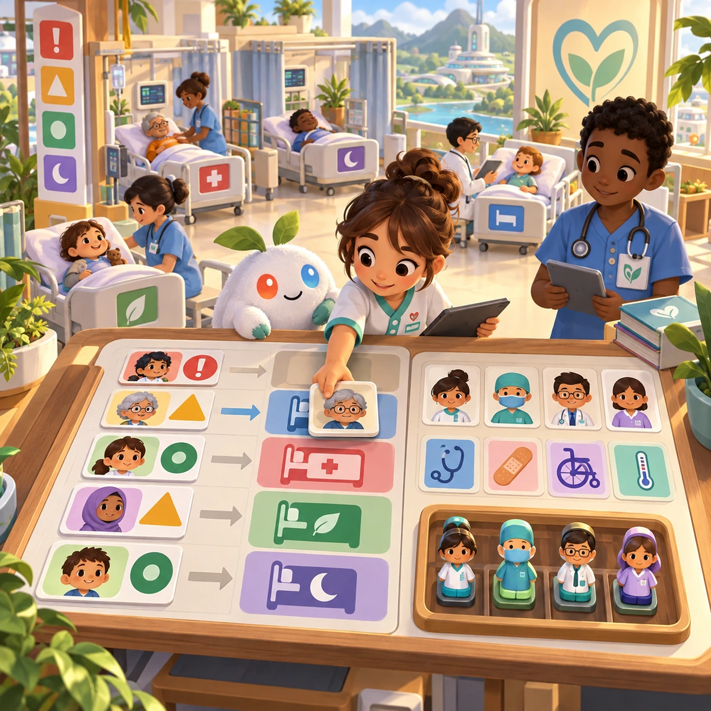

# Care Hospital

SS-09 · [Strategy and simulation](../ss.md) · Cx 4 · Original catalog

**The idea:** Assign care teams and beds in a friendly hospital planning board.

| Decision             | Proposal                                                                                                                                                                                    |
| -------------------- | ------------------------------------------------------------------------------------------------------------------------------------------------------------------------------------------- |
| Familiar mechanic    | Hospital management                                                                                                                                                                         |
| Learning objective   | Health systems, triage, empathy                                                                                                                                                             |
| First prototype      | One authored challenge built around the interaction above, with a clear goal, immediate feedback, restart and unlimited retries.                                                            |
| Technology           | React shell + PixiJS; use the shared simulation adapter only where motion or agent behavior requires it. Start with one bounded scene and measured frame time.                              |
| Scope boundary       | One bounded scenario and one core system; defer a full campaign, network play and production-scale content.                                                                                 |
| Reuse                | Shared input, saves, accessibility, seeded state and the strategy and simulation collection shell.                                                                                          |
| Prototype acceptance | A player can identify the next action from the screen, complete one challenge, explain the practiced idea and restart without help. Check touch and keyboard play at narrow and wide sizes. |
| Main uncertainty     | Simulation accuracy and device cost need measured evidence before extending the scenario.                                                                                                   |

## Estimated plan

**First playable version:** A friendly hospital planning board over 15 days where care teams and beds are assigned by triage need, with voiced patient stories rewarding empathy. Medical procedures and staff management are left out.

| Measure              | Estimate                                                                                                   |
| -------------------- | ---------------------------------------------------------------------------------------------------------- |
| Youngest age         | 7+                                                                                                         |
| Toddler learnability | 1 of 5 — Needs reading, precise motor control, timing pressure or abstract rules; not a toddler game (6+). |
| Code                 | 2800 LOC, 23.3 days                                                                                        |
| Assets               | 205 hours, 34.2 days                                                                                       |
| Effort               | 57.5 days, risk 3 of 5                                                                                     |
| Start score          | 172.5 (rank 281 of 300; lower is better)                                                                   |

**Algorithms:** `economy-sim` (Resource economy, 600 LOC) · `pathfinding` (Pathfinding, 250 LOC) · `drag-drop-snap` (Drag and snap, 150 LOC) · `dialogue-branching` (Branching dialogue, 300 LOC)

**Assets:** 45 sprites, 14 animations, 5 backgrounds, 10 UI screens, 15 sound effects, 2 music tracks, 50 voice lines, 15 authored levels, 60 content items

How the numbers are computed: [development plan](../../development-plan.md#how-the-scores-work).

## Four visual directions

These are independently generated concept proposals for selecting a prototype.
The four views compare gameplay readability, world appeal, tactile identity and
room to grow. They are not screenshots of an implemented game. Native image
dimensions, hashes, exact prompts and generation provenance are recorded in the
[art manifest](../art/ss-09/manifest.json); see the [generation notes](../README.md#image-generation-and-provenance).

### Gameplay

### World

### Characters and materials

### Expanded play

## Design checks before prototyping

- Learning target: **Health systems, triage, empathy**. Ask a domain reviewer to validate factual content in the mechanic.
- Keep goals cooperative or self-directed, using resources and needs. Avoid purchasable power. No pressure timers in the accessible mode.
- Use original layouts and character designs; the [legal checklist](../../legal.md) applies even when a mechanic is familiar.
- Choose the minimum [fidelity level](../../simulation-engine.md#determinism-and-fidelity-levels) the lesson needs; concept art does not establish scientific accuracy.
- Review silhouettes, text alternatives, reduced motion and non-color cues against the [adorability gate](../../lore/adorability-gate.md).

Genre context: [existing genre research](../../../case-studies/issue-1/data/research-genres-ideas.md)
and [expansion research](../../../case-studies/issue-1/data/research-visual-catalog.md).

[← Food Web](ss-08.md) · [All concepts](../README.md) · [Town of Links →](ss-10.md)
