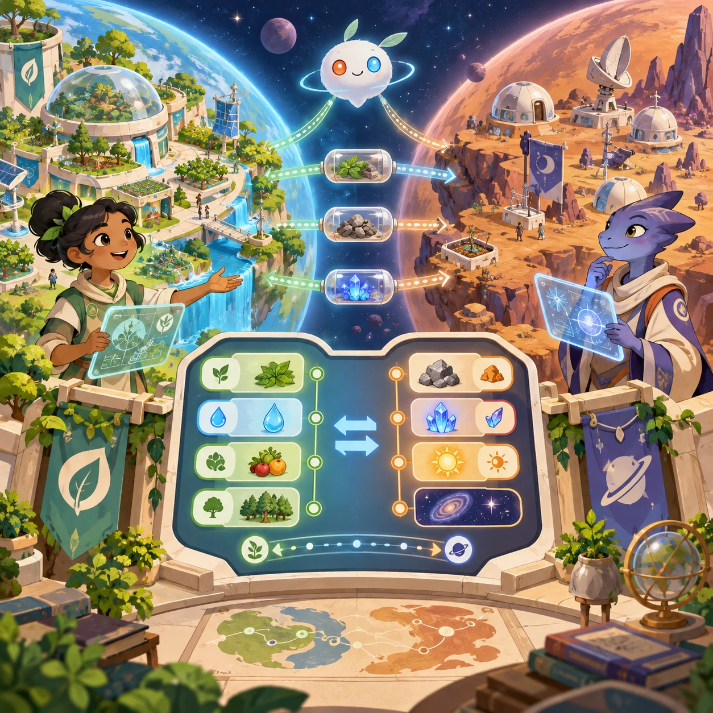
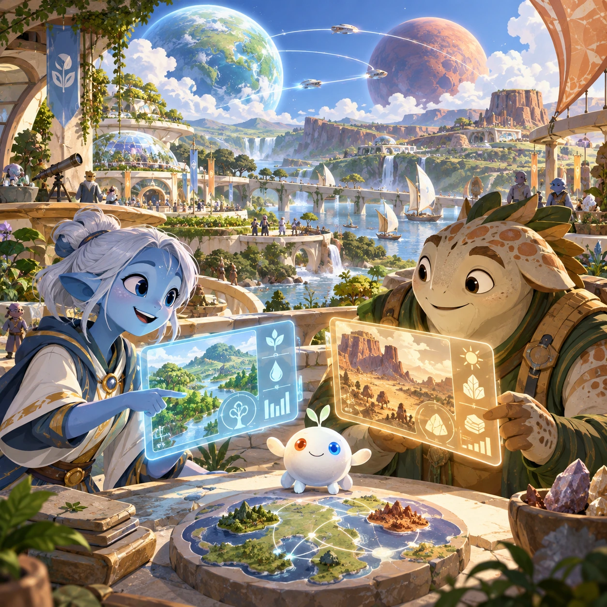
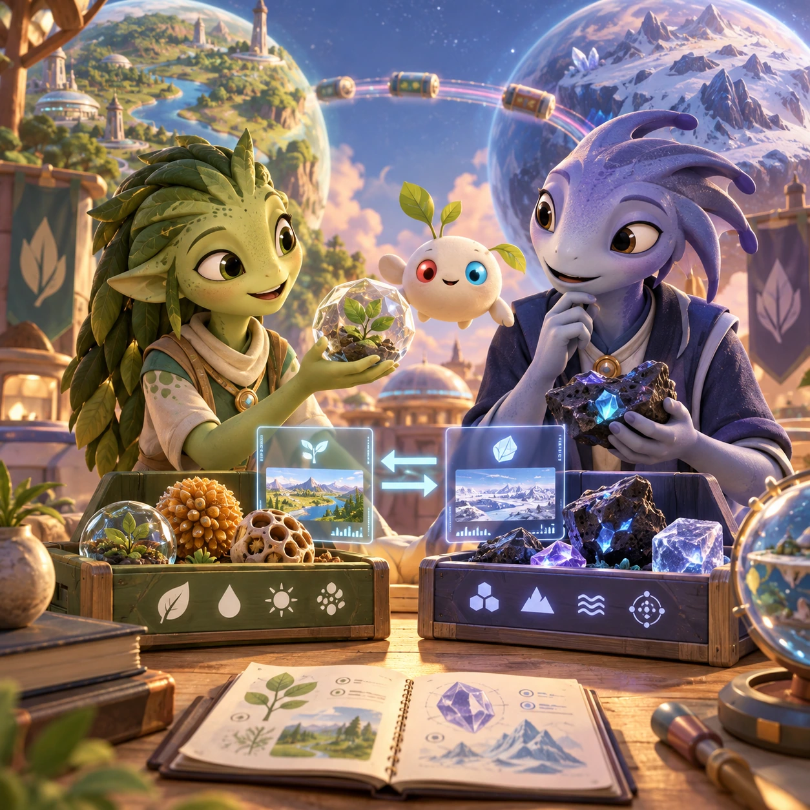
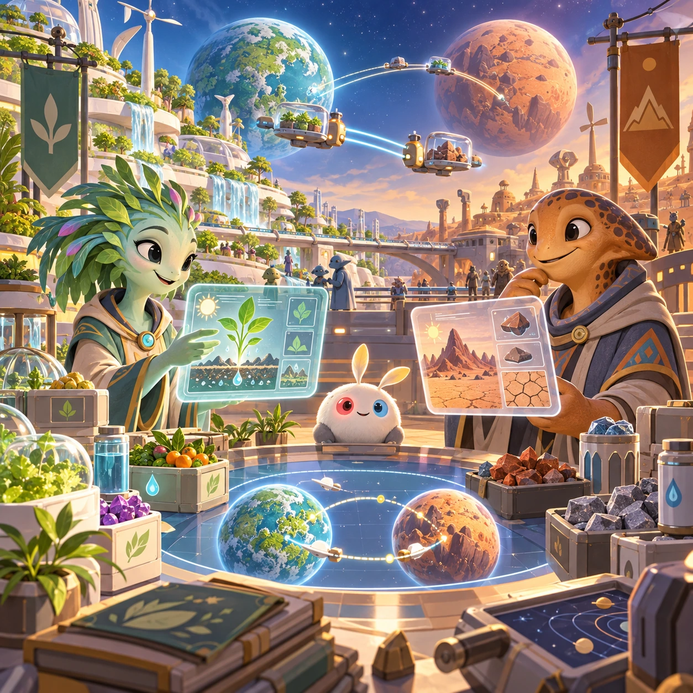
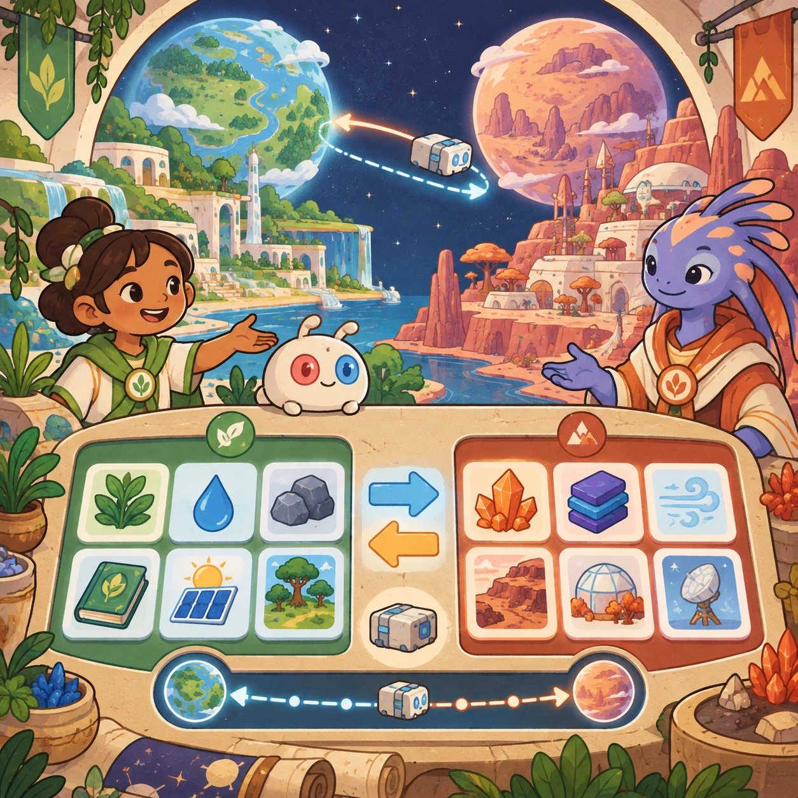
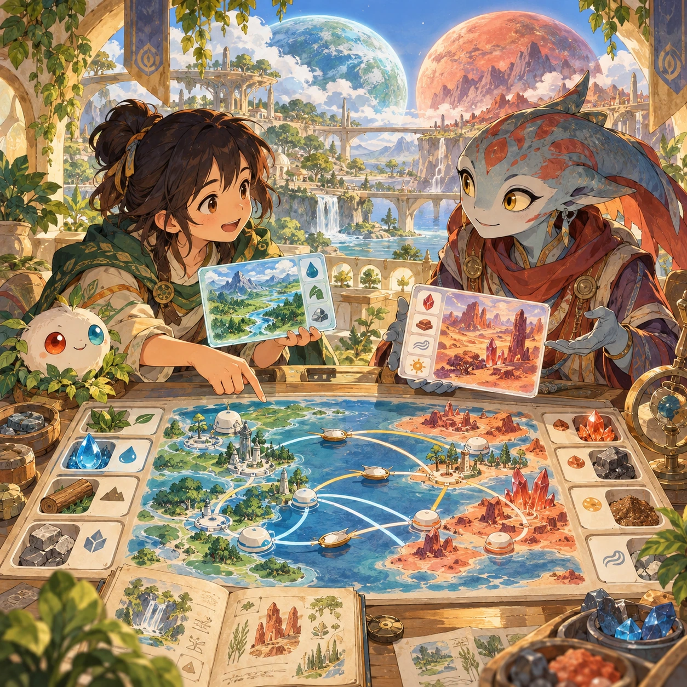

# Two Planets

SS-12 · [Strategy and simulation](../ss.md) · Cx 5 · Original catalog

**The idea:** Exchange scientific observations between Raya and Shacados using peaceful diplomatic routes.

| Decision             | Proposal                                                                                                                                                                                    |
| -------------------- | ------------------------------------------------------------------------------------------------------------------------------------------------------------------------------------------- |
| Familiar mechanic    | 4X without war (explore, expand, exchange, cooperate)                                                                                                                                       |
| Learning objective   | Resource-based vs scarcity economies                                                                                                                                                        |
| First prototype      | One authored challenge built around the interaction above, with a clear goal, immediate feedback, restart and unlimited retries.                                                            |
| Technology           | React shell + three.js/R3F and a validated simulation adapter. Begin with a small 2D reference model before a 3D vertical slice; use measured device tiers.                                 |
| Scope boundary       | One bounded scenario and one core system; defer a full campaign, network play and production-scale content.                                                                                 |
| Reuse                | Shared input, saves, accessibility, seeded state and the strategy and simulation collection shell.                                                                                          |
| Prototype acceptance | A player can identify the next action from the screen, complete one challenge, explain the practiced idea and restart without help. Check touch and keyboard play at narrow and wide sizes. |
| Main uncertainty     | Simulation accuracy and device cost need measured evidence before extending the scenario.                                                                                                   |

## Estimated plan

**First playable version:** Two generated planets, Raya and Shacados, seen side by side: the player helps Shacados explore and grow cleaner within its own system and exchanges observations with an AI partner by radio messages that take 11.6 days each way, over 8 scenarios. Nothing is ever built on Raya, war is never included and online play is deferred.

| Measure              | Estimate                                                                                                   |
| -------------------- | ---------------------------------------------------------------------------------------------------------- |
| Youngest age         | 10+                                                                                                        |
| Toddler learnability | 1 of 5 — Needs reading, precise motor control, timing pressure or abstract rules; not a toddler game (6+). |
| Code                 | 5800 LOC, 48.3 days                                                                                        |
| Assets               | 422 hours, 70.3 days                                                                                       |
| Effort               | 118.7 days, risk 4 of 5                                                                                    |
| Start score          | 356.1 (rank 305 of 310; lower is better)                                                                   |

**Algorithms:** `terrain-gen` (Procedural terrain, 600 LOC) · `economy-sim` (Resource economy, 600 LOC) · `game-ai-minimax` (Turn-based AI, 500 LOC) · `dialogue-branching` (Branching dialogue, 300 LOC) · `camera-3d` (3D camera, 300 LOC)

**Assets:** 40 sprites, 10 animations, 4 backgrounds, 18 UI screens, 20 sound effects, 4 music tracks, 60 voice lines, 8 authored levels, 200 content items, 25 3D models

How the numbers are computed: [development plan](../../development-plan.md#how-the-scores-work).

## Four visual directions

These are independently generated concept proposals for selecting a prototype.
The four views compare gameplay readability, world appeal, tactile identity and
room to grow. Two additional core-screen alternatives make the flat storybook and painted anime styles explicit alongside the tactile 3D study. They are not screenshots of an implemented game. Native image
dimensions, hashes, exact prompts and generation provenance are recorded in the
[art manifest](../art/ss-12/manifest.json); see the [generation notes](../README.md#image-generation-and-provenance).

The [core prompts](../jobs/ss.json) use IDs `ss-12/01-gameplay` to `ss-12/04-discovery`. Additional [style prompts](../jobs/style-variations.json) match the two alternatives below.

### Gameplay

### World

### Characters and materials

### Expanded play

## Additional style alternatives

### Flat storybook alternative

### Painted anime alternative

## Design checks before prototyping

- Learning target: **Resource-based vs scarcity economies**. Ask a domain reviewer to validate factual content in the mechanic.
- Keep goals cooperative or self-directed, using resources and needs. Avoid purchasable power. No pressure timers in the accessible mode.
- Use original layouts and character designs; the [legal checklist](../../legal.md) applies even when a mechanic is familiar.
- Choose the minimum [fidelity level](../../simulation-engine.md#determinism-and-fidelity-levels) the lesson needs; concept art does not establish scientific accuracy.
- Review silhouettes, text alternatives, reduced motion and non-color cues against the [adorability gate](../../lore/adorability-gate.md).

Genre context: [existing genre research](../../../case-studies/issue-1/data/research-genres-ideas.md)
and [expansion research](../../../case-studies/issue-1/data/research-visual-catalog.md).

[← Climate Council](ss-11.md) · [All concepts](../README.md) · [Mars Habitat →](ss-13.md)
