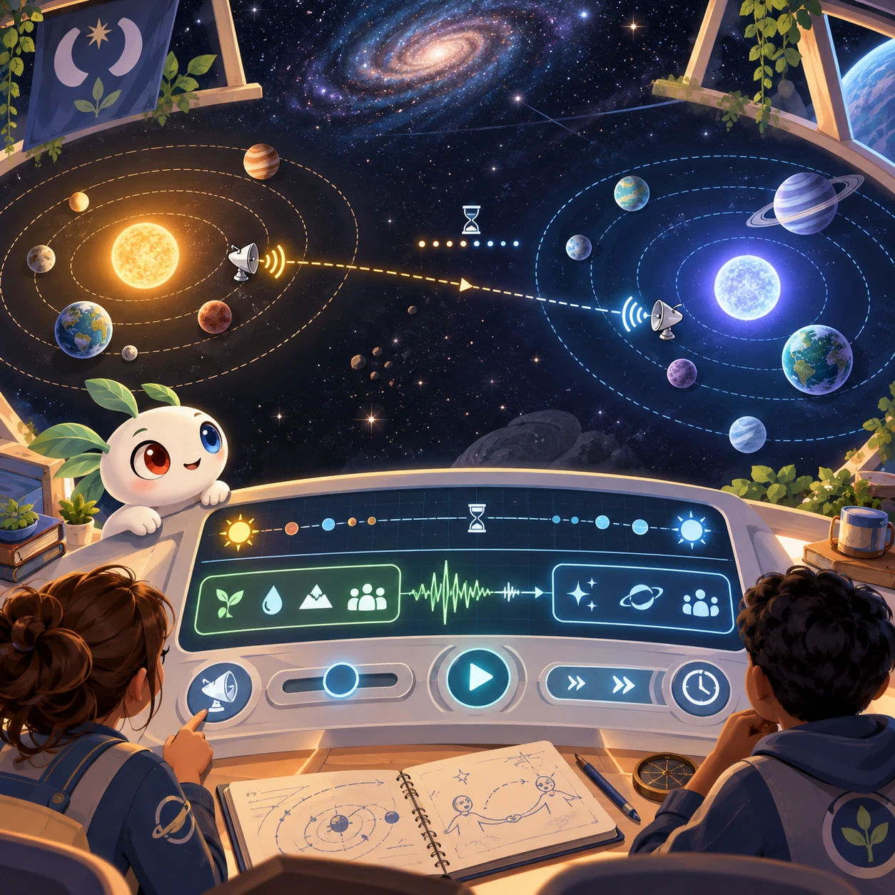
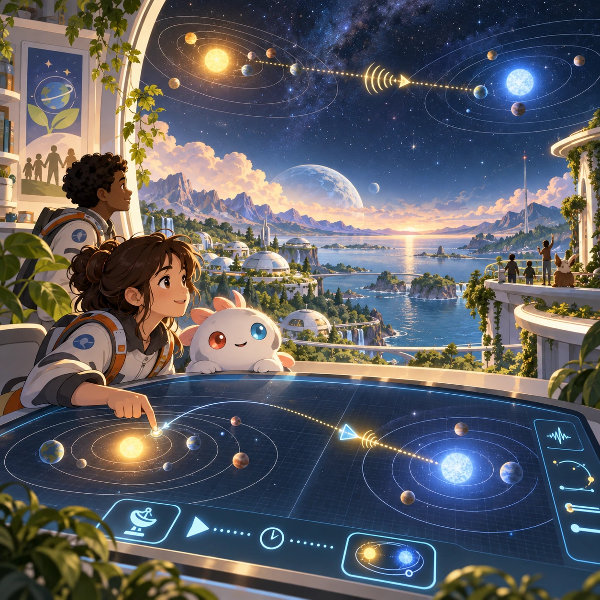
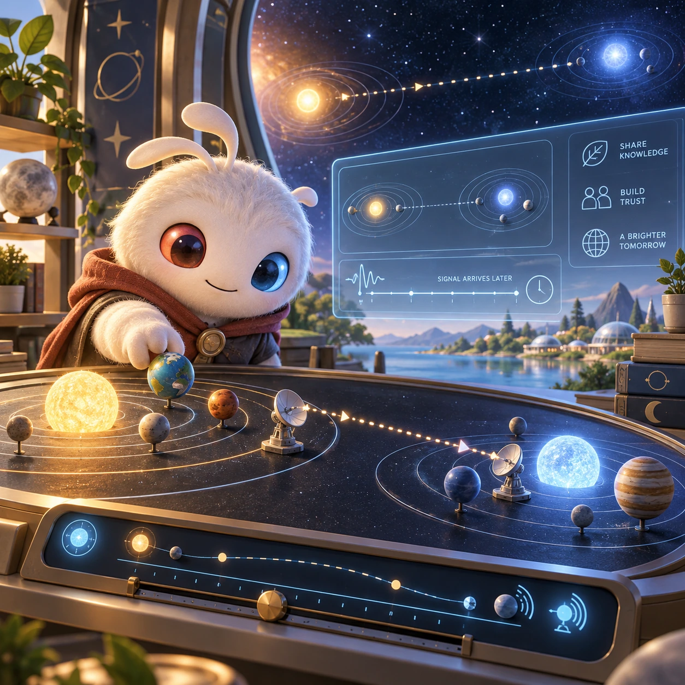
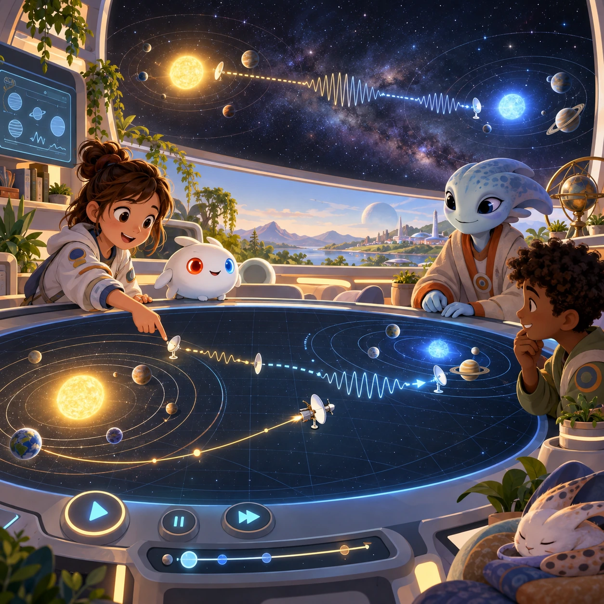

# First Contact (final)

SS-14 · [Strategy and simulation](../ss.md) · Cx 7 · Original catalog

**The idea:** Coordinate a physically grounded peaceful first contact between two star systems, using delayed signals and orbital trajectories.

| Decision             | Proposal                                                                                                                                                                                    |
| -------------------- | ------------------------------------------------------------------------------------------------------------------------------------------------------------------------------------------- |
| Familiar mechanic    | Realistic multi-genre simulator                                                                                                                                                             |
| Learning objective   | Everything above, at real scale                                                                                                                                                             |
| First prototype      | One authored challenge built around the interaction above, with a clear goal, immediate feedback, restart and unlimited retries.                                                            |
| Technology           | React shell + three.js/R3F and a validated simulation adapter. Begin with a small 2D reference model before a 3D vertical slice; use measured device tiers.                                 |
| Scope boundary       | One bounded scenario and one core system; defer a full campaign, network play and production-scale content.                                                                                 |
| Reuse                | Shared input, saves, accessibility, seeded state and the strategy and simulation collection shell.                                                                                          |
| Prototype acceptance | A player can identify the next action from the screen, complete one challenge, explain the practiced idea and restart without help. Check touch and keyboard play at narrow and wide sizes. |
| Main uncertainty     | Simulation accuracy and device cost need measured evidence before extending the scenario.                                                                                                   |

## Estimated plan

**First playable version:** A vertical slice of 15 missions combining delayed signals, orbital transfers and peaceful contact talks between two star systems at real scale. The full campaign and every earlier subsystem are deferred.

| Measure              | Estimate                                                                                                   |
| -------------------- | ---------------------------------------------------------------------------------------------------------- |
| Youngest age         | 12+                                                                                                        |
| Toddler learnability | 1 of 5 — Needs reading, precise motor control, timing pressure or abstract rules; not a toddler game (6+). |
| Code                 | 7850 LOC, 65.4 days                                                                                        |
| Assets               | 741 hours, 123.5 days                                                                                      |
| Effort               | 188.9 days, risk 5 of 5                                                                                    |
| Start score          | 566.7 (rank 300 of 300; lower is better)                                                                   |

**Algorithms:** `orbital-mechanics` (Orbital mechanics, 500 LOC) · `relativity` (Relativistic physics, 600 LOC) · `camera-3d` (3D camera, 300 LOC) · `dialogue-branching` (Branching dialogue, 300 LOC) · `economy-sim` (Resource economy, 600 LOC) · `quest-state` (Quest and story state, 300 LOC) · `timeline` (Timeline, 250 LOC)

**Assets:** 40 sprites, 15 animations, 8 backgrounds, 24 UI screens, 30 sound effects, 6 music tracks, 200 voice lines, 15 authored levels, 300 content items, 50 3D models

How the numbers are computed: [development plan](../../development-plan.md#how-the-scores-work).

## Four visual directions

These are independently generated concept proposals for selecting a prototype.
The four views compare gameplay readability, world appeal, tactile identity and
room to grow. They are not screenshots of an implemented game. Native image
dimensions, hashes, exact prompts and generation provenance are recorded in the
[art manifest](../art/ss-14/manifest.json); see the [generation notes](../README.md#image-generation-and-provenance).

### Gameplay

### World

### Characters and materials

### Expanded play

## Design checks before prototyping

- Learning target: **Everything above, at real scale**. Ask a domain reviewer to validate factual content in the mechanic.
- Keep goals cooperative or self-directed, using resources and needs. Avoid purchasable power. No pressure timers in the accessible mode.
- Use original layouts and character designs; the [legal checklist](../../legal.md) applies even when a mechanic is familiar.
- Choose the minimum [fidelity level](../../simulation-engine.md#determinism-and-fidelity-levels) the lesson needs; concept art does not establish scientific accuracy.
- Review silhouettes, text alternatives, reduced motion and non-color cues against the [adorability gate](../../lore/adorability-gate.md).

Genre context: [existing genre research](../../../case-studies/issue-1/data/research-genres-ideas.md)
and [expansion research](../../../case-studies/issue-1/data/research-visual-catalog.md).

[← Mars Habitat](ss-13.md) · [All concepts](../README.md) · [Circular Factory →](ss-15.md)
