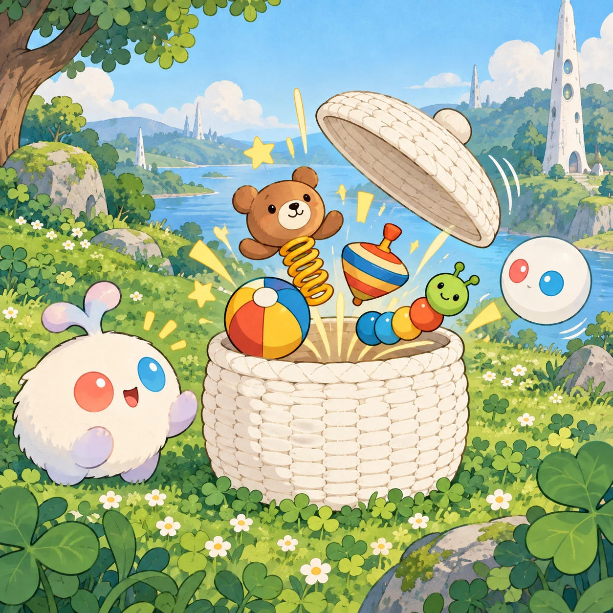
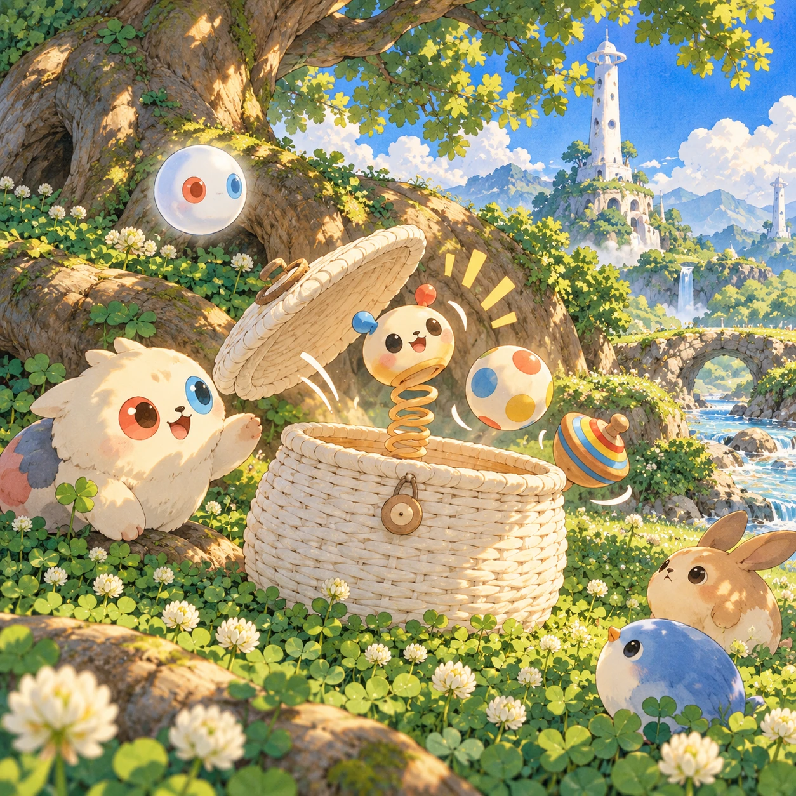

# Pop-Up Basket

TD-05 · [Toddlers (1–3)](../td.md) · Cx 1 · Ages 1–3 · Raya story catalog

**The idea:** A big woven white basket sits in the clover with its lid bouncing; one tap anywhere makes the lid fly open and a springy toy pops out, a ball, a spinning top or a wriggly bead friend.

| Decision             | Proposal                                                                                                                                                                                                                                                                               |
| -------------------- | -------------------------------------------------------------------------------------------------------------------------------------------------------------------------------------------------------------------------------------------------------------------------------------- |
| Familiar mechanic    | Cause-and-effect toy box                                                                                                                                                                                                                                                               |
| Learning objective   | Cause and effect, surprise, naming toys                                                                                                                                                                                                                                                |
| First prototype      | One sensory toy or guided interaction with a large tap target, immediate gentle feedback and unlimited repetition. Introduce dragging only after an accessible tap alternative. No score or fail state; invite caregiver co-play under age 2.                                          |
| Technology           | React + SVG/DOM; deterministic state, undo and seeded levels. Start with one local screen and touch plus keyboard input.                                                                                                                                                               |
| Scope boundary       | One board and one rule set; defer accounts, multiplayer, procedural content and platform SDKs.                                                                                                                                                                                         |
| Reuse                | Shared input, saves, accessibility, seeded state and the toddlers (1–3) collection shell.                                                                                                                                                                                              |
| Prototype acceptance | During caregiver co-play, the child can explore one clear interaction and repeat it willingly. Observe recognition or purposeful action; require no reading or spoken explanation. Check large touch targets and a keyboard-accessible caregiver alternative at narrow and wide sizes. |
| Main uncertainty     | Test whether the lesson follows from play and whether the first interaction is understandable without reading.                                                                                                                                                                         |

## Estimated plan

**First playable version:** One basket that pops out eight springy toys in turn on any tap, each with its own bounce and sound, and a goodnight clean-up where the toys climb back in; hide-again tricks are left out.

| Measure              | Estimate                                                                                                |
| -------------------- | ------------------------------------------------------------------------------------------------------- |
| Youngest age         | 1+                                                                                                      |
| Toddler learnability | 5 of 5 — One tap anywhere gives an instant response; no goal or failure; works with co-play from age 1. |
| Code                 | 460 LOC, 3.8 days                                                                                       |
| Assets               | 66 hours, 11 days                                                                                       |
| Effort               | 14.9 days, risk 1 of 5                                                                                  |
| Start score          | 14.9 (rank 8 of 310; lower is better)                                                                   |

**Algorithms:** `tap-feedback` (Tap feedback, 80 LOC) · `tween-cause-effect` (Cause-and-effect animation, 100 LOC) · `particle-effects` (Particles, 150 LOC)

**Assets:** 14 sprites, 8 animations, 1 background, 1 UI screen, 12 sound effects, 1 music track, 8 voice lines, 8 content items

How the numbers are computed: [development plan](../../development-plan.md#how-the-scores-work).

## Story

In the shade of the big tree stood a white basket. It was very still. Then... bump! The lid jumped. Linky tapped it. Out popped a red ball! Boing, boing, it bounced away. Linky tapped again. Out popped Oopsy, with a band-aid and a big grin. Oopsy fell over and laughed. Linky laughed too. Every tap brought a new friend. When the sun went low, all the toys climbed back inside, and the lid closed with a tiny click. Goodnight, toys.

> **Wisdom:** Surprises make us smile.

## Four visual directions

These are independently generated concept proposals for selecting a prototype.
The four views compare gameplay readability, world appeal, tactile identity and
room to grow. They are not screenshots of an implemented game. Native image
dimensions, hashes, exact prompts and generation provenance are recorded in the
[art manifest](../art/td-05/manifest.json); see the [generation notes](../README.md#image-generation-and-provenance).

The [core prompts](../jobs/td.json) use IDs `td-05/01-gameplay` to `td-05/04-discovery`.

### Gameplay

A big woven white basket sits in the clover with its lid bouncing; one tap anywhere makes the lid fly open and a springy toy pops out, a ball, a spinning top or a wriggly bead friend.

### World

A cozy corner of the toddler meadow under a broad shade tree whose roots curve like soft benches, with clover all around. The short white Chord tower peeks between the leaves. Afternoon sun makes dappled spots on the grass and a tiny stream murmurs nearby. Calm, warm and close, like a world the size of a picnic blanket.

### Characters and materials

The basket is woven from white lattice with coral and sky-blue ribbons. Toys: a wooden ball, a spinning top, a spring-legged Verbi, a Beadle bead chain that wriggles, a soft star-shaped Anya and a little drum. An Orbi lifts toys with a gentle shimmer. Wood, felt and woven textures in warm pastels.

### Expanded play

As play grows, the basket learns new tricks: toys that hide again on a second tap, Oopsy popping out like a jack-in-the-box who laughs and tumbles over, a music toy that plays a short tune, and a goodnight mode where every toy climbs back into the basket and the lid closes softly.

## Design checks before prototyping

- Learning target: **Cause and effect, surprise, naming toys**. Ask a domain reviewer to validate factual content in the mechanic.
- Keep goals cooperative or self-directed, using resources and needs. Avoid purchasable power. No pressure timers in the accessible mode.
- Use original layouts and character designs; the [legal checklist](../../legal.md) applies even when a mechanic is familiar.
- Choose the minimum [fidelity level](../../simulation-engine.md#determinism-and-fidelity-levels) the lesson needs; concept art does not establish scientific accuracy.
- Review silhouettes, text alternatives, reduced motion and non-color cues against the [adorability gate](../../lore/adorability-gate.md).
- Follow the [toddler design rules](../../../case-studies/issue-1/data/research-raya-shacados.md#7-toddlers-and-screens-r68-r69): tap before drag, no reading, no failure, co-play under age 2.

Genre context: [existing genre research](../../../case-studies/issue-1/data/research-genres-ideas.md)
and [expansion research](../../../case-studies/issue-1/data/research-visual-catalog.md).

[← Clover Chimes](td-04.md) · [All concepts](../README.md) · [Hello, Little Fish →](td-06.md)
