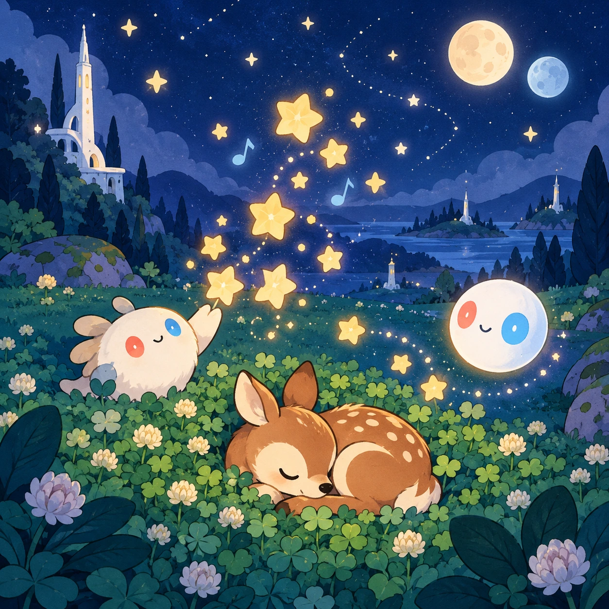
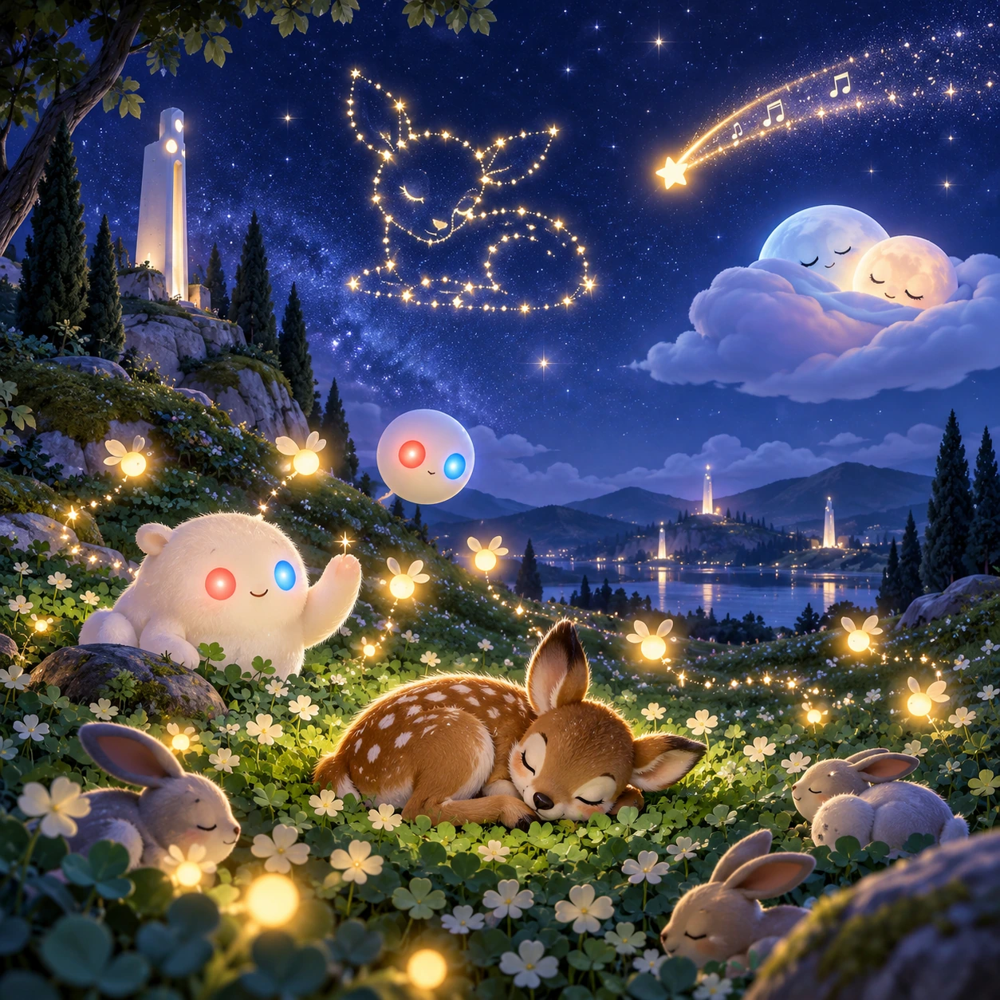

# Pim and Pom Lullaby

TD-07 · [Toddlers (1–3)](../td.md) · Cx 1 · Ages 1–3 · Raya story catalog

**The idea:** A deep blue night meadow lies under two small moons; a tap anywhere sprinkles a cluster of stars that hum one soft lullaby note, while a sleepy fawn curls up in the clover below.

| Decision             | Proposal                                                                                                                                                                                                                                                                               |
| -------------------- | -------------------------------------------------------------------------------------------------------------------------------------------------------------------------------------------------------------------------------------------------------------------------------------- |
| Familiar mechanic    | Lullaby night sky toy                                                                                                                                                                                                                                                                  |
| Learning objective   | Calming down, bedtime, the night sky                                                                                                                                                                                                                                                   |
| First prototype      | One sensory toy or guided interaction with a large tap target, immediate gentle feedback and unlimited repetition. Introduce dragging only after an accessible tap alternative. No score or fail state; invite caregiver co-play under age 2.                                          |
| Technology           | React + SVG/DOM; deterministic state, undo and seeded levels. Start with one local screen and touch plus keyboard input.                                                                                                                                                               |
| Scope boundary       | One board and one rule set; defer accounts, multiplayer, procedural content and platform SDKs.                                                                                                                                                                                         |
| Reuse                | Shared input, saves, accessibility, seeded state and the toddlers (1–3) collection shell.                                                                                                                                                                                              |
| Prototype acceptance | During caregiver co-play, the child can explore one clear interaction and repeat it willingly. Observe recognition or purposeful action; require no reading or spoken explanation. Check large touch targets and a keyboard-accessible caregiver alternative at narrow and wide sizes. |
| Main uncertainty     | Test whether the lesson follows from play and whether the first interaction is understandable without reading.                                                                                                                                                                         |

## Estimated plan

**First playable version:** One night meadow where taps sprinkle humming stars and fireflies over a sleeping fawn while the lullaby slows and the screen dims by itself; star pictures and the shooting star are left out.

| Measure              | Estimate                                                                                                |
| -------------------- | ------------------------------------------------------------------------------------------------------- |
| Youngest age         | 1+                                                                                                      |
| Toddler learnability | 5 of 5 — One tap anywhere gives an instant response; no goal or failure; works with co-play from age 1. |
| Code                 | 350 LOC, 2.9 days                                                                                       |
| Assets               | 41 hours, 6.8 days                                                                                      |
| Effort               | 9.7 days, risk 1 of 5                                                                                   |
| Start score          | 9.7 (rank 3 of 310; lower is better)                                                                    |

**Algorithms:** `tap-feedback` (Tap feedback, 80 LOC) · `particle-effects` (Particles, 150 LOC)

**Assets:** 8 sprites, 4 animations, 1 background, 1 UI screen, 6 sound effects, 1 music track, 6 voice lines

How the numbers are computed: [development plan](../../development-plan.md#how-the-scores-work).

## Story

The sun went down behind the hill. Pim came up, and then Pom, the two little moons. Linky yawned a big yawn. The fawn yawned a small yawn. Linky touched the sky, and a star came out, singing hmmm. Another star, and another, very softly. Nully floated by and whispered, rest is important. The Orbi made its light low and warm. The stars sang slower and slower. The fawn closed its eyes. Linky closed its eyes. Goodnight, Pim. Goodnight, Pom. Goodnight, meadow.

> **Wisdom:** Rest is important.

## Four visual directions

These are independently generated concept proposals for selecting a prototype.
The four views compare gameplay readability, world appeal, tactile identity and
room to grow. They are not screenshots of an implemented game. Native image
dimensions, hashes, exact prompts and generation provenance are recorded in the
[art manifest](../art/td-07/manifest.json); see the [generation notes](../README.md#image-generation-and-provenance).

The [core prompts](../jobs/td.json) use IDs `td-07/01-gameplay` to `td-07/04-discovery`.

### Gameplay

A deep blue night meadow lies under two small moons; a tap anywhere sprinkles a cluster of stars that hum one soft lullaby note, while a sleepy fawn curls up in the clover below.

### World

The toddler meadow at night, deep blue but never black. The short white Chord tower glows softly at its crown, dimmed and shielded for the animals. Two little moons, Pim and Pom, hang over a far hill. Fireflies drift above the clover, and a river of stars fills the quiet sky.

### Characters and materials

Sleepy friends: a curled-up fawn, Linky yawning with half-closed red and blue eyes, Nully as a soft see-through nap bubble, and an Orbi floating low with dim eyes like a night light. Stars are round and soft with gentle halos. A palette of indigo, lavender, cream and moon silver.

### Expanded play

Each night the sky offers a new gentle picture: fireflies that follow the finger, stars that join into the shape of a sleeping fawn, a slow shooting star that sings, and a cloud that tucks the moons in. The music slows and fades over a few minutes, the screen dims by itself, and the game always ends asleep.

## Design checks before prototyping

- Learning target: **Calming down, bedtime, the night sky**. Ask a domain reviewer to validate factual content in the mechanic.
- Keep goals cooperative or self-directed, using resources and needs. Avoid purchasable power. No pressure timers in the accessible mode.
- Use original layouts and character designs; the [legal checklist](../../legal.md) applies even when a mechanic is familiar.
- Choose the minimum [fidelity level](../../simulation-engine.md#determinism-and-fidelity-levels) the lesson needs; concept art does not establish scientific accuracy.
- Review silhouettes, text alternatives, reduced motion and non-color cues against the [adorability gate](../../lore/adorability-gate.md).
- Follow the [toddler design rules](../../../case-studies/issue-1/data/research-raya-shacados.md#7-toddlers-and-screens-r68-r69): tap before drag, no reading, no failure, co-play under age 2.

Genre context: [existing genre research](../../../case-studies/issue-1/data/research-genres-ideas.md)
and [expansion research](../../../case-studies/issue-1/data/research-visual-catalog.md).

[← Hello, Little Fish](td-06.md) · [All concepts](../README.md) · [Clover Fingerpaint →](td-08.md)
