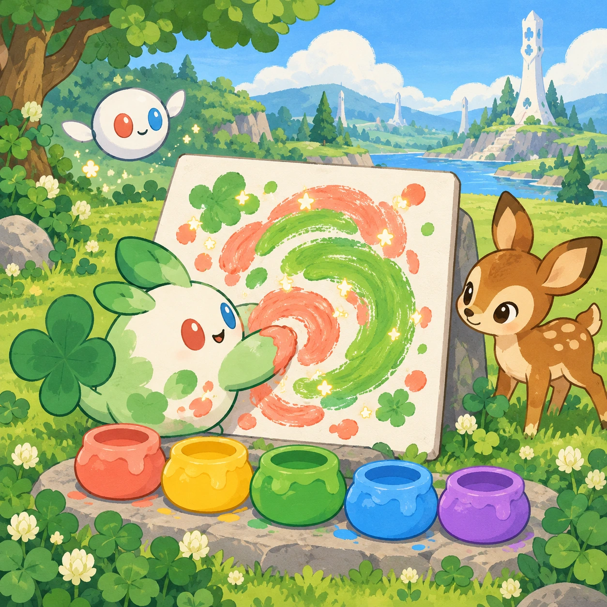
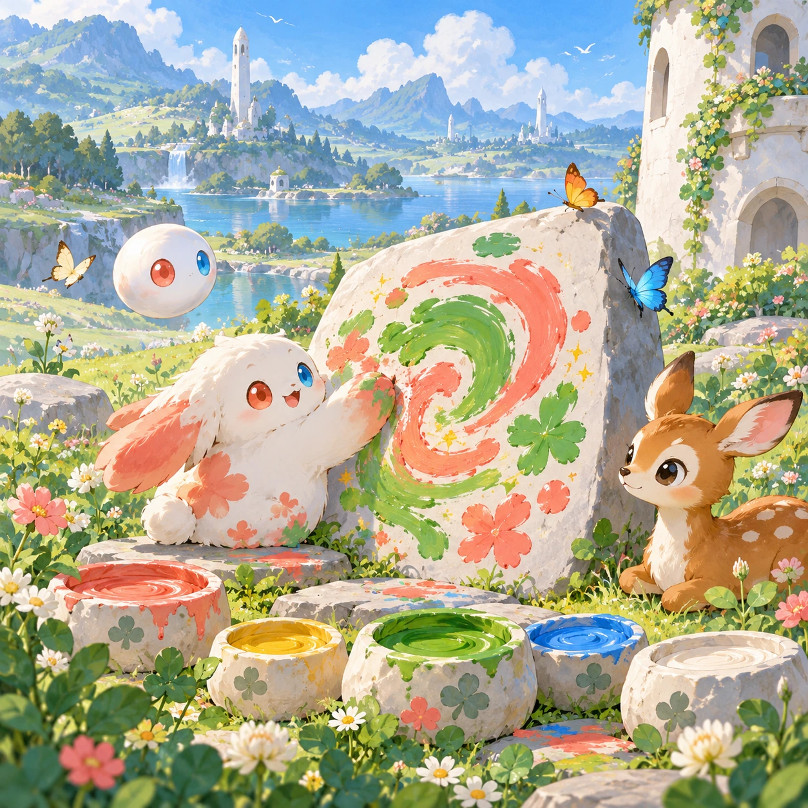
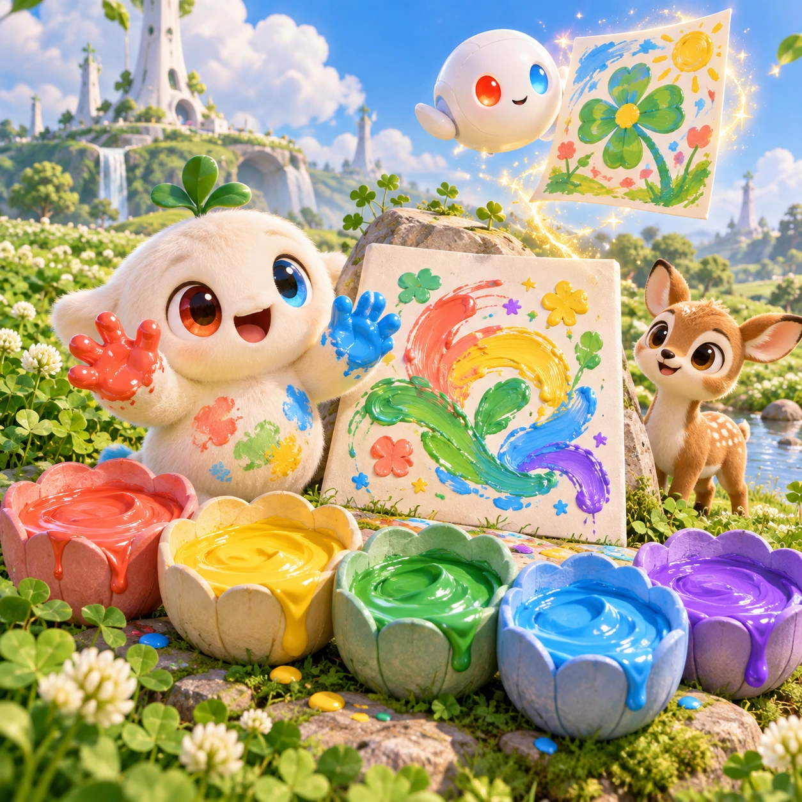
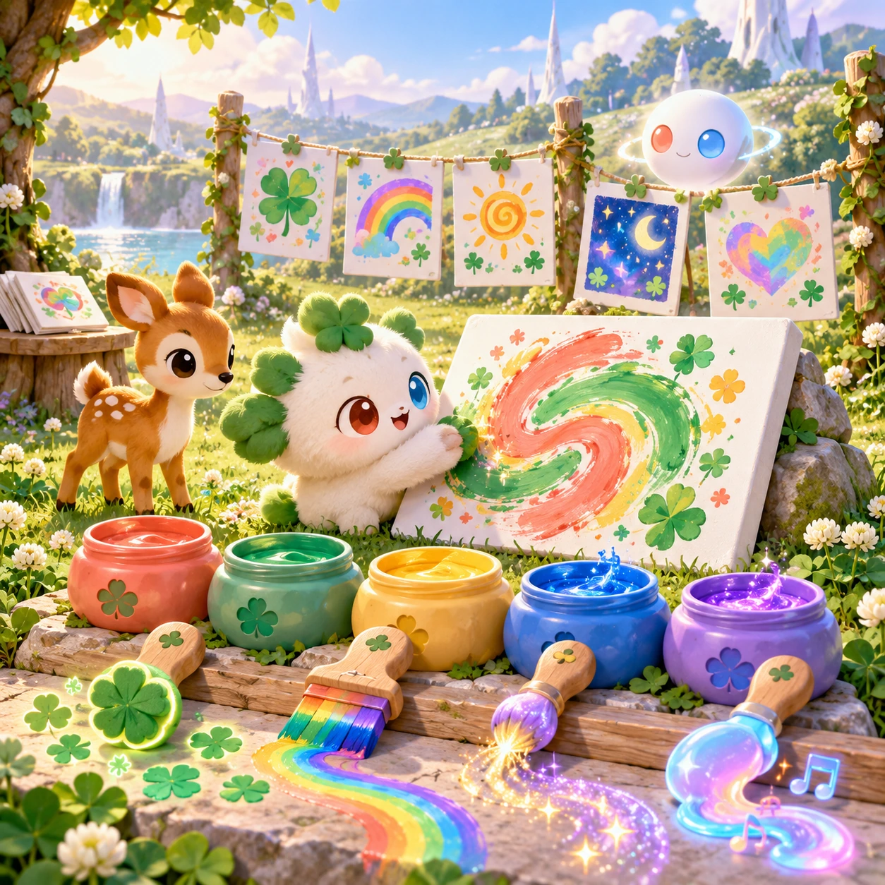

# Clover Fingerpaint

TD-08 · [Toddlers (1–3)](../td.md) · Cx 2 · Ages 1–3 · Raya story catalog

**The idea:** A smooth white canvas leans on a stone in the meadow; Linky swirls thick coral and leaf-green paint across it with a round paw, leaving trails of little sparkles, while a fawn watches beside five big round paint pots.

| Decision             | Proposal                                                                                                                                                                                                                                                                               |
| -------------------- | -------------------------------------------------------------------------------------------------------------------------------------------------------------------------------------------------------------------------------------------------------------------------------------- |
| Familiar mechanic    | Finger painting                                                                                                                                                                                                                                                                        |
| Learning objective   | Creativity, colors, hand control                                                                                                                                                                                                                                                       |
| First prototype      | One sensory toy or guided interaction with a large tap target, immediate gentle feedback and unlimited repetition. Introduce dragging only after an accessible tap alternative. No score or fail state; invite caregiver co-play under age 2.                                          |
| Technology           | React + SVG/DOM; deterministic state, undo and seeded levels. Start with one local screen and touch plus keyboard input.                                                                                                                                                               |
| Scope boundary       | One board and one rule set; defer accounts, multiplayer, procedural content and platform SDKs.                                                                                                                                                                                         |
| Reuse                | Shared input, saves, accessibility, seeded state and the toddlers (1–3) collection shell.                                                                                                                                                                                              |
| Prototype acceptance | During caregiver co-play, the child can explore one clear interaction and repeat it willingly. Observe recognition or purposeful action; require no reading or spoken explanation. Check large touch targets and a keyboard-accessible caregiver alternative at narrow and wide sizes. |
| Main uncertainty     | Test whether the lesson follows from play and whether the first interaction is understandable without reading.                                                                                                                                                                         |

## Estimated plan

**First playable version:** One canvas where any finger smear paints thick sparkly color from five big pots, a clear-and-start-over button and a keep-for-parents save; stamps, sound paint and the meadow gallery are left out.

| Measure              | Estimate                                                                                                |
| -------------------- | ------------------------------------------------------------------------------------------------------- |
| Youngest age         | 1+                                                                                                      |
| Toddler learnability | 5 of 5 — One tap anywhere gives an instant response; no goal or failure; works with co-play from age 1. |
| Code                 | 660 LOC, 5.5 days                                                                                       |
| Assets               | 44 hours, 7.4 days                                                                                      |
| Effort               | 12.9 days, risk 2 of 5                                                                                  |
| Start score          | 12.9 (rank 5 of 310; lower is better)                                                                   |

**Algorithms:** `draw-trace` (Freehand drawing, 250 LOC) · `particle-effects` (Particles, 150 LOC) · `tap-feedback` (Tap feedback, 80 LOC)

**Assets:** 10 sprites, 3 animations, 1 background, 2 UI screens, 8 sound effects, 1 music track, 8 voice lines

How the numbers are computed: [development plan](../../development-plan.md#how-the-scores-work).

## Story

Linky found a white stone, flat and clean. Linky dipped one finger in yellow paint. Swish! A sun. Linky dipped a finger in green. Swoosh! Grass. Then Linky dipped all its fingers in blue and made a big, wiggly sky. It did not look like anything else in the world. It looked like Linky. The fawns came to look. The Orbi lifted the painting up high so the whole meadow could see. Every painting is right, because every painting is yours.

> **Wisdom:** Your colors are just right.

## Four visual directions

These are independently generated concept proposals for selecting a prototype.
The four views compare gameplay readability, world appeal, tactile identity and
room to grow. They are not screenshots of an implemented game. Native image
dimensions, hashes, exact prompts and generation provenance are recorded in the
[art manifest](../art/td-08/manifest.json); see the [generation notes](../README.md#image-generation-and-provenance).

The [core prompts](../jobs/td.json) use IDs `td-08/01-gameplay` to `td-08/04-discovery`.

### Gameplay

A smooth white canvas leans on a stone in the meadow; Linky swirls thick coral and leaf-green paint across it with a round paw, leaving trails of little sparkles, while a fawn watches beside five big round paint pots.

### World

A breezy meadow corner beside the short white Chord tower, with smooth flat stones that stand like easels and wildflowers that inspire the colors. Soft morning light, no harsh shadows. Butterflies land near the drying paint. The background stays calm and pale, so the painting is always the brightest thing on screen.

### Characters and materials

Five huge paint pots shaped like flower cups: coral, sunshine yellow, leaf green, sky blue and violet. Linky holds up its red hand and blue hand, both covered in paint. An Orbi lifts a finished painting toward the sky with a shimmer. Thick creamy paint texture, sparkles and rounded brush trails.

### Expanded play

Later, new brushes appear one by one: a clover-leaf stamp, a rainbow brush, a sparkle brush and paint that makes soft sounds as it flows. Finished paintings hang on a white lattice line in a little meadow gallery. A parent can keep a painting for the family; nothing ever leaves the device.

## Design checks before prototyping

- Learning target: **Creativity, colors, hand control**. Ask a domain reviewer to validate factual content in the mechanic.
- Keep goals cooperative or self-directed, using resources and needs. Avoid purchasable power. No pressure timers in the accessible mode.
- Use original layouts and character designs; the [legal checklist](../../legal.md) applies even when a mechanic is familiar.
- Choose the minimum [fidelity level](../../simulation-engine.md#determinism-and-fidelity-levels) the lesson needs; concept art does not establish scientific accuracy.
- Review silhouettes, text alternatives, reduced motion and non-color cues against the [adorability gate](../../lore/adorability-gate.md).
- Follow the [toddler design rules](../../../case-studies/issue-1/data/research-raya-shacados.md#7-toddlers-and-screens-r68-r69): tap before drag, no reading, no failure, co-play under age 2.

Genre context: [existing genre research](../../../case-studies/issue-1/data/research-genres-ideas.md)
and [expansion research](../../../case-studies/issue-1/data/research-visual-catalog.md).

[← Pim and Pom Lullaby](td-07.md) · [All concepts](../README.md) · [Choo-Choo Parade →](td-09.md)
