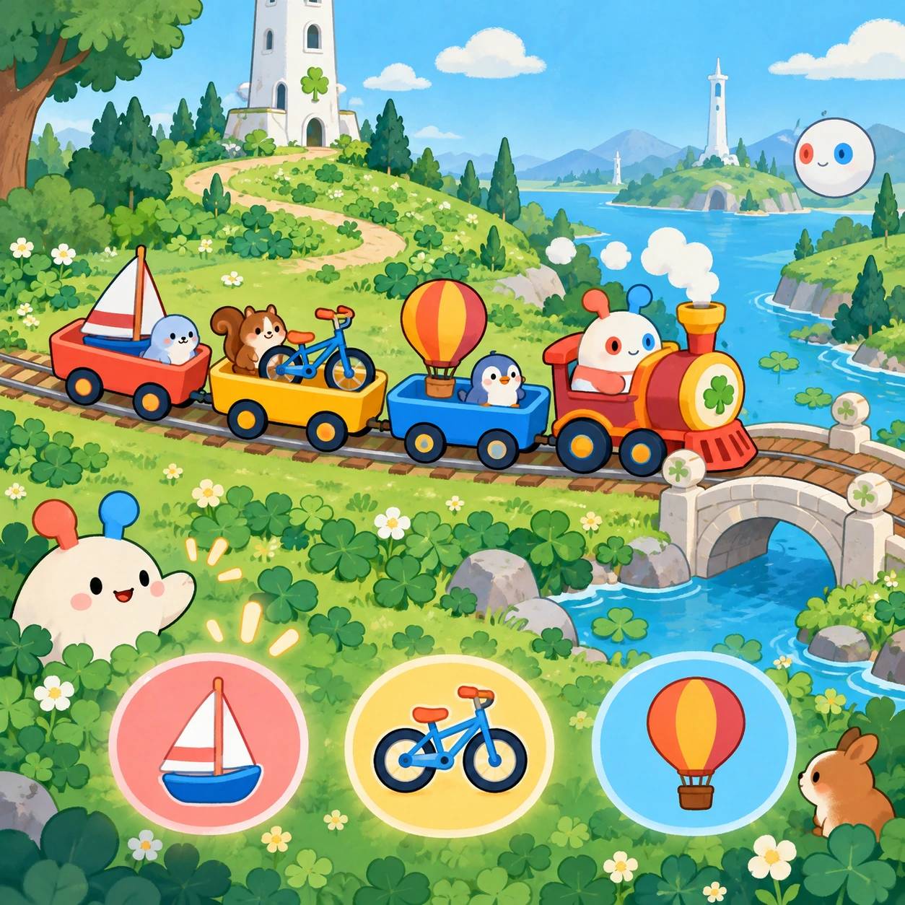
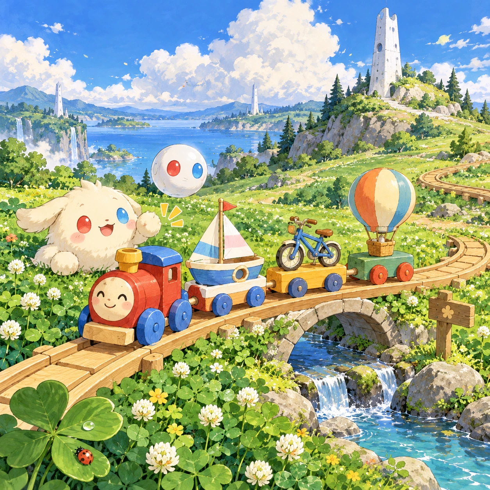
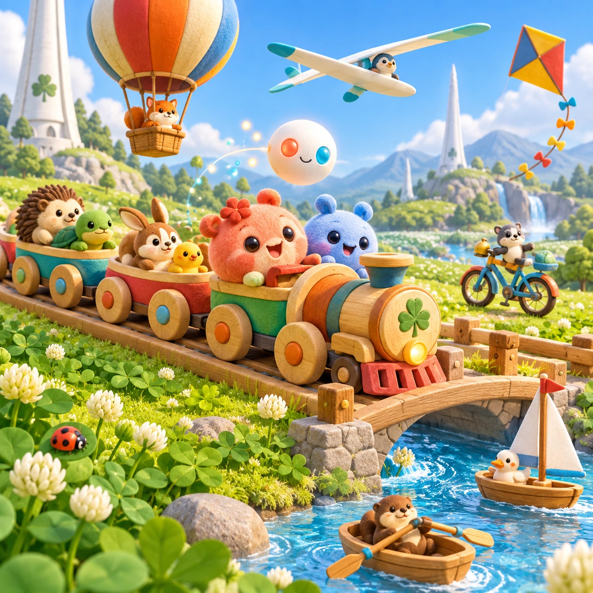

# Choo-Choo Parade

TD-09 · [Toddlers (1–3)](../td.md) · Cx 1 · Ages 1–3 · Raya story catalog

**The idea:** Choo-Choo Seq, a cheerful train of paired friend cars, rolls across the clover toward a tiny bridge; a tap anywhere sends the next toy vehicle past with its sound, a sailboat, a bicycle or a balloon.

| Decision             | Proposal                                                                                                                                                                                                                                                                               |
| -------------------- | -------------------------------------------------------------------------------------------------------------------------------------------------------------------------------------------------------------------------------------------------------------------------------------- |
| Familiar mechanic    | Vehicles and their sounds                                                                                                                                                                                                                                                              |
| Learning objective   | Vehicle names and sounds, things that move                                                                                                                                                                                                                                             |
| First prototype      | One sensory toy or guided interaction with a large tap target, immediate gentle feedback and unlimited repetition. Introduce dragging only after an accessible tap alternative. No score or fail state; invite caregiver co-play under age 2.                                          |
| Technology           | React + SVG/DOM; deterministic state, undo and seeded levels. Start with one local screen and touch plus keyboard input.                                                                                                                                                               |
| Scope boundary       | One board and one rule set; defer accounts, multiplayer, procedural content and platform SDKs.                                                                                                                                                                                         |
| Reuse                | Shared input, saves, accessibility, seeded state and the toddlers (1–3) collection shell.                                                                                                                                                                                              |
| Prototype acceptance | During caregiver co-play, the child can explore one clear interaction and repeat it willingly. Observe recognition or purposeful action; require no reading or spoken explanation. Check large touch targets and a keyboard-accessible caregiver alternative at narrow and wide sizes. |
| Main uncertainty     | Test whether the lesson follows from play and whether the first interaction is understandable without reading.                                                                                                                                                                         |

## Estimated plan

**First playable version:** A toy meadow where each tap sends the next of eight toy vehicles past with its sound and voiced name, ending in a goodnight parking row; the sound guessing mode and sky-lane glider are left out.

| Measure              | Estimate                                                                                                |
| -------------------- | ------------------------------------------------------------------------------------------------------- |
| Youngest age         | 1+                                                                                                      |
| Toddler learnability | 5 of 5 — One tap anywhere gives an instant response; no goal or failure; works with co-play from age 1. |
| Code                 | 440 LOC, 3.7 days                                                                                       |
| Assets               | 69 hours, 11.5 days                                                                                     |
| Effort               | 15.1 days, risk 1 of 5                                                                                  |
| Start score          | 15.1 (rank 9 of 310; lower is better)                                                                   |

**Algorithms:** `tap-feedback` (Tap feedback, 80 LOC) · `tween-cause-effect` (Cause-and-effect animation, 100 LOC) · `phonics-audio` (Letter sounds, 120 LOC)

**Assets:** 16 sprites, 8 animations, 1 background, 1 UI screen, 10 sound effects, 1 music track, 10 voice lines, 8 content items

How the numbers are computed: [development plan](../../development-plan.md#how-the-scores-work).

## Story

Choo-choo! Here comes Seq, the train of friends. Each car carries two friends holding hands. Ring-ring! Here comes a little bicycle. Whoosh! Here comes a sailboat on the stream. Fwoo! A big round balloon floats over the hill. Linky waves at everyone. They all go somewhere different, but they all share the same meadow. At the end of the day, the train, the bike, the boat and the balloon line up in a row. One, two, three, four. Big things are made of small steps.

> **Wisdom:** Big things are made of small steps.

## Four visual directions

These are independently generated concept proposals for selecting a prototype.
The four views compare gameplay readability, world appeal, tactile identity and
room to grow. They are not screenshots of an implemented game. Native image
dimensions, hashes, exact prompts and generation provenance are recorded in the
[art manifest](../art/td-09/manifest.json); see the [generation notes](../README.md#image-generation-and-provenance).

The [core prompts](../jobs/td.json) use IDs `td-09/01-gameplay` to `td-09/04-discovery`.

### Gameplay

Choo-Choo Seq, a cheerful train of paired friend cars, rolls across the clover toward a tiny bridge; a tap anywhere sends the next toy vehicle past with its sound, a sailboat, a bicycle or a balloon.

### World

Omi's toy meadow, a soft play version of the clover meadow, with a curving wooden toy track, a little stream, a tiny arched bridge and a toy-sized white tower. There are no roads or cars: the vehicles are toys in a learning world. Clear midday light, puffy clouds and a gentle hill to roll down.

### Characters and materials

Choo-Choo Seq has round cars, each carrying a pair of friends: Soru in coral and Tari in sky blue. The other toy vehicles are a white sailboat on the stream, a bicycle with a bell, a hot-air balloon, a kite, a little rowing boat and a glider. Wood and felt toy textures, rounded edges and bright flat colors.

### Expanded play

New vehicles join the parade over time: a slow raft, a big sailing ship and a pearl glider riding the sky-lane near the white tower. A sound guessing mode plays the sound first, then the vehicle rolls in. At the end, every vehicle parks in a row and Choo-Choo Seq says goodnight with a soft whistle.

## Design checks before prototyping

- Learning target: **Vehicle names and sounds, things that move**. Ask a domain reviewer to validate factual content in the mechanic.
- Keep goals cooperative or self-directed, using resources and needs. Avoid purchasable power. No pressure timers in the accessible mode.
- Use original layouts and character designs; the [legal checklist](../../legal.md) applies even when a mechanic is familiar.
- Choose the minimum [fidelity level](../../simulation-engine.md#determinism-and-fidelity-levels) the lesson needs; concept art does not establish scientific accuracy.
- Review silhouettes, text alternatives, reduced motion and non-color cues against the [adorability gate](../../lore/adorability-gate.md).
- Follow the [toddler design rules](../../../case-studies/issue-1/data/research-raya-shacados.md#7-toddlers-and-screens-r68-r69): tap before drag, no reading, no failure, co-play under age 2.

Genre context: [existing genre research](../../../case-studies/issue-1/data/research-genres-ideas.md)
and [expansion research](../../../case-studies/issue-1/data/research-visual-catalog.md).

[← Clover Fingerpaint](td-08.md) · [All concepts](../README.md) · [Hum-Along Hill →](td-10.md)
