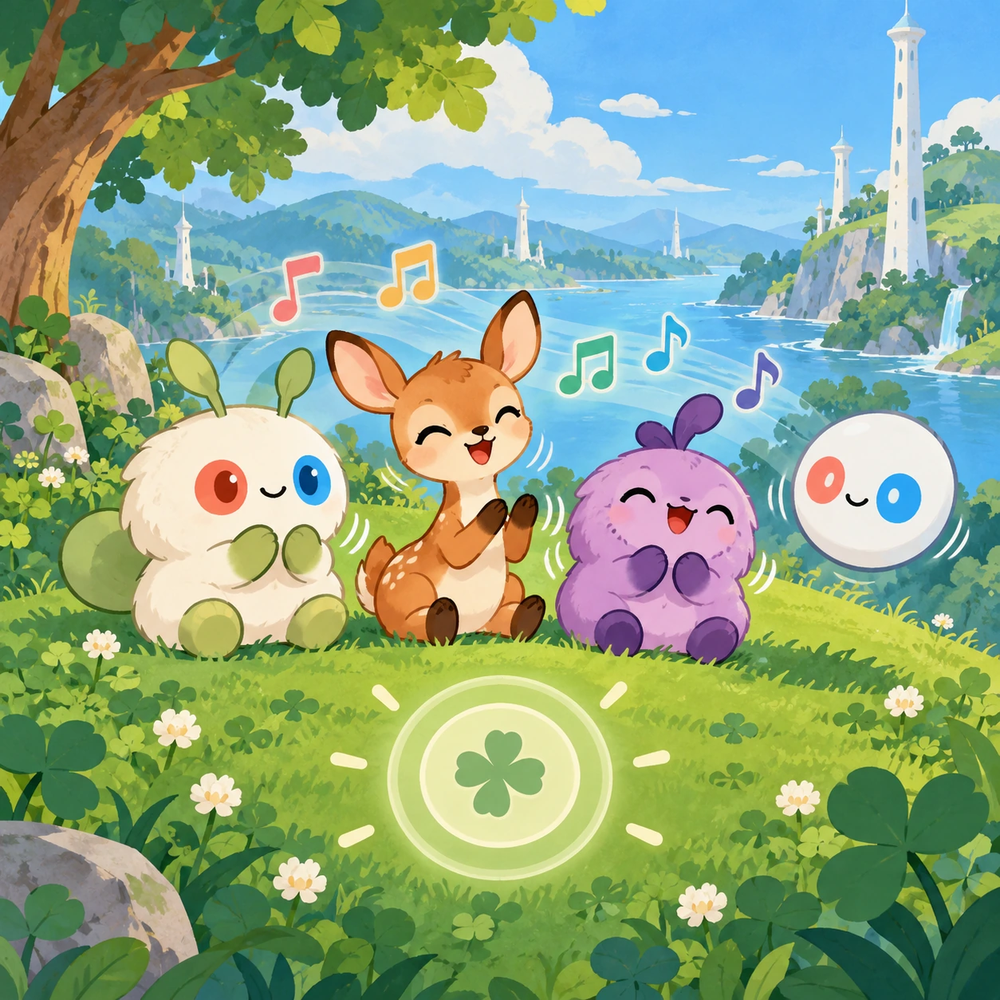
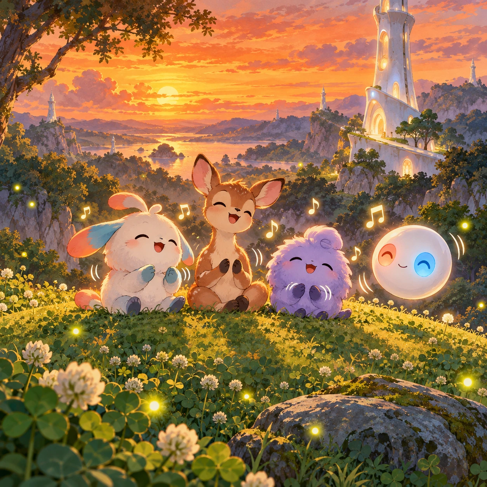
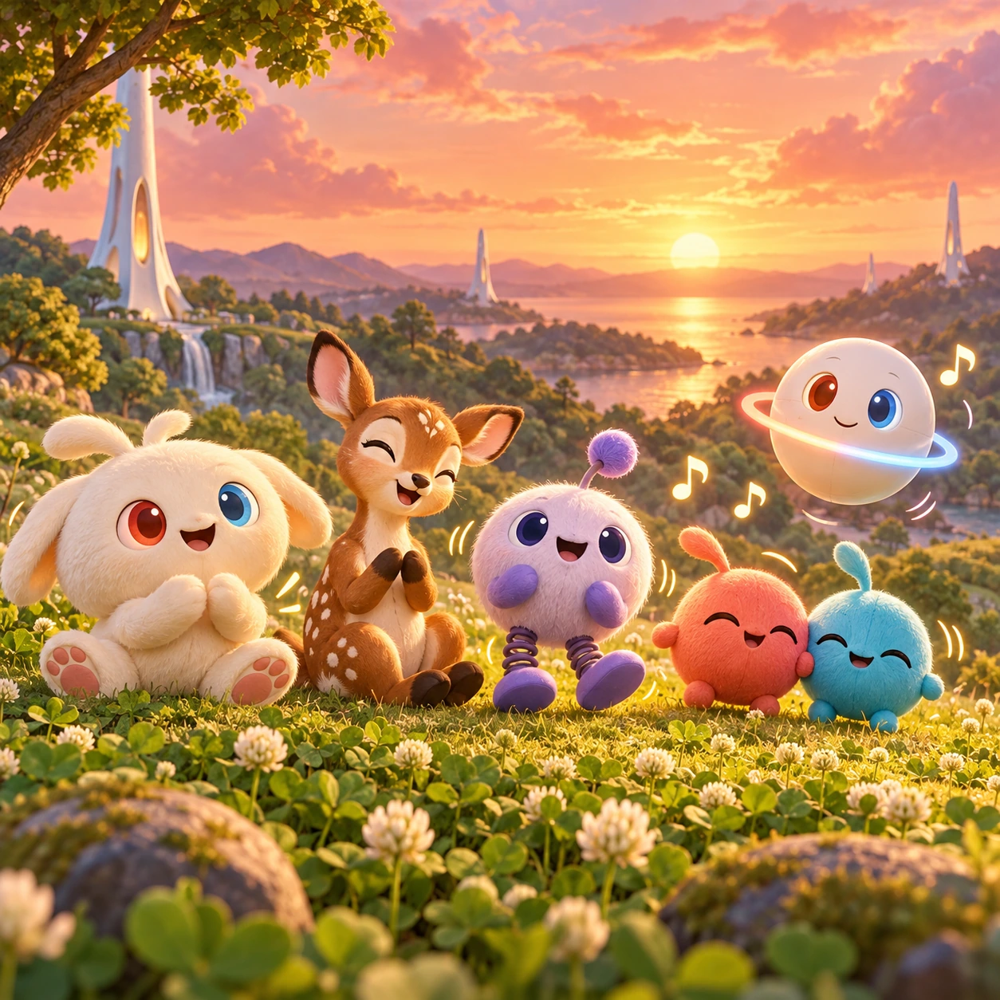
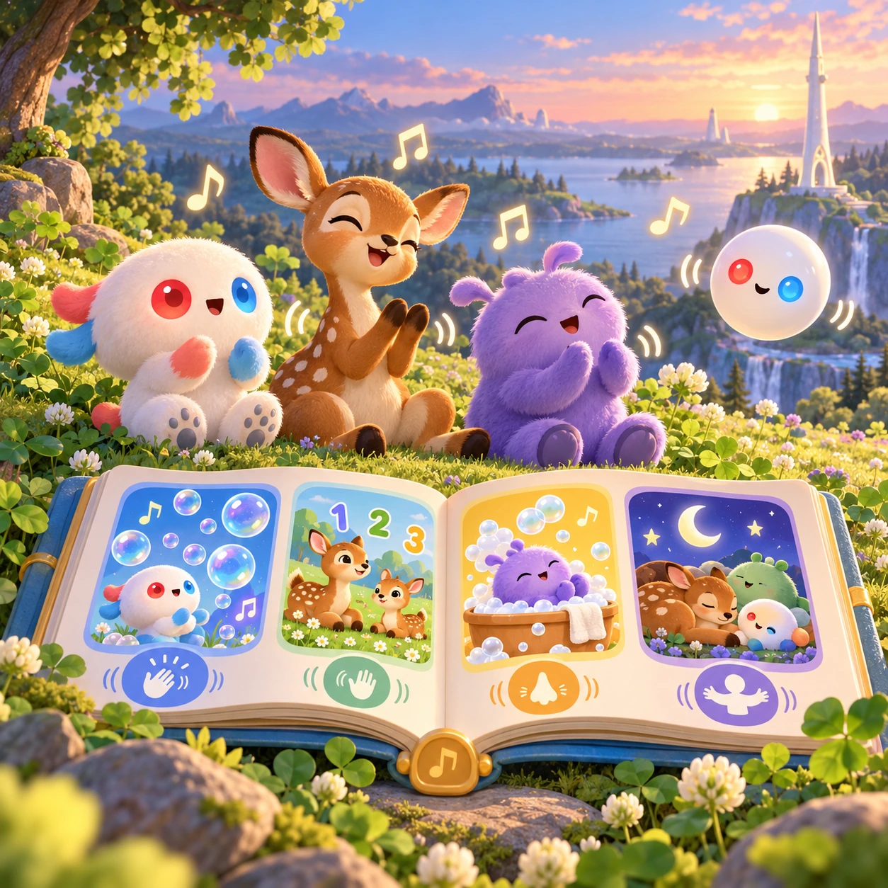

# Hum-Along Hill

TD-10 · [Toddlers (1–3)](../td.md) · Cx 1 · Ages 1–3 · Raya story catalog

**The idea:** Friends sit in a row on a grassy hill, Linky, a fawn, Verbi and an Orbi; a tap anywhere starts the next line of a short original song, and everyone sways and claps in time.

| Decision             | Proposal                                                                                                                                                                                                                                                                               |
| -------------------- | -------------------------------------------------------------------------------------------------------------------------------------------------------------------------------------------------------------------------------------------------------------------------------------- |
| Familiar mechanic    | Nursery-rhyme sing-along                                                                                                                                                                                                                                                               |
| Learning objective   | Rhythm of language, singing, gestures                                                                                                                                                                                                                                                  |
| First prototype      | One sensory toy or guided interaction with a large tap target, immediate gentle feedback and unlimited repetition. Introduce dragging only after an accessible tap alternative. No score or fail state; invite caregiver co-play under age 2.                                          |
| Technology           | React + SVG/DOM; deterministic state, undo and seeded levels. Start with one local screen and touch plus keyboard input.                                                                                                                                                               |
| Scope boundary       | One board and one rule set; defer accounts, multiplayer, procedural content and platform SDKs.                                                                                                                                                                                         |
| Reuse                | Shared input, saves, accessibility, seeded state and the toddlers (1–3) collection shell.                                                                                                                                                                                              |
| Prototype acceptance | During caregiver co-play, the child can explore one clear interaction and repeat it willingly. Observe recognition or purposeful action; require no reading or spoken explanation. Check large touch targets and a keyboard-accessible caregiver alternative at narrow and wide sizes. |
| Main uncertainty     | Test whether the lesson follows from play and whether the first interaction is understandable without reading.                                                                                                                                                                         |

## Estimated plan

**First playable version:** Three short original songs on one hill where each tap starts the next sung line and the friends clap and sway in time; the slow parent mode and the full songbook are left out.

| Measure              | Estimate                                                                                                |
| -------------------- | ------------------------------------------------------------------------------------------------------- |
| Youngest age         | 1+                                                                                                      |
| Toddler learnability | 5 of 5 — One tap anywhere gives an instant response; no goal or failure; works with co-play from age 1. |
| Code                 | 640 LOC, 5.3 days                                                                                       |
| Assets               | 67 hours, 11.1 days                                                                                     |
| Effort               | 16.4 days, risk 2 of 5                                                                                  |
| Start score          | 16.4 (rank 10 of 310; lower is better)                                                                  |

**Algorithms:** `tap-feedback` (Tap feedback, 80 LOC) · `tween-cause-effect` (Cause-and-effect animation, 100 LOC) · `rhythm-timing` (Rhythm timing, 300 LOC)

**Assets:** 10 sprites, 6 animations, 1 background, 1 UI screen, 6 sound effects, 3 music tracks, 12 voice lines, 3 authored levels

How the numbers are computed: [development plan](../../development-plan.md#how-the-scores-work).

## Story

On the top of the hill, the friends sat in a row. Linky began to hum. Hmm, hmm. The fawn nodded. Verbi bounced. Clap, clap. The Orbi made its light blink in time. Then everybody sang the meadow song, a little song about clover and sky. Some voices were high and some were low. Some friends sang the wrong words, and nobody minded. A song is better when we sing it together. When the song was done, the sun went to bed.

> **Wisdom:** Songs are better together.

## Four visual directions

These are independently generated concept proposals for selecting a prototype.
The four views compare gameplay readability, world appeal, tactile identity and
room to grow. They are not screenshots of an implemented game. Native image
dimensions, hashes, exact prompts and generation provenance are recorded in the
[art manifest](../art/td-10/manifest.json); see the [generation notes](../README.md#image-generation-and-provenance).

The [core prompts](../jobs/td.json) use IDs `td-10/01-gameplay` to `td-10/04-discovery`.

### Gameplay

Friends sit in a row on a grassy hill, Linky, a fawn, Verbi and an Orbi; a tap anywhere starts the next line of a short original song, and everyone sways and claps in time.

### World

A round grassy hill in the clover meadow at sunset, with the short white Chord tower behind it glowing gently as if it hums along. The sky is warm orange, long soft shadows stretch over the grass, and the first fireflies come out. The hill feels like a little outdoor stage, open and safe.

### Characters and materials

Linky with red and blue eyes, a fawn with white spots, Verbi bouncing on springy legs, Soru and Tari holding hands, and an Orbi keeping the beat with a pulsing equator ring. Simple dance poses: clap, sway, wave and nod. A warm sunset palette of coral, peach, gold and soft green.

### Expanded play

A small songbook of short original rhymes grows over time: a bubble song, a counting song with fawns, a washing song and a goodnight song. The actions match the words, so children learn to clap, wave and touch their nose together with the friends. A slow mode lets parents sing along at their own pace.

## Design checks before prototyping

- Learning target: **Rhythm of language, singing, gestures**. Ask a domain reviewer to validate factual content in the mechanic.
- Keep goals cooperative or self-directed, using resources and needs. Avoid purchasable power. No pressure timers in the accessible mode.
- Use original layouts and character designs; the [legal checklist](../../legal.md) applies even when a mechanic is familiar.
- Choose the minimum [fidelity level](../../simulation-engine.md#determinism-and-fidelity-levels) the lesson needs; concept art does not establish scientific accuracy.
- Review silhouettes, text alternatives, reduced motion and non-color cues against the [adorability gate](../../lore/adorability-gate.md).
- Follow the [toddler design rules](../../../case-studies/issue-1/data/research-raya-shacados.md#7-toddlers-and-screens-r68-r69): tap before drag, no reading, no failure, co-play under age 2.

Genre context: [existing genre research](../../../case-studies/issue-1/data/research-genres-ideas.md)
and [expansion research](../../../case-studies/issue-1/data/research-visual-catalog.md).

[← Choo-Choo Parade](td-09.md) · [All concepts](../README.md) · [Word Leaves →](td-11.md)
