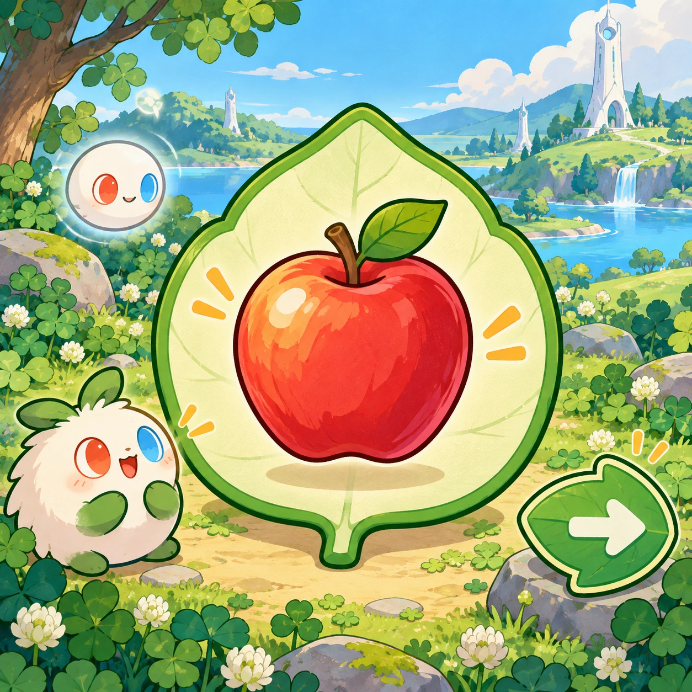
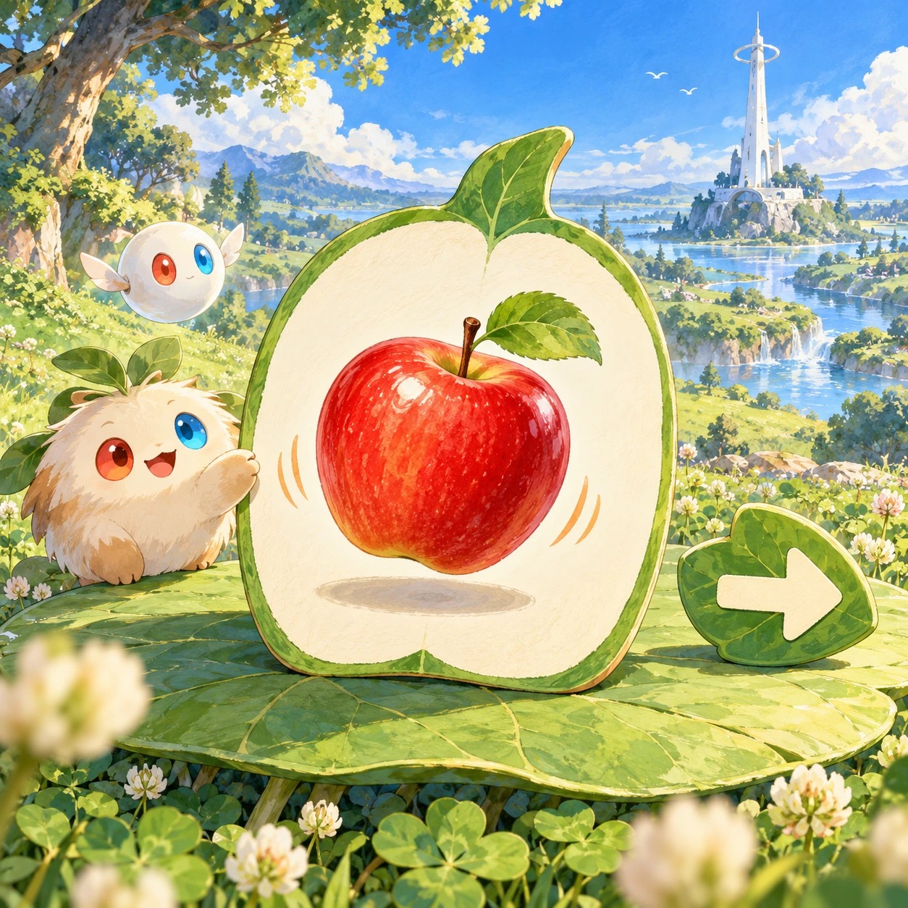
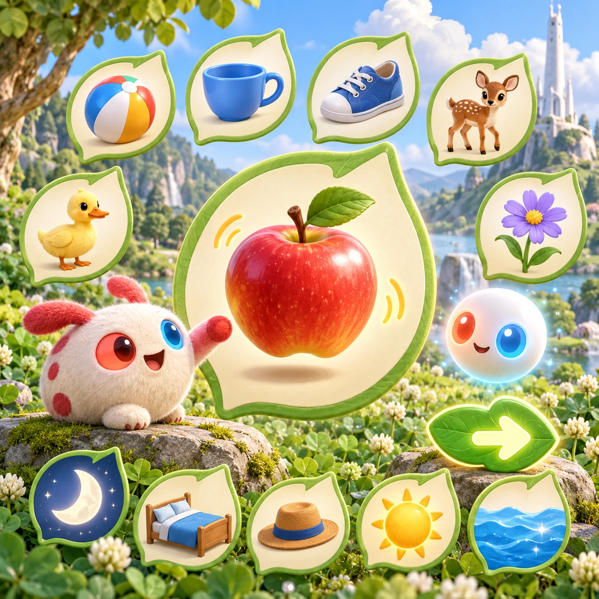
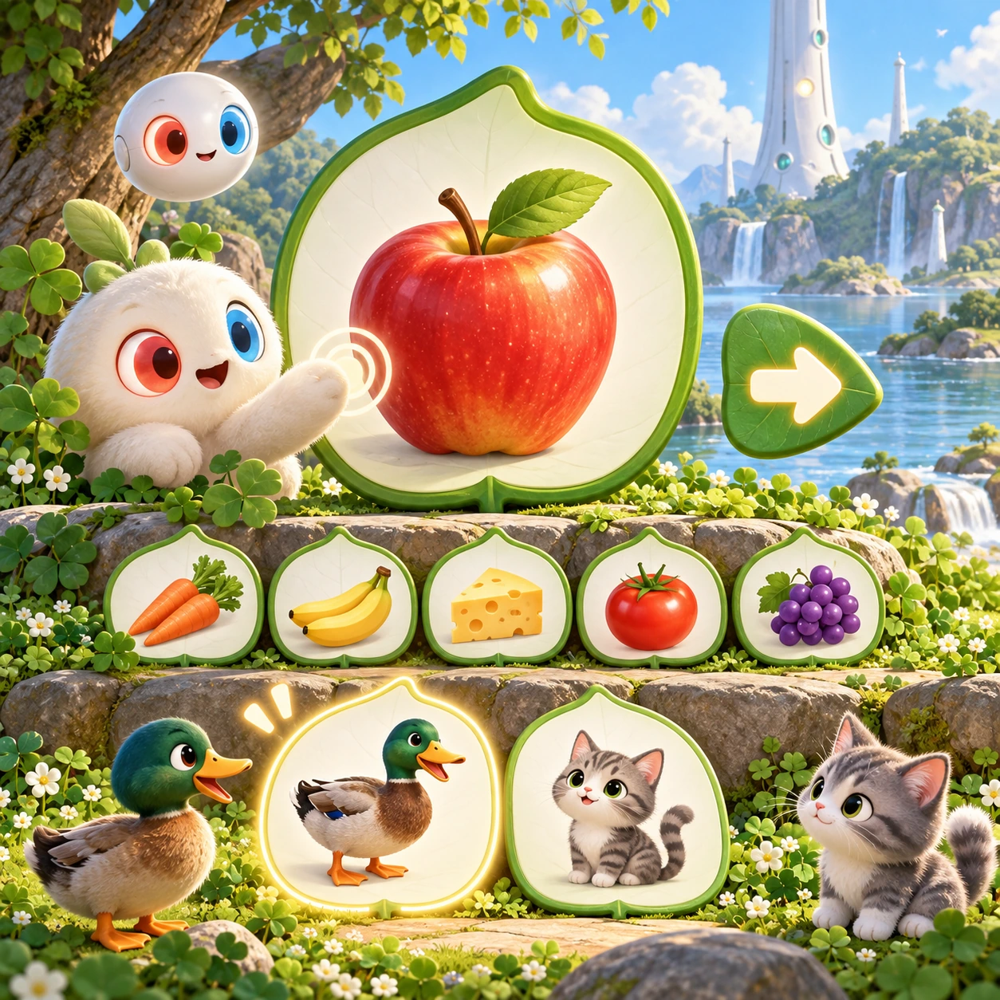

# Word Leaves

TD-11 · [Toddlers (1–3)](../td.md) · Cx 1 · Ages 2–3 · Raya story catalog

**The idea:** One huge leaf-shaped card fills the middle of the screen showing a shiny apple; a tap on the card makes the apple bounce as a warm voice says its name, and a big leaf arrow waits for the next card.

| Decision             | Proposal                                                                                                                                                                                                                                                                               |
| -------------------- | -------------------------------------------------------------------------------------------------------------------------------------------------------------------------------------------------------------------------------------------------------------------------------------- |
| Familiar mechanic    | First words picture cards                                                                                                                                                                                                                                                              |
| Learning objective   | First words, naming everyday things                                                                                                                                                                                                                                                    |
| First prototype      | One sensory toy or guided interaction with a large tap target, immediate gentle feedback and unlimited repetition. Introduce dragging only after an accessible tap alternative. No score or fail state; invite caregiver co-play under age 2.                                          |
| Technology           | React + SVG/DOM; deterministic state, undo and seeded levels. Start with one local screen and touch plus keyboard input.                                                                                                                                                               |
| Scope boundary       | One board and one rule set; defer accounts, multiplayer, procedural content and platform SDKs.                                                                                                                                                                                         |
| Reuse                | Shared input, saves, accessibility, seeded state and the toddlers (1–3) collection shell.                                                                                                                                                                                              |
| Prototype acceptance | During caregiver co-play, the child can explore one clear interaction and repeat it willingly. Observe recognition or purposeful action; require no reading or spoken explanation. Check large touch targets and a keyboard-accessible caregiver alternative at narrow and wide sizes. |
| Main uncertainty     | Test whether the lesson follows from play and whether the first interaction is understandable without reading.                                                                                                                                                                         |

## Estimated plan

**First playable version:** Two themed sets of twelve picture leaves (home and animals), each tap bouncing the picture with a voiced word and a big next arrow; the pointing mode and parent voice recording are left out.

| Measure              | Estimate                                                                                      |
| -------------------- | --------------------------------------------------------------------------------------------- |
| Youngest age         | 2+                                                                                            |
| Toddler learnability | 4 of 5 — Tap a specific big target or drag one object to a big slot; one-step goal; ages 2-3. |
| Code                 | 570 LOC, 4.8 days                                                                             |
| Assets               | 62 hours, 10.3 days                                                                           |
| Effort               | 15.1 days, risk 1 of 5                                                                        |
| Start score          | 18.9 (rank 19 of 310; lower is better)                                                        |

**Algorithms:** `tap-feedback` (Tap feedback, 80 LOC) · `word-list` (Word lists and validation, 150 LOC) · `phonics-audio` (Letter sounds, 120 LOC) · `tween-cause-effect` (Cause-and-effect animation, 100 LOC)

**Assets:** 20 sprites, 2 animations, 1 background, 2 UI screens, 6 sound effects, 1 music track, 22 voice lines, 24 content items

How the numbers are computed: [development plan](../../development-plan.md#how-the-scores-work).

## Story

Linky and the Orbi went for a walk with a basket of leaves. On each leaf was a picture. Apple, said the Orbi. Linky said, ap-pull! Ball, said the Orbi. Linky said, baw! Linky did not say every word right yet. That was fine. Words grow like clover, a tiny bit every day. By the end of the walk, Linky knew three new words. Linky whispered the best one to the fawn: friend.

> **Wisdom:** Words grow a little every day.

## Four visual directions

These are independently generated concept proposals for selecting a prototype.
The four views compare gameplay readability, world appeal, tactile identity and
room to grow. They are not screenshots of an implemented game. Native image
dimensions, hashes, exact prompts and generation provenance are recorded in the
[art manifest](../art/td-11/manifest.json); see the [generation notes](../README.md#image-generation-and-provenance).

The [core prompts](../jobs/td.json) use IDs `td-11/01-gameplay` to `td-11/04-discovery`.

### Gameplay

One huge leaf-shaped card fills the middle of the screen showing a shiny apple; a tap on the card makes the apple bounce as a warm voice says its name, and a big leaf arrow waits for the next card.

### World

A soft clover meadow with a picnic feeling: the cards rest on a giant round leaf like a table, the short white Chord tower stands small in the distance, and the sky is clear. Bright, even light keeps every picture easy to see. Background details are blurred and quiet so nothing competes with the card.

### Characters and materials

Picture cards show familiar things drawn simply: an apple, a ball, a cup, a shoe, a fawn, a duck, a flower, the moon, a bed, a hat, the sun and water. Each card is a big rounded leaf with a single object. Linky points with its red hand, and an Orbi glows when the word is spoken. No letters anywhere.

### Expanded play

Card sets grow by theme: food, animals, home, clothes, nature, body and family words. A pointing mode shows two cards and gently asks where the duck is, and either answer is praised and named. Parents can record their own voice for a word in their language, kept only on the device.

## Design checks before prototyping

- Learning target: **First words, naming everyday things**. Ask a domain reviewer to validate factual content in the mechanic.
- Keep goals cooperative or self-directed, using resources and needs. Avoid purchasable power. No pressure timers in the accessible mode.
- Use original layouts and character designs; the [legal checklist](../../legal.md) applies even when a mechanic is familiar.
- Choose the minimum [fidelity level](../../simulation-engine.md#determinism-and-fidelity-levels) the lesson needs; concept art does not establish scientific accuracy.
- Review silhouettes, text alternatives, reduced motion and non-color cues against the [adorability gate](../../lore/adorability-gate.md).
- Follow the [toddler design rules](../../../case-studies/issue-1/data/research-raya-shacados.md#7-toddlers-and-screens-r68-r69): tap before drag, no reading, no failure, co-play under age 2.

Genre context: [existing genre research](../../../case-studies/issue-1/data/research-genres-ideas.md)
and [expansion research](../../../case-studies/issue-1/data/research-visual-catalog.md).

[← Hum-Along Hill](td-10.md) · [All concepts](../README.md) · [Clover Coloring →](td-12.md)
