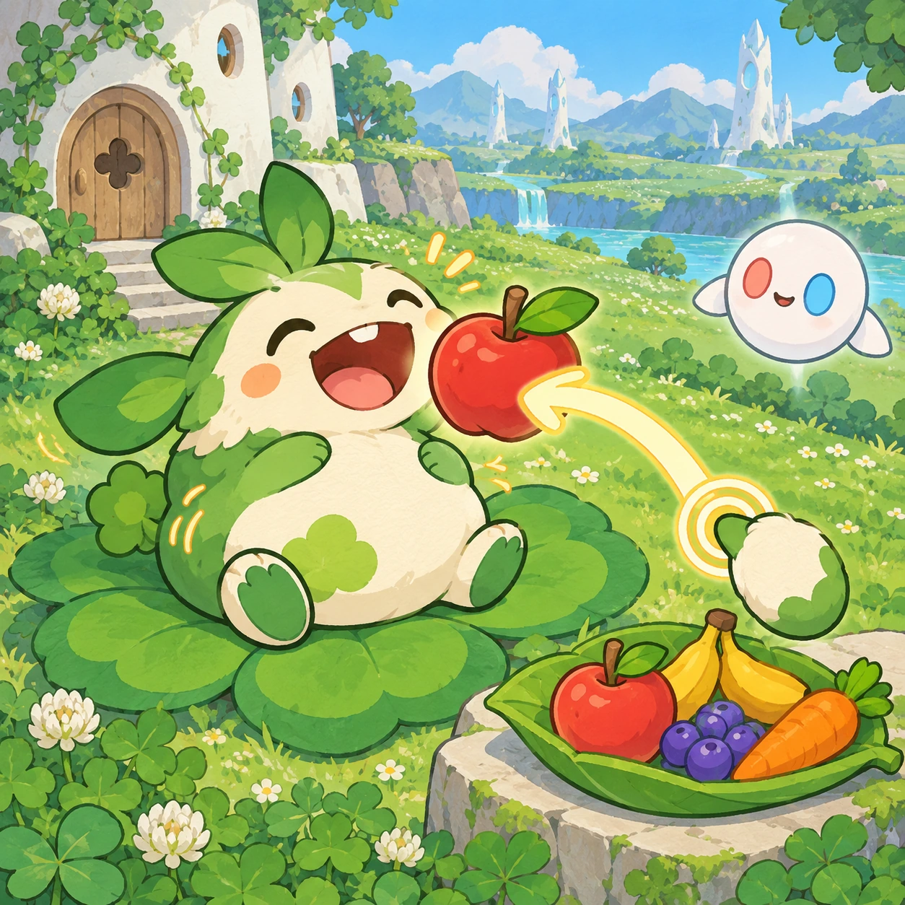
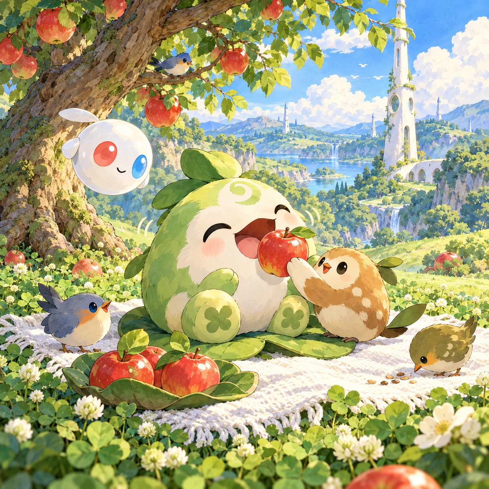
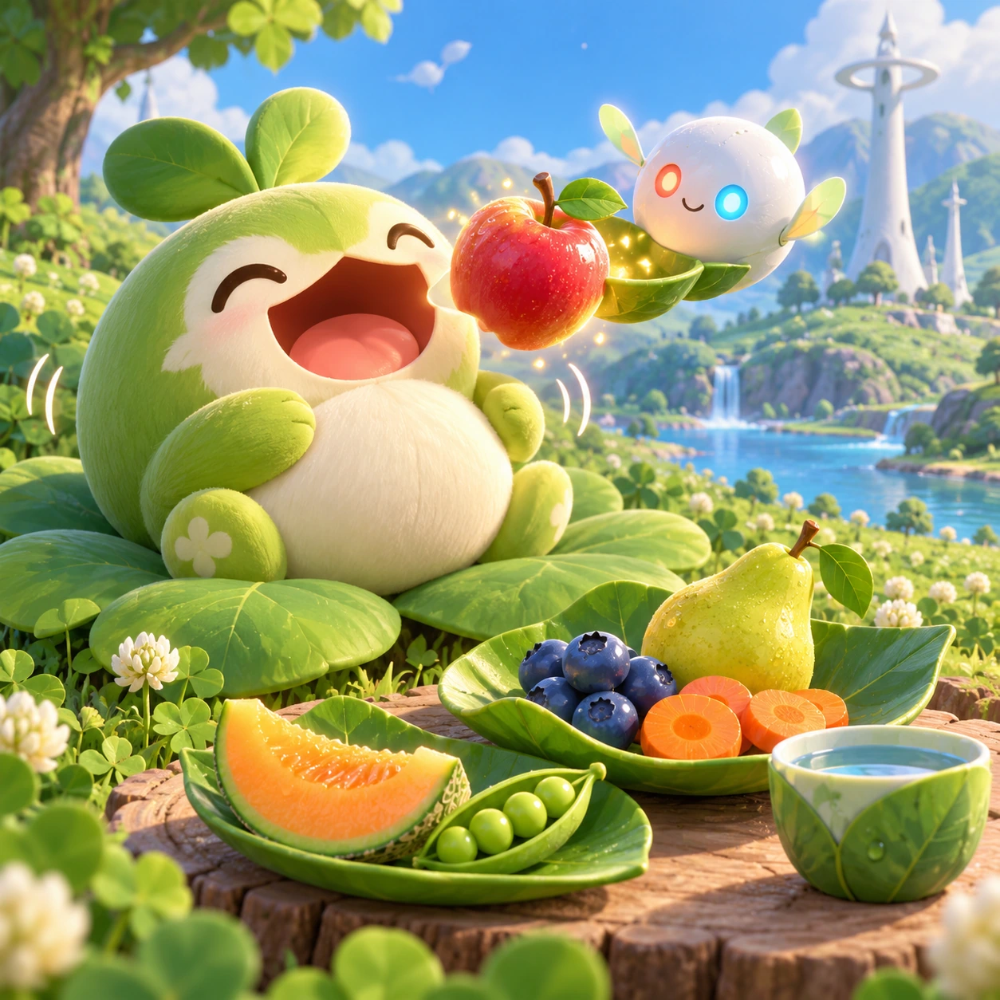
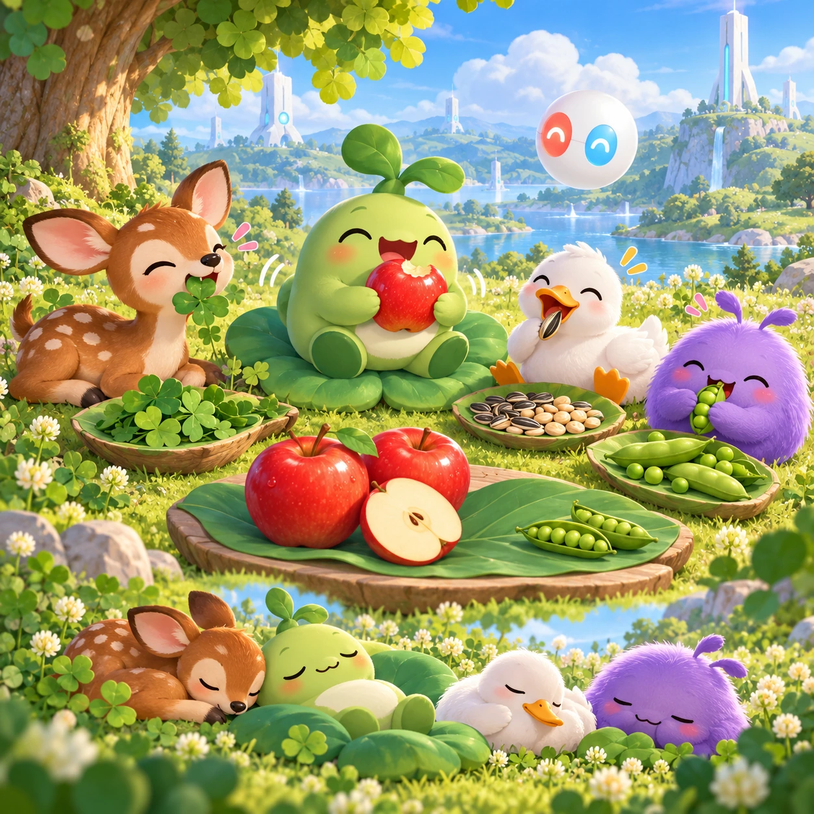

# Linky's Snack Time

TD-14 · [Toddlers (1–3)](../td.md) · Cx 1 · Ages 2–3 · Raya story catalog

**The idea:** Linky sits on the clover with a rumbling round tummy; the child drags one big shiny apple from a leaf plate to Linky's open arrow-smile, and Linky munches with a happy wiggle.

| Decision             | Proposal                                                                                                                                                                                                                                                                               |
| -------------------- | -------------------------------------------------------------------------------------------------------------------------------------------------------------------------------------------------------------------------------------------------------------------------------------- |
| Familiar mechanic    | Feeding a hungry friend                                                                                                                                                                                                                                                                |
| Learning objective   | Food names, caring, healthy food                                                                                                                                                                                                                                                       |
| First prototype      | One sensory toy or guided interaction with a large tap target, immediate gentle feedback and unlimited repetition. Introduce dragging only after an accessible tap alternative. No score or fail state; invite caregiver co-play under age 2.                                          |
| Technology           | React + SVG/DOM; deterministic state, undo and seeded levels. Start with one local screen and touch plus keyboard input.                                                                                                                                                               |
| Scope boundary       | One board and one rule set; defer accounts, multiplayer, procedural content and platform SDKs.                                                                                                                                                                                         |
| Reuse                | Shared input, saves, accessibility, seeded state and the toddlers (1–3) collection shell.                                                                                                                                                                                              |
| Prototype acceptance | During caregiver co-play, the child can explore one clear interaction and repeat it willingly. Observe recognition or purposeful action; require no reading or spoken explanation. Check large touch targets and a keyboard-accessible caregiver alternative at narrow and wide sizes. |
| Main uncertainty     | Test whether the lesson follows from play and whether the first interaction is understandable without reading.                                                                                                                                                                         |

## Estimated plan

**First playable version:** Linky on a picnic blanket with seven plant foods, two at a time on a leaf plate, dragged to its mouth for munch animations and voiced names; other hungry friends and sharing mode are left out.

| Measure              | Estimate                                                                                      |
| -------------------- | --------------------------------------------------------------------------------------------- |
| Youngest age         | 2+                                                                                            |
| Toddler learnability | 4 of 5 — Tap a specific big target or drag one object to a big slot; one-step goal; ages 2-3. |
| Code                 | 510 LOC, 4.3 days                                                                             |
| Assets               | 61 hours, 10.2 days                                                                           |
| Effort               | 14.4 days, risk 1 of 5                                                                        |
| Start score          | 18 (rank 17 of 310; lower is better)                                                          |

**Algorithms:** `drag-drop-snap` (Drag and snap, 150 LOC) · `tween-cause-effect` (Cause-and-effect animation, 100 LOC) · `phonics-audio` (Letter sounds, 120 LOC)

**Assets:** 14 sprites, 6 animations, 1 background, 1 UI screen, 10 sound effects, 1 music track, 14 voice lines, 7 content items

How the numbers are computed: [development plan](../../development-plan.md#how-the-scores-work).

## Story

Grumble, grumble. What was that noise? It was Linky's tummy! Linky was hungry. The Orbi brought an apple from the garden. It was a copy, made in the night, so the real apple stayed on the tree for the birds. Munch, munch. Linky smiled. Then the Orbi brought peas. Crunch, crunch. And a cup of water. Glug, glug. Linky was full. Linky saved one berry for the fawn, because food tastes better when we share.

> **Wisdom:** Food tastes better shared.

## Four visual directions

These are independently generated concept proposals for selecting a prototype.
The four views compare gameplay readability, world appeal, tactile identity and
room to grow. They are not screenshots of an implemented game. Native image
dimensions, hashes, exact prompts and generation provenance are recorded in the
[art manifest](../art/td-14/manifest.json); see the [generation notes](../README.md#image-generation-and-provenance).

The [core prompts](../jobs/td.json) use IDs `td-14/01-gameplay` to `td-14/04-discovery`.

### Gameplay

Linky sits on the clover with a rumbling round tummy; the child drags one big shiny apple from a leaf plate to Linky's open arrow-smile, and Linky munches with a happy wiggle.

### World

A picnic spot under a wild apple tree in the toddler meadow, with a soft woven white blanket spread on the clover. The short white Chord tower rises behind the tree. Midday light, a few birds pecking at fallen seeds, and a calm, warm mood. Apples still hang on the branches for the birds.

### Characters and materials

All foods are plants: an apple, a pear, berries, peas, carrot coins, a slice of melon and a cup of water. A leaf plate holds two items at a time. Linky opens its arrow-smile wide; an Orbi brings food copied overnight by the home garden, glowing a little. Rounded food shapes with juicy, glossy highlights.

### Expanded play

New hungry friends visit: a fawn who loves clover, a duck who loves seeds and Verbi who loves peas. Each friend says yum and thank you, and a full tummy leads to a little nap. A sharing mode lets Linky give half an apple to a friend. No sweets race, no counting, no wrong food.

## Design checks before prototyping

- Learning target: **Food names, caring, healthy food**. Ask a domain reviewer to validate factual content in the mechanic.
- Keep goals cooperative or self-directed, using resources and needs. Avoid purchasable power. No pressure timers in the accessible mode.
- Use original layouts and character designs; the [legal checklist](../../legal.md) applies even when a mechanic is familiar.
- Choose the minimum [fidelity level](../../simulation-engine.md#determinism-and-fidelity-levels) the lesson needs; concept art does not establish scientific accuracy.
- Review silhouettes, text alternatives, reduced motion and non-color cues against the [adorability gate](../../lore/adorability-gate.md).
- Follow the [toddler design rules](../../../case-studies/issue-1/data/research-raya-shacados.md#7-toddlers-and-screens-r68-r69): tap before drag, no reading, no failure, co-play under age 2.

Genre context: [existing genre research](../../../case-studies/issue-1/data/research-genres-ideas.md)
and [expansion research](../../../case-studies/issue-1/data/research-visual-catalog.md).

[← Snap-Together Pictures](td-13.md) · [All concepts](../README.md) · [Bubble Bath Buddy →](td-15.md)
