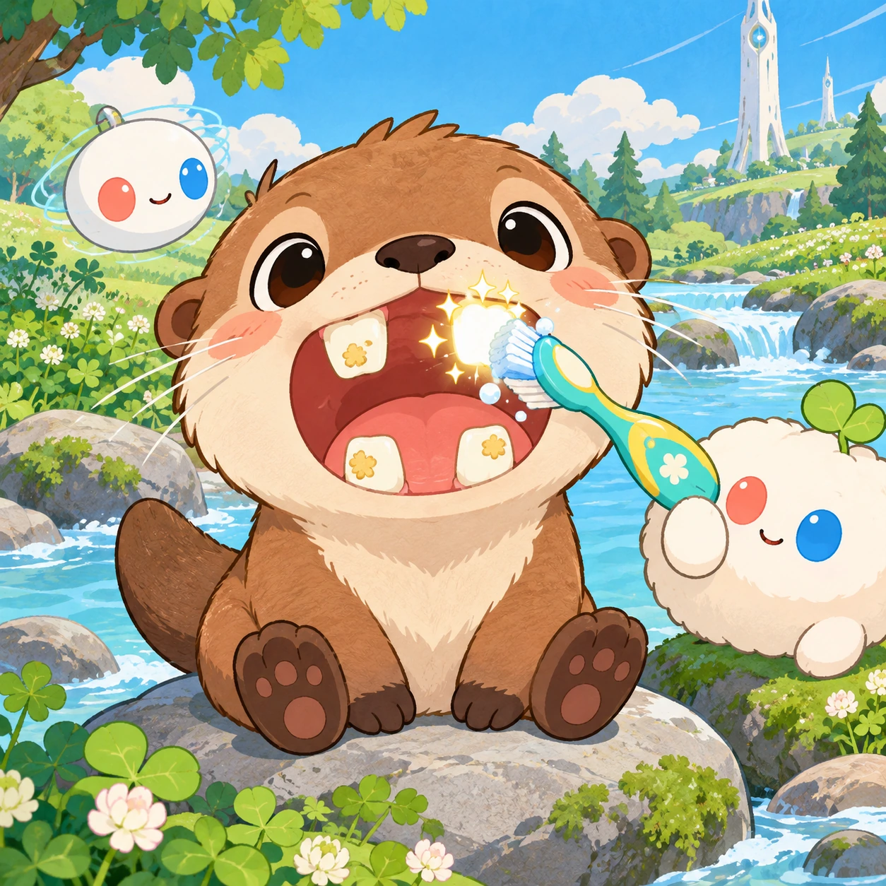
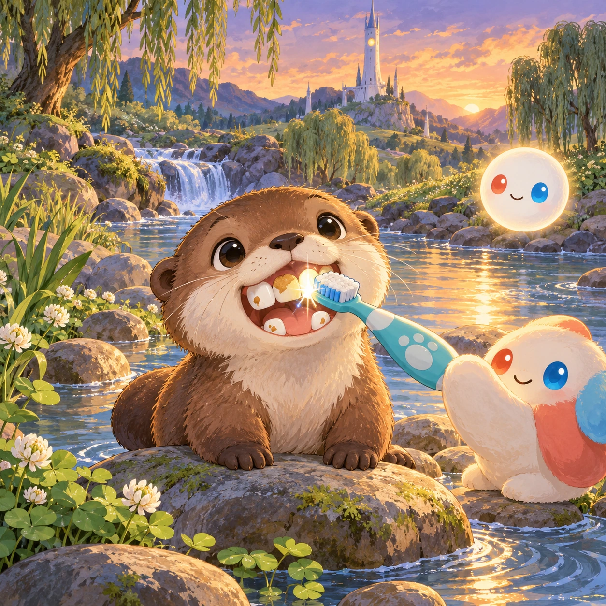
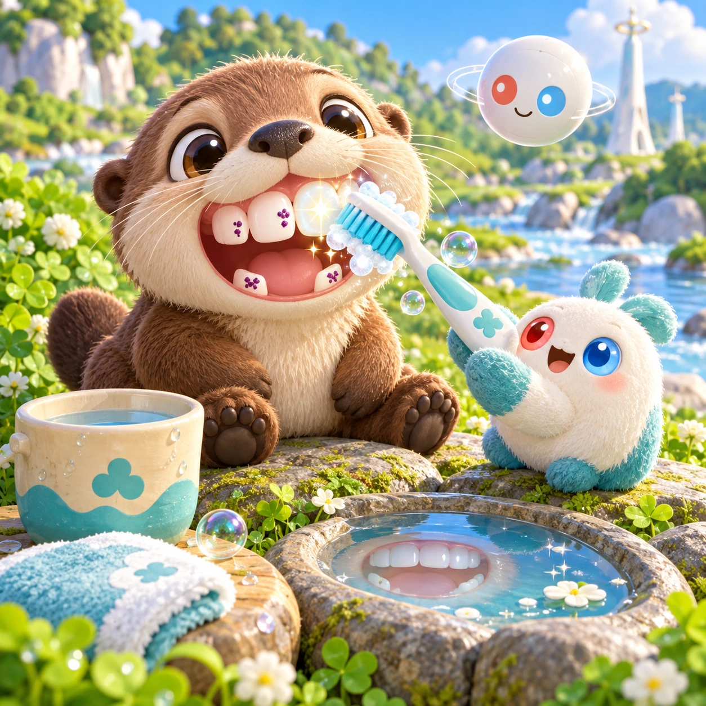
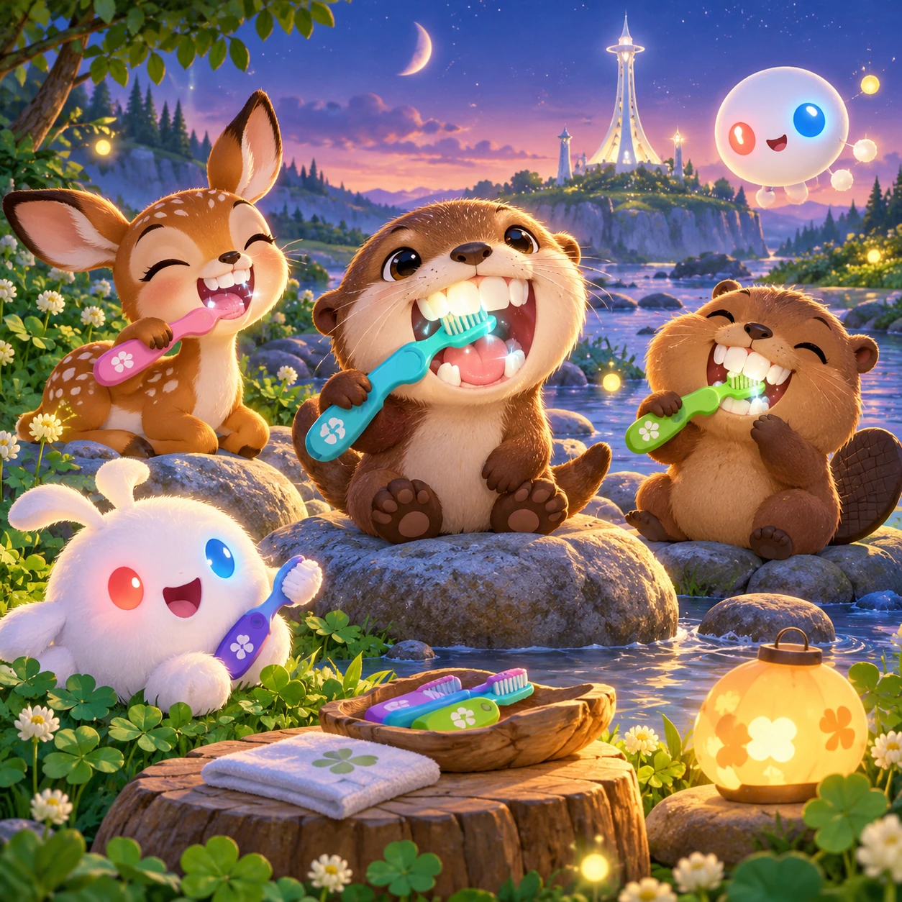

# Sparkly Teeth

TD-16 · [Toddlers (1–3)](../td.md) · Cx 1 · Ages 2–3 · Raya story catalog

**The idea:** A baby otter on a river stone opens its mouth wide, showing four big teeth with fuzzy crumb spots; the child rubs a chunky toothbrush over a glowing tooth and it sparkles clean.

| Decision             | Proposal                                                                                                                                                                                                                                                                               |
| -------------------- | -------------------------------------------------------------------------------------------------------------------------------------------------------------------------------------------------------------------------------------------------------------------------------------- |
| Familiar mechanic    | Brushing teeth routine                                                                                                                                                                                                                                                                 |
| Learning objective   | Tooth brushing habit, body care                                                                                                                                                                                                                                                        |
| First prototype      | One sensory toy or guided interaction with a large tap target, immediate gentle feedback and unlimited repetition. Introduce dragging only after an accessible tap alternative. No score or fail state; invite caregiver co-play under age 2.                                          |
| Technology           | React + SVG/DOM; deterministic state, undo and seeded levels. Start with one local screen and touch plus keyboard input.                                                                                                                                                               |
| Scope boundary       | One board and one rule set; defer accounts, multiplayer, procedural content and platform SDKs.                                                                                                                                                                                         |
| Reuse                | Shared input, saves, accessibility, seeded state and the toddlers (1–3) collection shell.                                                                                                                                                                                              |
| Prototype acceptance | During caregiver co-play, the child can explore one clear interaction and repeat it willingly. Observe recognition or purposeful action; require no reading or spoken explanation. Check large touch targets and a keyboard-accessible caregiver alternative at narrow and wide sizes. |
| Main uncertainty     | Test whether the lesson follows from play and whether the first interaction is understandable without reading.                                                                                                                                                                         |

## Estimated plan

**First playable version:** The baby otter with four big teeth brushed by rubbing to a short brushing song, rinse and smile, plus a brush-along screen; extra animals and a brushing timer are left out.

| Measure              | Estimate                                                                                      |
| -------------------- | --------------------------------------------------------------------------------------------- |
| Youngest age         | 2+                                                                                            |
| Toddler learnability | 4 of 5 — Tap a specific big target or drag one object to a big slot; one-step goal; ages 2-3. |
| Code                 | 460 LOC, 3.8 days                                                                             |
| Assets               | 48 hours, 8 days                                                                              |
| Effort               | 11.8 days, risk 1 of 5                                                                        |
| Start score          | 14.8 (rank 7 of 310; lower is better)                                                         |

**Algorithms:** `swipe-gesture` (Swipe gestures, 80 LOC) · `particle-effects` (Particles, 150 LOC) · `tween-cause-effect` (Cause-and-effect animation, 100 LOC)

**Assets:** 10 sprites, 4 animations, 1 background, 1 UI screen, 8 sound effects, 1 music track, 10 voice lines, 2 authored levels

How the numbers are computed: [development plan](../../development-plan.md#how-the-scores-work).

## Story

Little Otter ate berries and crunchy seeds all day. Now there were crumbs on its teeth. Snack time was over, and brush time was here. Linky held the toothbrush. Up and down, round and round. Brush, brush, brush. A little song played. One tooth sparkled. Two teeth sparkled. Then all the teeth were shiny. Little Otter rinsed with a swish, swish, and smiled the biggest smile in the whole river.

> **Wisdom:** Shiny teeth, happy smile.

## Four visual directions

These are independently generated concept proposals for selecting a prototype.
The four views compare gameplay readability, world appeal, tactile identity and
room to grow. They are not screenshots of an implemented game. Native image
dimensions, hashes, exact prompts and generation provenance are recorded in the
[art manifest](../art/td-16/manifest.json); see the [generation notes](../README.md#image-generation-and-provenance).

The [core prompts](../jobs/td.json) use IDs `td-16/01-gameplay` to `td-16/04-discovery`.

### Gameplay

A baby otter on a river stone opens its mouth wide, showing four big teeth with fuzzy crumb spots; the child rubs a chunky toothbrush over a glowing tooth and it sparkles clean.

### World

A calm river bend in the toddler meadow at evening, with round stones, reeds and a small waterfall. The short white Chord tower glows softly behind the willows. Warm light from an Orbi makes the riverbank feel like a cozy bathroom by the water. Peaceful, quiet and slow.

### Characters and materials

The otter is round and fluffy with big eyes and four big front teeth. A chunky toothbrush with soft blue bristles, minty bubble foam, a cup of water and a little mirror pool. Linky brushes its own arrow-smile alongside. The crumb spots look like little berry bits, never like germs with faces.

### Expanded play

Other friends join the evening brush: a fawn, a beaver kit and Linky. A short brushing song plays while the teeth sparkle one by one, top, bottom, left and right. A brush-along mode lets the child brush their own teeth with the otter. The routine leads gently into bedtime.

## Design checks before prototyping

- Learning target: **Tooth brushing habit, body care**. Ask a domain reviewer to validate factual content in the mechanic.
- Keep goals cooperative or self-directed, using resources and needs. Avoid purchasable power. No pressure timers in the accessible mode.
- Use original layouts and character designs; the [legal checklist](../../legal.md) applies even when a mechanic is familiar.
- Choose the minimum [fidelity level](../../simulation-engine.md#determinism-and-fidelity-levels) the lesson needs; concept art does not establish scientific accuracy.
- Review silhouettes, text alternatives, reduced motion and non-color cues against the [adorability gate](../../lore/adorability-gate.md).
- Follow the [toddler design rules](../../../case-studies/issue-1/data/research-raya-shacados.md#7-toddlers-and-screens-r68-r69): tap before drag, no reading, no failure, co-play under age 2.

Genre context: [existing genre research](../../../case-studies/issue-1/data/research-genres-ideas.md)
and [expansion research](../../../case-studies/issue-1/data/research-visual-catalog.md).

[← Bubble Bath Buddy](td-15.md) · [All concepts](../README.md) · [Fawn's Nose and Toes →](td-17.md)
