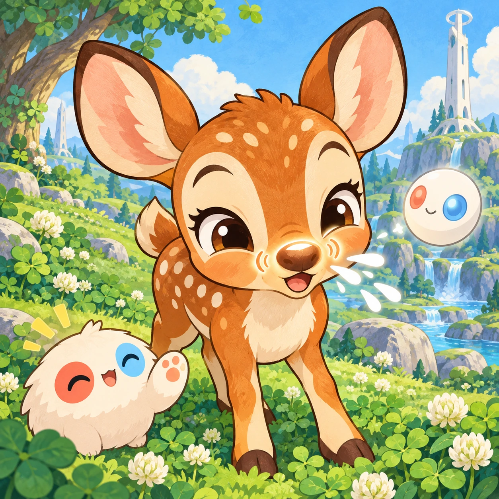
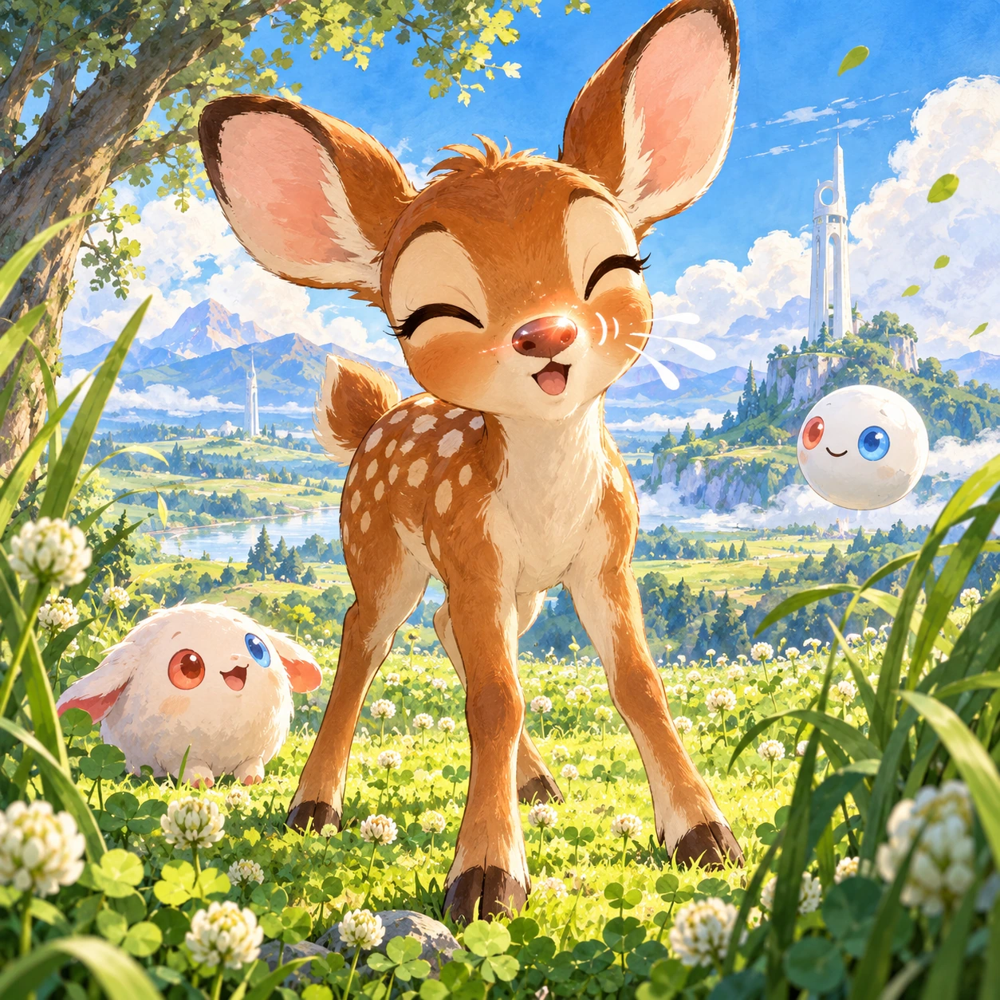
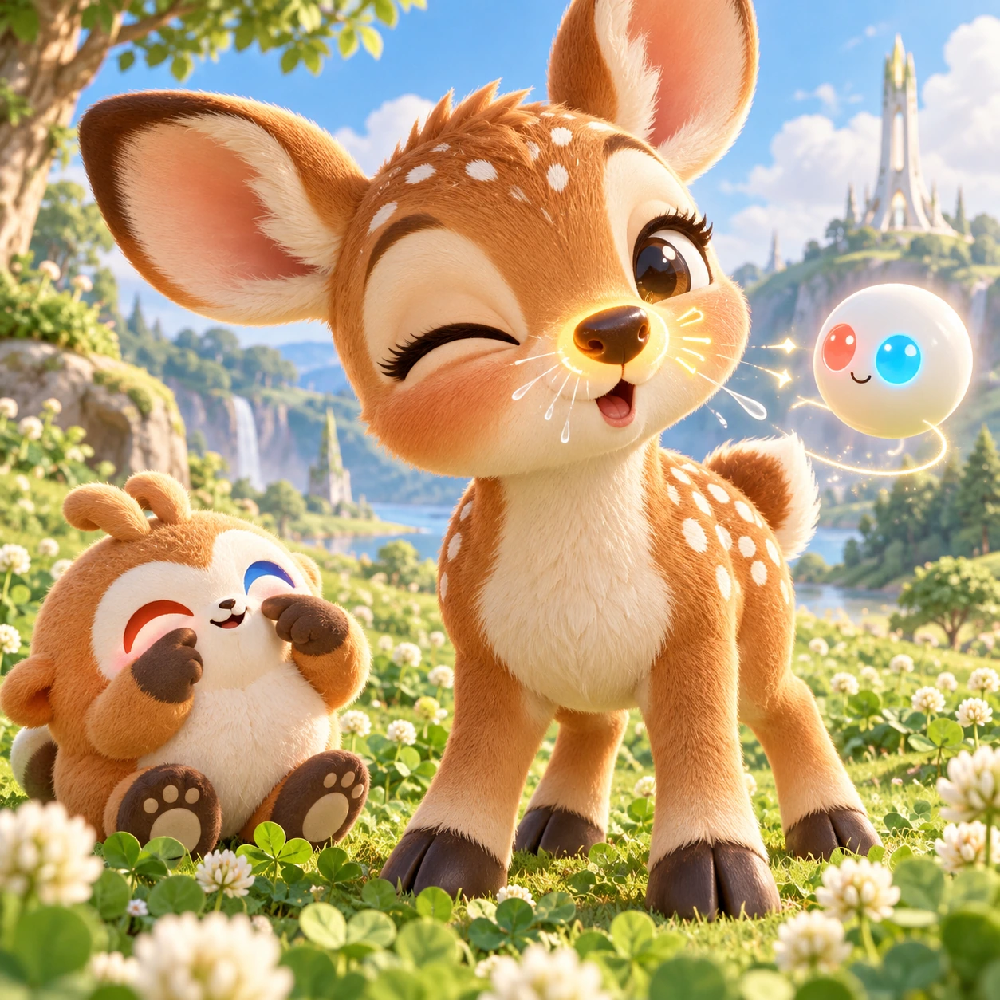
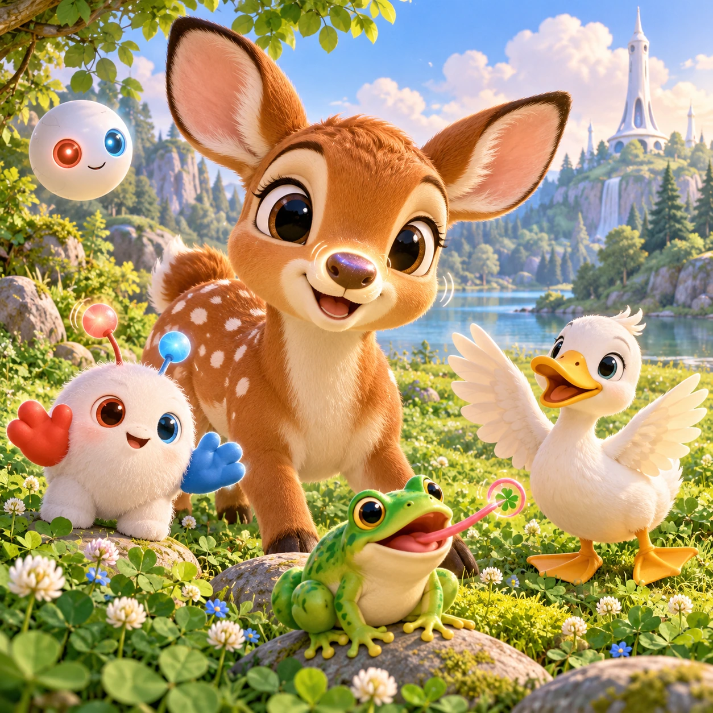

# Fawn's Nose and Toes

TD-17 · [Toddlers (1–3)](../td.md) · Cx 1 · Ages 2–3 · Raya story catalog

**The idea:** A big friendly fawn faces the child and fills most of the screen; a tap on its nose makes it wiggle and sneeze, the nose glows gently, and a warm voice says nose.

| Decision             | Proposal                                                                                                                                                                                                                                                                               |
| -------------------- | -------------------------------------------------------------------------------------------------------------------------------------------------------------------------------------------------------------------------------------------------------------------------------------- |
| Familiar mechanic    | Body parts naming                                                                                                                                                                                                                                                                      |
| Learning objective   | Body part names, self-awareness                                                                                                                                                                                                                                                        |
| First prototype      | One sensory toy or guided interaction with a large tap target, immediate gentle feedback and unlimited repetition. Introduce dragging only after an accessible tap alternative. No score or fail state; invite caregiver co-play under age 2.                                          |
| Technology           | React + SVG/DOM; deterministic state, undo and seeded levels. Start with one local screen and touch plus keyboard input.                                                                                                                                                               |
| Scope boundary       | One board and one rule set; defer accounts, multiplayer, procedural content and platform SDKs.                                                                                                                                                                                         |
| Reuse                | Shared input, saves, accessibility, seeded state and the toddlers (1–3) collection shell.                                                                                                                                                                                              |
| Prototype acceptance | During caregiver co-play, the child can explore one clear interaction and repeat it willingly. Observe recognition or purposeful action; require no reading or spoken explanation. Check large touch targets and a keyboard-accessible caregiver alternative at narrow and wide sizes. |
| Main uncertainty     | Test whether the lesson follows from play and whether the first interaction is understandable without reading.                                                                                                                                                                         |

## Estimated plan

**First playable version:** One large fawn with eight tappable body parts, each wiggling with a voiced name, and Linky copying the move; the where-is mode and the duck and frog are left out.

| Measure              | Estimate                                                                                      |
| -------------------- | --------------------------------------------------------------------------------------------- |
| Youngest age         | 2+                                                                                            |
| Toddler learnability | 4 of 5 — Tap a specific big target or drag one object to a big slot; one-step goal; ages 2-3. |
| Code                 | 430 LOC, 3.6 days                                                                             |
| Assets               | 61 hours, 10.2 days                                                                           |
| Effort               | 13.8 days, risk 1 of 5                                                                        |
| Start score          | 17.3 (rank 13 of 310; lower is better)                                                        |

**Algorithms:** `tap-feedback` (Tap feedback, 80 LOC) · `tween-cause-effect` (Cause-and-effect animation, 100 LOC) · `phonics-audio` (Letter sounds, 120 LOC)

**Assets:** 10 sprites, 8 animations, 1 background, 1 UI screen, 10 sound effects, 1 music track, 14 voice lines, 8 content items

How the numbers are computed: [development plan](../../development-plan.md#how-the-scores-work).

## Story

This is the fawn. Where are the fawn's ears? Here! They flick and flutter. Where is the fawn's nose? Here! Achoo, a little sneeze. Where is the fawn's tummy? Here! It giggles, because it is ticklish. Where are the fawn's toes? Here, four little hooves that tap the ground. Linky touched its own eyes, its own hands and its own tummy too. Every body is a good body. And at night, every body needs a rest.

> **Wisdom:** Every body is a good body.

## Four visual directions

These are independently generated concept proposals for selecting a prototype.
The four views compare gameplay readability, world appeal, tactile identity and
room to grow. They are not screenshots of an implemented game. Native image
dimensions, hashes, exact prompts and generation provenance are recorded in the
[art manifest](../art/td-17/manifest.json); see the [generation notes](../README.md#image-generation-and-provenance).

The [core prompts](../jobs/td.json) use IDs `td-17/01-gameplay` to `td-17/04-discovery`.

### Gameplay

A big friendly fawn faces the child and fills most of the screen; a tap on its nose makes it wiggle and sneeze, the nose glows gently, and a warm voice says nose.

### World

A soft sunlit spot in the clover meadow with tall grass at the sides like curtains. The short white Chord tower stands far behind. The background is simple, the light is clear, and there is plenty of space around the fawn, so every body part is large and easy to touch.

### Characters and materials

The fawn is chibi-round with big ears, glossy eyes, a button nose, a white spotted back, a round tummy, four little hooves and a short tail. Linky copies each move, touching its own eyes and hands. An Orbi glows near the part that is named. A warm caramel, cream and clover-green palette.

### Expanded play

More friends join: Linky with its red and blue hands, a duck with wings and webbed feet, and a frog with a long tongue. A where-is mode asks for a part, and any tap gets a kind answer that names what was touched. Children are invited to touch their own nose, ears and toes together with a parent.

## Design checks before prototyping

- Learning target: **Body part names, self-awareness**. Ask a domain reviewer to validate factual content in the mechanic.
- Keep goals cooperative or self-directed, using resources and needs. Avoid purchasable power. No pressure timers in the accessible mode.
- Use original layouts and character designs; the [legal checklist](../../legal.md) applies even when a mechanic is familiar.
- Choose the minimum [fidelity level](../../simulation-engine.md#determinism-and-fidelity-levels) the lesson needs; concept art does not establish scientific accuracy.
- Review silhouettes, text alternatives, reduced motion and non-color cues against the [adorability gate](../../lore/adorability-gate.md).
- Follow the [toddler design rules](../../../case-studies/issue-1/data/research-raya-shacados.md#7-toddlers-and-screens-r68-r69): tap before drag, no reading, no failure, co-play under age 2.

Genre context: [existing genre research](../../../case-studies/issue-1/data/research-genres-ideas.md)
and [expansion research](../../../case-studies/issue-1/data/research-visual-catalog.md).

[← Sparkly Teeth](td-16.md) · [All concepts](../README.md) · [Muddy Train Wash →](td-18.md)
