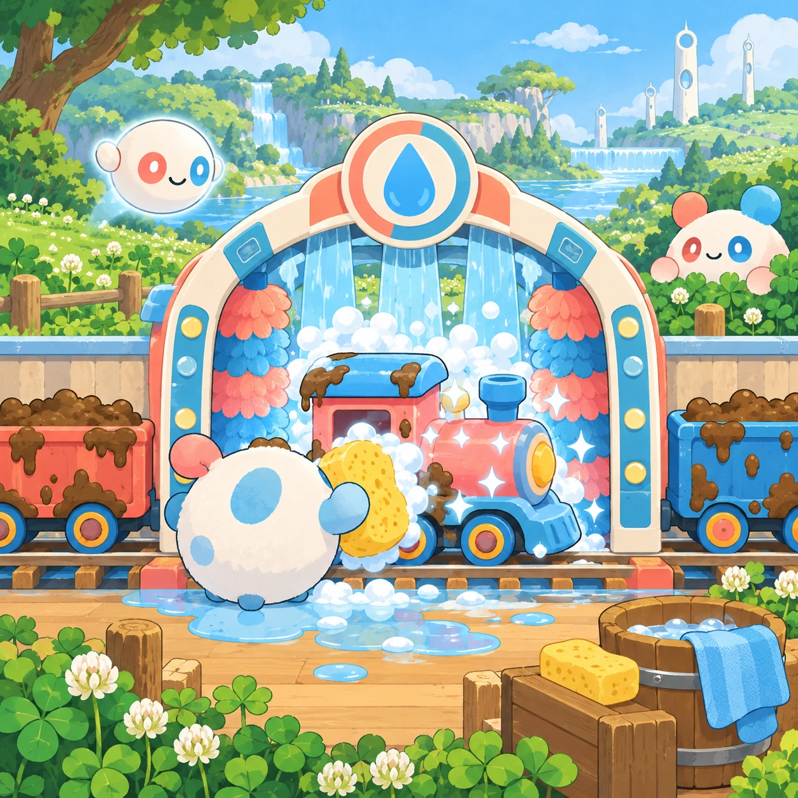
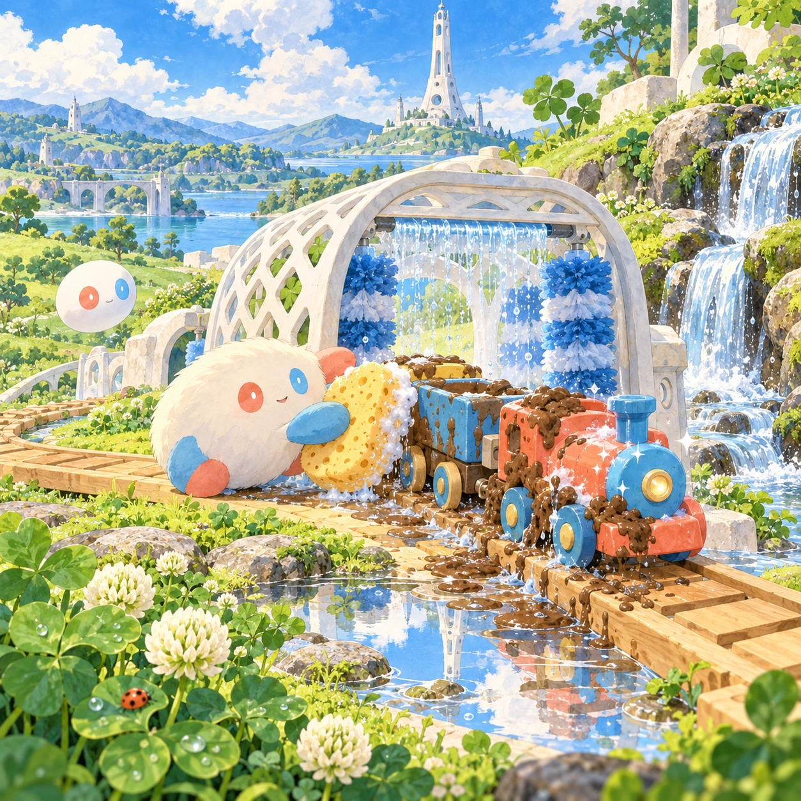
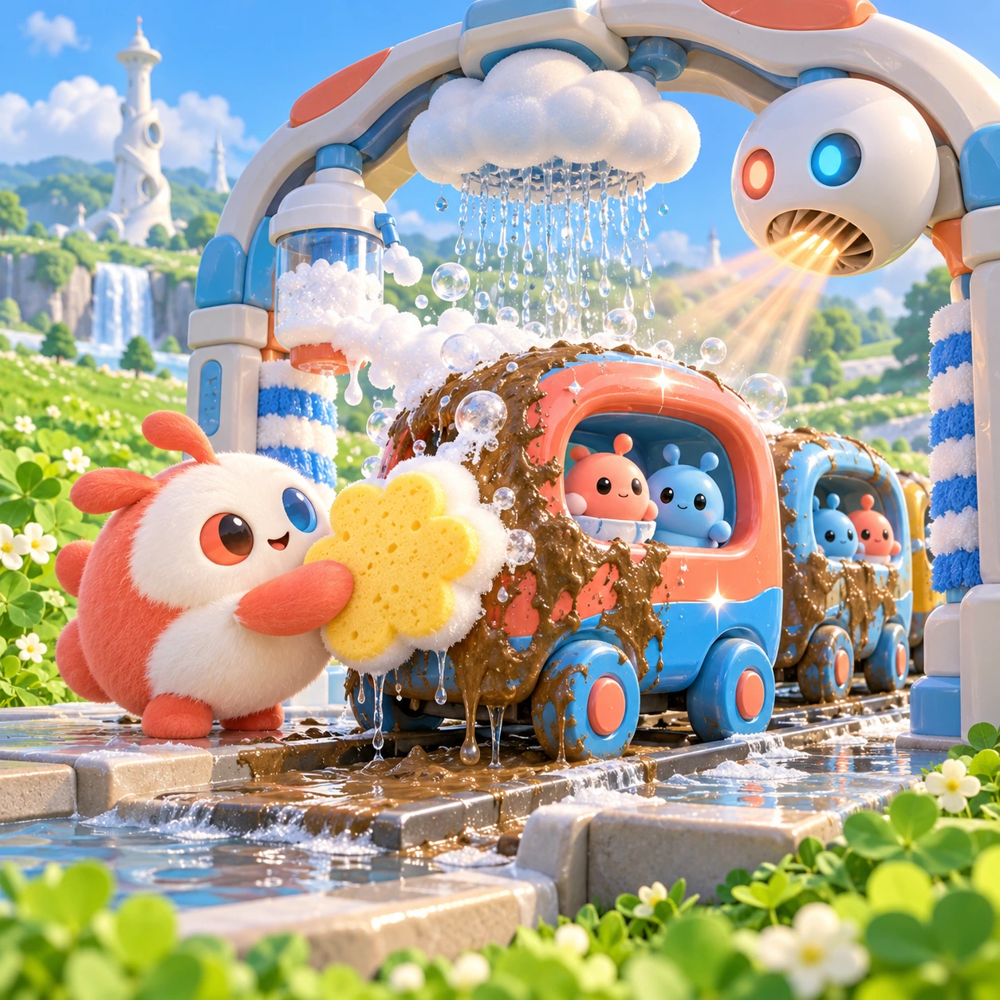
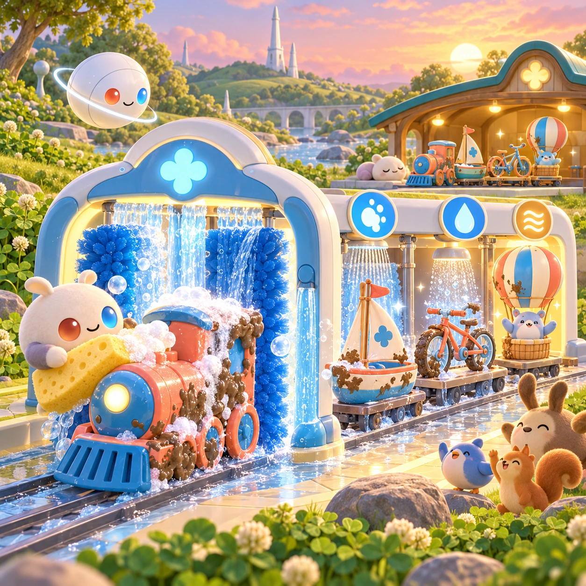

# Muddy Train Wash

TD-18 · [Toddlers (1–3)](../td.md) · Cx 1 · Ages 2–3 · Raya story catalog

**The idea:** Choo-Choo Seq's toy train cars wait, covered in mud, inside a sparkling wash arch; the child rubs a huge sponge over a car, the mud slides away, and the car shines coral and blue.

| Decision             | Proposal                                                                                                                                                                                                                                                                               |
| -------------------- | -------------------------------------------------------------------------------------------------------------------------------------------------------------------------------------------------------------------------------------------------------------------------------------- |
| Familiar mechanic    | Car wash toy                                                                                                                                                                                                                                                                           |
| Learning objective   | Washing steps, cause and effect                                                                                                                                                                                                                                                        |
| First prototype      | One sensory toy or guided interaction with a large tap target, immediate gentle feedback and unlimited repetition. Introduce dragging only after an accessible tap alternative. No score or fail state; invite caregiver co-play under age 2.                                          |
| Technology           | React + SVG/DOM; deterministic state, undo and seeded levels. Start with one local screen and touch plus keyboard input.                                                                                                                                                               |
| Scope boundary       | One board and one rule set; defer accounts, multiplayer, procedural content and platform SDKs.                                                                                                                                                                                         |
| Reuse                | Shared input, saves, accessibility, seeded state and the toddlers (1–3) collection shell.                                                                                                                                                                                              |
| Prototype acceptance | During caregiver co-play, the child can explore one clear interaction and repeat it willingly. Observe recognition or purposeful action; require no reading or spoken explanation. Check large touch targets and a keyboard-accessible caregiver alternative at narrow and wide sizes. |
| Main uncertainty     | Test whether the lesson follows from play and whether the first interaction is understandable without reading.                                                                                                                                                                         |

## Estimated plan

**First playable version:** Four muddy train cars washed one at a time with soap rub, cloud rinse and warm-wind dry, rolling off shiny; the boat, bike and balloon washes are left out.

| Measure              | Estimate                                                                                      |
| -------------------- | --------------------------------------------------------------------------------------------- |
| Youngest age         | 2+                                                                                            |
| Toddler learnability | 4 of 5 — Tap a specific big target or drag one object to a big slot; one-step goal; ages 2-3. |
| Code                 | 480 LOC, 4 days                                                                               |
| Assets               | 59 hours, 9.9 days                                                                            |
| Effort               | 13.9 days, risk 1 of 5                                                                        |
| Start score          | 17.4 (rank 14 of 310; lower is better)                                                        |

**Algorithms:** `swipe-gesture` (Swipe gestures, 80 LOC) · `particle-effects` (Particles, 150 LOC) · `tween-cause-effect` (Cause-and-effect animation, 100 LOC)

**Assets:** 14 sprites, 5 animations, 1 background, 1 UI screen, 10 sound effects, 1 music track, 8 voice lines, 4 authored levels

How the numbers are computed: [development plan](../../development-plan.md#how-the-scores-work).

## Story

Choo-choo! Seq came back from a long ride through the puddles. Splat, splat. Every car was covered in mud. Linky got the big sponge. Scrub, scrub, scrub. The soap made fluffy bubbles. Then a little cloud came by and rained clean water. Shhhhh. Then the Orbi blew a warm wind. Whoosh! Seq was shiny again, every car red and blue and bright. Thank you, said Seq, and rolled home to the station.

> **Wisdom:** Helping makes things shine.

## Four visual directions

These are independently generated concept proposals for selecting a prototype.
The four views compare gameplay readability, world appeal, tactile identity and
room to grow. They are not screenshots of an implemented game. Native image
dimensions, hashes, exact prompts and generation provenance are recorded in the
[art manifest](../art/td-18/manifest.json); see the [generation notes](../README.md#image-generation-and-provenance).

The [core prompts](../jobs/td.json) use IDs `td-18/01-gameplay` to `td-18/04-discovery`.

### Gameplay

Choo-Choo Seq's toy train cars wait, covered in mud, inside a sparkling wash arch; the child rubs a huge sponge over a car, the mud slides away, and the car shines coral and blue.

### World

Omi's toy meadow, where a wooden toy track runs through a white lattice wash arch beside a little waterfall. The short white Chord tower stands at the back. Clear daylight and puddles that reflect the sky. The mud is soft and brown and the water is clean and bright.

### Characters and materials

Choo-Choo Seq has round cars that carry pairs of Soru and Tari. The wash tools are a big cloud sponge, a soap foamer, a rain shower from a small cloud and a warm wind from an Orbi. Mud, foam, drips and sparkle textures, with bright toy colors hiding under the mud.

### Expanded play

Later, other toy vehicles roll in for a wash: the little sailboat, the bicycle and the balloon basket. The steps stay simple, soap, rinse, dry, with one big glowing tool at a time. Each clean vehicle rolls off waving, and the last wash of the day ends at the toy station for sleep.

## Design checks before prototyping

- Learning target: **Washing steps, cause and effect**. Ask a domain reviewer to validate factual content in the mechanic.
- Keep goals cooperative or self-directed, using resources and needs. Avoid purchasable power. No pressure timers in the accessible mode.
- Use original layouts and character designs; the [legal checklist](../../legal.md) applies even when a mechanic is familiar.
- Choose the minimum [fidelity level](../../simulation-engine.md#determinism-and-fidelity-levels) the lesson needs; concept art does not establish scientific accuracy.
- Review silhouettes, text alternatives, reduced motion and non-color cues against the [adorability gate](../../lore/adorability-gate.md).
- Follow the [toddler design rules](../../../case-studies/issue-1/data/research-raya-shacados.md#7-toddlers-and-screens-r68-r69): tap before drag, no reading, no failure, co-play under age 2.

Genre context: [existing genre research](../../../case-studies/issue-1/data/research-genres-ideas.md)
and [expansion research](../../../case-studies/issue-1/data/research-visual-catalog.md).

[← Fawn's Nose and Toes](td-17.md) · [All concepts](../README.md) · [Sprout Patch →](td-19.md)
