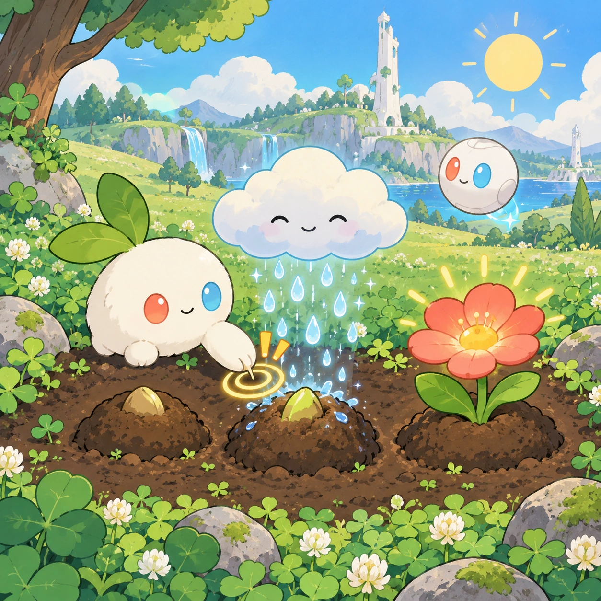
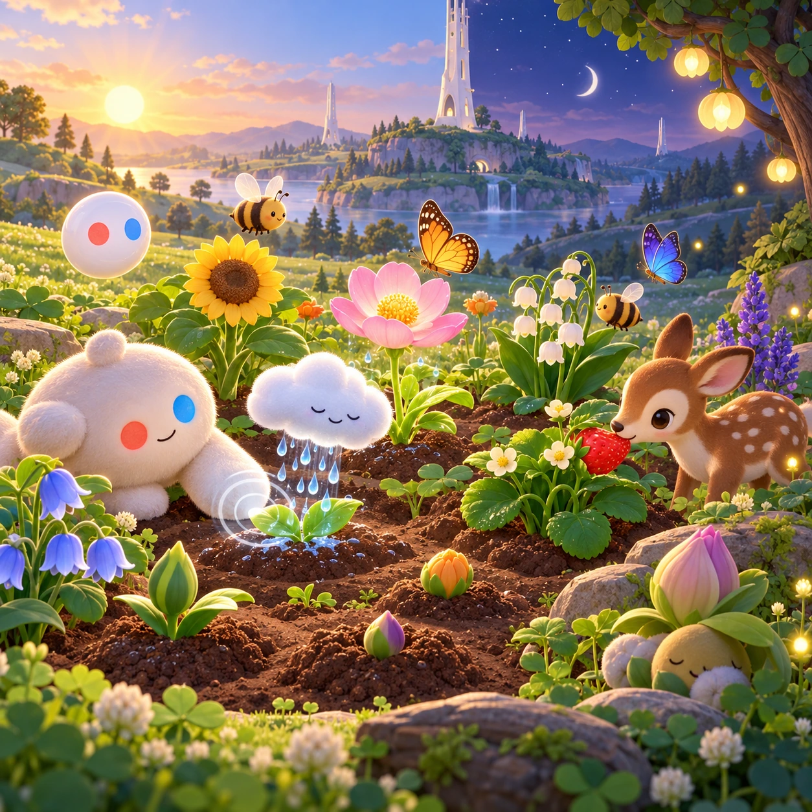

# Sprout Patch

TD-19 · [Toddlers (1–3)](../td.md) · Cx 1 · Ages 2–3 · Raya story catalog

**The idea:** Three big seed bumps sit in dark soil at the edge of the meadow; the child taps the one that wiggles, a soft rain cloud waters it, and a flower pops up and opens its petals.

| Decision             | Proposal                                                                                                                                                                                                                                                                               |
| -------------------- | -------------------------------------------------------------------------------------------------------------------------------------------------------------------------------------------------------------------------------------------------------------------------------------- |
| Familiar mechanic    | Garden grow (tap to water)                                                                                                                                                                                                                                                             |
| Learning objective   | Plants need water and sun, patience                                                                                                                                                                                                                                                    |
| First prototype      | One sensory toy or guided interaction with a large tap target, immediate gentle feedback and unlimited repetition. Introduce dragging only after an accessible tap alternative. No score or fail state; invite caregiver co-play under age 2.                                          |
| Technology           | React + SVG/DOM; deterministic state, undo and seeded levels. Start with one local screen and touch plus keyboard input.                                                                                                                                                               |
| Scope boundary       | One board and one rule set; defer accounts, multiplayer, procedural content and platform SDKs.                                                                                                                                                                                         |
| Reuse                | Shared input, saves, accessibility, seeded state and the toddlers (1–3) collection shell.                                                                                                                                                                                              |
| Prototype acceptance | During caregiver co-play, the child can explore one clear interaction and repeat it willingly. Observe recognition or purposeful action; require no reading or spoken explanation. Check large touch targets and a keyboard-accessible caregiver alternative at narrow and wide sizes. |
| Main uncertainty     | Test whether the lesson follows from play and whether the first interaction is understandable without reading.                                                                                                                                                                         |

## Estimated plan

**First playable version:** Three seed bumps that grow over five watering taps into a sunflower, tulip and pea vine, with the garden kept between sessions; seasons, visiting bees and new seeds are left out.

| Measure              | Estimate                                                                                      |
| -------------------- | --------------------------------------------------------------------------------------------- |
| Youngest age         | 2+                                                                                            |
| Toddler learnability | 4 of 5 — Tap a specific big target or drag one object to a big slot; one-step goal; ages 2-3. |
| Code                 | 590 LOC, 4.9 days                                                                             |
| Assets               | 64 hours, 10.7 days                                                                           |
| Effort               | 15.6 days, risk 2 of 5                                                                        |
| Start score          | 19.5 (rank 23 of 310; lower is better)                                                        |

**Algorithms:** `tap-feedback` (Tap feedback, 80 LOC) · `tween-cause-effect` (Cause-and-effect animation, 100 LOC) · `idle-progression` (Idle progression, 250 LOC)

**Assets:** 18 sprites, 6 animations, 1 background, 1 UI screen, 8 sound effects, 1 music track, 8 voice lines, 5 content items

How the numbers are computed: [development plan](../../development-plan.md#how-the-scores-work).

## Story

Akoren gave Linky a tiny seed. It was very small. Linky put it in the soil and waited. Nothing happened. The little cloud came and rained. Pitter, patter. The sun came out. Then, a tiny green leaf! Linky clapped. The next day there were two leaves. Then a stem. Then, one morning, a big yellow sunflower looked up at the sun. Akoren laughed slowly. Every big thing starts small.

> **Wisdom:** Big trees grow from tiny acorns.

## Four visual directions

These are independently generated concept proposals for selecting a prototype.
The four views compare gameplay readability, world appeal, tactile identity and
room to grow. They are not screenshots of an implemented game. Native image
dimensions, hashes, exact prompts and generation provenance are recorded in the
[art manifest](../art/td-19/manifest.json); see the [generation notes](../README.md#image-generation-and-provenance).

The [core prompts](../jobs/td.json) use IDs `td-19/01-gameplay` to `td-19/04-discovery`.

### Gameplay

Three big seed bumps sit in dark soil at the edge of the meadow; the child taps the one that wiggles, a soft rain cloud waters it, and a flower pops up and opens its petals.

### World

A small wild garden at the edge of the clover meadow, with perennial plants that look natural, no fences and no rows. The short white Chord tower stands tall nearby, its solar skin glinting. Bees buzz, the morning light is warm, and a gentle shower now and then leaves a rainbow.

### Characters and materials

Seeds grow into a sunflower, a tulip, a pea vine, a strawberry plant and a tiny apple tree. A small rain cloud with a happy face, a peeking sun, and Akoren, the glowing acorn, who smiles at each sprout. Linky waits with its red and blue hands on its cheeks. Soil, leaf and petal textures.

### Expanded play

The garden grows across days: plants stay where they were planted, bees and butterflies visit, and the strawberry plant shares a berry with a fawn. New kinds of seeds arrive with the seasons. A gentle evening mode lets the garden fall asleep with its petals closing. Nothing ever wilts or dies.

## Design checks before prototyping

- Learning target: **Plants need water and sun, patience**. Ask a domain reviewer to validate factual content in the mechanic.
- Keep goals cooperative or self-directed, using resources and needs. Avoid purchasable power. No pressure timers in the accessible mode.
- Use original layouts and character designs; the [legal checklist](../../legal.md) applies even when a mechanic is familiar.
- Choose the minimum [fidelity level](../../simulation-engine.md#determinism-and-fidelity-levels) the lesson needs; concept art does not establish scientific accuracy.
- Review silhouettes, text alternatives, reduced motion and non-color cues against the [adorability gate](../../lore/adorability-gate.md).
- Follow the [toddler design rules](../../../case-studies/issue-1/data/research-raya-shacados.md#7-toddlers-and-screens-r68-r69): tap before drag, no reading, no failure, co-play under age 2.

Genre context: [existing genre research](../../../case-studies/issue-1/data/research-genres-ideas.md)
and [expansion research](../../../case-studies/issue-1/data/research-visual-catalog.md).

[← Muddy Train Wash](td-18.md) · [All concepts](../README.md) · [Tiny White Tower →](td-20.md)
