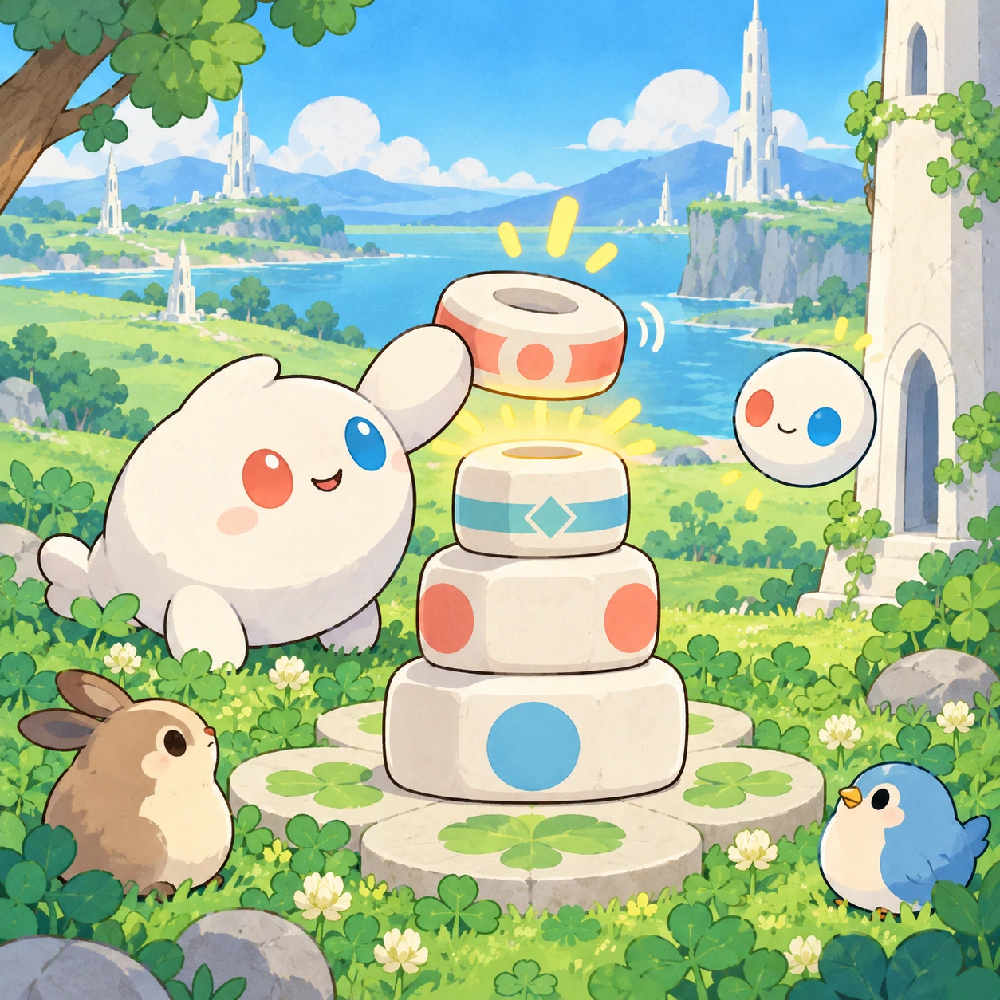

# Tiny White Tower

TD-20 · [Toddlers (1–3)](../td.md) · Cx 2 · Ages 2–3 · Raya story catalog

**The idea:** A short tower of big rounded white blocks rises on the clover; the child drags one more ringed block to the top, it snaps on with a wobble, and the little tower glows at its crown.

| Decision             | Proposal                                                                                                                                                                                                                                                                               |
| -------------------- | -------------------------------------------------------------------------------------------------------------------------------------------------------------------------------------------------------------------------------------------------------------------------------------- |
| Familiar mechanic    | Stacking blocks                                                                                                                                                                                                                                                                        |
| Learning objective   | Balance, big and small, building                                                                                                                                                                                                                                                       |
| First prototype      | One sensory toy or guided interaction with a large tap target, immediate gentle feedback and unlimited repetition. Introduce dragging only after an accessible tap alternative. No score or fail state; invite caregiver co-play under age 2.                                          |
| Technology           | React + SVG/DOM; deterministic state, undo and seeded levels. Start with one local screen and touch plus keyboard input.                                                                                                                                                               |
| Scope boundary       | One board and one rule set; defer accounts, multiplayer, procedural content and platform SDKs.                                                                                                                                                                                         |
| Reuse                | Shared input, saves, accessibility, seeded state and the toddlers (1–3) collection shell.                                                                                                                                                                                              |
| Prototype acceptance | During caregiver co-play, the child can explore one clear interaction and repeat it willingly. Observe recognition or purposeful action; require no reading or spoken explanation. Check large touch targets and a keyboard-accessible caregiver alternative at narrow and wide sizes. |
| Main uncertainty     | Test whether the lesson follows from play and whether the first interaction is understandable without reading.                                                                                                                                                                         |

## Estimated plan

**First playable version:** One meadow building spot with eight chunky ringed blocks and a glowing crown block, soft tumbles and a reset; round blocks, sitting friends and two linked towers are left out.

| Measure              | Estimate                                                                                      |
| -------------------- | --------------------------------------------------------------------------------------------- |
| Youngest age         | 2+                                                                                            |
| Toddler learnability | 4 of 5 — Tap a specific big target or drag one object to a big slot; one-step goal; ages 2-3. |
| Code                 | 880 LOC, 7.3 days                                                                             |
| Assets               | 46 hours, 7.7 days                                                                            |
| Effort               | 15.1 days, risk 2 of 5                                                                        |
| Start score          | 18.9 (rank 20 of 310; lower is better)                                                        |

**Algorithms:** `drag-drop-snap` (Drag and snap, 150 LOC) · `stacking-stability` (Stacking and balance, 250 LOC) · `physics-2d` (2D physics, 300 LOC)

**Assets:** 10 sprites, 3 animations, 1 background, 1 UI screen, 8 sound effects, 1 music track, 8 voice lines, 4 authored levels

How the numbers are computed: [development plan](../../development-plan.md#how-the-scores-work).

## Story

Linky wanted to build a tower just like the big white one. One block. Two blocks. Three blocks. Wobble, wobble... bump! The blocks rolled into the clover. Oopsy laughed. Oops means you're learning! Linky tried again, slower this time, big blocks at the bottom and small blocks on top. One, two, three, four, five. The little tower stood tall, and Linky put the glowing crown on top. The big tower blinked its light, as if to say hello.

> **Wisdom:** Oops means you're learning.

## Four visual directions

These are independently generated concept proposals for selecting a prototype.
The four views compare gameplay readability, world appeal, tactile identity and
room to grow. They are not screenshots of an implemented game. Native image
dimensions, hashes, exact prompts and generation provenance are recorded in the
[art manifest](../art/td-20/manifest.json); see the [generation notes](../README.md#image-generation-and-provenance).

The [core prompts](../jobs/td.json) use IDs `td-20/01-gameplay` to `td-20/04-discovery`.

### Gameplay

A short tower of big rounded white blocks rises on the clover; the child drags one more ringed block to the top, it snaps on with a wobble, and the little tower glows at its crown.

### World

The toddler meadow right beside the real short white Chord tower, so the toy tower copies it. Soft afternoon light, a few fawns watching and bubbles drifting by. The ground is flat, soft clover. When a tower tips, the blocks bounce gently into the grass like soft cushions.

### Characters and materials

Blocks are chunky, rounded and soft-looking, white with coral, leaf-green and sky-blue ring stripes like the nodes of a Chord tower. Linky stacks with its red and blue hands, and Oopsy giggles when the tower tumbles. An Orbi lifts the crown block for a sparkly finish. Matte, toy-like material.

### Expanded play

Later, new pieces arrive: round blocks that roll, tall thin blocks, a crown block that lights up and friends who like to sit on top. A soft tumble is part of the fun, with laughter and a fresh start. A bigger building spot lets the child build two towers and link them with a glowing thread.

## Design checks before prototyping

- Learning target: **Balance, big and small, building**. Ask a domain reviewer to validate factual content in the mechanic.
- Keep goals cooperative or self-directed, using resources and needs. Avoid purchasable power. No pressure timers in the accessible mode.
- Use original layouts and character designs; the [legal checklist](../../legal.md) applies even when a mechanic is familiar.
- Choose the minimum [fidelity level](../../simulation-engine.md#determinism-and-fidelity-levels) the lesson needs; concept art does not establish scientific accuracy.
- Review silhouettes, text alternatives, reduced motion and non-color cues against the [adorability gate](../../lore/adorability-gate.md).
- Follow the [toddler design rules](../../../case-studies/issue-1/data/research-raya-shacados.md#7-toddlers-and-screens-r68-r69): tap before drag, no reading, no failure, co-play under age 2.

Genre context: [existing genre research](../../../case-studies/issue-1/data/research-genres-ideas.md)
and [expansion research](../../../case-studies/issue-1/data/research-visual-catalog.md).

[← Sprout Patch](td-19.md) · [All concepts](../README.md) · [Where's Orbi? →](td-21.md)
