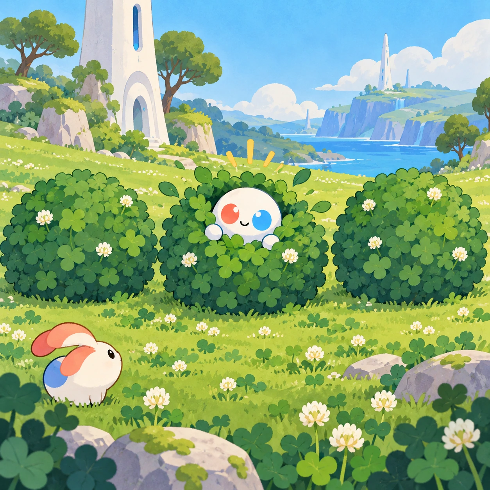
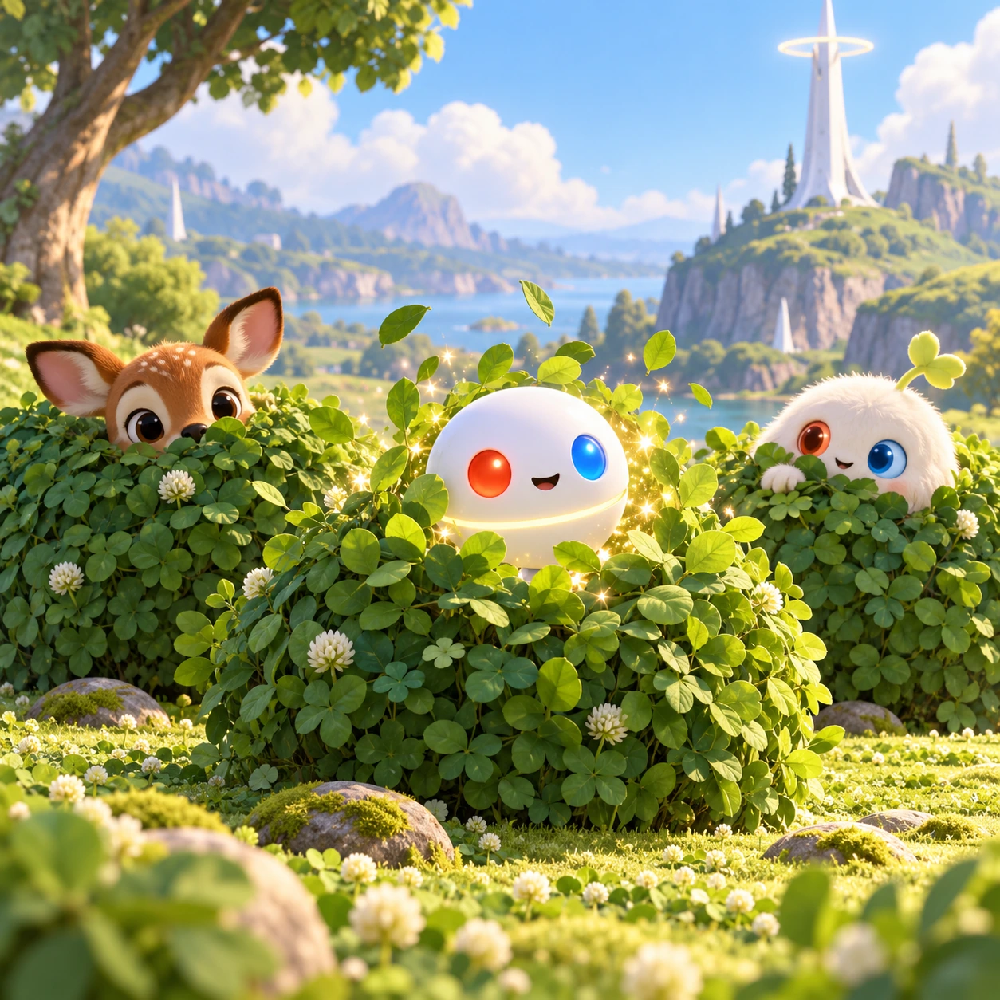

# Where's Orbi?

TD-21 · [Toddlers (1–3)](../td.md) · Cx 1 · Ages 2–3 · Raya story catalog

**The idea:** Three big round bushes stand in the meadow; one rustles and a white glowing curve peeks out. A tap on the wiggling bush makes the Orbi pop up with blinking red and blue eyes.

| Decision             | Proposal                                                                                                                                                                                                                                                                               |
| -------------------- | -------------------------------------------------------------------------------------------------------------------------------------------------------------------------------------------------------------------------------------------------------------------------------------- |
| Familiar mechanic    | Hide and seek                                                                                                                                                                                                                                                                          |
| Learning objective   | Looking and searching, object permanence                                                                                                                                                                                                                                               |
| First prototype      | One sensory toy or guided interaction with a large tap target, immediate gentle feedback and unlimited repetition. Introduce dragging only after an accessible tap alternative. No score or fail state; invite caregiver co-play under age 2.                                          |
| Technology           | React + SVG/DOM; deterministic state, undo and seeded levels. Start with one local screen and touch plus keyboard input.                                                                                                                                                               |
| Scope boundary       | One board and one rule set; defer accounts, multiplayer, procedural content and platform SDKs.                                                                                                                                                                                         |
| Reuse                | Shared input, saves, accessibility, seeded state and the toddlers (1–3) collection shell.                                                                                                                                                                                              |
| Prototype acceptance | During caregiver co-play, the child can explore one clear interaction and repeat it willingly. Observe recognition or purposeful action; require no reading or spoken explanation. Check large touch targets and a keyboard-accessible caregiver alternative at narrow and wide sizes. |
| Main uncertainty     | Test whether the lesson follows from play and whether the first interaction is understandable without reading.                                                                                                                                                                         |

## Estimated plan

**First playable version:** Six hide-and-seek rounds in two meadow areas with two to three big hiding spots and a wiggle and glow hint; switching turns so the child hides Linky is left out.

| Measure              | Estimate                                                                                      |
| -------------------- | --------------------------------------------------------------------------------------------- |
| Youngest age         | 2+                                                                                            |
| Toddler learnability | 4 of 5 — Tap a specific big target or drag one object to a big slot; one-step goal; ages 2-3. |
| Code                 | 470 LOC, 3.9 days                                                                             |
| Assets               | 62 hours, 10.3 days                                                                           |
| Effort               | 14.3 days, risk 1 of 5                                                                        |
| Start score          | 17.9 (rank 16 of 310; lower is better)                                                        |

**Algorithms:** `tap-feedback` (Tap feedback, 80 LOC) · `hidden-object` (Hidden objects, 150 LOC) · `tween-cause-effect` (Cause-and-effect animation, 100 LOC)

**Assets:** 12 sprites, 5 animations, 2 backgrounds, 1 UI screen, 8 sound effects, 1 music track, 10 voice lines, 6 authored levels

How the numbers are computed: [development plan](../../development-plan.md#how-the-scores-work).

## Story

Let's play hide and seek, said Linky. The Orbi closed its eyes. One, two, three! Linky ran behind a bush. But Linky's blue hand stuck out. Found you! said the Orbi. Now it was the Orbi's turn. Where was the Orbi? Not behind the log. Not behind the rock. A bush wiggled and glowed. Peek! There it was. Hiding is fun, but being found is even better, because then you are together again.

> **Wisdom:** Being found is the best part.

## Four visual directions

These are independently generated concept proposals for selecting a prototype.
The four views compare gameplay readability, world appeal, tactile identity and
room to grow. They are not screenshots of an implemented game. Native image
dimensions, hashes, exact prompts and generation provenance are recorded in the
[art manifest](../art/td-21/manifest.json); see the [generation notes](../README.md#image-generation-and-provenance).

The [core prompts](../jobs/td.json) use IDs `td-21/01-gameplay` to `td-21/04-discovery`.

### Gameplay

Three big round bushes stand in the meadow; one rustles and a white glowing curve peeks out. A tap on the wiggling bush makes the Orbi pop up with blinking red and blue eyes.

### World

A gently hilly part of the clover meadow with big round bushes, a hollow log, a mossy rock and a cluster of tall ferns. The short white Chord tower watches from the hilltop. Late afternoon light, long soft shadows and birdsong. Every hiding place is big and easy to tap.

### Characters and materials

The Orbi is a smooth white sphere about the size of a ball, with a soft equator ring, a coral-red left eye and a sky-blue right eye. Linky and a fawn take turns hiding too. Bushes shake, leaves flutter and little sparkles leak out as hints. Soft greens, mossy browns and clean white.

### Expanded play

As the child grows, the hiding spots grow from two to four, and the hints get gentler: a tiny giggle, a tail sticking out, a little glow. Turns switch so the child can choose where Linky hides while the Orbi pretends to search. A wrong guess just shows a sleepy beetle who says hi.

## Design checks before prototyping

- Learning target: **Looking and searching, object permanence**. Ask a domain reviewer to validate factual content in the mechanic.
- Keep goals cooperative or self-directed, using resources and needs. Avoid purchasable power. No pressure timers in the accessible mode.
- Use original layouts and character designs; the [legal checklist](../../legal.md) applies even when a mechanic is familiar.
- Choose the minimum [fidelity level](../../simulation-engine.md#determinism-and-fidelity-levels) the lesson needs; concept art does not establish scientific accuracy.
- Review silhouettes, text alternatives, reduced motion and non-color cues against the [adorability gate](../../lore/adorability-gate.md).
- Follow the [toddler design rules](../../../case-studies/issue-1/data/research-raya-shacados.md#7-toddlers-and-screens-r68-r69): tap before drag, no reading, no failure, co-play under age 2.

Genre context: [existing genre research](../../../case-studies/issue-1/data/research-genres-ideas.md)
and [expansion research](../../../case-studies/issue-1/data/research-visual-catalog.md).

[← Tiny White Tower](td-20.md) · [All concepts](../README.md) · [Goodnight Nest →](td-22.md)
