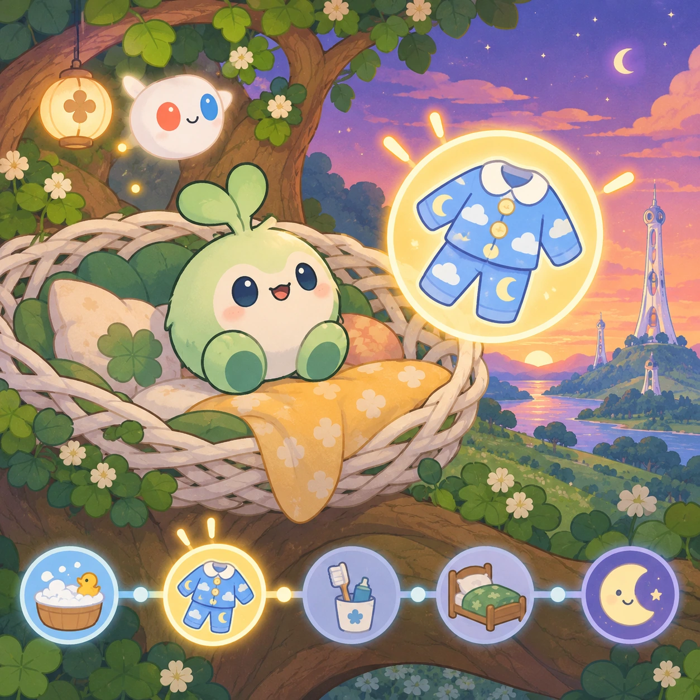
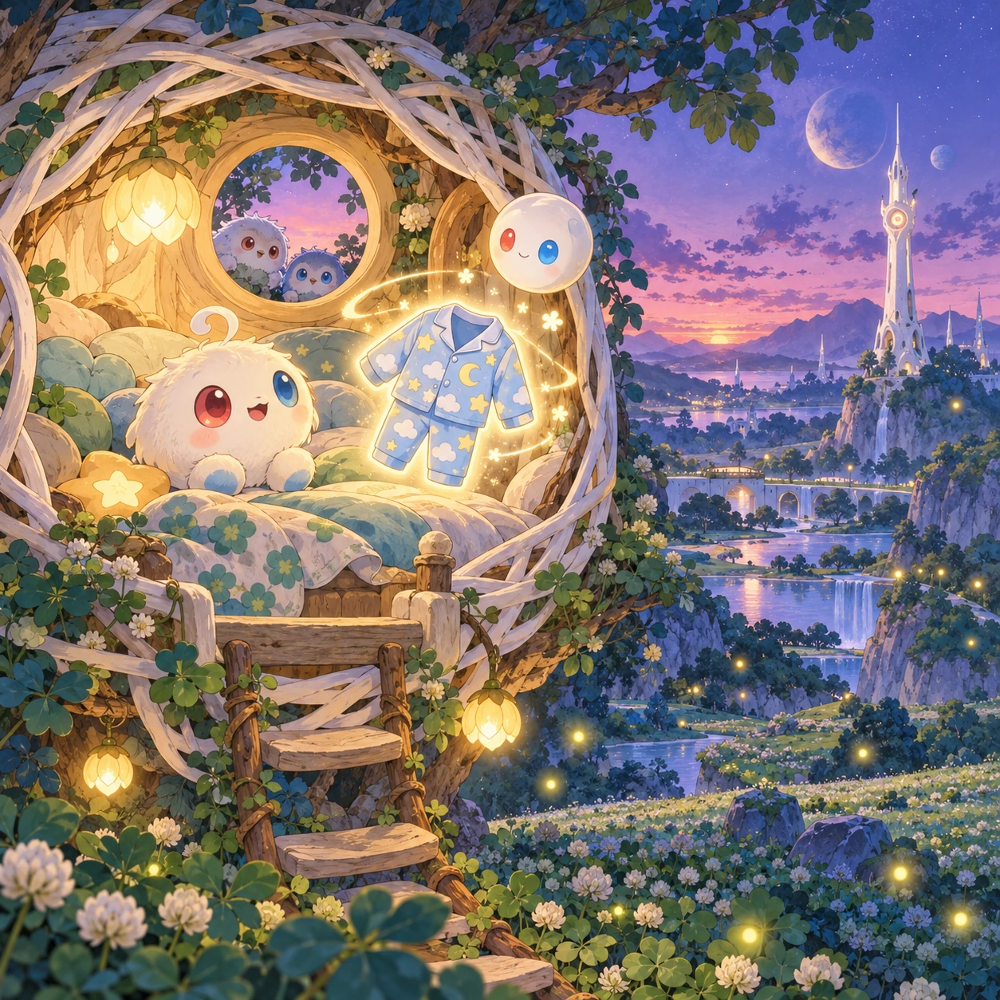
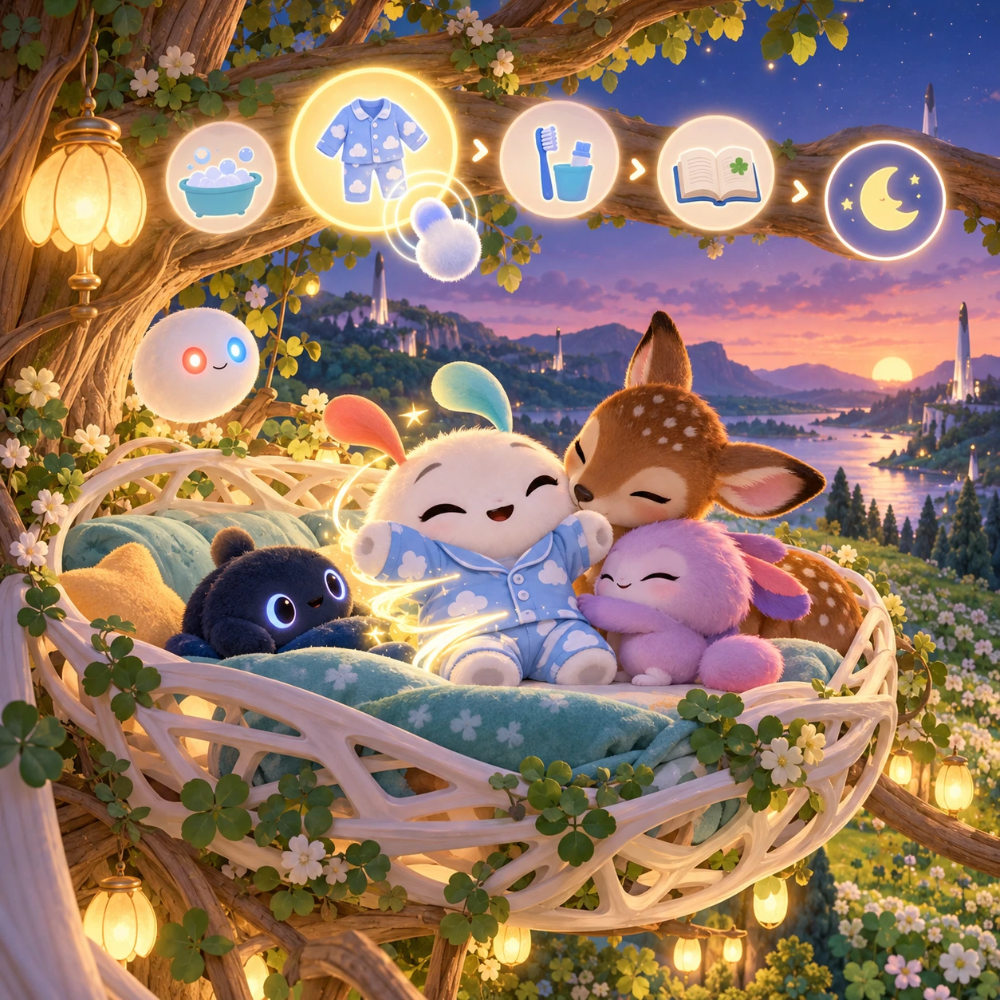

# Goodnight Nest

TD-22 · [Toddlers (1–3)](../td.md) · Cx 1 · Ages 2–3 · Raya story catalog

**The idea:** Linky sits in a cozy white lattice nest in a tree at dusk; one big glowing item waits, soft pajamas, and a tap puts them on with a gentle whoosh before the next step lights up.

| Decision             | Proposal                                                                                                                                                                                                                                                                               |
| -------------------- | -------------------------------------------------------------------------------------------------------------------------------------------------------------------------------------------------------------------------------------------------------------------------------------- |
| Familiar mechanic    | Bedtime routine                                                                                                                                                                                                                                                                        |
| Learning objective   | Routines, calming down, bedtime steps                                                                                                                                                                                                                                                  |
| First prototype      | One sensory toy or guided interaction with a large tap target, immediate gentle feedback and unlimited repetition. Introduce dragging only after an accessible tap alternative. No score or fail state; invite caregiver co-play under age 2.                                          |
| Technology           | React + SVG/DOM; deterministic state, undo and seeded levels. Start with one local screen and touch plus keyboard input.                                                                                                                                                               |
| Scope boundary       | One board and one rule set; defer accounts, multiplayer, procedural content and platform SDKs.                                                                                                                                                                                         |
| Reuse                | Shared input, saves, accessibility, seeded state and the toddlers (1–3) collection shell.                                                                                                                                                                                              |
| Prototype acceptance | During caregiver co-play, the child can explore one clear interaction and repeat it willingly. Observe recognition or purposeful action; require no reading or spoken explanation. Check large touch targets and a keyboard-accessible caregiver alternative at narrow and wide sizes. |
| Main uncertainty     | Test whether the lesson follows from play and whether the first interaction is understandable without reading.                                                                                                                                                                         |

## Estimated plan

**First playable version:** Six bedtime steps in a fixed order, each one big glowing object tapped in turn, ending with the lights fading and the app closing; parent step reordering and extra friends are left out.

| Measure              | Estimate                                                                                      |
| -------------------- | --------------------------------------------------------------------------------------------- |
| Youngest age         | 2+                                                                                            |
| Toddler learnability | 4 of 5 — Tap a specific big target or drag one object to a big slot; one-step goal; ages 2-3. |
| Code                 | 600 LOC, 5 days                                                                               |
| Assets               | 56 hours, 9.4 days                                                                            |
| Effort               | 14.4 days, risk 1 of 5                                                                        |
| Start score          | 18 (rank 18 of 310; lower is better)                                                          |

**Algorithms:** `tap-feedback` (Tap feedback, 80 LOC) · `tween-cause-effect` (Cause-and-effect animation, 100 LOC) · `pattern-sequence` (Pattern completion, 150 LOC) · `day-cycle` (Day and season cycle, 120 LOC)

**Assets:** 12 sprites, 6 animations, 1 background, 1 UI screen, 8 sound effects, 1 music track, 12 voice lines, 6 content items

How the numbers are computed: [development plan](../../development-plan.md#how-the-scores-work).

## Story

The sky turned purple. Time for bed, little Linky. First, a warm bath. Splash. Then soft pajamas. Snuggle. Then brush, brush, brush. Then a story about a fawn who found a star. Itsy gave Linky a big hug. The Orbi made its light small and golden. Linky got under the blanket, and the nest rocked gently in the tree. Outside, Pim and Pom were shining. Every evening, the same little steps, and then sweet dreams.

> **Wisdom:** Little steps lead to sweet dreams.

## Four visual directions

These are independently generated concept proposals for selecting a prototype.
The four views compare gameplay readability, world appeal, tactile identity and
room to grow. They are not screenshots of an implemented game. Native image
dimensions, hashes, exact prompts and generation provenance are recorded in the
[art manifest](../art/td-22/manifest.json); see the [generation notes](../README.md#image-generation-and-provenance).

The [core prompts](../jobs/td.json) use IDs `td-22/01-gameplay` to `td-22/04-discovery`.

### Gameplay

Linky sits in a cozy white lattice nest in a tree at dusk; one big glowing item waits, soft pajamas, and a tap puts them on with a gentle whoosh before the next step lights up.

### World

A cozy nest woven from white lattice and grown wood, high in a blue-green tree at the edge of the clover meadow. The short white Chord tower glows softly nearby. Dusk turns the sky lavender, fireflies come out, and the round window of the nest shows Pim and Pom rising.

### Characters and materials

Each step is one big glowing object: a bath cup, soft pajamas, a toothbrush, a picture book, a cuddly plush fawn and a night light. Linky yawns with sleepy red and blue eyes, and an Orbi dims to a warm glow. Soft felt, knitted blanket and wood textures in lavender and honey colors.

### Expanded play

Over time a parent can arrange the same steps to match the family's own evening. Friends join the nest: the fawn, Nully, and Itsy, who gives a goodnight hug. Each night ends with the lights fading slowly and the game closing by itself, never with a cliffhanger.

## Design checks before prototyping

- Learning target: **Routines, calming down, bedtime steps**. Ask a domain reviewer to validate factual content in the mechanic.
- Keep goals cooperative or self-directed, using resources and needs. Avoid purchasable power. No pressure timers in the accessible mode.
- Use original layouts and character designs; the [legal checklist](../../legal.md) applies even when a mechanic is familiar.
- Choose the minimum [fidelity level](../../simulation-engine.md#determinism-and-fidelity-levels) the lesson needs; concept art does not establish scientific accuracy.
- Review silhouettes, text alternatives, reduced motion and non-color cues against the [adorability gate](../../lore/adorability-gate.md).
- Follow the [toddler design rules](../../../case-studies/issue-1/data/research-raya-shacados.md#7-toddlers-and-screens-r68-r69): tap before drag, no reading, no failure, co-play under age 2.

Genre context: [existing genre research](../../../case-studies/issue-1/data/research-genres-ideas.md)
and [expansion research](../../../case-studies/issue-1/data/research-visual-catalog.md).

[← Where's Orbi?](td-21.md) · [All concepts](../README.md) · [Shape Friends Sorter →](td-23.md)
