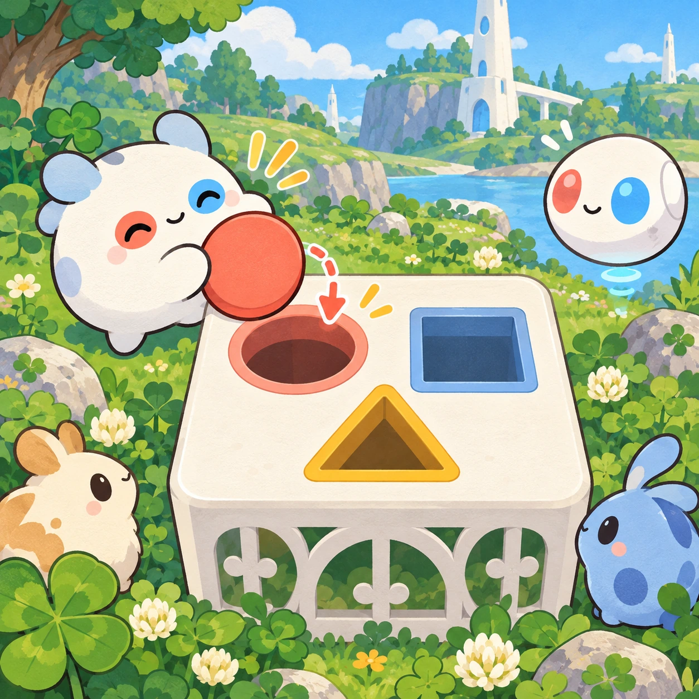
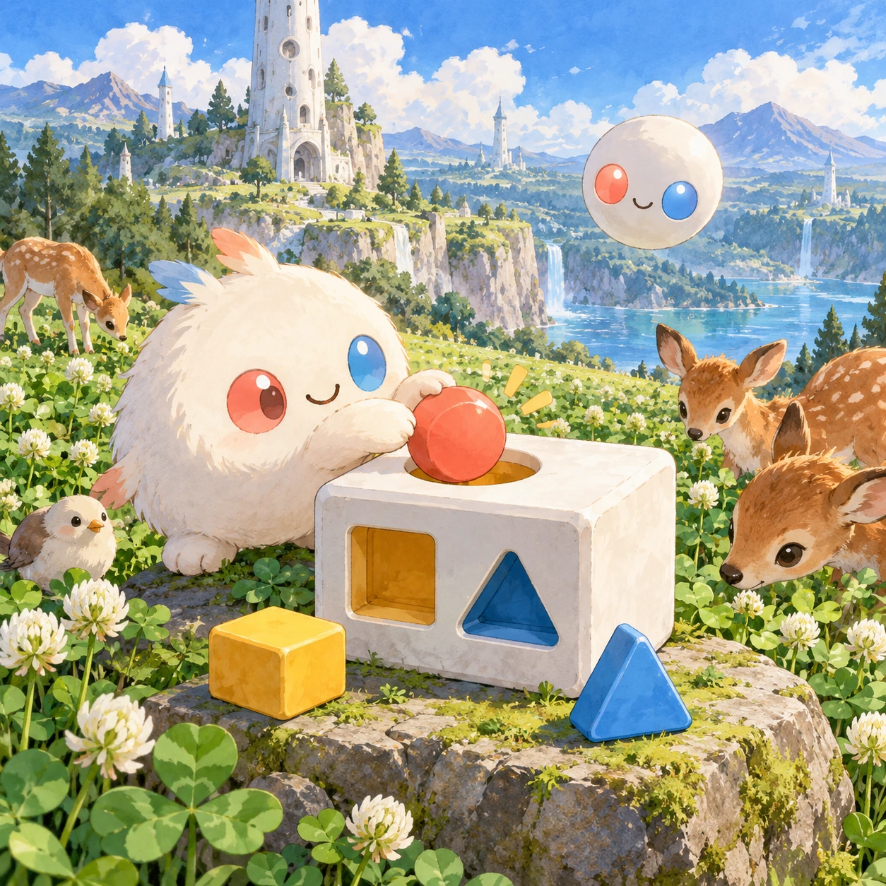
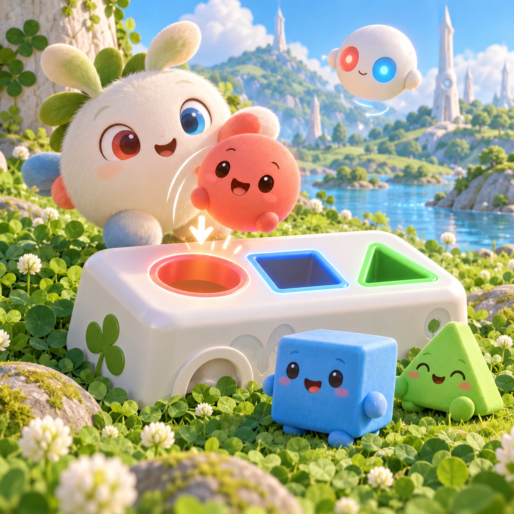
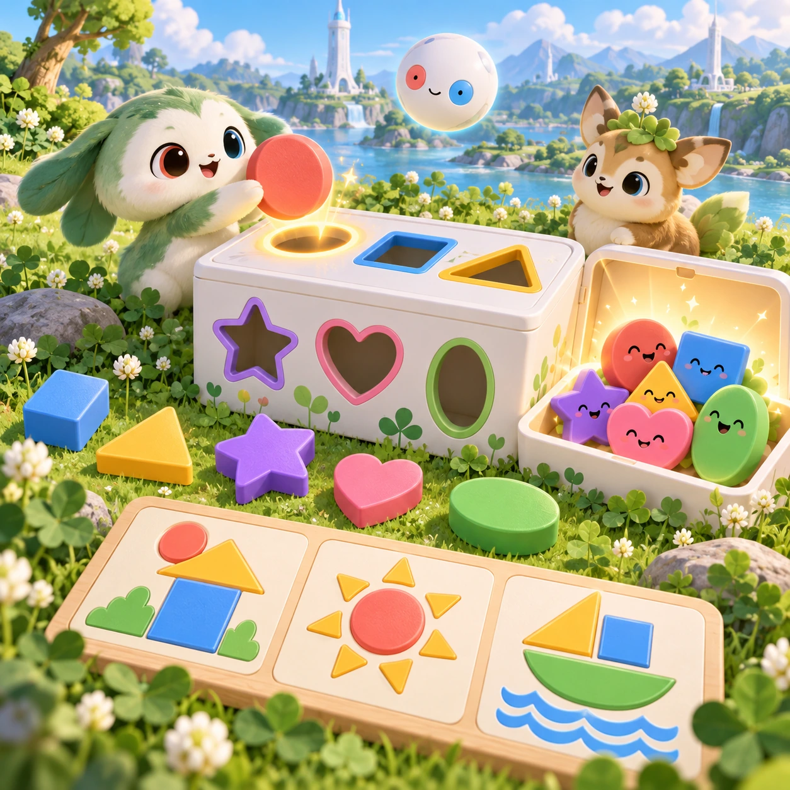

# Shape Friends Sorter

TD-23 · [Toddlers (1–3)](../td.md) · Cx 1 · Ages 2–3 · Raya story catalog

**The idea:** A white lattice box sits in the clover with a round, a square and a triangle hole; the child drags a coral circle toward the round hole and it drops in with a happy boop.

| Decision             | Proposal                                                                                                                                                                                                                                                                               |
| -------------------- | -------------------------------------------------------------------------------------------------------------------------------------------------------------------------------------------------------------------------------------------------------------------------------------- |
| Familiar mechanic    | Shape sorter                                                                                                                                                                                                                                                                           |
| Learning objective   | Shapes: circle, square, triangle                                                                                                                                                                                                                                                       |
| First prototype      | One sensory toy or guided interaction with a large tap target, immediate gentle feedback and unlimited repetition. Introduce dragging only after an accessible tap alternative. No score or fail state; invite caregiver co-play under age 2.                                          |
| Technology           | React + SVG/DOM; deterministic state, undo and seeded levels. Start with one local screen and touch plus keyboard input.                                                                                                                                                               |
| Scope boundary       | One board and one rule set; defer accounts, multiplayer, procedural content and platform SDKs.                                                                                                                                                                                         |
| Reuse                | Shared input, saves, accessibility, seeded state and the toddlers (1–3) collection shell.                                                                                                                                                                                              |
| Prototype acceptance | During caregiver co-play, the child can explore one clear interaction and repeat it willingly. Observe recognition or purposeful action; require no reading or spoken explanation. Check large touch targets and a keyboard-accessible caregiver alternative at narrow and wide sizes. |
| Main uncertainty     | Test whether the lesson follows from play and whether the first interaction is understandable without reading.                                                                                                                                                                         |

## Estimated plan

**First playable version:** A sorter box with round, square and triangle holes and six rounds of shape friends sliding back with a giggle at the wrong hole; star and heart holes and the picture mode are left out.

| Measure              | Estimate                                                                          |
| -------------------- | --------------------------------------------------------------------------------- |
| Youngest age         | 2+                                                                                |
| Toddler learnability | 3 of 5 — Choose among 2-4 options, sort or match, or a two-step action; ages 3-4. |
| Code                 | 500 LOC, 4.2 days                                                                 |
| Assets               | 52 hours, 8.7 days                                                                |
| Effort               | 12.8 days, risk 1 of 5                                                            |
| Start score          | 19.2 (rank 21 of 310; lower is better)                                            |

**Algorithms:** `drag-drop-snap` (Drag and snap, 150 LOC) · `sort-classify` (Sorting by attribute, 120 LOC) · `tween-cause-effect` (Cause-and-effect animation, 100 LOC)

**Assets:** 10 sprites, 4 animations, 1 background, 1 UI screen, 8 sound effects, 1 music track, 10 voice lines, 6 authored levels

How the numbers are computed: [development plan](../../development-plan.md#how-the-scores-work).

## Story

Soru is round, like a ball. Tari is square, like a box. Verbi is a triangle, like a little roof. They all wanted to go into the white box. Soru tried the square door. Bump! It did not fit. Soru tried the round door. Boop! In it went. Tari found the square door. Verbi found the triangle door. Everybody fits somewhere. You just have to find your own door.

> **Wisdom:** Everybody fits somewhere.

## Four visual directions

These are independently generated concept proposals for selecting a prototype.
The four views compare gameplay readability, world appeal, tactile identity and
room to grow. They are not screenshots of an implemented game. Native image
dimensions, hashes, exact prompts and generation provenance are recorded in the
[art manifest](../art/td-23/manifest.json); see the [generation notes](../README.md#image-generation-and-provenance).

The [core prompts](../jobs/td.json) use IDs `td-23/01-gameplay` to `td-23/04-discovery`.

### Gameplay

A white lattice box sits in the clover with a round, a square and a triangle hole; the child drags a coral circle toward the round hole and it drops in with a happy boop.

### World

A sunny play corner of the toddler meadow on a flat mossy rock, with the short white Chord tower behind it and a few fawns nibbling clover. Soft, even light makes the holes clear and easy to see. Everything is big, rounded and close to the camera.

### Characters and materials

The shapes follow the roles of the Links: Soru is the round coral shape, Tari the square sky-blue shape and Verbi the leaf-green triangle. Each shape has a little face. The sorter box is smooth white with glowing hole rims. A shape at the wrong hole slides back with a wiggle and a giggle.

### Expanded play

Later the box grows a star hole for Anya, a heart and an oval, and the shapes change colors so the child sorts by shape, not by color. A picture mode lets shapes fill the outline of a house, a sun or a boat. When every shape is home, the box opens and the friends hug.

## Design checks before prototyping

- Learning target: **Shapes: circle, square, triangle**. Ask a domain reviewer to validate factual content in the mechanic.
- Keep goals cooperative or self-directed, using resources and needs. Avoid purchasable power. No pressure timers in the accessible mode.
- Use original layouts and character designs; the [legal checklist](../../legal.md) applies even when a mechanic is familiar.
- Choose the minimum [fidelity level](../../simulation-engine.md#determinism-and-fidelity-levels) the lesson needs; concept art does not establish scientific accuracy.
- Review silhouettes, text alternatives, reduced motion and non-color cues against the [adorability gate](../../lore/adorability-gate.md).
- Follow the [toddler design rules](../../../case-studies/issue-1/data/research-raya-shacados.md#7-toddlers-and-screens-r68-r69): tap before drag, no reading, no failure, co-play under age 2.

Genre context: [existing genre research](../../../case-studies/issue-1/data/research-genres-ideas.md)
and [expansion research](../../../case-studies/issue-1/data/research-visual-catalog.md).

[← Goodnight Nest](td-22.md) · [All concepts](../README.md) · [Rain or Shine Closet →](td-24.md)
