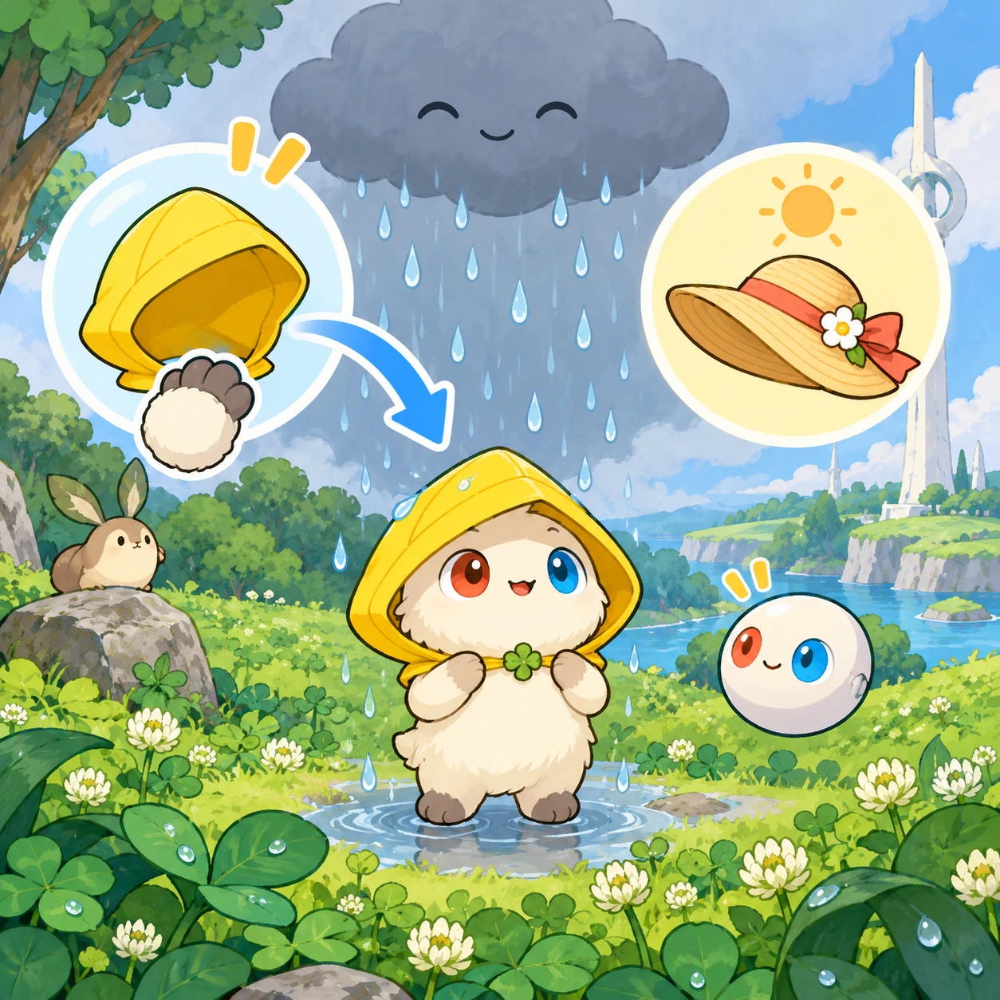
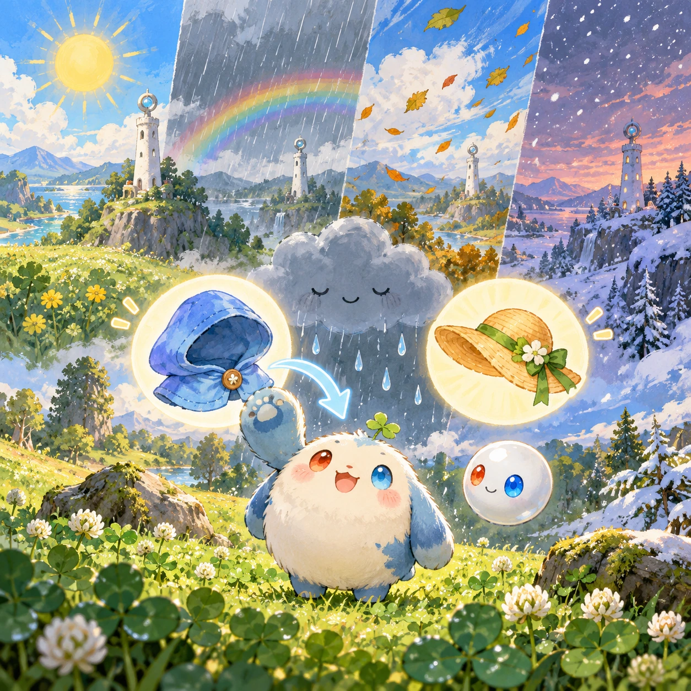
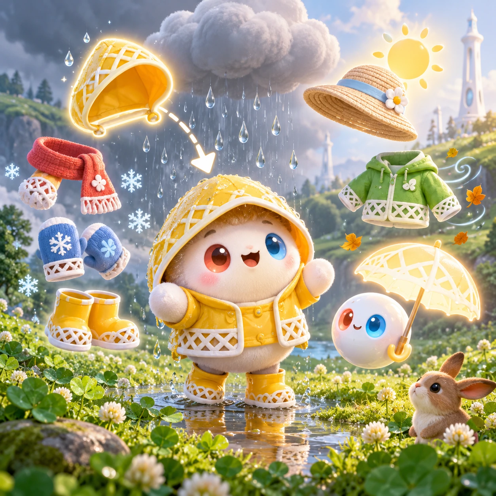
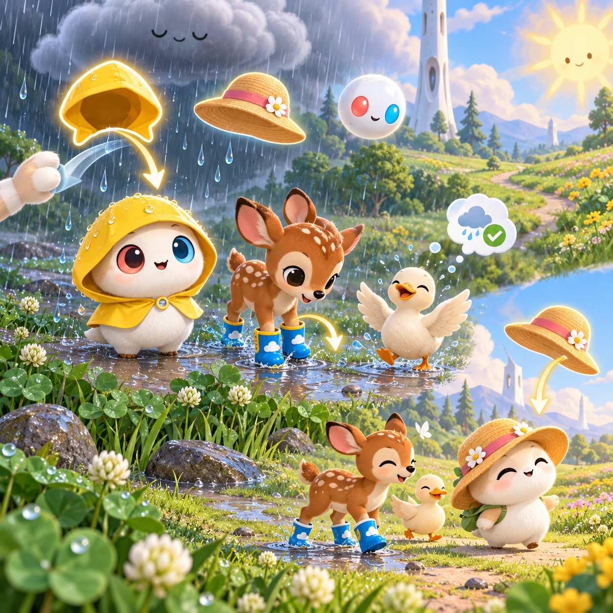

# Rain or Shine Closet

TD-24 · [Toddlers (1–3)](../td.md) · Cx 1 · Ages 2–3 · Raya story catalog

**The idea:** Linky stands in the meadow under a gray rain cloud with two big clothing choices floating beside it, a rain hood and a sun hat; the child drags the rain hood onto Linky as drops patter.

| Decision             | Proposal                                                                                                                                                                                                                                                                               |
| -------------------- | -------------------------------------------------------------------------------------------------------------------------------------------------------------------------------------------------------------------------------------------------------------------------------------- |
| Familiar mechanic    | Dress-up for weather                                                                                                                                                                                                                                                                   |
| Learning objective   | Weather words, choosing clothes                                                                                                                                                                                                                                                        |
| First prototype      | One sensory toy or guided interaction with a large tap target, immediate gentle feedback and unlimited repetition. Introduce dragging only after an accessible tap alternative. No score or fail state; invite caregiver co-play under age 2.                                          |
| Technology           | React + SVG/DOM; deterministic state, undo and seeded levels. Start with one local screen and touch plus keyboard input.                                                                                                                                                               |
| Scope boundary       | One board and one rule set; defer accounts, multiplayer, procedural content and platform SDKs.                                                                                                                                                                                         |
| Reuse                | Shared input, saves, accessibility, seeded state and the toddlers (1–3) collection shell.                                                                                                                                                                                              |
| Prototype acceptance | During caregiver co-play, the child can explore one clear interaction and repeat it willingly. Observe recognition or purposeful action; require no reading or spoken explanation. Check large touch targets and a keyboard-accessible caregiver alternative at narrow and wide sizes. |
| Main uncertainty     | Test whether the lesson follows from play and whether the first interaction is understandable without reading.                                                                                                                                                                         |

## Estimated plan

**First playable version:** Four weather scenes with two clothing choices each dragged onto Linky and voiced kindly whatever is chosen; two-change walks and the fawn and duck are left out.

| Measure              | Estimate                                                                          |
| -------------------- | --------------------------------------------------------------------------------- |
| Youngest age         | 2+                                                                                |
| Toddler learnability | 3 of 5 — Choose among 2-4 options, sort or match, or a two-step action; ages 3-4. |
| Code                 | 550 LOC, 4.6 days                                                                 |
| Assets               | 73 hours, 12.2 days                                                               |
| Effort               | 16.8 days, risk 1 of 5                                                            |
| Start score          | 25.2 (rank 36 of 310; lower is better)                                            |

**Algorithms:** `dress-up-layers` (Layered dress-up, 150 LOC) · `drag-drop-snap` (Drag and snap, 150 LOC) · `tween-cause-effect` (Cause-and-effect animation, 100 LOC)

**Assets:** 16 sprites, 4 animations, 4 backgrounds, 1 UI screen, 10 sound effects, 1 music track, 14 voice lines, 4 authored levels

How the numbers are computed: [development plan](../../development-plan.md#how-the-scores-work).

## Story

Linky wanted to go for a walk. Pitter, patter. It was raining! Should Linky wear the sun hat or the rain hood? The rain hood! Linky stayed dry and jumped in puddles. Then the sun came out. Hot, hot! Linky put on the sun hat. In the evening, snowflakes fell. Brrr! A scarf and mittens. The sky changes, and we can change too. Linky was ready for every kind of day.

> **Wisdom:** Be ready for every kind of day.

## Four visual directions

These are independently generated concept proposals for selecting a prototype.
The four views compare gameplay readability, world appeal, tactile identity and
room to grow. They are not screenshots of an implemented game. Native image
dimensions, hashes, exact prompts and generation provenance are recorded in the
[art manifest](../art/td-24/manifest.json); see the [generation notes](../README.md#image-generation-and-provenance).

The [core prompts](../jobs/td.json) use IDs `td-24/01-gameplay` to `td-24/04-discovery`.

### Gameplay

Linky stands in the meadow under a gray rain cloud with two big clothing choices floating beside it, a rain hood and a sun hat; the child drags the rain hood onto Linky as drops patter.

### World

The clover meadow changes weather in front of the child: a sunny morning, a soft rain shower, a windy afternoon and a snowy evening. The short white Chord tower stands in every scene. Each kind of weather is gentle and pretty, never stormy, and a rainbow always follows the rain.

### Characters and materials

The clothes are small, cute white lattice pieces with role-color accents: a rain shell hood, a sun hat, a warm scarf, mittens, boots and a wind jacket. Linky's round body wears them, and an Orbi holds an umbrella of light. Raindrops, snowflakes, wind-blown leaves and sun rays.

### Expanded play

More weather and friends join: the fawn needs boots for puddles, and the duck happily needs nothing in the rain. Later, the child dresses Linky for two weather changes in one walk. Every choice is allowed and gently named; a sun hat in the rain just makes the fawn giggle and the rain hood floats closer.

## Design checks before prototyping

- Learning target: **Weather words, choosing clothes**. Ask a domain reviewer to validate factual content in the mechanic.
- Keep goals cooperative or self-directed, using resources and needs. Avoid purchasable power. No pressure timers in the accessible mode.
- Use original layouts and character designs; the [legal checklist](../../legal.md) applies even when a mechanic is familiar.
- Choose the minimum [fidelity level](../../simulation-engine.md#determinism-and-fidelity-levels) the lesson needs; concept art does not establish scientific accuracy.
- Review silhouettes, text alternatives, reduced motion and non-color cues against the [adorability gate](../../lore/adorability-gate.md).
- Follow the [toddler design rules](../../../case-studies/issue-1/data/research-raya-shacados.md#7-toddlers-and-screens-r68-r69): tap before drag, no reading, no failure, co-play under age 2.

Genre context: [existing genre research](../../../case-studies/issue-1/data/research-genres-ideas.md)
and [expansion research](../../../case-studies/issue-1/data/research-visual-catalog.md).

[← Shape Friends Sorter](td-23.md) · [All concepts](../README.md) · [Big Fawn, Little Fawn →](td-25.md)
