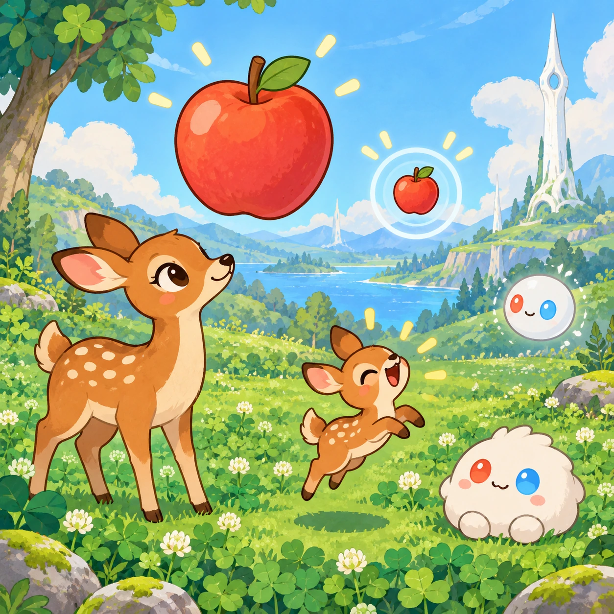
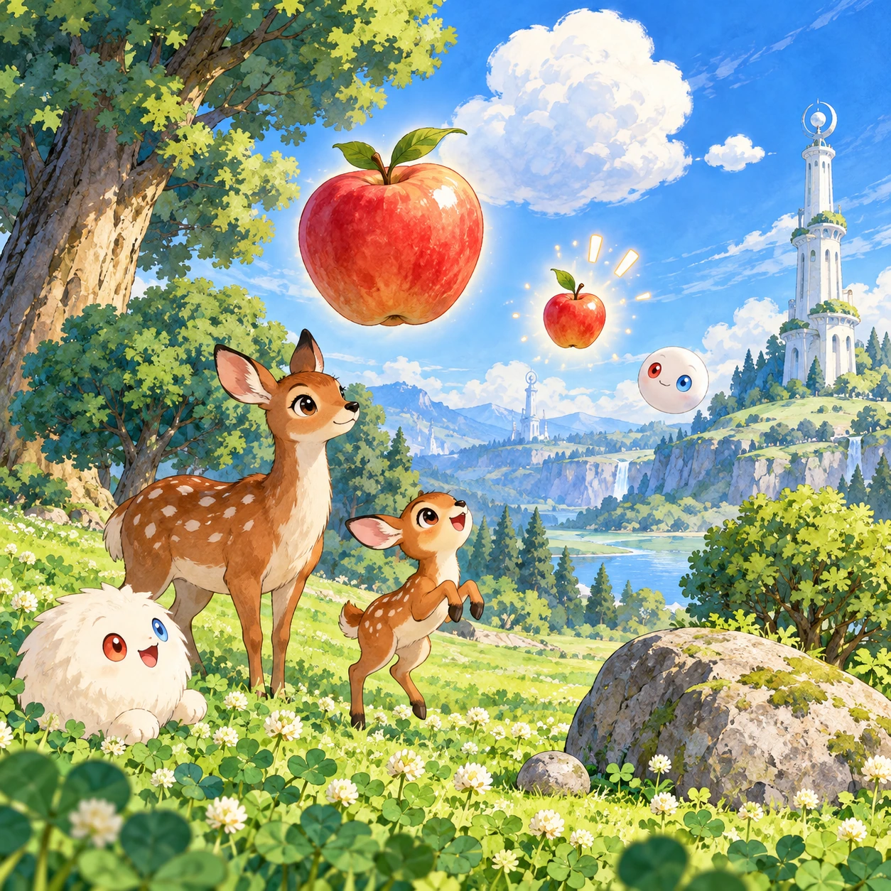
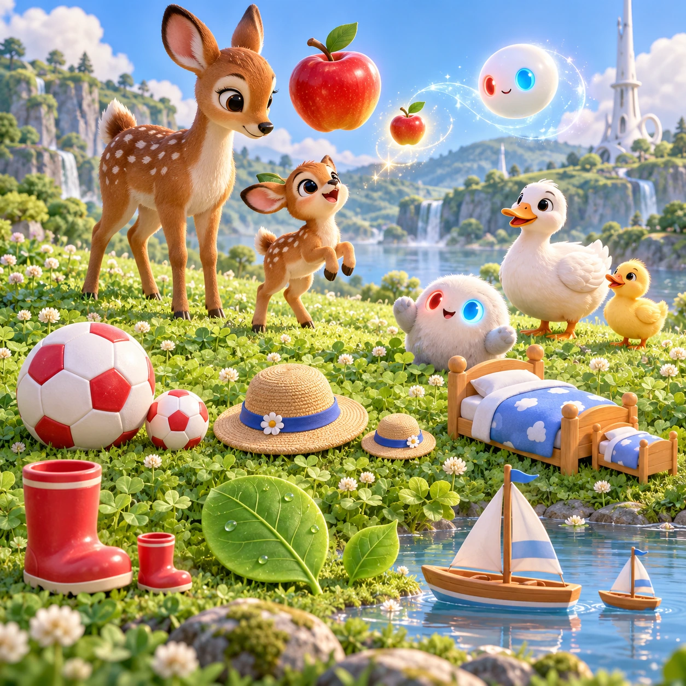
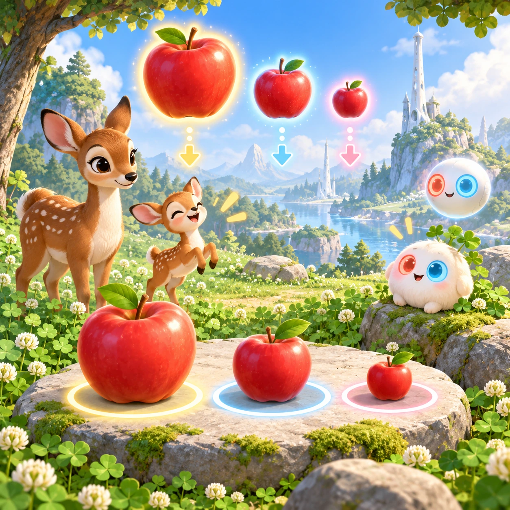

# Big Fawn, Little Fawn

TD-25 · [Toddlers (1–3)](../td.md) · Cx 1 · Ages 2–3 · Raya story catalog

**The idea:** Two apples float over the clover, one big and one tiny; a mother deer and her little fawn wait below, and the child taps the tiny apple for the fawn, who bounces happily.

| Decision             | Proposal                                                                                                                                                                                                                                                                               |
| -------------------- | -------------------------------------------------------------------------------------------------------------------------------------------------------------------------------------------------------------------------------------------------------------------------------------- |
| Familiar mechanic    | Big and small comparison                                                                                                                                                                                                                                                               |
| Learning objective   | Size words: big, small, bigger                                                                                                                                                                                                                                                         |
| First prototype      | One sensory toy or guided interaction with a large tap target, immediate gentle feedback and unlimited repetition. Introduce dragging only after an accessible tap alternative. No score or fail state; invite caregiver co-play under age 2.                                          |
| Technology           | React + SVG/DOM; deterministic state, undo and seeded levels. Start with one local screen and touch plus keyboard input.                                                                                                                                                               |
| Scope boundary       | One board and one rule set; defer accounts, multiplayer, procedural content and platform SDKs.                                                                                                                                                                                         |
| Reuse                | Shared input, saves, accessibility, seeded state and the toddlers (1–3) collection shell.                                                                                                                                                                                              |
| Prototype acceptance | During caregiver co-play, the child can explore one clear interaction and repeat it willingly. Observe recognition or purposeful action; require no reading or spoken explanation. Check large touch targets and a keyboard-accessible caregiver alternative at narrow and wide sizes. |
| Main uncertainty     | Test whether the lesson follows from play and whether the first interaction is understandable without reading.                                                                                                                                                                         |

## Estimated plan

**First playable version:** Eight big-and-small pairs given to a deer and her fawn or a duck and duckling by tapping, with a happy dance; three-size families and grow-and-shrink play are left out.

| Measure              | Estimate                                                                          |
| -------------------- | --------------------------------------------------------------------------------- |
| Youngest age         | 2+                                                                                |
| Toddler learnability | 3 of 5 — Choose among 2-4 options, sort or match, or a two-step action; ages 3-4. |
| Code                 | 420 LOC, 3.5 days                                                                 |
| Assets               | 67 hours, 11.1 days                                                               |
| Effort               | 14.6 days, risk 1 of 5                                                            |
| Start score          | 21.9 (rank 30 of 310; lower is better)                                            |

**Algorithms:** `tap-feedback` (Tap feedback, 80 LOC) · `sort-classify` (Sorting by attribute, 120 LOC) · `tween-cause-effect` (Cause-and-effect animation, 100 LOC)

**Assets:** 18 sprites, 4 animations, 1 background, 1 UI screen, 8 sound effects, 1 music track, 12 voice lines, 8 authored levels

How the numbers are computed: [development plan](../../development-plan.md#how-the-scores-work).

## Story

Mama Deer is big. Little Fawn is small. Mama Deer has a big bed of soft leaves. Little Fawn has a small bed. Mama Deer eats a big apple. Little Fawn eats a small one. One day Little Fawn tried on Mama's big hat. It covered its whole face! Everybody laughed. Big is good and small is good. Each size is just right for someone.

> **Wisdom:** Big or small, each one is right.

## Four visual directions

These are independently generated concept proposals for selecting a prototype.
The four views compare gameplay readability, world appeal, tactile identity and
room to grow. They are not screenshots of an implemented game. Native image
dimensions, hashes, exact prompts and generation provenance are recorded in the
[art manifest](../art/td-25/manifest.json); see the [generation notes](../README.md#image-generation-and-provenance).

The [core prompts](../jobs/td.json) use IDs `td-25/01-gameplay` to `td-25/04-discovery`.

### Gameplay

Two apples float over the clover, one big and one tiny; a mother deer and her little fawn wait below, and the child taps the tiny apple for the fawn, who bounces happily.

### World

A sunny meadow slope below the short white Chord tower, with big trees and small bushes side by side, a big stone and a pebble, a big cloud and a tiny cloud, so the whole place plays with size. Calm light and clear space make each pair easy to compare.

### Characters and materials

Pairs of objects in big and small: apples, balls, hats, beds, boots, leaves and boats. A grown deer and a spotted fawn, a big duck and a duckling, Linky and a tiny Beadle. The sizes differ a lot, so the choice is always clear. An Orbi grows and shrinks things with a shimmer.

### Expanded play

Later, three sizes appear for a big, middle and small family, like nesting cups, and the child lines them up. A grow and shrink mode lets the child tap to make things bigger or smaller with funny sounds. Every choice is named kindly, and the right fit gets a happy dance.

## Design checks before prototyping

- Learning target: **Size words: big, small, bigger**. Ask a domain reviewer to validate factual content in the mechanic.
- Keep goals cooperative or self-directed, using resources and needs. Avoid purchasable power. No pressure timers in the accessible mode.
- Use original layouts and character designs; the [legal checklist](../../legal.md) applies even when a mechanic is familiar.
- Choose the minimum [fidelity level](../../simulation-engine.md#determinism-and-fidelity-levels) the lesson needs; concept art does not establish scientific accuracy.
- Review silhouettes, text alternatives, reduced motion and non-color cues against the [adorability gate](../../lore/adorability-gate.md).
- Follow the [toddler design rules](../../../case-studies/issue-1/data/research-raya-shacados.md#7-toddlers-and-screens-r68-r69): tap before drag, no reading, no failure, co-play under age 2.

Genre context: [existing genre research](../../../case-studies/issue-1/data/research-genres-ideas.md)
and [expansion research](../../../case-studies/issue-1/data/research-visual-catalog.md).

[← Rain or Shine Closet](td-24.md) · [All concepts](../README.md) · [Color Baskets →](td-26.md)
