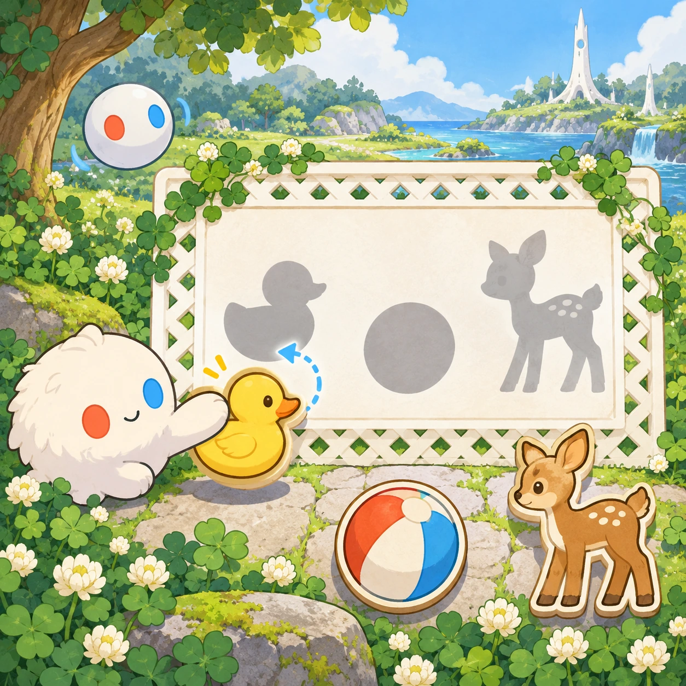
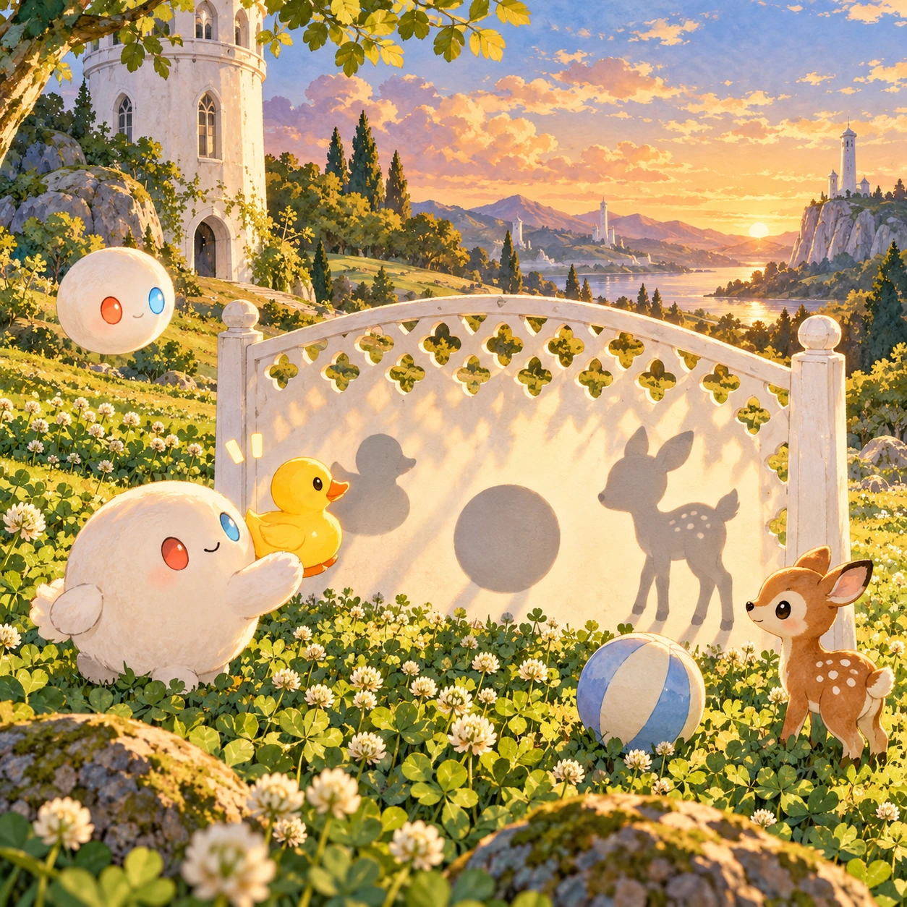
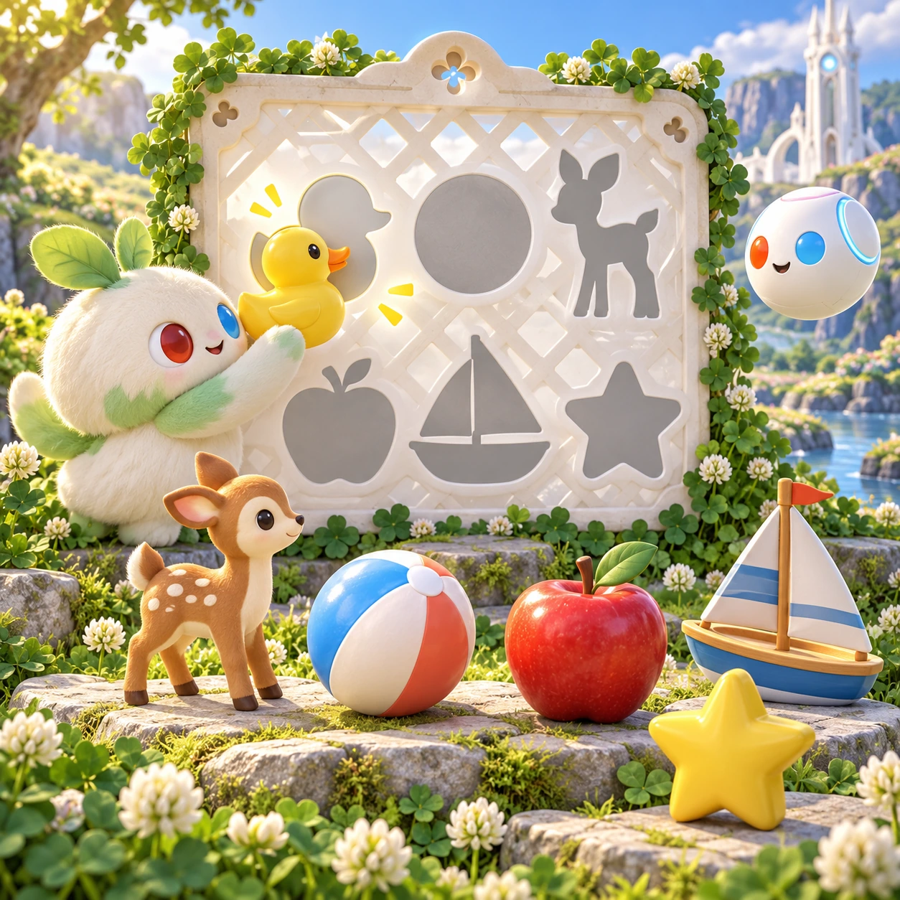
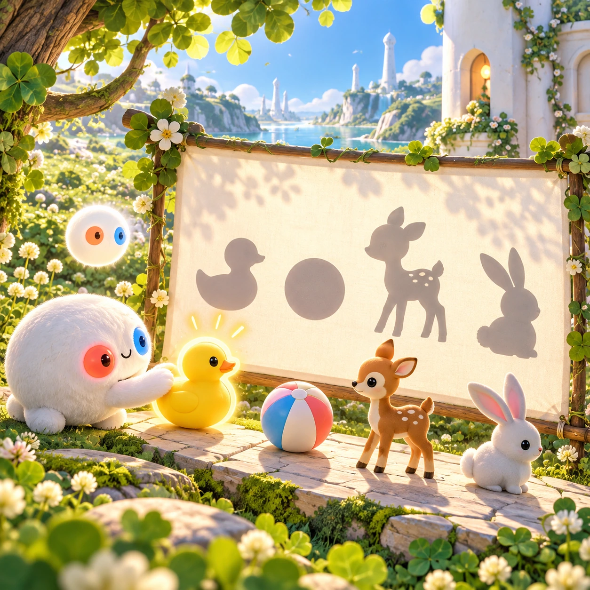

# Shadow Friends

TD-28 · [Toddlers (1–3)](../td.md) · Cx 1 · Ages 2–3 · Raya story catalog

**The idea:** On a sunlit white lattice screen three soft gray shadows wait, a duck, a ball and a fawn; the child drags a bright yellow duck onto the duck shadow and it fills with color.

| Decision             | Proposal                                                                                                                                                                                                                                                                               |
| -------------------- | -------------------------------------------------------------------------------------------------------------------------------------------------------------------------------------------------------------------------------------------------------------------------------------- |
| Familiar mechanic    | Shadow matching                                                                                                                                                                                                                                                                        |
| Learning objective   | Shape recognition, visual matching                                                                                                                                                                                                                                                     |
| First prototype      | One sensory toy or guided interaction with a large tap target, immediate gentle feedback and unlimited repetition. Introduce dragging only after an accessible tap alternative. No score or fail state; invite caregiver co-play under age 2.                                          |
| Technology           | React + SVG/DOM; deterministic state, undo and seeded levels. Start with one local screen and touch plus keyboard input.                                                                                                                                                               |
| Scope boundary       | One board and one rule set; defer accounts, multiplayer, procedural content and platform SDKs.                                                                                                                                                                                         |
| Reuse                | Shared input, saves, accessibility, seeded state and the toddlers (1–3) collection shell.                                                                                                                                                                                              |
| Prototype acceptance | During caregiver co-play, the child can explore one clear interaction and repeat it willingly. Observe recognition or purposeful action; require no reading or spoken explanation. Check large touch targets and a keyboard-accessible caregiver alternative at narrow and wide sizes. |
| Main uncertainty     | Test whether the lesson follows from play and whether the first interaction is understandable without reading.                                                                                                                                                                         |

## Estimated plan

**First playable version:** Eight rounds matching a bright object to one of three soft gray shadows on a lattice screen, each turning colored and waving; wiggling shadows and shadow puppets are left out.

| Measure              | Estimate                                                                          |
| -------------------- | --------------------------------------------------------------------------------- |
| Youngest age         | 2+                                                                                |
| Toddler learnability | 3 of 5 — Choose among 2-4 options, sort or match, or a two-step action; ages 3-4. |
| Code                 | 500 LOC, 4.2 days                                                                 |
| Assets               | 59 hours, 9.9 days                                                                |
| Effort               | 14.1 days, risk 1 of 5                                                            |
| Start score          | 21.2 (rank 28 of 310; lower is better)                                            |

**Algorithms:** `drag-drop-snap` (Drag and snap, 150 LOC) · `sort-classify` (Sorting by attribute, 120 LOC) · `tween-cause-effect` (Cause-and-effect animation, 100 LOC)

**Assets:** 16 sprites, 3 animations, 1 background, 1 UI screen, 8 sound effects, 1 music track, 8 voice lines, 8 authored levels

How the numbers are computed: [development plan](../../development-plan.md#how-the-scores-work).

## Story

In the evening sun, Linky saw shadows on the white screen. A shadow with long ears. A shadow with a round body. A shadow with a flat beak. Whose shadows were they? Linky held up the duck. The flat beak matched! Linky found the fawn. The long ears matched! And the round shadow? That was Linky's own shadow, waving back. Everyone has a shadow, and it goes wherever you go.

> **Wisdom:** Look closely, and you will see.

## Four visual directions

These are independently generated concept proposals for selecting a prototype.
The four views compare gameplay readability, world appeal, tactile identity and
room to grow. They are not screenshots of an implemented game. Native image
dimensions, hashes, exact prompts and generation provenance are recorded in the
[art manifest](../art/td-28/manifest.json); see the [generation notes](../README.md#image-generation-and-provenance).

The [core prompts](../jobs/td.json) use IDs `td-28/01-gameplay` to `td-28/04-discovery`.

### Gameplay

On a sunlit white lattice screen three soft gray shadows wait, a duck, a ball and a fawn; the child drags a bright yellow duck onto the duck shadow and it fills with color.

### World

Golden late afternoon in the clover meadow, when long soft shadows stretch across the grass from the short white Chord tower and the trees. A smooth white lattice screen stands in the clover like a little shadow theater. Warm amber light and a calm mood.

### Characters and materials

Objects and friends with clear outlines: a duck, a fawn, Linky, an Orbi, an apple, a sailboat, a star and Verbi. The shadows are soft gray, never black, with rounded edges. When matched, a shadow turns into the colored friend, who waves. Big outlines and forgiving snap zones.

### Expanded play

Later, shadows get trickier in gentle steps: three choices, then four, then shadows that wiggle, then a shadow puppet mode where the Orbi's light makes friends grow and shrink on the screen. Every Link character passes the silhouette test, so the cast itself becomes the puzzle.

## Design checks before prototyping

- Learning target: **Shape recognition, visual matching**. Ask a domain reviewer to validate factual content in the mechanic.
- Keep goals cooperative or self-directed, using resources and needs. Avoid purchasable power. No pressure timers in the accessible mode.
- Use original layouts and character designs; the [legal checklist](../../legal.md) applies even when a mechanic is familiar.
- Choose the minimum [fidelity level](../../simulation-engine.md#determinism-and-fidelity-levels) the lesson needs; concept art does not establish scientific accuracy.
- Review silhouettes, text alternatives, reduced motion and non-color cues against the [adorability gate](../../lore/adorability-gate.md).
- Follow the [toddler design rules](../../../case-studies/issue-1/data/research-raya-shacados.md#7-toddlers-and-screens-r68-r69): tap before drag, no reading, no failure, co-play under age 2.

Genre context: [existing genre research](../../../case-studies/issue-1/data/research-genres-ideas.md)
and [expansion research](../../../case-studies/issue-1/data/research-visual-catalog.md).

[← Who Is My Mama?](td-27.md) · [All concepts](../README.md) · [One, Two, Three Fawns →](td-29.md)
