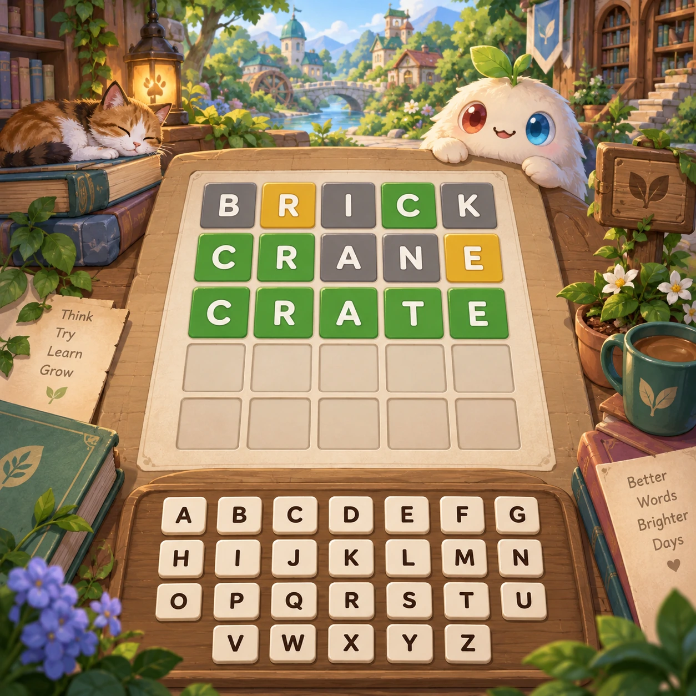
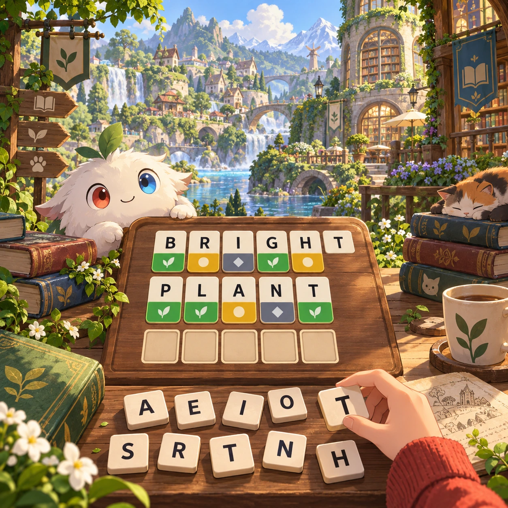
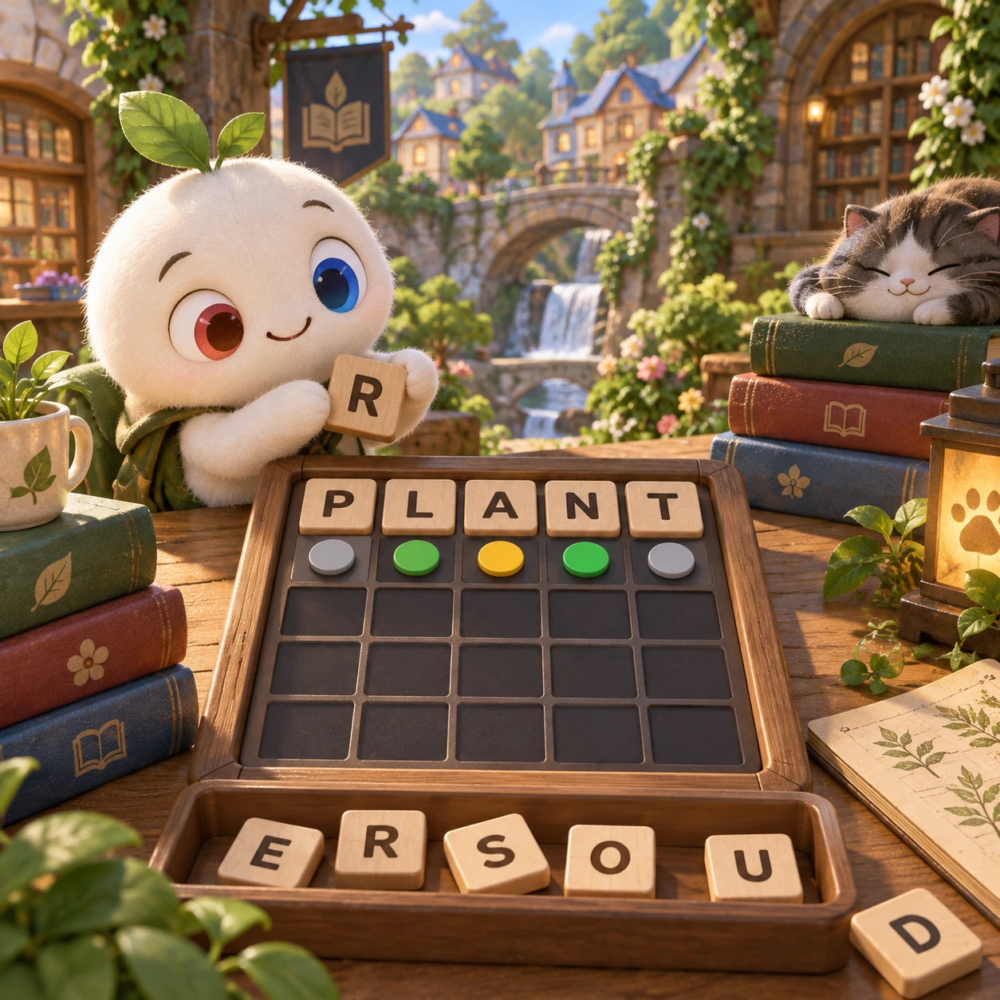
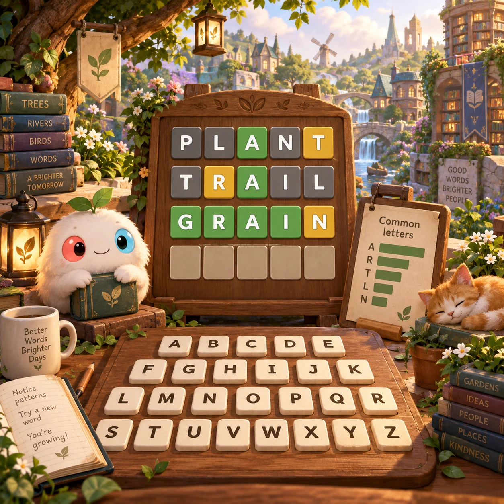

# Word Links

WL-06 · [Words and languages](../wl.md) · Cx 2 · W1 · Original catalog

**The idea:** Place letter tiles into a five-letter guess grid with patterned feedback markers.

| Decision             | Proposal                                                                                                                                                                                    |
| -------------------- | ------------------------------------------------------------------------------------------------------------------------------------------------------------------------------------------- |
| Familiar mechanic    | Daily word guess                                                                                                                                                                            |
| Learning objective   | Spelling, letter frequency                                                                                                                                                                  |
| First prototype      | One authored challenge built around the interaction above, with a clear goal, immediate feedback, restart and unlimited retries.                                                            |
| Technology           | React + SVG/DOM; deterministic state, undo and seeded levels. Start with one local screen and touch plus keyboard input.                                                                    |
| Scope boundary       | One board and one rule set; defer accounts, multiplayer, procedural content and platform SDKs.                                                                                              |
| Reuse                | Shared input, saves, accessibility, seeded state and the words and languages collection shell.                                                                                              |
| Prototype acceptance | A player can identify the next action from the screen, complete one challenge, explain the practiced idea and restart without help. Check touch and keyboard play at narrow and wide sizes. |
| Main uncertainty     | Test whether the lesson follows from play and whether the first interaction is understandable without reading.                                                                              |

## Estimated plan

**First playable version:** A daily seeded five-letter guess grid with six rows, on-screen keyboard, colour plus shape feedback markers and 300 curated child-safe answers. Sharing, streak pressure and other languages are left out.

| Measure              | Estimate                                                                                                   |
| -------------------- | ---------------------------------------------------------------------------------------------------------- |
| Youngest age         | 8+                                                                                                         |
| Toddler learnability | 1 of 5 — Needs reading, precise motor control, timing pressure or abstract rules; not a toddler game (6+). |
| Code                 | 950 LOC, 7.9 days                                                                                          |
| Assets               | 79 hours, 13.2 days                                                                                        |
| Effort               | 21.1 days, risk 1 of 5                                                                                     |
| Start score          | 63.3 (rank 160 of 300; lower is better)                                                                    |

**Algorithms:** `grid-board` (Grid board, 150 LOC) · `typing-input` (Keyboard and letter input, 150 LOC) · `word-list` (Word lists and validation, 150 LOC)

**Assets:** 8 sprites, 3 animations, 2 backgrounds, 5 UI screens, 8 sound effects, 1 music track, 300 content items

How the numbers are computed: [development plan](../../development-plan.md#how-the-scores-work).

## Four visual directions

These are independently generated concept proposals for selecting a prototype.
The four views compare gameplay readability, world appeal, tactile identity and
room to grow. They are not screenshots of an implemented game. Native image
dimensions, hashes, exact prompts and generation provenance are recorded in the
[art manifest](../art/wl-06/manifest.json); see the [generation notes](../README.md#image-generation-and-provenance).

### Gameplay

### World

### Characters and materials

### Expanded play

## Design checks before prototyping

- Learning target: **Spelling, letter frequency**. Ask a domain reviewer to validate factual content in the mechanic.
- Keep goals cooperative or self-directed, using resources and needs. Avoid purchasable power. No pressure timers in the accessible mode.
- Use original layouts and character designs; the [legal checklist](../../legal.md) applies even when a mechanic is familiar.
- Choose the minimum [fidelity level](../../simulation-engine.md#determinism-and-fidelity-levels) the lesson needs; concept art does not establish scientific accuracy.
- Review silhouettes, text alternatives, reduced motion and non-color cues against the [adorability gate](../../lore/adorability-gate.md).

Genre context: [existing genre research](../../../case-studies/issue-1/data/research-genres-ideas.md)
and [expansion research](../../../case-studies/issue-1/data/research-visual-catalog.md).

[← Translate Bridge](wl-05.md) · [All concepts](../README.md) · [Anagram Bakery →](wl-07.md)
