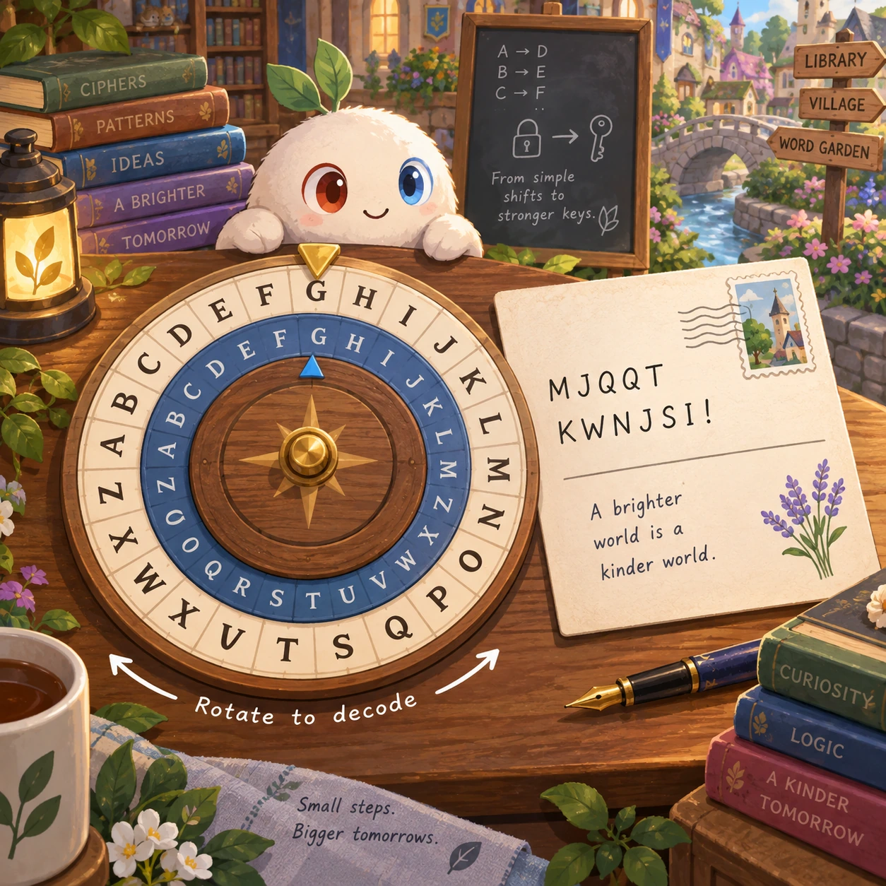
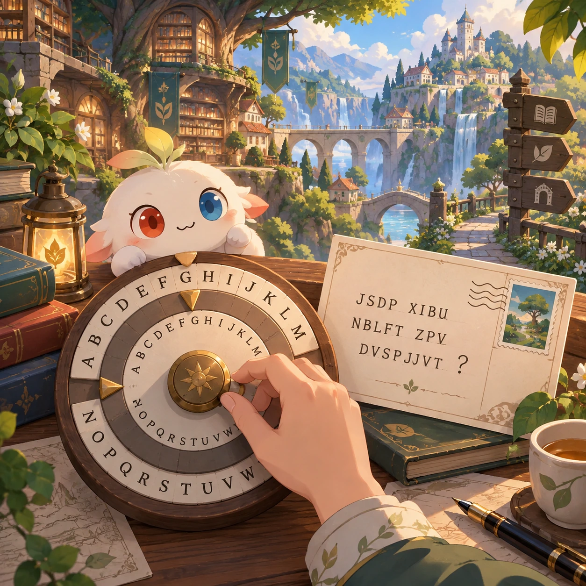
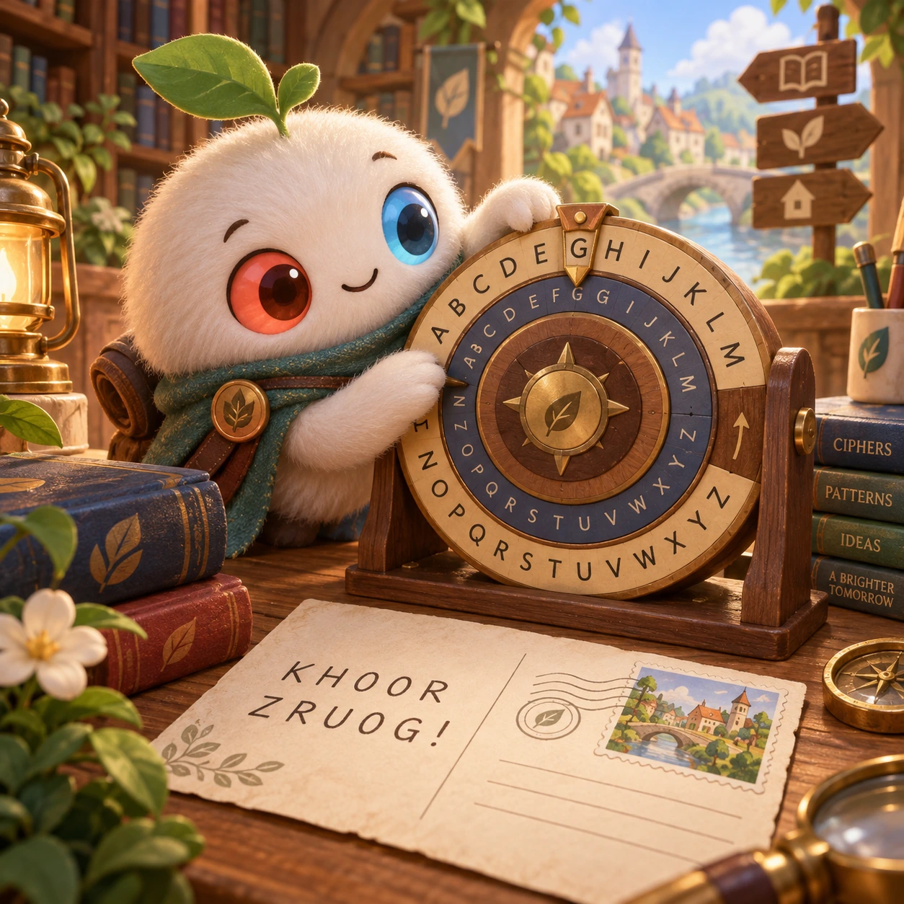
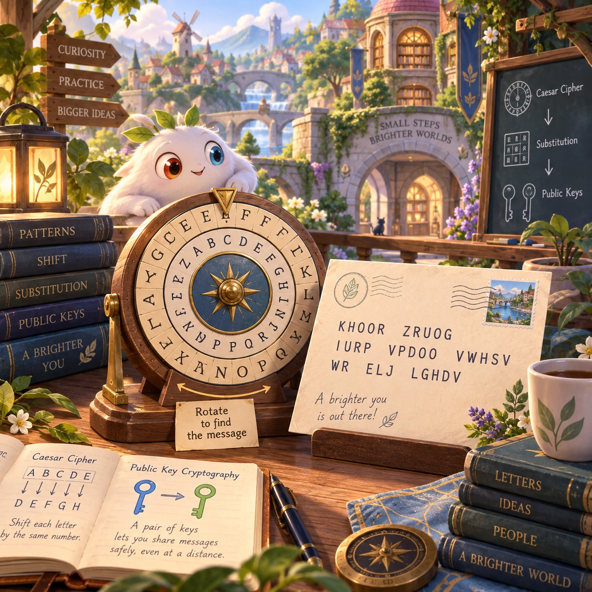

# Code Words

WL-13 · [Words and languages](../wl.md) · Cx 2–3 · Original catalog

**The idea:** Rotate a Caesar-cipher wheel beside a short encoded postcard.

| Decision             | Proposal                                                                                                                                                                                    |
| -------------------- | ------------------------------------------------------------------------------------------------------------------------------------------------------------------------------------------- |
| Familiar mechanic    | Cipher puzzles                                                                                                                                                                              |
| Learning objective   | Cryptography from Caesar to public keys                                                                                                                                                     |
| First prototype      | One authored challenge built around the interaction above, with a clear goal, immediate feedback, restart and unlimited retries.                                                            |
| Technology           | React + SVG/DOM; deterministic state, undo and seeded levels. Start with one local screen and touch plus keyboard input.                                                                    |
| Scope boundary       | One board and one rule set; defer accounts, multiplayer, procedural content and platform SDKs.                                                                                              |
| Reuse                | Shared input, saves, accessibility, seeded state and the words and languages collection shell.                                                                                              |
| Prototype acceptance | A player can identify the next action from the screen, complete one challenge, explain the practiced idea and restart without help. Check touch and keyboard play at narrow and wide sizes. |
| Main uncertainty     | Test whether the lesson follows from play and whether the first interaction is understandable without reading.                                                                              |

## Estimated plan

**First playable version:** 24 postcard puzzles over a rotating Caesar wheel, simple substitution and a letter-frequency chart, each decoding a short friendly message. Vigenere and public-key chapters come later.

| Measure              | Estimate                                                                                                   |
| -------------------- | ---------------------------------------------------------------------------------------------------------- |
| Youngest age         | 8+                                                                                                         |
| Toddler learnability | 1 of 5 — Needs reading, precise motor control, timing pressure or abstract rules; not a toddler game (6+). |
| Code                 | 1280 LOC, 10.7 days                                                                                        |
| Assets               | 103 hours, 17.2 days                                                                                       |
| Effort               | 27.8 days, risk 1 of 5                                                                                     |
| Start score          | 83.4 (rank 200 of 300; lower is better)                                                                    |

**Algorithms:** `typing-input` (Keyboard and letter input, 150 LOC) · `word-list` (Word lists and validation, 150 LOC) · `tap-feedback` (Tap feedback, 80 LOC)

**Assets:** 16 sprites, 3 animations, 3 backgrounds, 6 UI screens, 8 sound effects, 1 music track, 20 voice lines, 24 authored levels, 60 content items

How the numbers are computed: [development plan](../../development-plan.md#how-the-scores-work).

## Four visual directions

These are independently generated concept proposals for selecting a prototype.
The four views compare gameplay readability, world appeal, tactile identity and
room to grow. They are not screenshots of an implemented game. Native image
dimensions, hashes, exact prompts and generation provenance are recorded in the
[art manifest](../art/wl-13/manifest.json); see the [generation notes](../README.md#image-generation-and-provenance).

### Gameplay

### World

### Characters and materials

### Expanded play

## Design checks before prototyping

- Learning target: **Cryptography from Caesar to public keys**. Ask a domain reviewer to validate factual content in the mechanic.
- Keep goals cooperative or self-directed, using resources and needs. Avoid purchasable power. No pressure timers in the accessible mode.
- Use original layouts and character designs; the [legal checklist](../../legal.md) applies even when a mechanic is familiar.
- Choose the minimum [fidelity level](../../simulation-engine.md#determinism-and-fidelity-levels) the lesson needs; concept art does not establish scientific accuracy.
- Review silhouettes, text alternatives, reduced motion and non-color cues against the [adorability gate](../../lore/adorability-gate.md).

Genre context: [existing genre research](../../../case-studies/issue-1/data/research-genres-ideas.md)
and [expansion research](../../../case-studies/issue-1/data/research-visual-catalog.md).

[← Type the Rain](wl-12.md) · [All concepts](../README.md) · [Prime Sprites →](wl-14.md)
