# Preschool (3–5) — visual concepts

[All collections](README.md) · 22 ideas · four full-resolution core views per idea.

Open a game page to compare the four views, the learning objective, the prototype scope and the estimated plan. Cx follows the [complexity ladder](../game-ideas.md#complexity-ladder); days and the toddler learnability rating (1–5) come from the [development plan](../development-plan.md).

| Gameplay preview                                                                          | Idea                                              | Mechanic                              | Cx  | Days | Toddler |
| ----------------------------------------------------------------------------------------- | ------------------------------------------------- | ------------------------------------- | --- | ---- | ------- |
|         | [Wet Sand Letters](pages/pk-01.md) (PK-01)        | Letter tracing in sand                | 1   | 24.7 | 2       |
| [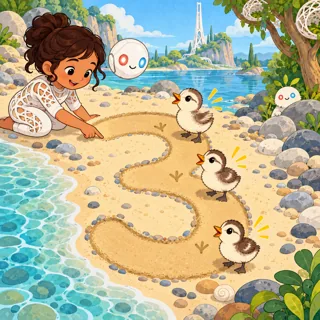](pages/pk-02.md)       | [Footprint Numbers](pages/pk-02.md) (PK-02)       | Number tracing and counting to ten    | 1   | 23.1 | 3       |
| [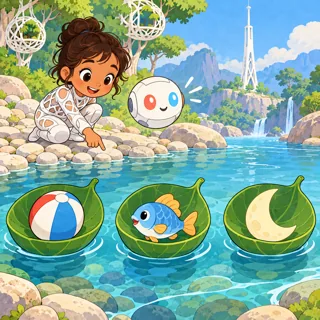](pages/pk-03.md)       | [First Sound Boats](pages/pk-03.md) (PK-03)       | First sound listening game            | 1   | 22.8 | 2       |
| [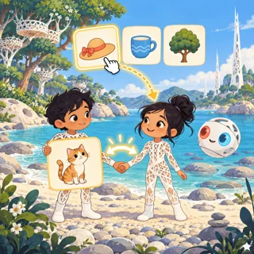](pages/pk-04.md)           | [Rhyming Twins](pages/pk-04.md) (PK-04)           | Rhyme matching pairs                  | 1   | 22   | 3       |
| [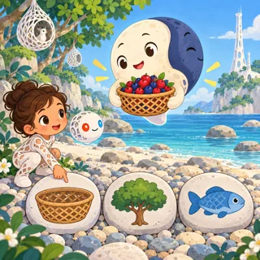](pages/pk-05.md)        | [Rela's Two Sides](pages/pk-05.md) (PK-05)        | Opposites matching                    | 1   | 22.8 | 3       |
| [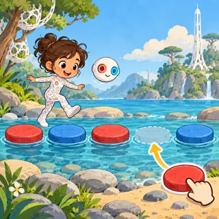](pages/pk-06.md) | [Stepping Stone Patterns](pages/pk-06.md) (PK-06) | AB and ABB pattern completion         | 1   | 21.8 | 3       |
| [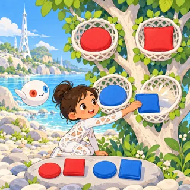](pages/pk-07.md)       | [Four Nest Sorting](pages/pk-07.md) (PK-07)       | Sorting by two attributes             | 2   | 29.3 | 2       |
| [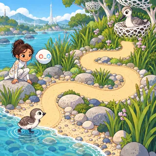](pages/pk-08.md)       | [Little Paths Home](pages/pk-08.md) (PK-08)       | Simple finger mazes                   | 1   | 23.3 | 3       |
| [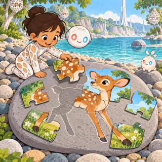](pages/pk-09.md)      | [Big Piece Pictures](pages/pk-09.md) (PK-09)      | Chunky jigsaw puzzles, 6 to 12 pieces | 2   | 32.9 | 3       |
| [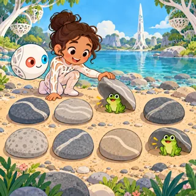](pages/pk-10.md)      | [Peek Under Pebbles](pages/pk-10.md) (PK-10)      | Memory pairs with 6 to 12 pebbles     | 1   | 22.8 | 3       |
| [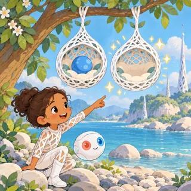](pages/pk-11.md)              | [Twin Nests](pages/pk-11.md) (PK-11)              | Spot one to three differences         | 1   | 23.1 | 3       |
| [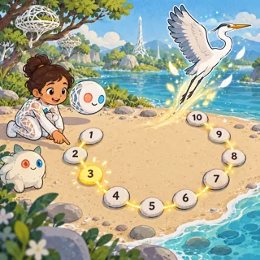](pages/pk-12.md)      | [Pebble Dot Friends](pages/pk-12.md) (PK-12)      | Dot-to-dot counting from 1 to 10      | 1   | 23.5 | 3       |
| [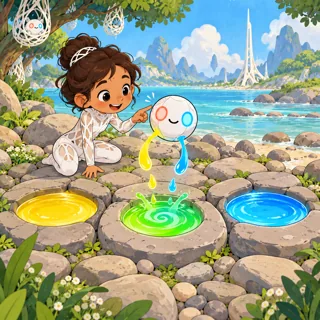](pages/pk-13.md)          | [Mixing Puddles](pages/pk-13.md) (PK-13)          | Color mixing toy                      | 1   | 18.2 | 4       |
|     | [Mirror Pond Feelings](pages/pk-14.md) (PK-14)    | Emotions matching                     | 1   | 23.3 | 3       |
| [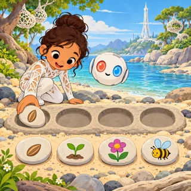](pages/pk-15.md)            | [Story Stones](pages/pk-15.md) (PK-15)            | Picture sequencing, 3 to 4 pictures   | 2   | 31.3 | 2       |
| [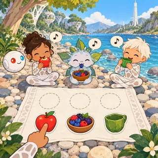](pages/pk-16.md)     | [Pebble Beach Picnic](pages/pk-16.md) (PK-16)     | Pretend picnic play                   | 1   | 24.8 | 4       |
| [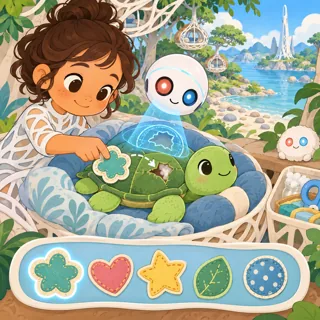](pages/pk-17.md)      | [Plush Patch Clinic](pages/pk-17.md) (PK-17)      | Pretend doctor for plush toys         | 2   | 31.8 | 3       |
| [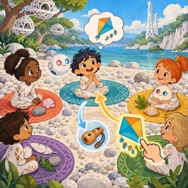](pages/pk-18.md)          | [Sharing Circle](pages/pk-18.md) (PK-18)          | Pretend sharing and swapping day      | 2   | 31.8 | 3       |
| [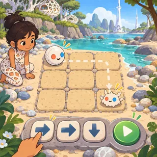](pages/pk-19.md)   | [Arrow Stones for Orbi](pages/pk-19.md) (PK-19)   | First coding with arrow paths         | 2   | 27.3 | 2       |
| [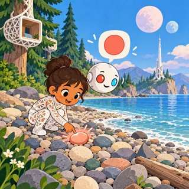](pages/pk-20.md)     | [Shape Spotting Walk](pages/pk-20.md) (PK-20)     | Find shapes in a scene                | 1   | 19.3 | 3       |
| [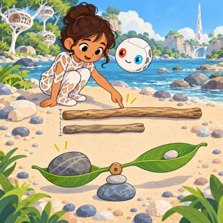](pages/pk-21.md) | [Long Stick, Heavy Stone](pages/pk-21.md) (PK-21) | Comparing length and weight           | 1   | 24.8 | 3       |
| [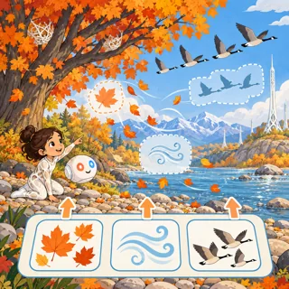](pages/pk-22.md)  | [One Tree, Four Seasons](pages/pk-22.md) (PK-22)  | Seasons and weather matching          | 1   | 24.4 | 3       |
