# Puzzles — visual concepts

[All collections](README.md) · 30 ideas · four full-resolution views per idea.

Open a game page to compare the four views, the learning objective, the prototype scope and the estimated plan. Cx follows the [complexity ladder](../game-ideas.md#complexity-ladder); days and the toddler learnability rating (1–5) come from the [development plan](../development-plan.md).

| Gameplay preview                                                                    | Idea                                        | Mechanic                              | Cx  | Days | Toddler |
| ----------------------------------------------------------------------------------- | ------------------------------------------- | ------------------------------------- | --- | ---- | ------- |
|       | [Pair Friends](pages/pz-01.md) (PZ-01)      | Memory / pairs                        | 1   | —    | —       |
|         | [Bead Merge](pages/pz-02.md) (PZ-02)        | Slide-merge (2048)                    | 1   | —    | —       |
|    | [Tangram Friends](pages/pz-03.md) (PZ-03)   | Tangram                               | 1   | —    | —       |
| [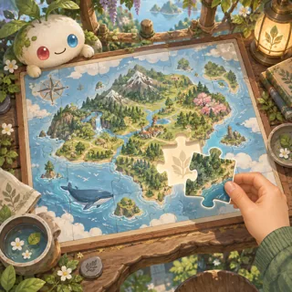](pages/pz-04.md)     | [Jigsaw of Omi](pages/pz-04.md) (PZ-04)     | Jigsaw                                | 1   | —    | —       |
| [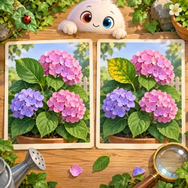](pages/pz-05.md)   | [Spot the Change](pages/pz-05.md) (PZ-05)   | Spot the difference                   | 1   | —    | —       |
| [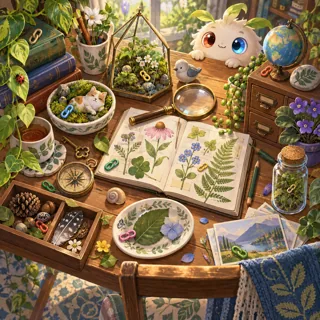](pages/pz-06.md)      | [Hidden Links](pages/pz-06.md) (PZ-06)      | Hidden object                         | 1   | —    | —       |
| [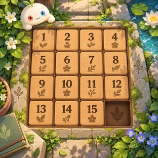](pages/pz-07.md)        | [Slide Home](pages/pz-07.md) (PZ-07)        | Sliding tiles (15-puzzle)             | 1   | —    | —       |
|         | [Color Cups](pages/pz-08.md) (PZ-08)        | Water / color sort                    | 1–2 | —    | —       |
| [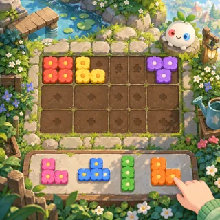](pages/pz-09.md)      | [Shape Garden](pages/pz-09.md) (PZ-09)      | Block placement                       | 2   | —    | —       |
| [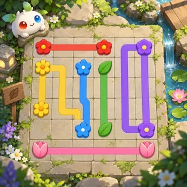](pages/pz-10.md)          | [Link It!](pages/pz-10.md) (PZ-10)          | Connect pairs with non-crossing paths | 2   | —    | —       |
| [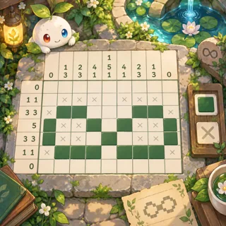](pages/pz-11.md)        | [Pixel Itsy](pages/pz-11.md) (PZ-11)        | Nonogram                              | 2–3 | —    | —       |
| [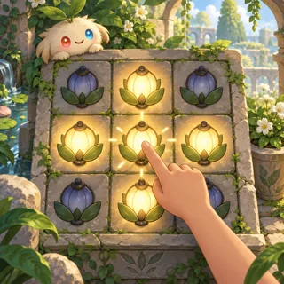](pages/pz-12.md)   | [Light the Links](pages/pz-12.md) (PZ-12)   | Lights Out                            | 2   | —    | —       |
| [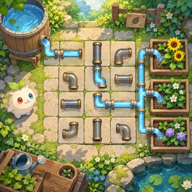](pages/pz-13.md)       | [Pipe Garden](pages/pz-13.md) (PZ-13)       | Rotate pipes (Pipe Mania, Net)        | 2   | —    | —       |
| [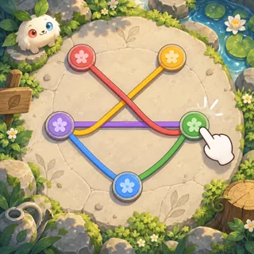](pages/pz-14.md)          | [Untangle](pages/pz-14.md) (PZ-14)          | Planar graph untangling               | 2   | —    | —       |
| [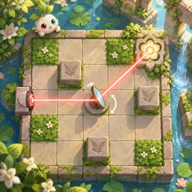](pages/pz-15.md)     | [Laser Mirrors](pages/pz-15.md) (PZ-15)     | Reflection puzzle                     | 2   | —    | —       |
| [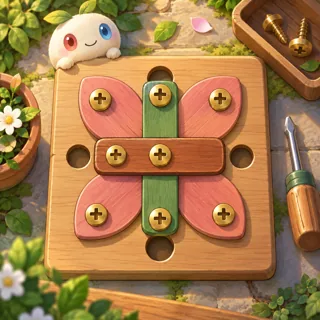](pages/pz-16.md)      | [Screw Garden](pages/pz-16.md) (PZ-16)      | Screw / pin puzzle                    | 2   | —    | —       |
| [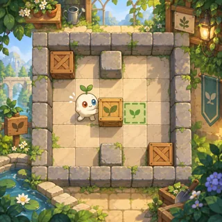](pages/pz-17.md)      | [Push & Think](pages/pz-17.md) (PZ-17)      | Box pushing (Sokoban)                 | 3   | —    | —       |
| [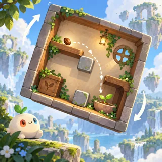](pages/pz-18.md)      | [Gravity Turn](pages/pz-18.md) (PZ-18)      | Rotate-the-world puzzle               | 3   | —    | —       |
|       | [Blossom Swap](pages/pz-19.md) (PZ-19)      | Match-3                               | 2   | —    | —       |
| [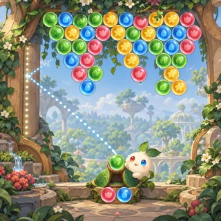](pages/pz-20.md)     | [Bubble Canopy](pages/pz-20.md) (PZ-20)     | Bubble shooter                        | 3   | —    | —       |
| [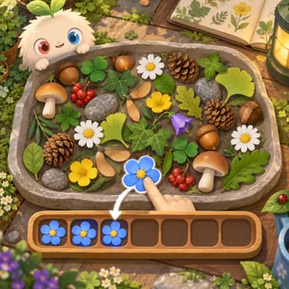](pages/pz-21.md)      | [Tiny Triples](pages/pz-21.md) (PZ-21)      | Triple-match object tray              | 2   | —    | —       |
| [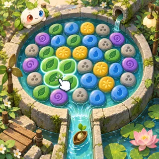](pages/pz-22.md)        | [Pebble Pop](pages/pz-22.md) (PZ-22)        | Tap-to-collapse puzzle                | 2   | —    | —       |
| [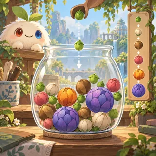](pages/pz-23.md)      | [Harvest Drop](pages/pz-23.md) (PZ-23)      | Physics drop-and-merge                | 3   | —    | —       |
| [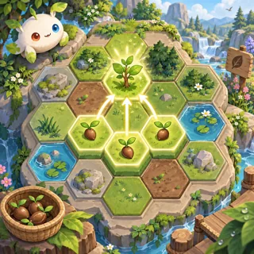](pages/pz-24.md)     | [Habitat Merge](pages/pz-24.md) (PZ-24)     | Merge-3 map puzzle                    | 2   | —    | —       |
| [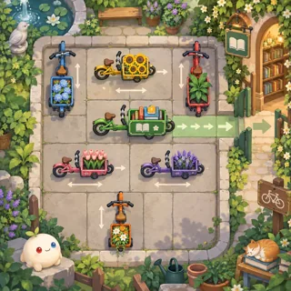](pages/pz-25.md)       | [Bicycle Jam](pages/pz-25.md) (PZ-25)       | Parking escape puzzle                 | 2   | —    | —       |
| [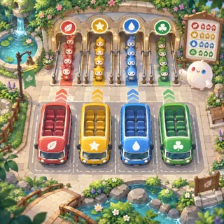](pages/pz-26.md)     | [Shuttle Queue](pages/pz-26.md) (PZ-26)     | Bus-seat sorting puzzle               | 2   | —    | —       |
| [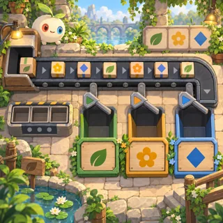](pages/pz-27.md)   | [Parcel Conveyor](pages/pz-27.md) (PZ-27)   | Conveyor tile matching                | 2   | —    | —       |
| [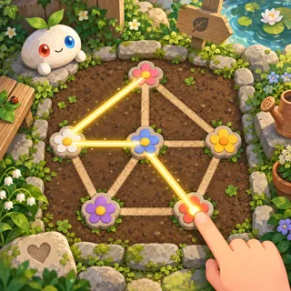](pages/pz-28.md) | [One Stroke Garden](pages/pz-28.md) (PZ-28) | One-line drawing puzzle               | 2   | —    | —       |
| [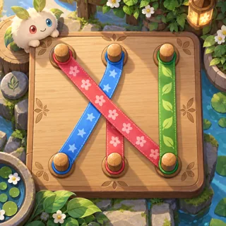](pages/pz-29.md)     | [Ribbon Rescue](pages/pz-29.md) (PZ-29)     | Rope sorting and untangling           | 3   | —    | —       |
| [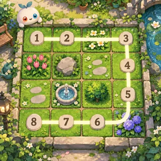](pages/pz-30.md)     | [Trail Numbers](pages/pz-30.md) (PZ-30)     | Numbered Hamiltonian path puzzle      | 2   | —    | —       |
