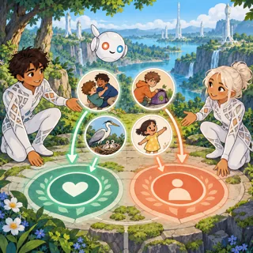
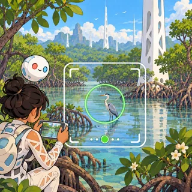
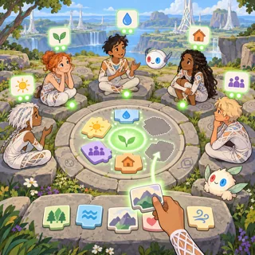

# Raya life — visual concepts

[All collections](README.md) · 16 ideas · four full-resolution core views per idea.

Open a game page to compare the four views, the learning objective, the prototype scope and the estimated plan. Cx follows the [complexity ladder](../game-ideas.md#complexity-ladder); days and the toddler learnability rating (1–5) come from the [development plan](../development-plan.md).

| Gameplay preview                                                                       | Idea                                           | Mechanic                                        | Cx  | Days | Toddler |
| -------------------------------------------------------------------------------------- | ---------------------------------------------- | ----------------------------------------------- | --- | ---- | ------- |
|           | [Hello, Orbi](pages/ry-01.md) (RY-01)          | Companion care toy (name, polish, charge, play) | 1   | 22.1 | 3       |
|       | [One Night Apple](pages/ry-02.md) (RY-02)      | Step-by-step story toy (ask, scan, wait, enjoy) | 1   | 18.1 | 3       |
|      | [Riding the Chord](pages/ry-03.md) (RY-03)     | 3D gliding along guided sky-lanes               | 4   | 59.9 | 1       |
|            | [Ring Tuner](pages/ry-04.md) (RY-04)           | Wave-tuning puzzle                              | 3   | 32.5 | 1       |
|     | [Thought Postcards](pages/ry-05.md) (RY-05)    | Picture-message composer with consent steps     | 2   | 34   | 1       |
|             | [Soft Hold](pages/ry-06.md) (RY-06)            | Scenario choices (pause or let be)              | 2   | 34.8 | 1       |
|             | [Two Yeses](pages/ry-07.md) (RY-07)            | Card sorting and scenario puzzles               | 2   | 30.7 | 1       |
|            | [Crown Nest](pages/ry-08.md) (RY-08)           | Physics building in a living tree               | 3   | 38.6 | 1       |
|            | [Quiet Feet](pages/ry-09.md) (RY-09)           | Tap-the-stepping-stone walk                     | 1   | 19.3 | 3       |
|      | [Field Sketchbook](pages/ry-10.md) (RY-10)     | Wildlife photo framing and sketching            | 2   | 34.4 | 1       |
|  | [Acorn's Long Seasons](pages/ry-11.md) (RY-11) | Story visits with gentle helping tasks          | 2   | 33.8 | 1       |
|          | [Share Basket](pages/ry-12.md) (RY-12)         | Gather, count and share                         | 1   | 19   | 3       |
|       | [Windows on Raya](pages/ry-13.md) (RY-13)      | Ambient landscape explorer                      | 2   | 33   | 3       |
|     | [Pim and Pom Night](pages/ry-14.md) (RY-14)    | Sky and time simulation with a day wheel        | 2   | 27.9 | 1       |
|   | [Tower Song Festival](pages/ry-15.md) (RY-15)  | Music composing and rhythm performance          | 3   | 38.3 | 1       |
|         | [Valley Circle](pages/ry-16.md) (RY-16)        | Consensus-building council game                 | 3   | 41.5 | 1       |
